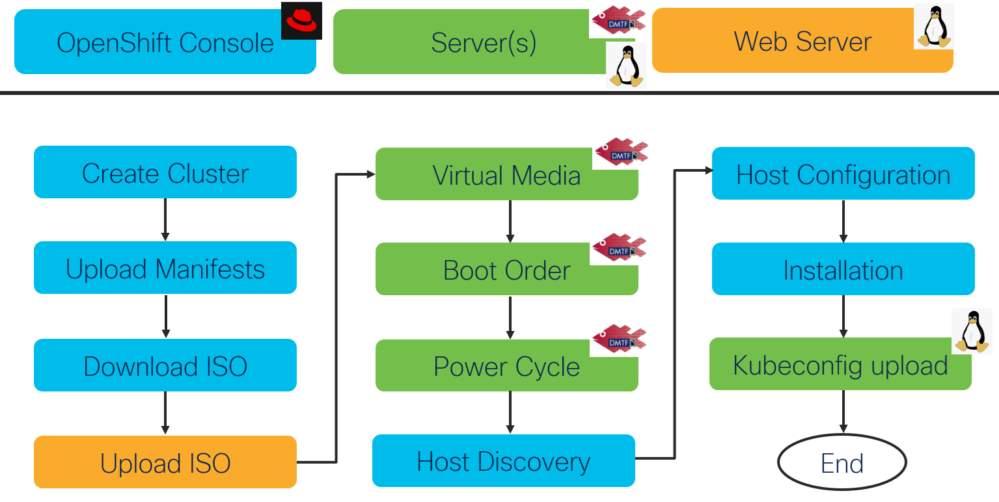

# OpenShift Installation on Bare Metal UCS Infrastructure

[[Back]](./Operations.md) [[Next]](./VcenterCluster.md)



## Key Features

- [improves](./bm/assisted_installer.md) assisted installer
- zero-touch OpenShift installation on bare metal servers
- network fabric checks prior to cluster installation
- post-installation cluster configuration [tasks](./Tasks.md)

## Requirements

- RedHat console REST API one-time [configuration](./Console.md)
- Isovalent Registry Access one-time [configuration](./IEP.md) in case of Cilium CNI
- Redfish-enabled servers with internet access
- web server for virtual-media-boot-from-iso

## Input files

> [!NOTE]
> Refer to [repository](https://github.com/akaliwod/ocp-bm-cluster/blob/main/README.md) for examples of cluster installation definition.

### All-in-one

- [cluster.json](./bm/input_data_cluster_aio.md)

### File-per-section

- [cluster.json](./bm/input_data_cluster_base.md)
- [server.json](./bm/input_data_server.md)
- [redfish.json](./bm/input_data_redfish.md)
- [nmstate.yaml](./bm/input_data_nmstate.md)
- [ssh.pub](./bm/input_data_ssh_pub.md)
- [web.json](./bm/input_data_web.md)
- [proxy.json](./bm/input_data_proxy.md)

Post-installation [tasks](./Tasks.md) can be defined in tasks.json file.

### Cilium CNI

>[!CAUTION]
>Remember to [configure](./IEP.md) Isovalent Registry Access. Even if manifests are prepared manually. OpenShift installer will generate registry access token and modify `pullSecret` automatically.

Cilium requires custom manifests to be downloaded-and-unpacked into `manifests` directory e.g.

```
$ find my-cluster-input-data
manifests/subscription.yaml
manifests/...
cluster.json
...
```

Alternatively, specify Cilium version in cluster.json. In such case manifests are downloaded and unpacked automatically e.g.,

```json
    "cilium": {
        "version": "1.19.7"
    }
```

There is no need to modify the Cilium manifests. By default [auto-fixups](./bm/cilium_fixup.md) will handle cidr and operator replica count. However, if you prefer to make changes manually and block automatic fixups then do 

```json
    "cilium": {
        "manage": false
    }
```

## RunIt

```
# iserver create ocp cluster bm --dir <directory> --mode install
```

Checks (fail-fast approach)
- [input file syntax](./bm/example_input_data_check.md)
- [OpenShift API](./bm/example_openshift_api_check.md)
- [web server](./bm/example_web_check.md)
- [redfish](./bm/example_redfish_check.md)
- [dns](./bm/example_fqdn_check.md)
- [nmstate and variables](./bm/example_variables_check.md)
- [OpenShift Console REST API body generation](./bm/example_console_body_generation.md)

Execution (run until completion)
- [create cluster, infra and manifests](./bm/example_create_cluster.md)
- [iso download, manipulation and upload to web server](./bm/example_iso.md)
- [vmedia boot and wait for call-back-home](./bm/example_boot.md)
- [extra configuration](./bm/example_extra_configuration.md)
- [wait for completion](./bm/example_wait.md)
- [post installation](./bm/example_post.md)

[[Back]](./Operations.md) [[Next]](./VcenterCluster.md)