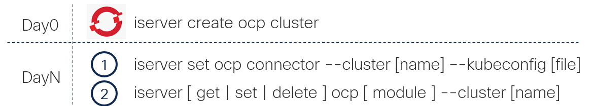

# OpenShift Installation and Day2 Operations

[[Back]](../../README.md)

## Install

- [Configure OpenShift console access](./Console.md)
- [Configure Isovalent registry access](./IEP.md)
- [Install on Bare Metal](./BareMetalCluster.md)
- [Install in VMWare](./VcenterCluster.md)

## State

- [Cluster access](./Access.md)
- [Operators](./operator/README.md)
- [Node power control](./node-power/README.md)

## General Configuration

- [Tasks](./Tasks.md)
- [CLI tools](./cli/README.md)
- [Web console](./web-console/README.md)
- [Web terminal](./web-terminal/README.md)
- [Container Runtime Policy](./cpolicy/README.md)
- [NTP](./ntp/README.md)

## Hardware

- [Cisco Intersight Plugin](./intersight/README.md)
- [Intersight Server Discovery](./imm/README.md)
- [Node Feature Discovery](./nfd/README.md)
- [Metal Kubed](./metal-kubed/README.md)

## Networking

- [NMState](./nmstate/README.md)
- [NodeNetworkConfigurationPolicy (NNCP)](./nncp/README.md)
- [Network Attachment Definition (NAD)](./k8s-nad/README.md)
- [SR-IOV](./sriov/README.md)

### OVN-Kubernetes

- [Cluster user defined network](./ovn-cudn/README.md)
- [User defined network](./ovn-udn/README.md)
- [BGP](./ovn-bgp/README.md)
- [MetalLB](./ovn-metallb/README.md)

### Cilium

- [Operator](./cilium-operator/README.md)
- [Agent](./cilium-agent/README.md)
- [Configuration](./cilium-config/README.md)
- [State](./cilium-state/README.md)
- [IEP distribution upgrade](./cilium-cni/upgrate-artifcatory.md)
- [OVN Migration](./cni-migration/README.md)
- [BGP](./cilium-bgp/README.md)
- [Cluster Mesh](./cilium-mesh/README.md)
- [Private Network](./cilium-pnet/README.md)
- [Isovalent Network Bridge](./cilium-inb/README.md)

## Storage

- [Linux: Disk and Logical Volume Manager](./disk/README.md)
- [Storage Class](./storage-class/README.md)
- [Kubernetes Volume](./k8s-volume/README.md)
- [Local Image Registry](./image-registry/manual.md)

### CSI

- [LVM Storage](./lvm/README.md)
- [Local Storage](./lso/README.md)
- [MinIO AIStor](./minio/README.md)
- [ODF](./odf/README.md)
- [Portworx](./portworx/README.md)
- [Trident](./trident/README.md)
- [VAST](./vast/README.md)

## Virtualization

- [Container Virtualization Operator](./cnv/README.md)
- [Virtual Machine](./k8s-vm/README.md)
- [CDI Data Import Cron](./cnv-data-import/README.md)
- [Migration Toolkit for Virtualization](./mtv/README.md)

## AI

- [Red Hat OpenShift AI](./ai/README.md)
- [NVIDIA GPU Operator](./gpu/README.md)
- [GPU Passthrough (VFIO)](./gpu-pt/README.md)
- [NVIDIA NIM](./nim/README.md)
- [Serverless](./serverless/README.md)
- [Service Mesh v2](./service-mesh/README.md)

## Security

- [OpenShift Authantication (OAuth)](./oauth/README.md)
- [HTPasswd Identity Provider](./htpasswd/README.md)
- [LDAP Identity Provider](./ldap/README.md)
- [Certificate Manager](./cert-manager/README.md)
- [SSH Access](./ssh/README.md)
- [Tetragon](./tetragon/README.md)

## Monitoring

- [Prometheus](./prometheus/README.md)
- [Grafana](./grafana/README.md)
- [Splunk](./splunk/README.md)
- [Intersight Open Telemetry](./iotel/README.md)
- [Hubble and Timescape](./cilium-hubble/README.md)

## Development

- [Console dynamic plugin](./console-plugin/README.md)

[[Back]](../../README.md)