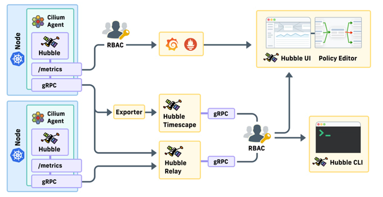

# Cilium Hubble and Timescape

[[Back]](../Operations.md)

Hubble is a fully distributed networking and security observability platform. It is built on top of Cilium and eBPF to enable deep visibility into the communication and behavior of services as well as the networking infrastructure in a completely transparent manner.

Hubble Relay provides real-time information **only**. 

Hubble Timescape (Isovalent Cilium Enterprise feature) adds historical view and supports three deployment options
- `Integrated Timescape` - Enabled as part of the Isovalent Cilium installation for small, single-cluster environments with short retention needs.
- `Timescape Lite` - Deployed separately as a single stateful workload, providing historical queries with a smaller footprint for modest retention and moderate throughput.
- `Standalone Timescape` - Deployed separately with dedicated storage services, designed for higher throughput, longer retention, and multi-cluster operations.

Both hubble and hubble timescape data can be rendered using ui and cli. 

>[!NOTE]
>Contact Isovalent experts for guidance on the Hubble Timescape mode. iserver supports `Integrated Timescape` mode only.

## Knowledge Base

Hubble relay
- [minimum setup](./kb/configuration-hubble-minimum.md)
- [without tls](./kb/configuration-hubble-relay-no-tls.md)
- [with tls](./kb/configuration-hubble-relay-tls.md)
- [ui](./kb/configuration-hubble-ui.md)

Hubble timescape integrated
- [without tls](./kb/configuration-hubble-timescape-no-tls.md)
- [tls](./kb/configuration-hubble-timescape-tls.md)
- [ui](./kb/configuration-timescape-ui.md)
- [push api](./kb/timescape-push-api.md)
- [stream api](./kb/timescape-stream-api.md)

Hubble cli
- [howto](./kb/hubble-cli.md)
- [cheat sheet (external link)](https://cilium.isovalent.com/hubfs/marketing%20briefs/Isovalent%20-%20Cilium%20Hubble%20Cheat%20Sheet.pdf)

Other
- [configuration cheat sheet](./kb/configuration.md)
- [hubble peer service](./kb/service-hubble-peer.md)
- [adding hubble link to web console application menu](./kb/console.md)

## Commands

Command | Intent | Details
--- | --- | ---
iserver get ocp cilium timescape | get timescape state | [Link](./get.md)
iserver set ocp cilium timescape --mode feature | enable timescape feature | [Link](./enable.md)
iserver set ocp task | in task way | [Link](./create_task.md)
iserver delete ocp cilium timescape --mode feature | disable timescape | [Link](./disable.md)
iserver delete ocp task | in task way | [Link](./delete_task.md)

[[Back]](../Operations.md)