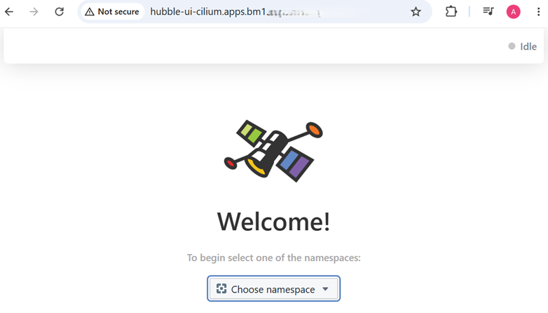
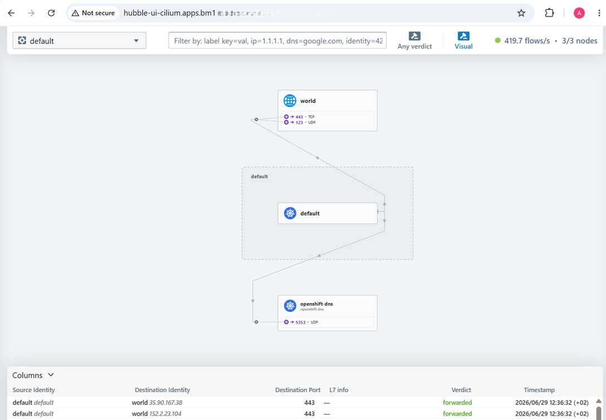

# Hubble UI

[[Back]](../README.md)

Hubble UI needs to be [enabled](./configuration-hubble-ui.md) first and then access to it can be exposed via OpenShift route

```
$ oc expose service -n cilium hubble-ui
route.route.openshift.io/hubble-ui exposed
```

```
$ oc get route -n cilium
NAME        HOST/PORT                                         PATH   SERVICES    PORT   TERMINATION   WILDCARD
hubble-ui   hubble-ui-cilium.apps.bm1.ocp.domain.com                 hubble-ui   http                 None
```





[[Back]](../README.md)