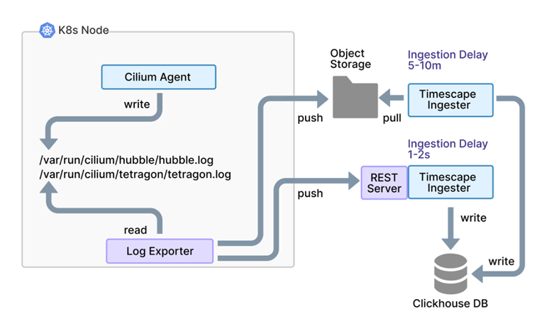

# Timescape push api

[[Back]](../README.md)

When running hubble timescape integrated as [here](./configuration-hubble-timescape-no-tls.md), `hubble-timescape-0` pod exposes tcp/4260 via `hubble-timescape` service used for **push api**.

## Overview

[Source](https://isovalent.com/blog/post/isovalent-networking-kubernetes-1-17/#push-api-real-time-visibility-no-object-storage-needed)

Timescape Push API offers a powerful way to stream observability events directly to Timescape in real time, persistence to object storage for resilience. Think of it as the natural successor to Hubble Relay, offering the same live-streaming capabilities, but with the added benefit of short-term historical context.

With the Push API, you can:
- Stream events directly to Timescape for real-time observability
- Optionally back events to object storage for durability
- Run it standalone or alongside storage, depending on your requirements

The Push API feature is a key enabler for replacing Hubble Relay in Isovalent Networking for Kubernetes, and it dramatically simplifies getting started with Timescape.

## Architecture

Timescape supports two `push` ways to ingest flows and events.
- write data to object storage for the Timescape Ingester to pull
- push data into the Timescape Push API over HTTP

Both options work well but introduce extra components, namely needing a component to export the log files aka [log exporter](./log-exporter.md) and some delay between events happening in the cluster and appearing in the UI.

[[Back]](../README.md)