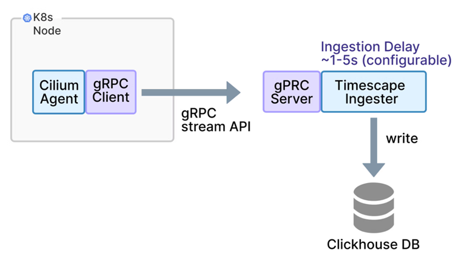

# Timescape stream api

[[Back]](../README.md)

When running hubble timescape integrated as [here](./configuration-hubble-timescape-no-tls.md), `hubble-timescape-0` pod exposes tcp/4261 via `hubble-timescape` service used for **stream api**.

## Overview

[Source](https://isovalent.com/blog/post/isovalent-networking-for-kubernetes-118-new-routing-policy-and-observability-enhancements/#timescape-stream-api)



Timescape 1.18 adds a gRPC Stream API to the Ingester component. When used with Isovalent Networking for Kubernetes 1.17.9 and later, which includes a gRPC client that can send flows and events directly to this new Timescape ingester endpoint. This shortens the path from node to database and reduces the amount of CPU and memory needed in the forwarding layer. In practice, the ingestion delay typically found with exporting to object storage first, can be reduced. The Stream API is the default for Integrated Timescape and is available in Timescape Lite for environments that want a simpler ingestion pipeline.

With the Stream API, the Cilium agent talks directly to Timescape over gRPC. There is no need for object storage or an intermediate REST server, which simplifies configuration and reduces moving parts, such as conversion of the JSON structure to a suitable format, which is a resource costly exercise. This pattern is well suited to Integrated Timescape and to Lite deployments where you want fast, low effort access to observability data.

The [Push API](./timescape-push-api.md) continues to be supported and is useful when you need more control over buffering, when you want to rely on object storage for durability, or when your existing observability stack is already built around log forwarders.

## Example

Cilium agent started with

```
time=2026-06-29T20:19:15.087875788Z level=info msg="  --hubble-export-timescape-target='hubble-timescape.cilium.svc.cluster.local:4261'"
time=2026-06-29T20:19:16.410087844Z level=info msg="start streaming flow logs" module=enterprise-agent.enterprise-controlplane.enterprise-hubble.enterprise-hubble-exporter.hubble-timescape-exporter subsys=hubble-timescape-exporter target=hubble-timescape.cilium.svc.cluster.local:4261
```

following config map

```
$ oc get configmaps -n cilium cilium-config -o yaml 
  hubble-export-timescape-enabled: "true"
  hubble-export-timescape-target: hubble-timescape.cilium.svc.cluster.local:4261
  hubble-export-timescape-use-cilium-service-resolver: "true"
```

[[Back]](../README.md)