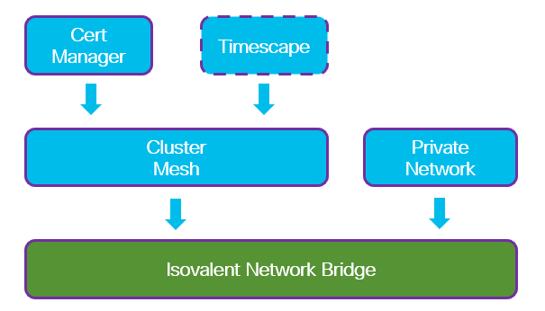

# Cilium Isovalent Network Bridge - Create with dependencies via Task

## Input




```
[
  {
    "cilium-image": {
      "set": {
        "url": "dev-image-url-from-isovalent-sales"
      }
    }
  },
  {
    "cli": {
      "cilium": {},
      "helm": {}
    }
  },
  {
    "cert-manager": {
      "feature": {}
    }
  },
  {
    "cilium-pnet": {
      "feature": {}
    }
  },
  {
    "cilium-timescape": {
      "feature": {}
    }
  },
  {
    "cilium-mesh": {
      "feature": {
        "mesh-id": 1,
        "mesh-name": "ocp",
        "mesh-port": 32379,
        "ca-crt": "filename-for-root-ca.crt",
        "ca-key": "filename-root-ca.key"
      },
      "timescape": {}
    }
  },
  {
    "cilium-inb": {
      "feature": {
        "ip": "10.10.20.20",
        "username": "admin",
        "password": "pass123",
        "mesh-id": 2,
        "mesh-name": "inb1",
        "mesh-port": 32380,
        "cidr": "172.17.0.0/16",
        "pnet": "vm-network",
        "nic": "ens224",
        "gateway": "10.10.30.254/24"
      }
    }
  }
]
```

- feature.ca-crt and feature.ca-key filenames
  - can be relative and then expected to be in the same directory as task.json file
  - can be absolute

## Requirements

Cilium CNI

## Configurable options

```
# iserver set ocp task 
  --cluster TEXT   Cluster Name
  --filename TEXT  Tasks filename
  --validate       Validate only
  --break          Break on error
  --no-confirm     Confirmation mode
```

## Expected outcome

- All dependant features enabled and configured
- Isovalent network bridge initiated
- Cluster mesh established
- Isovalent network bridge k8s and linux connectors created
- Private network created

## Example

```
# iserver set ocp task --cluster bm1 --filename C:\tmp\task.json --no-confirm

Cluster: bm1 (type: ocp)

OpenShift Workflow - Create Tasks
=================================

Validate Input
--------------
Completed


OpenShift Workflow - Cilium - Image upgrade
===========================================


OpenShift Cluster: bm1
Cilium CNI
Check cilium agent runtime image
Image already running

OpenShift Workflow - CLI Tools Installation
===========================================

Workflow Parameters
-------------------
{
    "cilium": {
        "enabled": true,
        "cluster": "bm1",
        "confirmation": false,
        "version_url": "https://raw.githubusercontent.com/cilium/cilium-cli/main/stable.txt",
        "version": "v0.18.8",
        "download_url": "https://github.com/cilium/cilium-cli/releases/download/v0.18.8/cilium-linux-amd64.tar.gz"
    },
    "helm": {
        "enabled": true,
        "cluster": "bm1",
        "confirmation": false,
        "version_url": "https://get.helm.sh/helm-latest-version",
        "version": "v3.19.0",
        "download_url": "https://get.helm.sh/helm-v3.19.0-linux-amd64.tar.gz"
    },
    "cluster": "bm1",
    "exec": [],
    "check-verbose": true
}


OpenShift Cluster
-----------------
- cluster: bm1 [domain:local]
- api [C:\Users\user\.itool\ocp-clusters\bm1\kubeconfig]: ok
- dns resolution: ok


OpenShift Workflow - Install cilium cli
=======================================

Workflow Parameters
-------------------
{
    "cluster": "bm1",
    "confirmation": false,
    "url": "https://github.com/cilium/cilium-cli/releases/download/v0.18.8/cilium-linux-amd64.tar.gz",
    "overwrite": false,
    "check-verbose": true
}


OpenShift Cluster
-----------------
- cluster: bm1 [domain:local]
- api [C:\Users\user\.itool\ocp-clusters\bm1\kubeconfig]: ok
- dns resolution: ok
- cluster node [10.10.10.10] [key:C:\Users\user\.itool\ocp-clusters\bm1\ssh.pub]: ok
- management node [10.10.10.10] [key:C:\Users\user\.itool\ocp-clusters\bm1\ssh.pub]: ok

/usr/local/bin/cilium found and overwrite not enforced

OpenShift Workflow - Install helm cli
=====================================

Workflow Parameters
-------------------
{
    "cluster": "bm1",
    "confirmation": false,
    "url": "https://get.helm.sh/helm-v3.19.0-linux-amd64.tar.gz",
    "overwrite": false,
    "check-verbose": true
}


OpenShift Cluster
-----------------
- cluster: bm1 [domain:local]
- api [C:\Users\user\.itool\ocp-clusters\bm1\kubeconfig]: ok
- dns resolution: ok
- cluster node [10.10.10.10] [key:C:\Users\user\.itool\ocp-clusters\bm1\ssh.pub]: ok
- management node [10.10.10.10] [key:C:\Users\user\.itool\ocp-clusters\bm1\ssh.pub]: ok

/usr/local/bin/helm found and overwrite not enforced

OpenShift Workflow - Certificate Manager - Install
==================================================


OpenShift Cluster: bm1
Check repo jetstack https://charts.jetstack.io
Not found
Add repo jetstack https://charts.jetstack.io
~~~
"jetstack" has been added to your repositories


~~~
Helm repo added
Check helm chart cert-manager
Not found
Install jetstack/cert-manager
~~~
NAME: cert-manager
LAST DEPLOYED: Mon Nov 10 20:31:41 2025
NAMESPACE: cert-manager
STATUS: deployed
REVISION: 1
TEST SUITE: None
NOTES:
⚠️  WARNING: New default private key rotation policy for Certificate resources.
The default private key rotation policy for Certificate resources was
changed to `Always` in cert-manager >= v1.18.0.
Learn more in the [1.18 release notes](https://cert-manager.io/docs/releases/release-notes/release-notes-1.18).

cert-manager v1.19.1 has been deployed successfully!

In order to begin issuing certificates, you will need to set up a ClusterIssuer
or Issuer resource (for example, by creating a 'letsencrypt-staging' issuer).

More information on the different types of issuers and how to configure them
can be found in our documentation:

https://cert-manager.io/docs/configuration/

For information on how to configure cert-manager to automatically provision
Certificates for Ingress resources, take a look at the `ingress-shim`
documentation:

https://cert-manager.io/docs/usage/ingress/


~~~
Helm installed
CRDs found

Completed tasks
- certificate manager installed

OpenShift Workflow - Cilium - Enable Private Network
====================================================


OpenShift Cluster: bm1
Cilium CNI
~~~
cni:
  binPath: /var/lib/cni/bin
  chainingMode: portmap
  confPath: /var/run/multus/cni/net.d
  exclusive: false
enterprise:
  featureGate:
    strict: false
  privateNetworks:
    enabled: true

~~~

Cilium config update
--------------------
CiliumConfig CRD patched
Take a nap to detect automatic deployment restart...
Fallback to forced reload
Deployment [cilium/cilium-operator] patch successful
Daemon set [cilium/cilium] patch successful

Wait for Cilium resources
-------------------------
- pod: cilium-5q8xm
- pod: cilium-envoy-bwzml
- pod: cilium-envoy-gm8k5
- pod: cilium-envoy-v9jgx
- pod: cilium-k82n2
- pod: cilium-operator-5659c9b476-7fjqg
- pod: cilium-operator-5659c9b476-9xltb
- pod: cilium-zpsf9
- pod: clife-controller-manager-6c79869f6c-gcj6l
- deployment: cilium-operator
- deployment: clife-controller-manager

Check private network crd
-------------------------
- ClusterwidePrivateNetwork
- PrivateNetworkEndpointSlice
- PrivateNetworkExternalEndpoint

Completed tasks
- Private Network feature enabled
- CRD ready

OpenShift Workflow - Cilium - Enable Timescape
==============================================


OpenShift Cluster: bm1
Cilium CNI
~~~
enterprise:
  featureGate:
    approved:
    - HubbleTimescape
hubble:
  enabled: true
  export:
    timescape:
      tls:
        mtls:
          enabled: true
  relay:
    enabled: false
  timescape:
    clustermesh:
      primary:
        namespace: ''
    enabled: true
    ingester:
      k8sImporter:
        enabled: true
    static:
      exporter:
        enabled: true
    useStreamAPI: true
  tls:
    enabled: true

~~~

Cilium config update
--------------------
CiliumConfig CRD patched
Take a nap to detect automatic deployment restart...
Automatic pods rollout detected

Wait for Cilium resources
-------------------------
- pod: cilium-22fhh
- pod: cilium-envoy-bwzml
- pod: cilium-envoy-gm8k5
- pod: cilium-envoy-v9jgx
- pod: cilium-operator-5659c9b476-7fjqg
- pod: cilium-operator-5659c9b476-9xltb
- pod: cilium-sktrx
- pod: cilium-wlhlw
- pod: clife-controller-manager-6c79869f6c-gcj6l
- pod: hubble-timescape-0
- deployment: cilium-operator
- deployment: clife-controller-manager
Wait for timescape pods...
Wait for timescape endpoints...

Create cilium timescape route
-----------------------------
- service namespace: cilium
- service name: hubble-timescape
- service found
- route namespace: cilium
- route name: hubble-timescape

~~~
apiVersion: route.openshift.io/v1
kind: Route
metadata:
  labels:
    app.kubernetes.io/component: hubble-timescape
    app.kubernetes.io/managed-by: Helm
    app.kubernetes.io/name: hubble-timescape
    app.kubernetes.io/part-of: cilium
    app.kubernetes.io/version: 1.18.0-dev
    isovalent.io/managed-by: clife
    k8s-app: hubble-timescape
  name: hubble-timescape
  namespace: cilium
spec:
  host: hubble-timescape-cilium.apps.bm1.ocp.domain.com
  port:
    targetPort: ui
  to:
    kind: Service
    name: hubble-timescape
    weight: 100
  wildcardPolicy: null

~~~

Route created

Wait for route ready...

Completed tasks
- Timescape feature enabled
- ui: http://hubble-timescape-cilium.apps.bm1.ocp.domain.com

OpenShift Workflow - Cilium - Enable Cluster Mesh
=================================================


OpenShift Cluster: bm1
Cilium CNI

Root CA Cert
------------
Cilium root ca secret
- namespace: cilium
- name: cilium-ca-root
- secret will be created based on user provided root ca crt and key

Create Secret
-------------
- namespace: cilium
- name: cilium-ca-root

Secret created

Wait for secret [timeout:60]...

Create Issuer
-------------
- namespace: cilium
- name: cilium-ca-root

~~~
apiVersion: cert-manager.io/v1
kind: Issuer
metadata:
  name: cilium-ca-root
  namespace: cilium
spec:
  ca:
    secretName: cilium-ca-root

~~~
- issuer created
- wait until issuer found...

Create Certificate
------------------
- namespace: cilium
- name: cilium-ocp

~~~
apiVersion: cert-manager.io/v1
kind: Certificate
metadata:
  name: cilium-ocp
  namespace: cilium
spec:
  commonName: cilium-ocp
  isCA: true
  issuerRef:
    group: cert-manager.io
    kind: Issuer
    name: cilium-ca-root
  secretName: cilium-ocp

~~~
- certificate created
- wait until certificate found...

Create Issuer
-------------
- namespace: cilium
- name: cilium

~~~
apiVersion: cert-manager.io/v1
kind: Issuer
metadata:
  name: cilium
  namespace: cilium
spec:
  ca:
    secretName: cilium-ocp

~~~
- issuer created
- wait until issuer found...

Cluster mesh configuration
--------------------------
~~~
cluster:
  id: 1
  name: ocp
clustermesh:
  apiserver:
    kvstoremesh:
      enabled: false
    nodePort: 32379
    replicas: 1
    service: {}
    tls:
      authMode: cluster
      auto:
        certManagerIssuerRef:
          group: cert-manager.io
          kind: Issuer
          name: cilium
        certValidityDuration: 1
        enabled: true
        method: certmanager
    type: NodePort
  useAPIServer: true

~~~

Cilium config update
--------------------
CiliumConfig CRD patched
Take a nap to detect automatic deployment restart...
Fallback to forced reload
Deployment [cilium/cilium-operator] patch successful
Daemon set [cilium/cilium] patch successful

Wait for Cilium resources
-------------------------
- pod: cilium-envoy-bwzml
- pod: cilium-envoy-gm8k5
- pod: cilium-envoy-v9jgx
- pod: cilium-kmzmc
- pod: cilium-ng725
- pod: cilium-operator-7bb7fd58b4-7rmj5
- pod: cilium-operator-7bb7fd58b4-ldcqm
- pod: cilium-plwln
- pod: clife-controller-manager-6c79869f6c-gcj6l
- pod: clustermesh-apiserver-5fbcd5b558-rj76m
- pod: hubble-timescape-0
- deployment: cilium-operator
- deployment: clife-controller-manager
- deployment: clustermesh-apiserver

Completed tasks
- Root CA secret created
- Certificate manager resources created
- Cluster mesh enabled

OpenShift Workflow - Cilium - Enable Cluster Mesh Timescape
===========================================================


OpenShift Cluster: bm1
Cilium CNI
Cluster mesh enabled
Timescape enabled
Timescape already enabled for cluster mesh

OpenShift Workflow - Cilium - Initialize Isovalent Network Bridge
=================================================================


OpenShift Cluster: bm1
Cilium CNI
Cluster mesh enabled
Private network enabled

Validate input parameters
-------------------------
SSH access to inb successful
Inb interface IP addresses collected
nic ens224 found
no ip address configured
Private network not defined: vm-network
inb pod cidr does not overlap with cluster pod cidr
mesh-name not used in cluster mesh configuration
inb ip not used in cluster mesh configuration
mesh-id not used
Create inb linux handler
Linux connector bm1-inb1

Generate inb config
-------------------
remote cluster ip as any worker node ip
remote cluster name from spec:cluster:name
remote cluster port from spec:clustermesh:apiserver:nodePort
tunnel port from spec:tunnelPort
health port from spec:clusterHealthPort
~~~
cluster:
  id: 2
  name: inb1
clusterHealthPort: 9940
host:
  ip: 10.10.20.20 
hubble:
  timescape:
    namespace: cilium
ipam:
  podCIDR: "172.17.0.0/16"
privateNetworks:
- interface:
    name: ens224
  name: vm-network
  routes:
  - destination: 0.0.0.0/0
    gateway: 10.10.30.254
  subnets:
  - 10.10.30.0/24
remoteClusters:
- ips:
  - 10.10.10.10
  name: ocp
  port: 32379
tunnelPort: 4789

~~~
config.yaml uploaded to inb

Upload CA certificate
---------------------
Get cilium ca secret: cilium/cilium-ca-root
ca.crt uploaded to inb
ca.key uploaded to inb

Initialize inb
--------------
Sit tight...
inb kubernetes api successful

Create Clusterwide Private Network
----------------------------------
- name: vm-network
- cidrv4: 10.10.30.0/24
- bridge: inb1
- gateway: 10.10.30.254

~~~
apiVersion: isovalent.com/v1alpha1
kind: ClusterwidePrivateNetwork
metadata:
  name: vm-network
spec:
  networkBridges:
  - cluster: inb1
  routes:
  - destination: 0.0.0.0/0
    gateway: 10.10.30.254
  subnets:
  - cidr: 10.10.30.0/24

~~~

Network created

Wait for network...

OpenShift Workflow - Cilium - Add Cluster to Mesh
=================================================


OpenShift Cluster: bm1
Cilium CNI

Cluster mesh enabled


Cilium config update
--------------------
CiliumConfig CRD patched
Take a nap to detect automatic deployment restart...
Automatic pods rollout detected

Wait for Cilium resources
-------------------------
- pod: cilium-envoy-bwzml
- pod: cilium-envoy-gm8k5
- pod: cilium-envoy-v9jgx
- pod: cilium-mxc6r
- pod: cilium-operator-7bb7fd58b4-7rmj5
- pod: cilium-operator-7bb7fd58b4-ldcqm
- pod: cilium-sm729
- pod: cilium-zmwz8
- pod: clife-controller-manager-6c79869f6c-gcj6l
- pod: clustermesh-apiserver-5fbcd5b558-rj76m
- pod: hubble-timescape-0
- deployment: cilium-operator
- deployment: clife-controller-manager
- deployment: clustermesh-apiserver

Wait for cluster [inb1] connected...

+----+--------------+------------+--------------+--------------+---------+--------------+-------+-------------+-------+
| ID | Cluster Name | Cluster ID | Cluster IP   | Cluster Port | Summary | Cilium Agent | Node  | Node IP     | Ready |
+----+--------------+------------+--------------+--------------+---------+--------------+-------+-------------+-------+
| 1  | inb1         | 2          | 10.10.20.20  | 32380        | 3/3     | cilium-zmwz8 | bm1-1 | 10.10.10.10 | ✓     | 
|    |              |            |              |              |         | cilium-mxc6r | bm1-2 | 10.10.10.11 | ✓     | 
|    |              |            |              |              |         | cilium-sm729 | bm1-3 | 10.10.10.12 | ✓     | 
+----+--------------+------------+--------------+--------------+---------+--------------+-------+-------------+-------+

Completed tasks
- Cluster mesh added

Completed tasks
- Isovalent network bridge initiated
- Cluster mesh established
- Isovalent network bridge k8s and linux connectors created
```

[[Back]](./README.md)