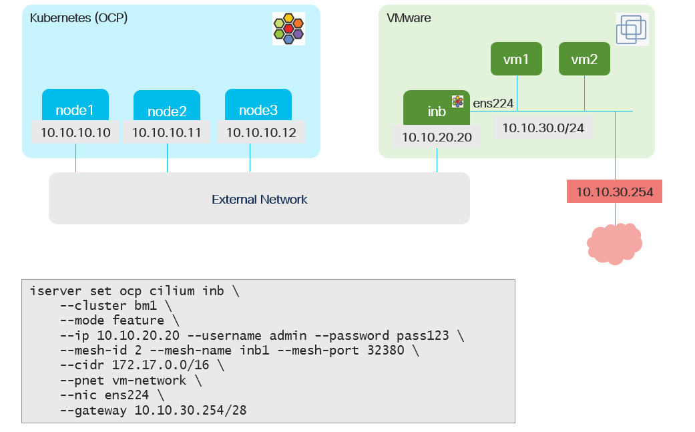

# Cilium Isovalent Network Bridge - Create via Task

## Input



```
[
  {
    "cilium-inb": {
      "feature": {
        "ip": "10.10.20.20",
        "username": "admin",
        "password": "pass123",
        "mesh-id": 2,
        "mesh-name": "inb1",
        "mesh-port": 32380,
        "cidr": "172.17.0.0/16",
        "pnet": "vm-network",
        "nic": "ens224",
        "gateway": "10.10.30.254/24"
      }
    }
  }    
]
```

## Requirements

Refer to [feature](./enable.md) documentation

## Configurable options

```
# iserver set ocp task 
  --cluster TEXT   Cluster Name
  --filename TEXT  Tasks filename
  --validate       Validate only
  --break          Break on error
  --no-confirm     Confirmation mode
```

## Expected outcome

- Isovalent network bridge initiated
- Cluster mesh established
- Isovalent network bridge k8s and linux connectors created
- Private network created

## Example

```
# iserver set ocp task --cluster bm1 --filename C:\tmp\task.json --no-confirm

OpenShift Workflow - Create Tasks
=================================

Validate Input
--------------
Completed


OpenShift Workflow - Cilium - Initialize Isovalent Network Bridge
=================================================================


OpenShift Cluster: bm1
Cilium CNI
Cluster mesh enabled
Private network enabled

Validate input parameters
-------------------------
SSH access to inb successful
Inb interface IP addresses collected
nic ens224 found
no ip address configured
Private network not defined: vm-network
inb pod cidr does not overlap with cluster pod cidr
mesh-name not used in cluster mesh configuration
inb ip not used in cluster mesh configuration
mesh-id not used
Create inb linux handler
Linux connector bm1-inb1

Generate inb config
-------------------
remote cluster ip as any worker node ip
remote cluster name from spec:cluster:name
remote cluster port from spec:clustermesh:apiserver:nodePort
tunnel port from spec:tunnelPort
health port from spec:clusterHealthPort
config.yaml uploaded to inb

Upload CA certificate
---------------------
Get cilium ca secret: cilium/cilium-ca-root
ca.crt uploaded to inb
ca.key uploaded to inb

Initialize inb
--------------
Sit tight...
inb kubernetes api successful

Create Clusterwide Private Network
----------------------------------
- name: vm-network
- cidrv4: 10.10.30.0/24
- bridge: inb1
- gateway: 10.10.30.254

~~~
apiVersion: isovalent.com/v1alpha1
kind: ClusterwidePrivateNetwork
metadata:
  name: vm-network
spec:
  networkBridges:
  - cluster: inb1
  routes:
  - destination: 0.0.0.0/0
    gateway: 10.10.30.254
  subnets:
  - cidr: 10.10.30.0/24

~~~

Network created

Wait for network...

OpenShift Workflow - Cilium - Add Cluster to Mesh
=================================================


OpenShift Cluster: bm1
Cilium CNI

Cluster mesh enabled


Cilium config update
--------------------
CiliumConfig CRD patched
Take a nap to detect automatic deployment restart...
Automatic pods rollout detected

Wait for Cilium resources
-------------------------
- pod: cilium-7jttw
- pod: cilium-dbbff
- pod: cilium-envoy-bwzml
- pod: cilium-envoy-gm8k5
- pod: cilium-envoy-v9jgx
- pod: cilium-gf7rh
- pod: cilium-operator-b5446b59f-sc2b8
- pod: cilium-operator-b5446b59f-vvrsn
- pod: clife-controller-manager-6c79869f6c-gcj6l
- pod: clustermesh-apiserver-5fbcd5b558-gws27
- pod: hubble-timescape-0
- deployment: cilium-operator
- deployment: clife-controller-manager
- deployment: clustermesh-apiserver

Wait for cluster [inb1] connected...

+----+--------------+------------+--------------+--------------+---------+--------------+-------+-------------+-------+
| ID | Cluster Name | Cluster ID | Cluster IP   | Cluster Port | Summary | Cilium Agent | Node  | Node IP     | Ready |
+----+--------------+------------+--------------+--------------+---------+--------------+-------+-------------+-------+
| 1  | inb1         | 2          | 10.10.20.20  | 32380        | 3/3     | cilium-gf7rh | bm1-1 | 10.10.10.10 | ✓     | 
|    |              |            |              |              |         | cilium-7jttw | bm1-2 | 10.10.10.11 | ✓     | 
|    |              |            |              |              |         | cilium-dbbff | bm1-3 | 10.10.10.12 | ✓     | 
+----+--------------+------------+--------------+--------------+---------+--------------+-------+-------------+-------+

Completed tasks
- Cluster mesh added

Completed tasks
- Isovalent network bridge initiated
- Cluster mesh established
- Isovalent network bridge k8s and linux connectors created
```

[[Back]](./README.md)