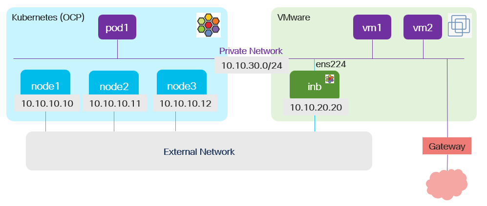

# Cilium Isovalent Network Bridge - Get state

## Workflow

Checks
- cilium cni operator state
- current cilium configuration (expected private network and cluster mesh)
- cluster mesh peer is inb (expected configured ssh and kubernetes access)

State (via ssh)
- container
- interface

State (via vcenter)
- inb vm state and network interfaces
- other vms connected to non-default interfaces

State (via kubernetes)
- node
- pod
- cilium agent
- cilium mesh
- private network
- private network endpoints

## Configurable options

- vcenter name (--vc) is optional and if provided then vcenter information is collected
- partial workflow can be selected using view (--view or -v) option
- multiple views can be selected

```
# iserver get ocp cilium inb
  --cluster TEXT    Cluster Name
  --vc TEXT         vCenter name
  --mesh-name TEXT  Cluster mesh name
  -v, --view TEXT   [ssh|vc|kube|pnet|mesh|all]  [default: all]
  --verbose         Verbose output
```

## Example



```
# iserver get ocp cilium inb --cluster bm1 --vcenter vc1


OpenShift Workflow - Cilium - Get Isovalent Network Bridge
==========================================================


OpenShift Cluster: bm1
Cilium CNI
Cluster mesh enabled
Private network enabled
Checking cluster mesh: inb1
- linux connector: bm1-inb1
- kubernetes connector: bm1-inb1
- cluster mesh peer detected as inb

inb: inb1
---------

## Container

+----+---------------+-------------------------+---------------+---------+---------------+--------------------------------------------------+-------------+
| ID | Container     | Name                    | Image         | State   | POD Namespace | POD Name                                         | POD Restart |
+----+---------------+-------------------------+---------------+---------+---------------+--------------------------------------------------+-------------+
| 1  | 2db39ad6f10f8 | apiserver               | 5dbc653986be8 | running | kube-system   | clustermesh-apiserver-5c9b4cd659-w2lrm           | 0           | 
| 2  | 8273f7f9bc8d2 | apiserver               | 5dbc653986be8 | running | kube-system   | clustermesh-apiserver-5c9b4cd659-ht26p           | 0           | 
| 3  | 80f2bc425e211 | apply-sysctl-overwrites | 801ccb443c7e8 | exited  | kube-system   | cilium-wcrb8                                     | 0           | 
| 4  | 0f75916662ab4 | cilium-agent            | 801ccb443c7e8 | running | kube-system   | cilium-wcrb8                                     | 0           | 
| 5  | f9c23ed69beec | cilium-envoy            | a30b64b9f8378 | running | kube-system   | cilium-envoy-t66pn                               | 0           | 
| 6  | 120aeb0f296d9 | cilium-operator         | 91c788bc93e37 | running | kube-system   | cilium-operator-d74996bd8-xfq72                  | 0           | 
| 7  | 47529358fb2b2 | clean-cilium-state      | 801ccb443c7e8 | exited  | kube-system   | cilium-wcrb8                                     | 0           | 
| 8  | b59731fa70a6c | config                  | 801ccb443c7e8 | exited  | kube-system   | cilium-wcrb8                                     | 0           | 
| 9  | d77a7562f982f | coredns                 | c69fa2e9cbf5f | running | kube-system   | coredns-668d6bf9bc-m4fqw                         | 0           | 
| 10 | 13dda108a26a4 | coredns                 | c69fa2e9cbf5f | running | kube-system   | coredns-668d6bf9bc-jgd6v                         | 0           | 
| 11 | b809da84d984e | etcd                    | 5dbc653986be8 | running | kube-system   | clustermesh-apiserver-5c9b4cd659-ht26p           | 0           | 
| 12 | 923ca8d96ee33 | etcd                    | 5dbc653986be8 | running | kube-system   | clustermesh-apiserver-5c9b4cd659-w2lrm           | 0           | 
| 13 | 9c2c7424e617b | etcd                    | a9e7e6b294baf | running | kube-system   | etcd-isovalent-network-bridge                    | 0           | 
| 14 | 3066cbe791274 | etcd-init               | 5dbc653986be8 | exited  | kube-system   | clustermesh-apiserver-5c9b4cd659-w2lrm           | 0           | 
| 15 | 11341d0c4c4bf | etcd-init               | 5dbc653986be8 | exited  | kube-system   | clustermesh-apiserver-5c9b4cd659-ht26p           | 0           | 
| 16 | 079491cc17522 | install-cni-binaries    | 801ccb443c7e8 | exited  | kube-system   | cilium-wcrb8                                     | 0           | 
| 17 | 191a160d1e413 | kube-apiserver          | 761ae2258f182 | running | kube-system   | kube-apiserver-isovalent-network-bridge          | 0           | 
| 18 | e820d40f2a47e | kube-controller-manager | 87f922d0bde0d | running | kube-system   | kube-controller-manager-isovalent-network-bridge | 0           | 
| 19 | 9cc181ad7a9b5 | kube-scheduler          | 36cc9c80994eb | running | kube-system   | kube-scheduler-isovalent-network-bridge          | 0           | 
| 20 | 7f741ee39dea0 | kvstoremesh             | 5dbc653986be8 | running | kube-system   | clustermesh-apiserver-5c9b4cd659-ht26p           | 0           | 
| 21 | 3653fdec474f7 | kvstoremesh             | 5dbc653986be8 | running | kube-system   | clustermesh-apiserver-5c9b4cd659-w2lrm           | 0           | 
| 22 | 51682016addbc | mount-bpf-fs            | 801ccb443c7e8 | exited  | kube-system   | cilium-wcrb8                                     | 0           | 
| 23 | 86df1276a0b45 | mount-cgroup            | 801ccb443c7e8 | exited  | kube-system   | cilium-wcrb8                                     | 0           | 
+----+---------------+-------------------------+---------------+---------+---------------+--------------------------------------------------+-------------+

## Interface

+----+-------+------------------------+---------------------------------------+------+---------+-------------------+
| ID | Index | Name                   | Flags                                 | MTU  | State   | MAC               |
+----+-------+------------------------+---------------------------------------+------+---------+-------------------+
| 1  | 2     | ens192                 | BROADCAST,MULTICAST,UP,LOWER_UP       | 1500 | UP      | aa:aa:aa:aa:aa:aa | 
| 2  | 3     | ens224                 | BROADCAST,MULTICAST,UP,LOWER_UP       | 1500 | UP      | bb:bb:bb:bb:bb:bb | 
+----+-------+------------------------+---------------------------------------+------+---------+-------------------+

## vCenter

### inb

+------+--------+-------------------------+-----+-------------+------+-----------+------------+-----+------+-----+-------+-------------+------------+-----+
| SF   | Name   | Host                    | CPU | Usage       | Rsvd | Memory    | Usage      | [%] | Rsvd | NIC | Disks | Storage     | Usage      | [%] |
+------+--------+-------------------------+-----+-------------+------+-----------+------------+-----+------+-----+-------+-------------+------------+-----+
| P+ H | inb-vm | host.vcenter.domain.com | 8   | 625.0 [MHz] |      | 8.0 [GiB] | 1.12 [GiB] | 13% |      | 2   | 1     | 112.73 [GB] | 15.78 [GB] | 13% | 
+------+--------+-------------------------+-----+-------------+------+-----------+------------+-----+------+-----+-------+-------------+------------+-----+

+-------------------+----------+--------------------+-------------------+-----------+
| Label             | Type     | Network            | MAC               | Interface |
+-------------------+----------+--------------------+-------------------+-----------+
| Network adapter 1 | VMXNET 3 | vcenter-ext-net    | aa:aa:aa:aa:aa:aa | ens192    | 
+-------------------+----------+--------------------+-------------------+-----------+
| Network adapter 2 | VMXNET 3 | vcenter-vm-net     | bb:bb:bb:bb:bb:bb | ens224    | 
+-------------------+----------+--------------------+-------------------+-----------+

### private network [vcenter-net1] via [ens224]

+------+-------------+-------------------------+-----+-------------+------+------------+-------------+-----+------+-----+-------+-------------+-------------+-----+
| SF   | Name        | Host                    | CPU | Usage       | Rsvd | Memory     | Usage       | [%] | Rsvd | NIC | Disks | Storage     | Usage       | [%] |
+------+-------------+-------------------------+-----+-------------+------+------------+-------------+-----+------+-----+-------+-------------+-------------+-----+
| P+ H | vm1         | host.vcenter.domain.com | 1   | 0 [Hz]      |      | 2.0 [GiB]  | 110 [MiB]   | 0%  |      | 1   | 1     | 52.23 [GB]  | 2.46 [GB]   | 4%  | 
| P+ H | vm2         | host.vcenter.domain.com | 32  | 25.0 [MHz]  |      | 48.0 [GiB] | 491.0 [MiB] | 0%  |      | 1   | 1     | 100.0 [GB]  | 98.69 [GB]  | 98% | 
| P+ H | inb-vm      | host.vcenter.domain.com | 8   | 625.0 [MHz] |      | 8.0 [GiB]  | 1.12 [GiB]  | 13% |      | 2   | 1     | 112.73 [GB] | 15.78 [GB]  | 13% | 
+------+-------------+-------------------------+-----+-------------+------+------------+-------------+-----+------+-----+-------+-------------+-------------+-----+

## Node

+----+--------------------------+-------+-------+--------+------+-----+-----+------+--------------------+-------+
| ID | Node                     | Ready | Taint | Memory | Disk | PID | MCP | Role | IP                 | Age   |
+----+--------------------------+-------+-------+--------+------+-----+-----+------+--------------------+-------+
| 1  | isovalent-network-bridge | ✓     | ---   | ✓      | ✓    | ✓   | --  | ---  | 10.10.20.20  (int) | 8h47m | 
+----+--------------------------+-------+-------+--------+------+-----+-----+------+--------------------+-------+

## POD

+----+--------------------------------------------------+-------+---------+--------------------+-------+--------------------------+----------------+-----+-----+----------+
| ID | Pod                                              | Ready | Status  | Condition          | Age   | Node                     | IP             | Net | Svc | Restarts |
+----+--------------------------------------------------+-------+---------+--------------------+-------+--------------------------+----------------+-----+-----+----------+
| 1  | kube-system                                      | 1/1   | Running | Initialized: ✓     | 8h47m | isovalent-network-bridge | 10.10.20.20    | 1   |     | 0        | 
|    | cilium-envoy-t66pn                               |       |         | PodScheduled: ✓    |       |                          |                |     |     |          | 
|    |                                                  |       |         | ContainersReady: ✓ |       |                          |                |     |     |          | 
|    |                                                  |       |         | Ready: ✓           |       |                          |                |     |     |          | 
+----+--------------------------------------------------+-------+---------+--------------------+-------+--------------------------+----------------+-----+-----+----------+
| 2  | kube-system                                      | 1/1   | Running | Initialized: ✓     | 8h47m | isovalent-network-bridge | 10.10.20.20    | 1   |     | 0        | 
|    | cilium-operator-d74996bd8-xfq72                  |       |         | PodScheduled: ✓    |       |                          |                |     |     |          | 
|    |                                                  |       |         | ContainersReady: ✓ |       |                          |                |     |     |          | 
|    |                                                  |       |         | Ready: ✓           |       |                          |                |     |     |          | 
+----+--------------------------------------------------+-------+---------+--------------------+-------+--------------------------+----------------+-----+-----+----------+
| 3  | kube-system                                      | 0/1   | Pending | Initialized: ✓     | 8h47m | isovalent-network-bridge | 172.17.54.2    | 1   |     | 0        | 
|    | cilium-vector-wsf8v                              |       |         | PodScheduled: ✓    |       |                          |                |     |     |          | 
|    |                                                  |       |         | ContainersReady: ✗ |       |                          |                |     |     |          | 
|    |                                                  |       |         | Ready: ✗           |       |                          |                |     |     |          | 
+----+--------------------------------------------------+-------+---------+--------------------+-------+--------------------------+----------------+-----+-----+----------+
| 4  | kube-system                                      | 1/1   | Running | Initialized: ✓     | 8h47m | isovalent-network-bridge | 10.10.20.20    | 1   |     | 0        | 
|    | cilium-wcrb8                                     |       |         | PodScheduled: ✓    |       |                          |                |     |     |          | 
|    |                                                  |       |         | ContainersReady: ✓ |       |                          |                |     |     |          | 
|    |                                                  |       |         | Ready: ✓           |       |                          |                |     |     |          | 
+----+--------------------------------------------------+-------+---------+--------------------+-------+--------------------------+----------------+-----+-----+----------+
| 5  | kube-system                                      | 3/3   | Running | Initialized: ✓     | 8h47m | isovalent-network-bridge | 172.17.27.109  | 1   |     | 0        | 
|    | clustermesh-apiserver-5c9b4cd659-ht26p           |       |         | PodScheduled: ✓    |       |                          |                |     |     |          | 
|    |                                                  |       |         | ContainersReady: ✓ |       |                          |                |     |     |          | 
|    |                                                  |       |         | Ready: ✓           |       |                          |                |     |     |          | 
+----+--------------------------------------------------+-------+---------+--------------------+-------+--------------------------+----------------+-----+-----+----------+
| 6  | kube-system                                      | 3/3   | Running | Initialized: ✓     | 8h47m | isovalent-network-bridge | 172.17.118.231 | 1   |     | 0        | 
|    | clustermesh-apiserver-5c9b4cd659-w2lrm           |       |         | PodScheduled: ✓    |       |                          |                |     |     |          | 
|    |                                                  |       |         | ContainersReady: ✓ |       |                          |                |     |     |          | 
|    |                                                  |       |         | Ready: ✓           |       |                          |                |     |     |          | 
+----+--------------------------------------------------+-------+---------+--------------------+-------+--------------------------+----------------+-----+-----+----------+
| 7  | kube-system                                      | 1/1   | Running | Initialized: ✓     | 8h47m | isovalent-network-bridge | 172.17.116.43  | 1   |     | 0        | 
|    | coredns-668d6bf9bc-jgd6v                         |       |         | PodScheduled: ✓    |       |                          |                |     |     |          | 
|    |                                                  |       |         | ContainersReady: ✓ |       |                          |                |     |     |          | 
|    |                                                  |       |         | Ready: ✓           |       |                          |                |     |     |          | 
+----+--------------------------------------------------+-------+---------+--------------------+-------+--------------------------+----------------+-----+-----+----------+
| 8  | kube-system                                      | 1/1   | Running | Initialized: ✓     | 8h47m | isovalent-network-bridge | 172.17.132.137 | 1   |     | 0        | 
|    | coredns-668d6bf9bc-m4fqw                         |       |         | PodScheduled: ✓    |       |                          |                |     |     |          | 
|    |                                                  |       |         | ContainersReady: ✓ |       |                          |                |     |     |          | 
|    |                                                  |       |         | Ready: ✓           |       |                          |                |     |     |          | 
+----+--------------------------------------------------+-------+---------+--------------------+-------+--------------------------+----------------+-----+-----+----------+
| 9  | kube-system                                      | 1/1   | Running | Initialized: ✓     | 8h47m | isovalent-network-bridge | 10.10.20.20    | 1   |     | 0        | 
|    | etcd-isovalent-network-bridge                    |       |         | PodScheduled: ✓    |       |                          |                |     |     |          | 
|    |                                                  |       |         | ContainersReady: ✓ |       |                          |                |     |     |          | 
|    |                                                  |       |         | Ready: ✓           |       |                          |                |     |     |          | 
+----+--------------------------------------------------+-------+---------+--------------------+-------+--------------------------+----------------+-----+-----+----------+
| 10 | kube-system                                      | 0/1   | Pending | Initialized: ✓     | 8h47m | isovalent-network-bridge | 172.17.96.119  | 1   |     | 0        | 
|    | hubble-k8s-exporter-797f656c8b-4cnh7             |       |         | PodScheduled: ✓    |       |                          |                |     |     |          | 
|    |                                                  |       |         | ContainersReady: ✗ |       |                          |                |     |     |          | 
|    |                                                  |       |         | Ready: ✗           |       |                          |                |     |     |          | 
+----+--------------------------------------------------+-------+---------+--------------------+-------+--------------------------+----------------+-----+-----+----------+
| 11 | kube-system                                      | 1/1   | Running | Initialized: ✓     | 8h47m | isovalent-network-bridge | 10.10.20.20    | 1   |     | 0        | 
|    | kube-apiserver-isovalent-network-bridge          |       |         | PodScheduled: ✓    |       |                          |                |     |     |          | 
|    |                                                  |       |         | ContainersReady: ✓ |       |                          |                |     |     |          | 
|    |                                                  |       |         | Ready: ✓           |       |                          |                |     |     |          | 
+----+--------------------------------------------------+-------+---------+--------------------+-------+--------------------------+----------------+-----+-----+----------+
| 12 | kube-system                                      | 1/1   | Running | Initialized: ✓     | 8h47m | isovalent-network-bridge | 10.10.20.20    | 1   |     | 0        | 
|    | kube-controller-manager-isovalent-network-bridge |       |         | PodScheduled: ✓    |       |                          |                |     |     |          | 
|    |                                                  |       |         | ContainersReady: ✓ |       |                          |                |     |     |          | 
|    |                                                  |       |         | Ready: ✓           |       |                          |                |     |     |          | 
+----+--------------------------------------------------+-------+---------+--------------------+-------+--------------------------+----------------+-----+-----+----------+
| 13 | kube-system                                      | 1/1   | Running | Initialized: ✓     | 8h47m | isovalent-network-bridge | 10.10.20.20    | 1   |     | 0        | 
|    | kube-scheduler-isovalent-network-bridge          |       |         | PodScheduled: ✓    |       |                          |                |     |     |          | 
|    |                                                  |       |         | ContainersReady: ✓ |       |                          |                |     |     |          | 
|    |                                                  |       |         | Ready: ✓           |       |                          |                |     |     |          | 
+----+--------------------------------------------------+-------+---------+--------------------+-------+--------------------------+----------------+-----+-----+----------+

## Cilium Agent

- agent: cilium-wcrb8
- state: Ok
- image: 1.18.3-cee.pre.1

## Cilium Mesh

+----+--------------+------------+--------------+--------------+---------+--------------+-------+-------------+-------+
| ID | Cluster Name | Cluster ID | Cluster IP   | Cluster Port | Summary | Cilium Agent | Node  | Node IP     | Ready |
+----+--------------+------------+--------------+--------------+---------+--------------+-------+-------------+-------+
| 1  | inb1         | 2          | 10.10.20.20  | 32380        | 3/3     | cilium-gf7rh | bm1-1 | 10.10.10.10 | ✓     | 
|    |              |            |              |              |         | cilium-7jttw | bm1-2 | 10.10.10.11 | ✓     | 
|    |              |            |              |              |         | cilium-dbbff | bm1-3 | 10.10.10.12 | ✓     | 
+----+--------------+------------+--------------+--------------+---------+--------------+-------+-------------+-------+

## Private Network

+----+-----------------------------+-----------------+--------+-----------+--------------+--------------------------+--------+
| ID | Clusterwide Private Network | CIDRv4          | CIDRv6 | Route     | Via          | POD                      | Bridge |
+----+-----------------------------+-----------------+--------+-----------+--------------+--------------------------+--------+
| 1  | vm-network                  | 10.10.30.0/24   | ---    | 0.0.0.0/0 | 10.10.30.254 | ocp/bm1-3/default/pod1   | inb1   | 
+----+-----------------------------+-----------------+--------+-----------+--------------+--------------------------+--------+

## Private Network Endpoints

+----+-----------------------------+--------------+-------------------+---------+-------+-----------+--------+--------------+--------------------------+
| ID | Clusterwide Private Network | Endpoint IP  | Endpoint MAC      | Cluster | Node  | Namespace | Name   | POD IP       | Since                    |
+----+-----------------------------+--------------+-------------------+---------+-------+-----------+--------+--------------+--------------------------+
| 1  | vm-network                  | 10.10.30.66  | cc:cc:cc:cc:cc:cc | ocp     | bm1-3 | default   | pod1   | 10.128.4.141 | 2025-11-10T12:45:49.962Z | 
+----+-----------------------------+--------------+-------------------+---------+-------+-----------+--------+--------------+--------------------------+
```
[[Back]](./README.md)