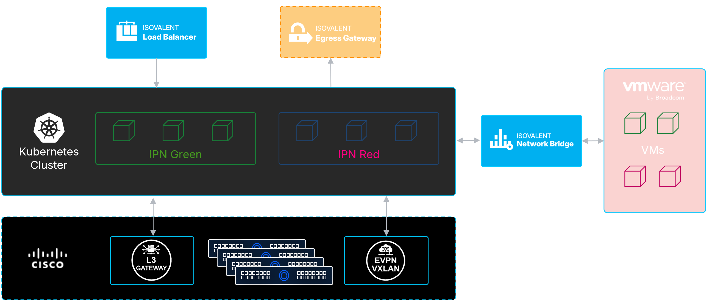

# Private Network

[[Back]](../Operations.md)

The private network feature enables network-level isolation between Cilium-managed endpoints. Endpoints within the same private network can communicate with each other, but are isolated from endpoints in other private networks. This feature assigns IP addresses from a designated private subnet range directly to the primary interface of each pod, eliminating the need for secondary interfaces for connecting to additional network segments. Refer to official [dccumentation](https://iep-docs.cisco.com/iep/latest/inv/ipn/index.html) for details.

Private network modes:
- isolated with [east-west connectivity](./ew-test/README.md) only
- connected to external infrastructure via [Isovalent Network Bridge](../cilium-inb/README.md) incl. [VM Migration](../vm-migration-inb/README.md) functionality
- connected to upstream network infrastructure over dedicated network devices in [local access](./local-access-test/README.md) or [EVPN](./evpn-test/README.md) mode

## Knowledge Base

PrivNet feature
- [enable private network](./kb/enable.md)
- [create private network](./kb/network.md)
- [eBPF maps](./kb/map.md)
- [custom resources](./kb/crd.md)

Application attachment
- [attach pod to private network](./kb/pod.md)
- [attach vm to private network](./kb/vm.md)

Test setup
- [east-west connectivity](./ew-test/README.md)
- [local access](./local-access-test/README.md)
- [evpn](./evpn-leaf/README.md)

## Commands

Command | Intent | Details
--- | --- | ---
iserver get ocp cilium pnet | get private network state | view: [state](./get_state.md), [res](./get_crd.md), [db](./get_map.md), [ep](./get_ep.md)
iserver set ocp cilium pnet --mode feature | enable private network feature with options | [Link](./enable.md)
iserver set ocp cilium pnet --mode network | create private network | [Link](./create_network.md)
iserver set ocp task | in task way | [Link](./create_task.md)
iserver delete ocp cilium pnet --mode feature | disable private network | [Link](./disable.md)
iserver delete ocp cilium pnet --mode multus | disable multus integration | [Link](./disable_multus.md)
iserver delete ocp cilium pnet --mode webhook | disable webhook | [Link](./disable_webhook.md)
iserver delete ocp cilium pnet --mode network | delete private network | [Link](./delete_network.md)
iserver delete ocp cilium pnet --mode wipe | delete private network crds | [Link](./wipe.md)
iserver delete ocp task | in task way | [Link](./delete_task.md)
    
[[Back]](../Operations.md)