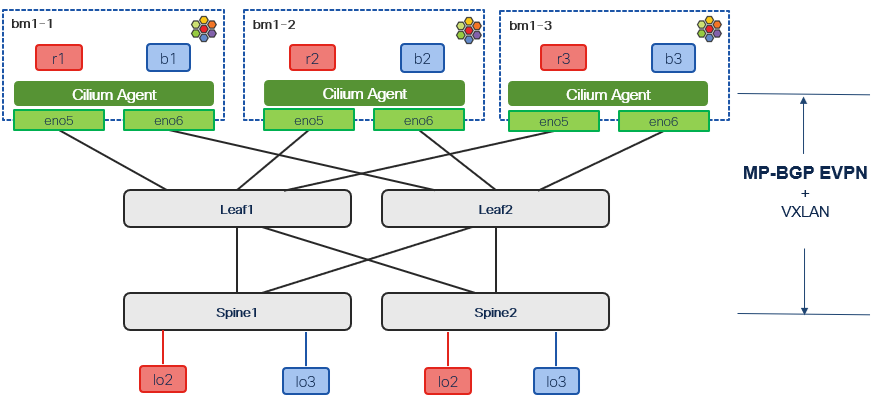

# Private Network - evpn/vxlan connectivity test setup

[[Back]](../README.md)

>[!NOTE]
>This case study follows the design principles as describe in the official [solution overview](https://www.cisco.com/c/en/us/products/collateral/networking/cloud-networking/nx-os/isovalent-net-v12n-int-n-one-fabric-so.html).

Kubernetes cluster
- OpenShift with Cilium Enterprise 1.19
- main kubernetes interface into another fabric (ACI used in the lab setup)
- dedicated two physical L3 routed p2p interfaces per node connected to different leaf (ToR) switches for redundancy and load distribution
- loopback ip per node used as bgp router-id and vtep source

BGP Control Plane
- between every cluster node and pair of leaves (ToRs)
- underlay v4/unicast af used to advertise nodes' loopback and receive from fabric vtep and routing loopbacks
- overlay l2vpn/evpn af, used to advertise evpn type 5 /32 host routes for vm/pod ip address and receive all evpn routes in the context of tenant VRF
- bgp unnumbered in underlay eliminates the need to manage IPv4 addressing on the point-to-point links, simplifying provisioning at scale
- next-hop manipulation on the leaf fabric nodes
    - leaf presents itself as next-hop for every evpn route advertised to the kube cluster node
    - leaf presents itself as next-hop for every kube learnt evpn route re-advertised towards the spine

VXLAN Data Plane
- packet leaving cluster node towards fabric is VXLAN encapsulated as per reachability exchanged with BGP control plane
- next-hop manipulation triggers the vxlan tunnel stitching behavior in both directions
    - traffic destined to kube cluster node is first vxlan terminated by one of leaves
    - traffic sourced by kube cluster node is first vxlan terminated by one of leaves

Success criteria
- applications connected to private network bgp evpn advertised to NXOS fabric
- vrf forwarding table per private network built based on bgp evpn advertisement
- N-S traffic with vxlan data plane encapsulation to remote vtep that in this design is always one of the leaf devices
- data plane stiching on the leaf towards the final vtep destination

## Table of Contents

[Addressing scheme](./address.md)

Kubernetes cluster
- [cilium configuration](./cilium-config.md)
- [interfaces](./server-intf.md)
- [bgp](./server-bgp.md)
- [private network](./private-network.md)
- [application](./kube-app.md)
- [complete configuration reference](./kube-baseline.md)

Data center fabric
- [interfaces](./fabric-intf.md)
- [bgp](./fabric-bgp.md)
- [vrf](./fabric-vrf.md)

Cilium closer look
- [eBPF maps](./map.md)
- [route import (underlay)](./route-import.md)
- [evpn advertisements](./cilium-advertisement.md)
- [export route target (overlay)](./export-route-target.md)
- [import route target (overlay)](./import-route-target.md)
- [vrf forwarding table](./rib-list.md)

Packet forwarding
- [E-W packet forwarding](./traffic-ew.md)
- [N-S packet forwarding](./traffic-ns.md)

Options
- [bfd](./bfd.md)
- [bgp timers](./timer.md)
- [bgp authentication](./auth.md)
- [bgp community](./community.md)
- [sgt](./sgt.md)
- [extended configuration reference](./kube-extras.md)

## Official documentation

Isovalent Networking for Virtualization
- [Product page](https://isovalent.com/products/networking-for-virtualization/)
- [Solution brief](https://isovalent.com/briefs/networking-for-virtual-infrastructure/)
- [Blog — Product overview](https://isovalent.com/blog/post/isovalent-networking-for-virtualization/)
- [Blog — Cisco Nexus ONE BGP EVPN integration](https://isovalent.com/blog/post/isovalent-private-networks-and-cisco-nexus-one-bgp-evpn-integration-for-the-enterprise-data-center/)

VXLAN EVPN Integration with Cisco ONE Fabric
- [Solution overview](https://www.cisco.com/c/en/us/products/collateral/networking/cloud-networking/nx-os/isovalent-net-v12n-int-n-one-fabric-so.html)

[[Back]](../README.md)