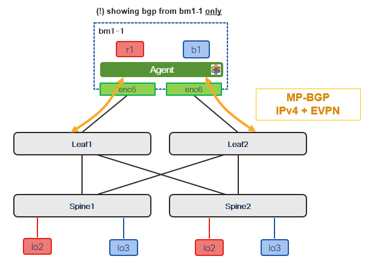

# Fabric BGP Control Plane

[[Back]](./README.md) [[Next]](./fabric-vrf.md)



## Underlay (leaf)

- BGP IPv4 in global route table is used to announce the fabric underlay information to Cilium ie. loopbacks for overlay bgp control plane and vtep
- BGP unnumbered eliminates the need to manage IPv4 addressing on the point-to-point links, simplifying provisioning at scale

>[!NOTE]
>Showing bgp configuration on Leaf1 for brevity

```
router bgp 64000
  address-family ipv4 unicast
    network 100.64.10.201/32
    network 100.64.20.201/32
  template peer CILIUM
    remote-as external
    address-family ipv4 unicast
    address-family ipv6 unicast
  template peer-session CILIUM
    log-neighbor-changes
  neighbor Ethernet1/11
    inherit peer CILIUM
    inherit peer-session CILIUM
  neighbor Ethernet1/12
    inherit peer CILIUM
    inherit peer-session CILIUM
  neighbor Ethernet1/13
    inherit peer CILIUM
    inherit peer-session CILIUM
```

Expected state

```
Leaf1# show bgp ipv4 unicast summary
BGP summary information for VRF default, address family IPv4 Unicast
BGP router identifier 100.64.10.201, local AS number 64000

Neighbor        V    AS    MsgRcvd    MsgSent   TblVer  InQ OutQ Up/Down  State/PfxRcd
fe80::200d:c753:4467:28a7%Ethernet1/11
                4   666        744        743       99    0    0 06:09:59 1
fe80::5c63:5c5a:c5e6:b016%Ethernet1/12
                4   666       2871       2874       99    0    0 06:13:44 1
fe80::c8eb:59e6:4f60:28b1%Ethernet1/13
                4   666       2871       2875       99    0    0 06:13:44 1
```

```
Leaf1# show bgp ipv4 unicast
BGP routing table information for VRF default, address family IPv4 Unicast
BGP table version is 101, Local Router ID is 100.64.10.201
Status: s-suppressed, x-deleted, S-stale, d-dampened, h-history, *-valid, >-best
Path type: i-internal, e-external, c-confed, l-local, a-aggregate, r-redist, I-injected
Origin codes: i - IGP, e - EGP, ? - incomplete, | - multipath, & - backup, 2 - best2

   Network            Next Hop            Metric     LocPrf     Weight Path
*>l100.64.10.201/32   0.0.0.0                           100      32768 i
*>e100.64.10.1/32     fe80::200d:c753:4467:28a7
                                                                     0 666 i
*>e100.64.10.2/32     fe80::5c63:5c5a:c5e6:b016
                                                                     0 666 i
*>e100.64.10.3/32     fe80::c8eb:59e6:4f60:28b1
                                                                     0 666 i
*>l100.64.20.201/32   0.0.0.0                           100      32768 i
```

## Overlay (leaf)

>[!CAUTION]
>Critically important next hop manipulation design principles

Towards Kubernetes
- the leaves must rewrite the next-hop to the Primary IP (PIP) of the leaf which in this documentation is the vtep loopback of the leaf

```
route-map TO_CILIUM_SET_NEXT_HOP permit 10
  match evpn route-type 5
  set ip next-hop 100.64.20.201
!
route-map ADD_PATHS_RM permit 10
  set path-selection all advertise
!
router bgp 64000
  address-family l2vpn evpn
    maximum-paths ibgp 64
    advertise-pip
    additional-paths send
    additional-paths receive
    additional-paths selection route-map ADD_PATHS_RM
  template peer CILIUM_OVERLAY
    remote-as 666
    update-source loopback0
    ebgp-multihop 5
    address-family l2vpn evpn
      send-community
      send-community extended
      route-map TO_CILIUM_SET_NEXT_HOP out
      rewrite-evpn-rt-asn
      no advertise-gw-ip
  template peer-session CILIUM_OVERLAY
    log-neighbor-changes
  neighbor 100.64.10.1
    inherit peer CILIUM_OVERLAY
    inherit peer-session CILIUM_OVERLAY
  neighbor 100.64.10.2
    inherit peer CILIUM_OVERLAY
    inherit peer-session CILIUM_OVERLAY
  neighbor 100.64.10.3
    inherit peer CILIUM_OVERLAY
    inherit peer-session CILIUM_OVERLAY
```

Toward spine
- the leaves must rewrite the next-hop of K8s-originated EVPN routes to their own PIP, so that remote leaves only see the leaf as the VTEP (collapsing N tunnels per leaf-pair into one)

```
ip as-path access-list k8s-vxlan seq 5 permit "^666$"
!
route-map TO_SPINES_SET_NEXT_HOP permit 10
  match as-path k8s-vxlan
  set ip next-hop 100.64.20.201
route-map TO_SPINES_SET_NEXT_HOP permit 1000
!
router bgp 64000
  address-family l2vpn evpn
    maximum-paths ibgp 64
    advertise-pip
    additional-paths send
    additional-paths receive
  neighbor 100.64.10.101
    remote-as 64000
    description spine1
    update-source loopback0
    address-family ipv4 mvpn
      send-community
      send-community extended
    address-family l2vpn evpn
      send-community
      send-community extended
      route-map TO_SPINES_SET_NEXT_HOP out
  neighbor 100.64.10.102
    remote-as 64000
    description spine2
    update-source loopback0
    address-family ipv4 mvpn
      send-community
      send-community extended
    address-family l2vpn evpn
      send-community
      send-community extended
      route-map TO_SPINES_SET_NEXT_HOP out
```

Expected state

```
Leaf1# show bgp l2vpn evpn summary
BGP summary information for VRF default, address family L2VPN EVPN
BGP router identifier 100.64.10.201, local AS number 64000

Neighbor        V    AS    MsgRcvd    MsgSent   TblVer  InQ OutQ Up/Down  State/PfxRcd
100.64.10.101   4 64000       1606       1522      975    0    0 06:10:32 29
100.64.10.102   4 64000       1609       1519      975    0    0 06:10:32 29
100.64.10.1     4   666      20959      20968      975    0    0 00:04:23 2
100.64.10.2     4   666      22874      22875      975    0    0 06:10:36 2
100.64.10.3     4   666      22861      22862      975    0    0 06:10:36 2

Neighbor        T    AS Type-1     Type-2     Type-3     Type-4     Type-5     Type-6     Type-7     Type-8     Type-12
100.64.10.101   I 64000 0          13         0          0          16         0          0          0          0
100.64.10.102   I 64000 0          13         0          0          16         0          0          0          0
100.64.10.1     I   666 0          0          0          0          2          0          0          0          0
100.64.10.2     I   666 0          0          0          0          2          0          0          0          0
100.64.10.3     I   666 0          0          0          0          2          0          0          0          0
```

[[Back]](./README.md) [[Next]](./fabric-vrf.md)