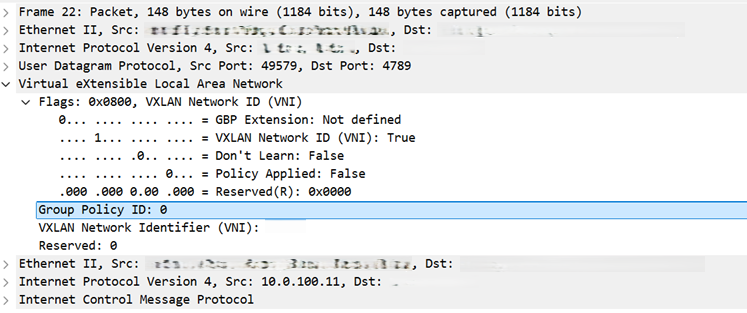

# Security Group Tag (SGT) and identity propagation

[[Back]](./README.md) 

## Table of Contents

- [Overview](#overview)
- [Cilium](#cilium)
- [Fabric](#fabric)
- [Data Plane](#data-plane)

## Overview

The kubernetes cluster can advertise workload/application identity using secure group tag (sgt) as a BGP extended community alongside the EVPN host routes. This enables group based policy to be applied in the fabric.

How it works
- classification i.e. workload/app selection is based on standard Kubernetes labels
- FabricSecurityGroup object defines in `metadata.name` the sgt value and `spec.endpointSelector.matchLabels` defines the label
- when Cilium advertises the workload's EVPN Type 5 /32 (or /128) host route, it attaches the corresponding SGT as a BGP extended community
- the fabric receives the route, learns both the reachability (next-hop) and the group/identity of the endpoint, and can enforce group-based policy on traffic to and from that workload — without any per-IP fabric classification

In fact, while the IP identity of the endpoint can change due to recreate, reschedule, live migration; its associated SGT does not change and the same group-based policy can be applied.

Example:

```yaml
apiVersion: isovalent.com/v1alpha1 
kind: FabricSecurityGroup 
metadata: 
  name: "666"
spec: 
  endpointSelector: 
    matchLabels: 
      app: red666
```

Any application (pod/vm) with label `app: red666` that is BGP EVPN advertised as type 5 route, will get SGT value of `666` advertised as BGP extended community.

>[!CAUTION]
>SGT value defined in `FabricSecurityGroup` **should not** overlap with any SGT values used elsewhere in DC fabric. There is no warning or error raised in case of overlap.

SGT-based enforcement is **one-directional**. Cilium **does not use SGTs to enforce policy itself**. It advetises the SGT to the fabric if configured to do so, however, 
- in-cluster (east-west or north-south) enforcement relies on Cilium/Kubernetes Network Policies **only**
- any SGTs received from the fabric is ignored by Cilium 

## Cilium

### Enable

Additional configuration on top of [base](./kube-baseline.md)

```yaml
spec:
  enterprise:
    evpn: 
      enabled: true 
      securityGroupTags: 
        enabled: true 
        defaultGroupID: 100
```

Once enabled new CRDs are installed
- FabricSecurityGroup

Complete configuration [reference](./kube-extras.md)

### Configure

Additional configuration on top of [base](./kube-baseline.md)

```
apiVersion: isovalent.com/v1alpha1 
kind: FabricSecurityGroup 
metadata: 
  name: "666"
spec: 
  endpointSelector: 
    matchLabels: 
      app: red666
```

Note: `spec.name` must be integer defined as string

Make sure to add label to application e.g., 

```
$ oc label pod r1 app=red666
```

```yaml
apiVersion: v1
kind: Pod
metadata:
  labels:
    app: red666
```

## Fabric

### Without sgt

```
leaf1# show bgp l2vpn evpn 10.0.100.11
BGP routing table information for VRF default, address family L2VPN EVPN
Route Distinguisher: 66.66.66.1:1
BGP routing table entry for [5]:[0]:[0]:[32]:[10.0.100.11]/224, version 2719
Paths: (1 available, best #1)
Flags: (0x000002) (high32 00000000) on xmit-list, is not in l2rib/evpn, is not in HW
Multipath: iBGP

  Advertised path-id 1
  Path type: external, path is valid, is best path, no labeled nexthop
             Imported to 2 destination(s)
             Imported paths list: infra L3-66100
  Gateway IP: 0.0.0.0
  AS-Path: 666 , path sourced external to AS
    10.64.10.1 (metric 0) from 10.64.10.1 (66.66.66.1)
      Origin incomplete, MED not set, localpref 100, weight 0
      Received label 60000
      Extcommunity: RT:64000:66100 ENCAP:8 PCTAG:0:80:100 Router MAC:aaaa.aaaa.aaaa <<< default sgt >>>

  Path-id 1 advertised to peers:
    100.64.10.101        100.64.10.102
```

### With sgt

```
leaf1# show bgp l2vpn evpn 10.0.100.11
BGP routing table information for VRF default, address family L2VPN EVPN
Route Distinguisher: 66.66.66.1:1
BGP routing table entry for [5]:[0]:[0]:[32]:[10.0.100.11]/224, version 2721
Paths: (1 available, best #1)
Flags: (0x000002) (high32 00000000) on xmit-list, is not in l2rib/evpn, is not in HW
Multipath: iBGP

  Advertised path-id 1
  Path type: external, path is valid, is best path, no labeled nexthop
             Imported to 2 destination(s)
             Imported paths list: infra L3-66100
  Gateway IP: 0.0.0.0
  AS-Path: 666 , path sourced external to AS
    10.64.10.1 (metric 0) from 10.64.10.1 (66.66.66.1)
      Origin incomplete, MED not set, localpref 100, weight 0
      Received label 60000
      Extcommunity: RT:64000:66100 ENCAP:8 PCTAG:0:80:666 Router MAC:aaaa.aaaa.aaaa <<< sgt as defined in FabricSecurityGroup >>>

  Path-id 1 advertised to peers:
    100.64.10.101        100.64.10.102
```

## Data plane

As of now the data plane vxlan header **does not** have sgt value



[[Back]](./README.md) 