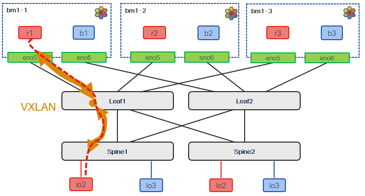

# Traffic forwarding - north-south

[[Back]](./README.md)

Example:
- pod (10.0.100.11) in private network `red` pings spine1 advertised loopback interface (100.64.100.101)
- vxlan originates on the bm1-1 with loopback as source and destined to leaf1 as per bgp control plane advertisement following next-hop manipulation
- leaf1 stitches the traffic to another tunnel sourced with leaf1 vtep address and destined to spine1 vtep address
- packet reaches loopback interface on spine1 after it is decapsulated



Address | Description
--- | ---
10.64.10.1 | bm1-1 loopback as vtep
100.64.20.201 | leaf1 vtep 
100.64.100.101 | spine1 loopback in vrf:red
10.0.100.11 | pod deployed on bm1-1 and connected to private network with vni 66100
bb:bb:bb:bb:bb:bb | bm1-1 cilium_evpn interface mac
aa:aa:aa:aa:aa:aa | bgp advertised destination mac

## Cilium route entry

```
$ oc exec -it cilium-4p49w -n cilium -- cilium-dbg shell -- rib/list
Best    VRF      Prefix               Owner          Protocol    NextHop
*       35645    100.64.100.101/32    bgp-overlay    eBGP        VXLANEncap vni 66100 vtep 100.64.20.201 inner-dst-mac aa:aa:aa:aa:aa:aa
```

## Ping

```
$ oc exec -it r1 -- ping 100.64.100.101 -c 1
64 bytes from 100.64.100.101: icmp_seq=1 ttl=254 time=0.881 ms
```

## Echo request

```
10.64.10.1.35293 > 100.64.20.201.4789: 
VXLAN, flags [I] (0x08), vni 66100
    bb:bb:bb:bb:bb:bb > aa:aa:aa:aa:aa:aa, 
    ethertype IPv4 (0x0800), 
    length 98: 
    10.0.100.11 > 100.64.100.101: 
    ICMP echo request, id 67, seq 5, length 64
```

## Echo reply

```
100.64.20.201.20309 > 10.64.10.1.4789: 
VXLAN, flags [I] (0x08), vni 66100
    aa:aa:aa:aa:aa:aa > bb:bb:bb:bb:bb:bb, 
    ethertype IPv4 (0x0800), 
    length 98: 
    100.64.100.101 > 10.0.100.11: 
    ICMP echo reply, id 67, seq 5, length 64
```

[[Back]](./README.md)