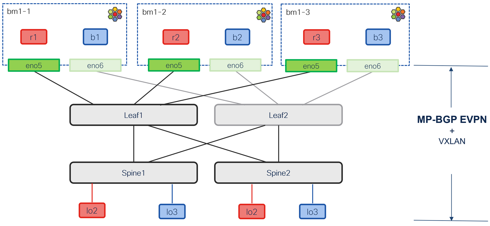

# Private Network - evpn/vxlan connectivity test setup

[[Back]](../README.md)

>[!CAUTION]
>**IMPORTANT**
>The test setup is **not** following the best practice for VXLAN EVPN integration with Cisco ONE Fabric as documented [here](
https://www.cisco.com/c/en/us/products/collateral/networking/cloud-networking/nx-os/isovalent-net-v12n-int-n-one-fabric-so.html). This document is designed to show by example and in details how the solution works.

Case study for private network extension via evpn/vxlan fabric.

Kubernetes cluster
- OpenShift with Cilium Enterprise 1.19-beta
- servers connected with single interface to leaf switch with p2p ipv4-enabled interface
- ethernet interface (**not** server loopbacks) used as bgp control plane or vxlan data plane source from Kubernetes domain
- v4-only setup 
- bgp control plane: underlay v4/unicast af with leaf and overlay l2vpn/evpn af with spines

Success criteria
- applications connected to private network bgp advertised 
- vrf forwarding table per private network built based on bgp advertisement
- N-S traffic with vxlan data plane encapsulation to remote vtep
- private network extended across bgp evpn/vxlan fabric

## Table of Contents

[Addressing scheme](./address.md)

Kubernetes cluster
- [cilium configuration](./cilium-config.md)
- [p2p interfaces](./server-intf.md)
- [bgp](./server-bgp.md)
- [private network](./private-network.md)
- [application](./kube-app.md)
- [complete configuration reference](./kube-complete.md)

Data center fabric
- [p2p interfaces](./fabric-intf.md)
- [bgp](./fabric-bgp.md)
- [vrf](./fabric-vrf.md)

Cilium features
- [evpn advertisements](./cilium-advertisement.md)
- [route import (underlay)](./route-import.md)
- [export route target (overlay)](./export-route-target.md)
- [import route target (overlay)](./import-route-target.md)
- [vrf forwarding table](./rib-list.md)

Packet forwarding
- [E-W packet forwarding](./traffic-ew.md)
- [N-S packet forwarding](./traffic-ns.md)

[[Back]](../README.md)