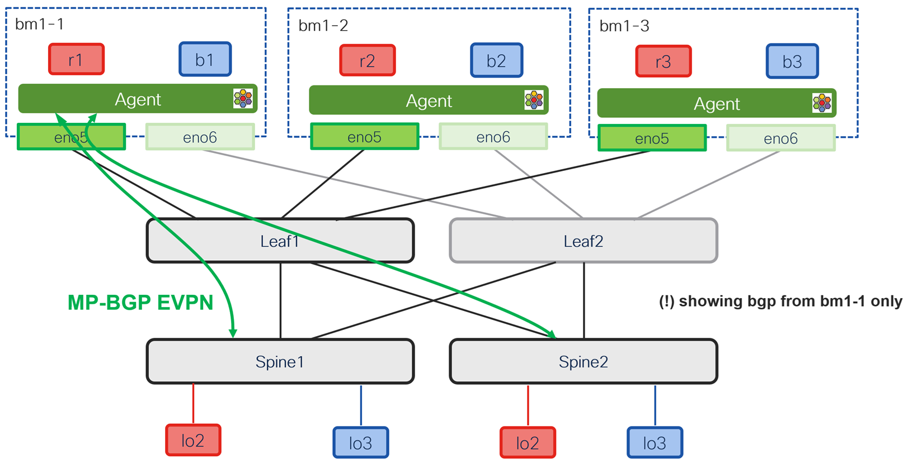

# Cilium BGP EVPN advertisement

[[Back]](./README.md)

Cilium advertises application (pod or kubevirt vm) ip address (/32 or /128) connected to private network via bgp control plane using route type 5. 



## Cilium perspective

```
$ cilium bgp peers -n cilium
Node    Local AS   Peer AS   Peer Address    Session State   Uptime      Family         Received   Advertised
bm1-1   666        64000     100.64.10.101   established     22h38m25s   l2vpn/evpn     30         2     <<< r1 ip advertised here >>>    
        666        64000     100.64.10.102   established     22h38m44s   l2vpn/evpn     30         2     <<< r1 ip advertised here >>>
        666        64000     100.64.66.110   established     22h41m22s   ipv4/unicast   14         0    
bm1-2   666        64000     100.64.10.101   established     22h27m6s    l2vpn/evpn     30         2    
        666        64000     100.64.10.102   established     22h25m43s   l2vpn/evpn     30         2    
        666        64000     100.64.66.120   established     22h30m2s    ipv4/unicast   14         0    
bm1-3   666        64000     100.64.10.101   established     22h26m48s   l2vpn/evpn     30         2    
        666        64000     100.64.10.102   established     22h25m29s   l2vpn/evpn     30         2    
        666        64000     100.64.66.130   established     22h30m2s    ipv4/unicast   14         0
```

Showing r1 pod only with formatted output

```
$ cilium bgp routes advertised l2vpn evpn peer 100.64.10.101 -n cilium
Node    VRouter   Peer          Prefix                  NextHop         Age      Attrs
bm1-1   666       100.64.10.101 [type:Prefix]           100.64.66.111   42m19s   Origin: ?
                                [rd:100.66.66.1:1]                               AsPath: 666
                                [etag:0]                                         MpReach(l2vpn-evpn):   
                                [prefix:10.0.100.11/32]                             Nexthop: 100.64.66.111
                                                                                    NLRIs: 
                                                                                        [type:Prefix]
                                                                                        [rd:100.66.66.1:1]
                                                                                        [etag:0]
                                                                                        [prefix:10.0.100.11/32]
                                                                                    Extcomms: 
                                                                                        [VXLAN]
                                                                                        [666:66100]
                                                                                        [router's mac: 66:66:66:11:11:11]
```

[[Back]](./README.md)