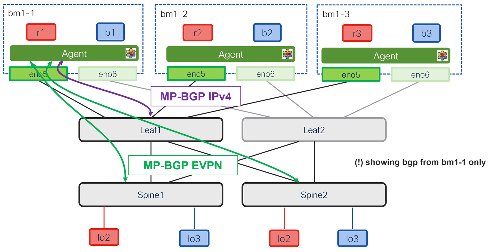

# Fabric BGP Control Plane

[[Back]](./README.md) [[Next]](./fabric-vrf.md) [[addressing scheme]](./address.md)



## Underlay (leaf)

- BGP IPv4 (GRT) is used to announce the fabric underlay information to Cilium
- The fabric uses OSPF as the underlay routing protocol. Its information must be redistributed into IPv4 BGP 
- The point-to-point subnets connecting the hosts
- 100.64.10.0/24 is the network used to address routing loopbacks (for BGP EVPN peering)
- 100.64.20.0/24 is the network used to address the VTEP loopbacks (for VXLAN data plane)
- 100.64.66.0/24 is the network used to address the point to point links
- BGP peering established with physical interface ip address per node

```
!
ip prefix-list FABRIC_UNDERLAY description Fabric underlay subnets
ip prefix-list FABRIC_UNDERLAY seq 5 permit 100.64.10.0/24 eq 32
ip prefix-list FABRIC_UNDERLAY seq 10 permit 100.64.20.0/24 eq 32
ip prefix-list FABRIC_UNDERLAY seq 15 permit 100.64.66.0/24 eq 31 ! /31 in the lab
!
route-map FABRIC_UNDERLAY permit 10
  description Fabric underlay subnet for redistribution into Cilium underlay
  match ip address prefix FABRIC_UNDERLAY
!
! Redistribute the underlay into BGP so that Cilium knows how to reach the BGP EVPN peer (control plane) and VTEP peers (data plane)
!
router bgp 64000
  address-family ipv4 unicast
    redistribute direct route-map FABRIC_UNDERLAY  ! <<< local leaf point-to-points and loopbacks
    redistribute ospf UNDERLAY route-map FABRIC_UNDERLAY ! <<< rest of the underlay
  template peer CILIUM
    remote-as 666
    address-family ipv4 unicast
  template peer-session CILIUM
    log-neighbor-changes
  neighbor 100.64.66.111
    inherit peer CILIUM
    inherit peer-session CILIUM
  neighbor 100.64.66.121
    inherit peer CILIUM
    inherit peer-session CILIUM    
  neighbor 100.64.66.131
    inherit peer CILIUM
    inherit peer-session CILIUM
!
```

## Overlay (spine)

- BGP next-hop must not be changed by EBGP rules so that the real VTEP address is available as next hop
- every cluster node peers with the spines

```
!
route-map NEXT_HOP_UNCHANGED permit 10
  set ip next-hop unchanged
!
router bgp 64000 
  template peer CILIUM
    remote-as 666
    address-family l2vpn evpn
      send-community
      send-community extended
      route-map NEXT_HOP_UNCHANGED out
      rewrite-evpn-rt-asn  !! <<< only needed to simplify VRF configuration in NX-OS. Only works for received routes   
  template peer-session CILIUM
    log-neighbor-changes
    update-source loopback0
    ebgp-multihop 5
  neighbor 100.64.66.111
    description BM1-1
    inherit peer CILIUM
    inherit peer-session CILIUM     
  neighbor 100.64.66.121
    description BM1-1
    inherit peer CILIUM
    inherit peer-session CILIUM
  neighbor 100.64.66.131
    description BM1-1
    inherit peer CILIUM
    inherit peer-session CILIUM
!
```

[[Back]](./README.md) [[Next]](./fabric-vrf.md) [[addressing scheme]](./address.md)