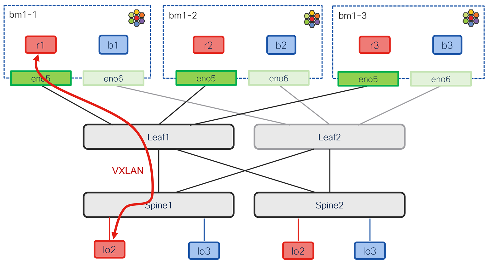

# Traffic forwarding - north-south

[[Back]](./README.md) [[addressing scheme]](./address.md)

Pod in private network `red` pings spine advertised interface



## Route entry

```
$ oc exec -it cilium-4p49w -n cilium -- cilium-dbg shell -- rib/list
Best    VRF     Prefix             Owner            Protocol    NextHop
*       7440    100.64.100.101/32  bgp-instance0    eBGP        VXLANEncap vni 66100 vtep 100.64.20.101 inner-dst-mac 64:00:00:40:64:65
```

## Ping

```
$ oc exec -it r1 -- ping 100.64.100.101 -c 1
64 bytes from 100.64.100.101: icmp_seq=1 ttl=254 time=0.881 ms
```

## Echo request

```
100.64.66.111.55935 > 100.64.20.101.4789: 
VXLAN, flags [I] (0x08), vni 66100
    66:66:66:11:11:11 > 64:00:00:40:64:65, 
    ethertype IPv4 (0x0800), 
    length 98: 
    10.0.100.11 > 100.64.100.101: 
    ICMP echo request, id 67, seq 5, length 64
```

## Echo reply

```
100.64.20.101.63143 > 100.64.66.111.4789: 
VXLAN, flags [I] (0x08), vni 66100
    64:00:00:40:64:65 > 66:66:66:11:11:11, 
    ethertype IPv4 (0x0800), 
    length 98: 
    100.64.100.101 > 10.0.100.11: 
    ICMP echo reply, id 67, seq 5, length 64
```

[[Back]](./README.md) [[addressing scheme]](./address.md)