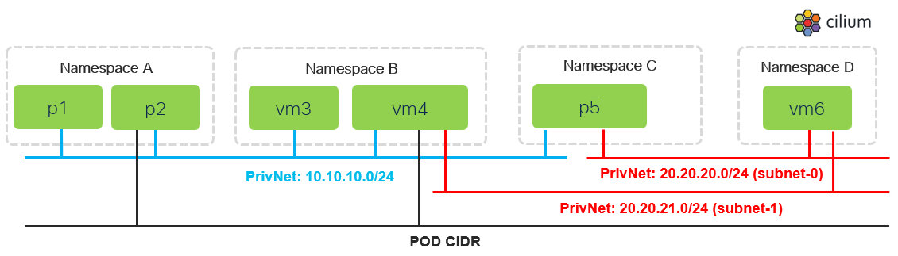

# Private Network - east-west connectivity test

[[Back]](./README.md) [[Next]](./red.md) [[Prev]](./namespace.md)



## Private Network "blue"

```shell
iserver set ocp cilium pnet --mode network --network blue --cidr4 10.10.10.0/24 --nad a --nad b --nad c
```

```yaml
apiVersion: isovalent.com/v1alpha1
kind: ClusterwidePrivateNetwork
metadata:
  name: blue
spec:
  networkAttachmentDefinitions:
    namespaceSelector:
      matchExpressions:
      - key: kubernetes.io/metadata.name
        operator: In
        values:
        - a
        - b
        - c
  subnets:
  - cidrv4: 10.10.10.0/24
    name: subnet-0
```

Notes:
- [ClusterwidePrivateNetwork](../kb/crd.md) defines private network that can be used as primary or secondary attachment for PODs and KubeVirt VMs
- in case of secondary interface attachment (Multus), **networkAttachmentDefinitions** must be added selecting the namespace for which NetworkAttachmentDefinition will be created

## Network Attachment Definition

NADs auto-created for selected namespace, network and subnet names combinations.

```
+----+-------------------------------+------------+-------------------------------------------------+-------+
| ID | Network Attachment Definition | Type       | Config                                          | Age   |
+----+-------------------------------+------------+-------------------------------------------------+-------+
| 1  | a                             | cilium-cni | {                                               | 2h49m | 
|    | blue-subnet-0                 |            |   "cniVersion": "0.3.1",                        |       | 
|    |                               |            |   "type": "cilium-cni",                         |       | 
|    |                               |            |   "enable-debug": false,                        |       | 
|    |                               |            |   "log-format": "text-ts",                      |       | 
|    |                               |            |   "log-file": "/var/run/cilium/cilium-cni.log", |       | 
|    |                               |            |   "private-networks": {                         |       | 
|    |                               |            |     "network": "blue",                          |       | 
|    |                               |            |     "subnet": "subnet-0"                        |       | 
|    |                               |            |   }                                             |       | 
|    |                               |            | }                                               |       | 
+----+-------------------------------+------------+-------------------------------------------------+-------+
| 2  | b                             | cilium-cni | {                                               | 2h49m | 
|    | blue-subnet-0                 |            |   "cniVersion": "0.3.1",                        |       | 
|    |                               |            |   "type": "cilium-cni",                         |       | 
|    |                               |            |   "enable-debug": false,                        |       | 
|    |                               |            |   "log-format": "text-ts",                      |       | 
|    |                               |            |   "log-file": "/var/run/cilium/cilium-cni.log", |       | 
|    |                               |            |   "private-networks": {                         |       | 
|    |                               |            |     "network": "blue",                          |       | 
|    |                               |            |     "subnet": "subnet-0"                        |       | 
|    |                               |            |   }                                             |       | 
|    |                               |            | }                                               |       | 
+----+-------------------------------+------------+-------------------------------------------------+-------+
| 3  | c                             | cilium-cni | {                                               | 2h49m | 
|    | blue-subnet-0                 |            |   "cniVersion": "0.3.1",                        |       | 
|    |                               |            |   "type": "cilium-cni",                         |       | 
|    |                               |            |   "enable-debug": false,                        |       | 
|    |                               |            |   "log-format": "text-ts",                      |       | 
|    |                               |            |   "log-file": "/var/run/cilium/cilium-cni.log", |       | 
|    |                               |            |   "private-networks": {                         |       | 
|    |                               |            |     "network": "blue",                          |       | 
|    |                               |            |     "subnet": "subnet-0"                        |       | 
|    |                               |            |   }                                             |       | 
|    |                               |            | }                                               |       | 
+----+-------------------------------+------------+-------------------------------------------------+-------+
```

## eBPF Map

[ClusterwidePrivateNetwork](../kb/crd.md) triggers network, subnet and route entries in [eBPF Map](../kb/map.md)

```
Cilium Agent Database
---------------------
- network  : 1
- subnet   : 1
- route    : 1
- inb      : 0
- endpoint : 0
- map      : 0


~~~~~~~~~~~~~~~~~~~~~~~~~~~~~~~~~
Cilium Agent DB: private-networks
~~~~~~~~~~~~~~~~~~~~~~~~~~~~~~~~~

+----+-----------------+-------+-----+--------------------------------+
| ID | Private Network | ID    | VNI | Subnet                         |
+----+-----------------+-------+-----+--------------------------------+
| 1  | blue            | 15476 | --- | [                              | 
|    |                 |       |     |   {                            | 
|    |                 |       |     |     "Name": "subnet-0",        | 
|    |                 |       |     |     "CIDRv4": "10.10.10.0/24", | 
|    |                 |       |     |     "CIDRv6": "",              | 
|    |                 |       |     |     "Routes": [],              | 
|    |                 |       |     |     "DHCP": {                  | 
|    |                 |       |     |       "mode": "none"           | 
|    |                 |       |     |     }                          | 
|    |                 |       |     |   }                            | 
|    |                 |       |     | ]                              | 
+----+-----------------+-------+-----+--------------------------------+

~~~~~~~~~~~~~~~~~~~~~~~~~~~~~~~~
Cilium Agent DB: privnet-subnets
~~~~~~~~~~~~~~~~~~~~~~~~~~~~~~~~

+----+-----------------+-----------------+------+---------------+--------+-----+-------+
| ID | Private Network | Subnet          | DHCP | CIDRv4        | CIDRv6 | VNI | Route |
+----+-----------------+-----------------+------+---------------+--------+-----+-------+
| 1  | blue [15476]    | subnet-0 [7581] | none | 10.10.10.0/24 |        | --- | []    | 
+----+-----------------+-----------------+------+---------------+--------+-----+-------+

~~~~~~~~~~~~~~~~~~~~~~~~~~~~~~~
Cilium Agent DB: privnet-routes
~~~~~~~~~~~~~~~~~~~~~~~~~~~~~~~

+----+-----------------+----------+---------------+---------+-------+-------------------+
| ID | Private Network | Subnet   | Destination   | Gateway | EVPN  | Peer              |
+----+-----------------+----------+---------------+---------+-------+-------------------+
| 1  | blue            | subnet-0 | 10.10.10.0/24 |         | False | {                 | 
|    |                 |          |               |         |       |   "Network": "",  | 
|    |                 |          |               |         |       |   "Subnet": "",   | 
|    |                 |          |               |         |       |   "ID": {         | 
|    |                 |          |               |         |       |     "Network": 0, | 
|    |                 |          |               |         |       |     "Subnet": 0   | 
|    |                 |          |               |         |       |   }               | 
|    |                 |          |               |         |       | }                 | 
+----+-----------------+----------+---------------+---------+-------+-------------------+
```

## Example

```
# iserver set ocp cilium pnet --mode network --network blue --cidr4 10.10.10.0/24 --nad a --nad b --nad c

OpenShift Workflow - Isovalent Private Network - Create
=======================================================

OpenShift Cluster: bm1
Cilium cni found


Isovalent Private Network State
-------------------------------
- enabled : ✓
- multus  : ✓
- webhook : ✗
- crds    : ✓
- ready   : ✓


Create Clusterwide Private Network
----------------------------------
- name: blue

~~~
apiVersion: isovalent.com/v1alpha1
kind: ClusterwidePrivateNetwork
metadata:
  name: blue
spec:
  networkAttachmentDefinitions:
    namespaceSelector:
      matchExpressions:
      - key: kubernetes.io/metadata.name
        operator: In
        values:
        - a
        - b
        - c
  subnets:
  - cidrv4: 10.10.10.0/24
    name: subnet-0
~~~

Network created

Wait for network...

+----+-----------------------------+----------+------+---------------+--------+-----+------------------+-----------------+
| ID | Clusterwide Private Network | Subnet   | DHCP | CIDRv4        | CIDRv6 | POD | Multus Namespace | NAD             |
+----+-----------------------------+----------+------+---------------+--------+-----+------------------+-----------------+
| 1  | blue                        | subnet-0 | none | 10.10.10.0/24 | --     | --- | a                | a/blue-subnet-0 | 
|    |                             |          |      |               |        |     | b                | b/blue-subnet-0 | 
|    |                             |          |      |               |        |     | c                | c/blue-subnet-0 | 
+----+-----------------------------+----------+------+---------------+--------+-----+------------------+-----------------+

+----+-------------------------------+------------+-------------------------------------------------+-------+
| ID | Network Attachment Definition | Type       | Config                                          | Age   |
+----+-------------------------------+------------+-------------------------------------------------+-------+
| 1  | a                             | cilium-cni | {                                               | 2h49m | 
|    | blue-subnet-0                 |            |   "cniVersion": "0.3.1",                        |       | 
|    |                               |            |   "type": "cilium-cni",                         |       | 
|    |                               |            |   "enable-debug": false,                        |       | 
|    |                               |            |   "log-format": "text-ts",                      |       | 
|    |                               |            |   "log-file": "/var/run/cilium/cilium-cni.log", |       | 
|    |                               |            |   "private-networks": {                         |       | 
|    |                               |            |     "network": "blue",                          |       | 
|    |                               |            |     "subnet": "subnet-0"                        |       | 
|    |                               |            |   }                                             |       | 
|    |                               |            | }                                               |       | 
+----+-------------------------------+------------+-------------------------------------------------+-------+
| 2  | b                             | cilium-cni | {                                               | 2h49m | 
|    | blue-subnet-0                 |            |   "cniVersion": "0.3.1",                        |       | 
|    |                               |            |   "type": "cilium-cni",                         |       | 
|    |                               |            |   "enable-debug": false,                        |       | 
|    |                               |            |   "log-format": "text-ts",                      |       | 
|    |                               |            |   "log-file": "/var/run/cilium/cilium-cni.log", |       | 
|    |                               |            |   "private-networks": {                         |       | 
|    |                               |            |     "network": "blue",                          |       | 
|    |                               |            |     "subnet": "subnet-0"                        |       | 
|    |                               |            |   }                                             |       | 
|    |                               |            | }                                               |       | 
+----+-------------------------------+------------+-------------------------------------------------+-------+
| 3  | c                             | cilium-cni | {                                               | 2h49m | 
|    | blue-subnet-0                 |            |   "cniVersion": "0.3.1",                        |       | 
|    |                               |            |   "type": "cilium-cni",                         |       | 
|    |                               |            |   "enable-debug": false,                        |       | 
|    |                               |            |   "log-format": "text-ts",                      |       | 
|    |                               |            |   "log-file": "/var/run/cilium/cilium-cni.log", |       | 
|    |                               |            |   "private-networks": {                         |       | 
|    |                               |            |     "network": "blue",                          |       | 
|    |                               |            |     "subnet": "subnet-0"                        |       | 
|    |                               |            |   }                                             |       | 
|    |                               |            | }                                               |       | 
+----+-------------------------------+------------+-------------------------------------------------+-------+

Completed tasks
- Private Network created

+----+---------+-------------+----------------+---------+---------+--------------+
| ID | Target  | Scope       | Workflow       | Changes | Success | Duration [s] |
+----+---------+-------------+----------------+---------+---------+--------------+
| 1  | ocp:bm1 | cilium-pnet | create network | 1       | ✓       | 20           | 
+----+---------+-------------+----------------+---------+---------+--------------+
```

[[Back]](./README.md) [[Next]](./red.md) [[Prev]](./namespace.md)