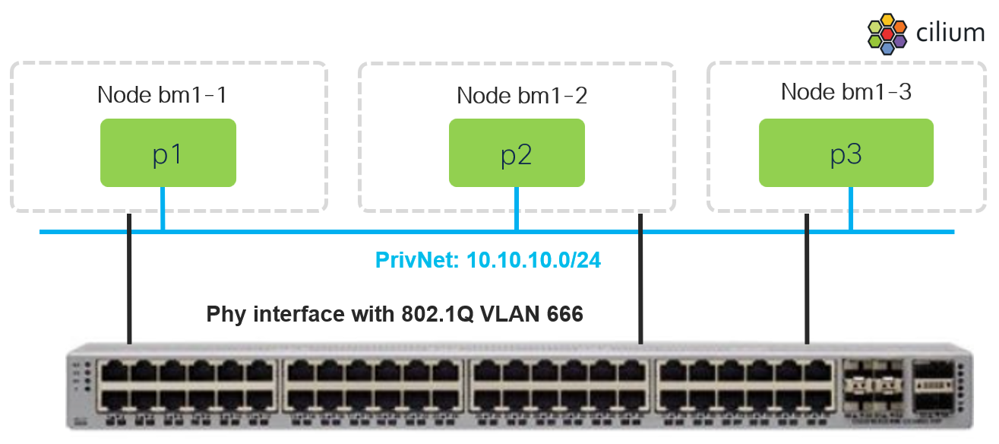

# Private Network - local access test setup

[[Back]](../README.md)

This guide covers how to configure and use Private Network (PrivNet) features in **local access** mode.

>[!NOTE]
>All communications to/from Private Networks is L3-routed

## Table of Contents

- [Enable Private Networks](./setup.md)
- [Create namespaces](./namespace.md)
- [Create privnet blue](./blue.md)
- [Define upstream phy interface](./device.md)
- [Prepare upstream device](./tor.md)
- [Deploy pods](./pod.md)
- [Test connectivity](./connecitivity.md)
- [Commands cheat sheet](./commands.md)

[[Back]](../README.md)