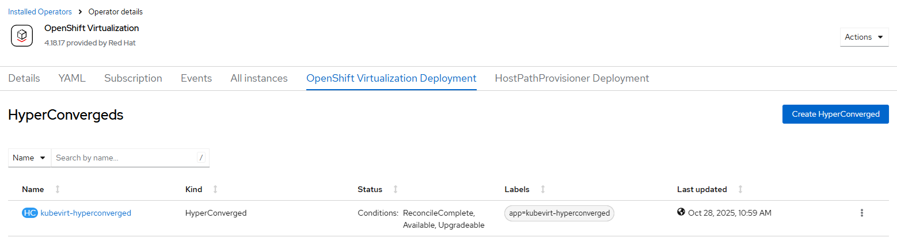

# Container Virtualization Operator - Create Instance

## Workflow

- create hyperconverged instance based on package reference or user-provided CRD
- wait for resources ready

## Requirements

- cnv operator must be [created](./create_operator.md)

## Expected outcome



## Configurable options

```
# iserver set ocp cnv --mode instance
  --cluster TEXT                  Cluster Name
  --filename TEXT                 HyperConverged CRD
  --no-confirm                    Confirmation mode
```

## Example

```
# iserver set ocp cnv --mode instance --cluster bm1 --no-confirm

OpenShift Workflow - Container Virtualization Operator - Create HyperConverged Instance
=======================================================================================

OpenShift Cluster: bm1

Operator
- subscription          : openshift-cnv/kubevirt-hyperconverged
- package               : openshift-marketplace/redhat-operators/kubevirt-hyperconverged
- channel               : stable
- install plan          : openshift-cnv/install-gvkg8
- install plan approved : V
- installed csv         : kubevirt-hyperconverged-operator.v4.21.3
- latest_csv            : V


Cnv operator ready

Create HyperConverged Instance
------------------------------

~~~
apiVersion: hco.kubevirt.io/v1beta1
kind: HyperConverged
metadata:
  annotations:
    deployOVS: 'false'
  name: kubevirt-hyperconverged
  namespace: openshift-cnv
spec: {}
~~~

HyperConverged instance created

Wait for hyperconverged instance and resources...
Wait for deployment openshift-cnv/cdi-apiserver ready (optional: False, allow zero replicas: False, timeout: 600s)...
Wait for deployment openshift-cnv/cdi-deployment ready (optional: False, allow zero replicas: False, timeout: 600s)...
Wait for deployment openshift-cnv/cdi-uploadproxy ready (optional: False, allow zero replicas: False, timeout: 600s)...
Wait for deployment openshift-cnv/kubemacpool-cert-manager ready (optional: False, allow zero replicas: False, timeout: 600s)...
Wait for deployment openshift-cnv/kubemacpool-mac-controller-manager ready (optional: False, allow zero replicas: False, timeout: 600s)...
Wait for deployment openshift-cnv/kubevirt-apiserver-proxy ready (optional: False, allow zero replicas: False, timeout: 600s)...
Wait for deployment openshift-cnv/kubevirt-console-plugin ready (optional: False, allow zero replicas: False, timeout: 600s)...
Wait for deployment openshift-cnv/kubevirt-ipam-controller-manager ready (optional: False, allow zero replicas: False, timeout: 600s)...
Wait for deployment openshift-cnv/virt-api ready (optional: False, allow zero replicas: False, timeout: 600s)...
Wait for deployment openshift-cnv/virt-controller ready (optional: False, allow zero replicas: False, timeout: 600s)...
Wait for deployment openshift-cnv/virt-exportproxy ready (optional: False, allow zero replicas: False, timeout: 600s)...
Wait for deployment openshift-cnv/virt-template-validator ready (optional: False, allow zero replicas: False, timeout: 600s)...
Wait for daemonset openshift-cnv/bridge-marker ready (optional: False, timeout: 600s)...
Wait for daemonset openshift-cnv/kube-cni-linux-bridge-plugin ready (optional: False, timeout: 600s)...
Wait for daemonset openshift-cnv/passt-binding-cni ready (optional: True, timeout: 600s)...
Success with optional condition
Wait for daemonset openshift-cnv/virt-handler ready (optional: False, timeout: 600s)...
Subscription cnv ready

Completed tasks
- HyperConverged instance created and ready

+----+---------+-------+-----------------+---------+---------+--------------+
| ID | Target  | Scope | Workflow        | Changes | Success | Duration [s] |
+----+---------+-------+-----------------+---------+---------+--------------+
| 1  | ocp:bm1 | cnv   | create instance | 1       | V       | 100          | 
+----+---------+-------+-----------------+---------+---------+--------------+
```

[[Back]](./README.md)