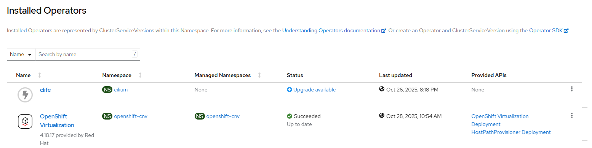

# Container Virtualization Operator - Create Operator

## Workflow

- create openshift-cnv namespace
- create operator group
- create subscription with user controlled channel or defaultChannelName
- wait for resources ready

## Requirements

None

## Expected outcome



## Configurable options

```
# iserver set ocp cnv --mode operator
  --cluster TEXT                  Cluster Name
  --channel TEXT                  Operator channel  [default: __default__]
  --no-confirm                    Confirmation mode
```

## Example

```
# iserver set ocp cnv --mode operator --cluster bm1 --no-confirm

OpenShift Workflow - Container Virtualization Operator - Create Operator
========================================================================

OpenShift Cluster: bm1
Subscription not found kubevirt-hyperconverged

Create Namespace
----------------
- name: openshift-cnv

~~~
apiVersion: v1
kind: Namespace
metadata:
  name: openshift-cnv
~~~
Namespace [openshift-cnv] created
Wait for namespace [timeout:60]...

Create OperatorGroup
--------------------
- namespace: openshift-cnv
- name: cnv-operator-group

~~~
apiVersion: operators.coreos.com/v1
kind: OperatorGroup
metadata:
  name: cnv-operator-group
  namespace: openshift-cnv
spec:
  targetNamespaces:
  - openshift-cnv
  upgradeStrategy: Default
~~~
OperatorGroup [openshift-cnv/cnv-operator-group] created
- wait for OperatorGroup openshift-cnv/cnv-operator-group [timeout:60s]

Create Subscription
-------------------
Subscription: openshift-cnv/kubevirt-hyperconverged
Source: openshift-marketplace/redhat-operators/kubevirt-hyperconverged
Install plan approval: Automatic
Getting subscription and packege manifest information...
Resolving channel name...
Channel: stable
- CSV [kubevirt-hyperconverged-operator.v4.21.3]
- CSV Display name [OpenShift Virtualization]
- CVS Version [4.21.3]
- CSV Provider [{'name': 'Red Hat'}]
- CSV Maturity [alpha]

~~~
apiVersion: operators.coreos.com/v1alpha1
kind: Subscription
metadata:
  name: kubevirt-hyperconverged
  namespace: openshift-cnv
spec:
  channel: stable
  installPlanApproval: Automatic
  name: kubevirt-hyperconverged
  source: redhat-operators
  sourceNamespace: openshift-marketplace
~~~

Subscription created

Wait for subscription install plan started [timeout:360]...
Install plan: install-gvkg8
Wait for subscription install plan ready [timeout:600]...
Install plan succeeded
Wait for deployment openshift-cnv/aaq-operator ready (optional: True, allow zero replicas: False, timeout: 600s)...
Wait for deployment openshift-cnv/cdi-operator ready (optional: True, allow zero replicas: False, timeout: 600s)...
Wait for deployment openshift-cnv/cluster-network-addons-operator ready (optional: True, allow zero replicas: False, timeout: 600s)...
Wait for deployment openshift-cnv/hco-operator ready (optional: True, allow zero replicas: False, timeout: 600s)...
Wait for deployment openshift-cnv/hco-webhook ready (optional: True, allow zero replicas: False, timeout: 600s)...
Wait for deployment openshift-cnv/hostpath-provisioner-operator ready (optional: True, allow zero replicas: False, timeout: 600s)...
Wait for deployment openshift-cnv/hyperconverged-cluster-cli-download ready (optional: True, allow zero replicas: False, timeout: 600s)...
Wait for deployment openshift-cnv/ssp-operator ready (optional: True, allow zero replicas: False, timeout: 600s)...
Wait for deployment openshift-cnv/virt-operator ready (optional: True, allow zero replicas: False, timeout: 600s)...

Operator
- subscription          : openshift-cnv/kubevirt-hyperconverged
- package               : openshift-marketplace/redhat-operators/kubevirt-hyperconverged
- channel               : stable
- install plan          : openshift-cnv/install-gvkg8
- install plan approved : V
- installed csv         : kubevirt-hyperconverged-operator.v4.21.3
- latest_csv            : V


Completed tasks
- Namespace created
- Operator Group created
- Subscription created

+----+---------+-------+-----------------+---------+---------+--------------+
| ID | Target  | Scope | Workflow        | Changes | Success | Duration [s] |
+----+---------+-------+-----------------+---------+---------+--------------+
| 1  | ocp:bm1 | cnv   | create operator | 3       | V       | 512          | 
+----+---------+-------+-----------------+---------+---------+--------------+
```

[[Back]](./README.md)