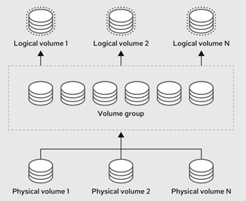

# Linux Disk and Logical Volume Manager (LVM)

[[Back]](../Operations.md) [[OpenShift: LVM]](../lvm/README.md)

>[!NOTE]
>These features work on Linux level **only** without any understanding of upper layer consumption like OpenShift LVM storage operator, pvc/pv, data volume, snapshot etc

 

Command | Intent | Details
--- | --- | ---
iserver get linux lsblk | get block devices | [Link](./lsblk.md)
iserver get linux lv | get lvm logical volumes | [Link](./lv.md)
iserver get linux vg | get lvm volume groups | [Link](./vg.md)
iserver get linux pv | get lvm physical volumes | [Link](./pv.md)
iserver get linux lvm | get logical volume manager overall state | [Link](./lvm.md)
iserver set linux disk --mode zap | zap block devices | [Link](./zap.md)
iserver delete linux lvm | remove lvm resources from disks | [Link](./delete_lvm.md)

## Linux server selection

The workflows above run on the selected Linux servers
- access details on-the-fly
- [Linux connector](../LinuxAccess.md)
- existing OpenShift cluster node(s) as long as [access is defined](../Access.md) e.g.,
    - `ocp:bm1` for all servers in OpenShift cluster with connector name bm1
    - `ocp:bm1:bm1-1` for node bm1-1 in OpenShift cluster with connector name bm1

[[Back]](../Operations.md) [[OpenShift: LVM]](../lvm/README.md)