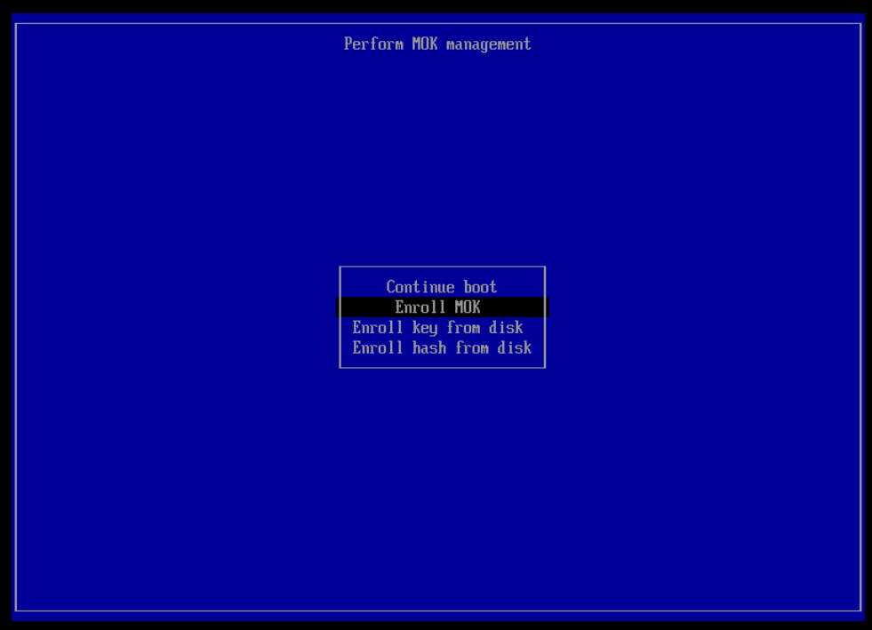

# RHEL9 Virtual Machine with NVIDIA GPU driver

Once the virtual machine is [created](./virtual-machine-rhel9.md) with GPU device in passthrough mode, it has [nouveau driver](https://nouveau.freedesktop.org/) which is the open-source driver for NVIDIA GPU. It has limited capabilities as compared to NVIDIA driver.

```
$ cat /etc/redhat-release
Red Hat Enterprise Linux release 9.7 (Plow)

$ uname -r
5.14.0-611.16.1.el9_7.x86_64

$ lspci -nn -k -d ::0302
09:00.0 3D controller [0302]: NVIDIA Corporation GA107GL [A2 / A16] [10de:25b6] (rev a1)
        Subsystem: NVIDIA Corporation Device [10de:14a9]
        Kernel driver in use: nouveau
        Kernel modules: nouveau
```

The goal of this guide is to show how to install NVIDIA driver inside the RHEL9 virtual machine

References
- [CUDA toolkit installation guide](https://docs.nvidia.com/cuda/cuda-installation-guide-linux/) 
- [NVIDIA driver installation guide](https://docs.nvidia.com/datacenter/tesla/driver-installation-guide/introduction.html)
- [FAQ](https://docs.nvidia.com/datacenter/tesla/driver-installation-guide/frequently-asked-questions.html)
- [RedHat case on CUDA/NVIDIA drivers with SecureBoot](https://access.redhat.com/solutions/7086735)
- [youtube video](https://www.youtube.com/watch?v=lud0C-K3ya0).

The main difference in the procedure compared to [RHEL8](./driver-rhel8.md) is due to SecureBoot enabled by default in RHEL9 that requires dkms certificate to be loaded.

## Command cheat sheet

```
$ sudo -E subscription-manager register
$ sudo -E yum -y install gcc kernel-devel-$(uname -r) kernel-headers-$(uname -r) freeglut mesa-libGLU
$ sudo -E subscription-manager repos --enable=rhel-9-for-x86_64-appstream-rpms --enable=rhel-9-for-x86_64-baseos-rpms --enable=codeready-builder-for-rhel-9-x86_64-rpms
$ sudo -E yum -y install https://dl.fedoraproject.org/pub/epel/epel-release-latest-9.noarch.rpm
$ sudo -E yum -y install https://developer.download.nvidia.com/compute/cuda/13.1.0/local_installers/cuda-repo-rhel9-13-1-local-13.1.0_590.44.01-1.x86_64.rpm
$ sudo mokutil --import /var/lib/dkms/mok.pub
$ sudo reboot + MOK enrollment procedure
$ sudo -E yum -y module install nvidia-driver:open-dkms
$ sudo -E yum -y install nvidia-open
$ sudo -E yum -y install cuda
```

Followed with system settings changes (check below for details).

## Expected outcome

```
$ lspci -nn -k -d ::0302
09:00.0 3D controller [0302]: NVIDIA Corporation GA107GL [A2 / A16] [10de:25b6] (rev a1)
        Subsystem: NVIDIA Corporation Device [10de:14a9]
        Kernel driver in use: nvidia
        Kernel modules: nvidia_drm, nvidia
```

## Register with Red Hat Subscription Management

Note: set http proxy if required

```
$ sudo -E subscription-manager register
Registering to: subscription.rhsm.redhat.com:443/subscription
Username: your-username-at-redhat
Password: your-password
The system has been registered with ID: system-uuid-generated-by-redhat
The registered system name is: your-vm-hostname
```

```
$ sudo -E subscription-manager status
+-------------------------------------------+
   System Status Details
+-------------------------------------------+
Overall Status: Registered
```

## Install 3rd party libraries

```
$ sudo -E yum -y install gcc kernel-devel-$(uname -r) kernel-headers-$(uname -r) freeglut mesa-libGLU
...
Installed:
  bison-3.7.4-5.el9.x86_64                  cpp-11.5.0-11.el9.x86_64                    elfutils-libelf-devel-0.193-1.el9.x86_64  flex-2.6.4-9.el9.x86_64
  freeglut-3.2.1-10.el9.x86_64              gcc-11.5.0-11.el9.x86_64                    glibc-devel-2.34-231.el9_7.2.x86_64       glibc-headers-2.34-231.el9_7.2.x86_64
  kernel-devel-5.14.0-611.5.1.el9_7.x86_64  kernel-headers-5.14.0-611.5.1.el9_7.x86_64  libX11-1.7.0-11.el9.x86_64                libX11-common-1.7.0-11.el9.noarch
  libX11-xcb-1.7.0-11.el9.x86_64            libXau-1.0.9-8.el9.x86_64                   libXext-1.3.4-8.el9.x86_64                libXi-1.7.10-8.el9.x86_64
  libXxf86vm-1.1.4-18.el9.x86_64            libdrm-2.4.123-2.el9.x86_64                 libglvnd-1:1.3.4-1.el9.x86_64             libglvnd-glx-1:1.3.4-1.el9.x86_64
  libmpc-1.2.1-4.el9.x86_64                 libpciaccess-0.16-7.el9.x86_64              libpkgconf-1.7.3-10.el9.x86_64            libwayland-server-1.21.0-1.el9.x86_64
  libxcb-1.13.1-9.el9.x86_64                libxcrypt-devel-4.4.18-3.el9.x86_64         libxshmfence-1.3-10.el9.x86_64            libzstd-devel-1.5.5-1.el9.x86_64
  llvm-filesystem-20.1.8-3.el9.x86_64       llvm-libs-20.1.8-3.el9.x86_64               m4-1.4.19-1.el9.x86_64                    make-1:4.3-8.el9.x86_64
  mesa-dri-drivers-25.0.7-3.el9_7.x86_64    mesa-filesystem-25.0.7-3.el9_7.x86_64       mesa-libGL-25.0.7-3.el9_7.x86_64          mesa-libGLU-9.0.1-6.el9.x86_64
  mesa-libgbm-25.0.7-3.el9_7.x86_64         openssl-devel-1:3.5.1-3.el9.x86_64          pkgconf-1.7.3-10.el9.x86_64               pkgconf-m4-1.7.3-10.el9.noarch
  pkgconf-pkg-config-1.7.3-10.el9.x86_64    spirv-tools-libs-2025.2-1.el9.x86_64        zlib-devel-1.2.11-40.el9.x86_64

Complete!
```

## Enable optional repositories

```
$ sudo -E subscription-manager repos --enable=rhel-9-for-x86_64-appstream-rpms --enable=rhel-9-for-x86_64-baseos-rpms --enable=codeready-builder-for-rhel-9-x86_64-rpms
Repository 'rhel-9-for-x86_64-appstream-rpms' is enabled for this system.
Repository 'rhel-9-for-x86_64-baseos-rpms' is enabled for this system.
Repository 'codeready-builder-for-rhel-9-x86_64-rpms' is enabled for this system.
```

## Install packages from EPEL repositories

Note: based on youtube video

```
$ sudo -E yum -y install https://dl.fedoraproject.org/pub/epel/epel-release-latest-9.noarch.rpm
Updating Subscription Management repositories.

...

Installed:
  epel-release-9-10.el9.noarch

Complete!
```

## Install CUDA toolkit repository package

Installation instructions based on [cuda-downloads](https://developer.nvidia.com/cuda-downloads) and depend on operating system, architecture, distribution and version.

Example below is for Cuda 13.1, x86_64 architecture, RHEL9, rpm local.

```
$ sudo -E yum -y install https://developer.download.nvidia.com/compute/cuda/13.1.0/local_installers/cuda-repo-rhel9-13-1-local-13.1.0_590.44.01-1.x86_64.rpm

...

Installed:
  cuda-repo-rhel9-13-1-local-13.1.0_590.44.01-1.x86_64
```

Notes: 
- it may take a while depending on download speed as the rpm package is 4.6GB
- the downloaded package is a repository package that informs the package manager where to find the actual installation packages, but will not install them.

## MOK Enrollment

In the next step the driver will be compiled and installed e.g.,

```
Sign command: /lib/modules/5.14.0-611.16.1.el9_7.x86_64/build/scripts/sign-file
Signing key: /var/lib/dkms/mok.key
Public certificate (MOK): /var/lib/dkms/mok.pub

Autoinstall of module nvidia/590.44.01 for kernel 5.14.0-611.16.1.el9_7.x86_64 (x86_64)
Building module(s)....................................................................................................................................................done.
Signing module /var/lib/dkms/nvidia/590.44.01/build/kernel-open/nvidia.ko
Signing module /var/lib/dkms/nvidia/590.44.01/build/kernel-open/nvidia-modeset.ko
Signing module /var/lib/dkms/nvidia/590.44.01/build/kernel-open/nvidia-drm.ko
Signing module /var/lib/dkms/nvidia/590.44.01/build/kernel-open/nvidia-uvm.ko
Signing module /var/lib/dkms/nvidia/590.44.01/build/kernel-open/nvidia-peermem.ko
Installing /lib/modules/5.14.0-611.16.1.el9_7.x86_64/extra/nvidia.ko.xz
Installing /lib/modules/5.14.0-611.16.1.el9_7.x86_64/extra/nvidia-modeset.ko.xz
Installing /lib/modules/5.14.0-611.16.1.el9_7.x86_64/extra/nvidia-drm.ko.xz
Installing /lib/modules/5.14.0-611.16.1.el9_7.x86_64/extra/nvidia-uvm.ko.xz
Installing /lib/modules/5.14.0-611.16.1.el9_7.x86_64/extra/nvidia-peermem.ko.xz
Running depmod.... done.
```

The driver is signed with the MOK certificate located at /var/lib/dkms/mok.pub. Since RHEL9 boots with SecureBoot enabled by default, unless dkms certificate is enrolled, drivers fail to load.

The certificate enrollment procedure is as follows.

```
$ sudo mokutil --import /var/lib/dkms/mok.pub
input password:
input password again:
$ sudo mokutil --list-new | grep Issuer
        Issuer: CN=DKMS module signing key
```

Open virtual machine console with Console UI. You must do that before reboot so you will have a chance to interrupt the boot procedure and start MOK enrollment process

```
$ sudo reboot
```

Press space as soon as you see blue screen for MOK enrollment process



Follow the steps in the UI, enter the same password that was defined in mokutil import step and finally reboot.

As the result, the NVIDIA driver is trusted

```
$ sudo mokutil --list-enrolled | grep Issuer
        Issuer: O=Red Hat, Inc., CN=Red Hat Secure Boot CA 5/emailAddress=secalert@redhat.com
        Issuer: CN=Red Hat Secure Boot CA 8/emailAddress=secalert@redhat.com
        Issuer: CN=DKMS module signing key
```

Note: some docs refer also to [NVIDIA certificate](https://developer.download.nvidia.com/compute/cuda/repos/rhel9/x86_64/NVIDIA2019-public_key.der) enrollment procedure, however I do not think it is required. Just in case though

```
$ curl -O https://developer.download.nvidia.com/compute/cuda/repos/rhel9/x86_64/NVIDIA2019-public_key.der
$ sudo mokutil --import /home/cloud-user/NVIDIA2019-public_key.der
input password:
input password again:
$ sudo mokutil --list-new | grep Issuer
        Issuer: O=NVIDIA, CN=NVIDIA/emailAddress=sw-cuda-installer@nvidia.com
```

Reboot and as before go via MOK enrollment via web console UI. As the result, the NVIDIA driver is trusted too

```
$ sudo mokutil --list-enrolled | grep Issuer
        Issuer: O=Red Hat, Inc., CN=Red Hat Secure Boot CA 5/emailAddress=secalert@redhat.com
        Issuer: CN=Red Hat Secure Boot CA 8/emailAddress=secalert@redhat.com
        Issuer: O=NVIDIA, CN=NVIDIA/emailAddress=sw-cuda-installer@nvidia.com
        Issuer: CN=DKMS module signing key
```

## Driver installation

Options
- open kernel module with nvidia-driver:open-dkms
- proprietary kernel module with nvida-driver:latest-dkms

### Which option to choose

The choice between the open vs. proprietary is based on the GPU hardware. I could not find explicit guideline other than rule-of-the-thumb rule that older GPUs may need proprietary kernel module while newer hardware expects open one.

No error is raised depending for hw-to-driver-option compatibility when module is installed. You can learn the hard way in the next step when installing cuda e.g.,

```
$ sudo -E yum -y install cuda
Error:
 Problem: package cuda-13.1.0-1.x86_64 from cuda-rhel9-13-1-local requires nvidia-open >= 590.44.01, but none of the providers can be installed
  - conflicting requests
  - package nvidia-open-3:590.44.01-1.el9.noarch from cuda-rhel9-13-1-local is filtered out by modular filtering
(try to add '--skip-broken' to skip uninstallable packages or '--nobest' to use not only best candidate packages)
```

In case of mismatch, uninstall driver first following the [documentation](https://docs.nvidia.com/datacenter/tesla/driver-installation-guide/removing-the-driver.html) or refer to outputs below for RHEL9.

### Install open

Module enablement

```
$ sudo -E yum -y module install nvidia-driver:open-dkms

...

Sign command: /lib/modules/5.14.0-611.16.1.el9_7.x86_64/build/scripts/sign-file
Signing key: /var/lib/dkms/mok.key
Public certificate (MOK): /var/lib/dkms/mok.pub

Autoinstall of module nvidia/590.44.01 for kernel 5.14.0-611.16.1.el9_7.x86_64 (x86_64)
Building module(s)....................................................................................................................................................done.
Signing module /var/lib/dkms/nvidia/590.44.01/build/kernel-open/nvidia.ko
Signing module /var/lib/dkms/nvidia/590.44.01/build/kernel-open/nvidia-modeset.ko
Signing module /var/lib/dkms/nvidia/590.44.01/build/kernel-open/nvidia-drm.ko
Signing module /var/lib/dkms/nvidia/590.44.01/build/kernel-open/nvidia-uvm.ko
Signing module /var/lib/dkms/nvidia/590.44.01/build/kernel-open/nvidia-peermem.ko
Installing /lib/modules/5.14.0-611.16.1.el9_7.x86_64/extra/nvidia.ko.xz
Installing /lib/modules/5.14.0-611.16.1.el9_7.x86_64/extra/nvidia-modeset.ko.xz
Installing /lib/modules/5.14.0-611.16.1.el9_7.x86_64/extra/nvidia-drm.ko.xz
Installing /lib/modules/5.14.0-611.16.1.el9_7.x86_64/extra/nvidia-uvm.ko.xz
Installing /lib/modules/5.14.0-611.16.1.el9_7.x86_64/extra/nvidia-peermem.ko.xz
Running depmod.... done.

...

Installed:
  ModemManager-glib-1.20.2-1.el9.x86_64                   adwaita-cursor-theme-40.1.1-3.el9.noarch                     adwaita-icon-theme-40.1.1-3.el9.noarch
  alsa-lib-1.2.14-1.el9.x86_64                            at-spi2-atk-2.38.0-4.el9.x86_64                              at-spi2-core-2.40.3-1.el9.x86_64
  atk-2.36.0-5.el9.x86_64                                 avahi-glib-0.8-23.el9.x86_64                                 bluez-libs-5.83-2.el9.x86_64
  bubblewrap-0.6.3-1.el9.x86_64                           cairo-1.17.4-7.el9.x86_64                                    cairo-gobject-1.17.4-7.el9.x86_64
  colord-libs-1.4.5-6.el9_6.x86_64                        composefs-libs-1.0.8-1.el9.x86_64                            cups-libs-1:2.3.3op2-34.el9_7.x86_64
  dconf-0.40.0-6.el9.x86_64                               dejavu-sans-fonts-2.37-18.el9.noarch                         dkms-3.3.0-1.el9.noarch
  ed-1.14.2-12.el9.x86_64                                 egl-gbm-2:1.1.2.1-1.el9.x86_64                               egl-wayland-1.1.20-1.el9.x86_64
  egl-x11-1.0.3-1.el9.x86_64                              exempi-2.6.0-0.2.20211007gite23c213.el9.x86_64               exiv2-0.27.5-2.el9.x86_64
  exiv2-libs-0.27.5-2.el9.x86_64                          fdk-aac-free-2.0.0-8.el9.x86_64                              flac-libs-1.3.3-10.el9_2.1.x86_64
  flatpak-1.12.9-4.el9_6.x86_64                           flatpak-selinux-1.12.9-4.el9_6.noarch                        flatpak-session-helper-1.12.9-4.el9_6.x86_64
  fontconfig-2.14.0-2.el9_1.x86_64                        freetype-2.10.4-10.el9_5.x86_64                              fribidi-1.0.10-6.el9.2.x86_64
  fuse-2.9.9-17.el9.x86_64                                fuse-common-3.10.2-9.el9.x86_64                              gcc-c++-11.5.0-11.el9.x86_64
  gdk-pixbuf2-modules-2.42.6-6.el9_6.x86_64               geoclue2-2.6.0-8.el9_6.1.x86_64                              giflib-5.2.1-9.el9.x86_64
  graphene-1.10.6-2.el9.x86_64                            graphite2-1.3.14-9.el9.x86_64                                gsm-1.0.19-6.el9.x86_64
  gstreamer1-1.22.12-3.el9.x86_64                         gstreamer1-plugins-base-1.22.12-4.el9.x86_64                 gtk-update-icon-cache-3.24.31-8.el9.x86_64
  gtk3-3.24.31-8.el9.x86_64                               harfbuzz-2.7.4-10.el9.x86_64                                 hicolor-icon-theme-0.17-13.el9.noarch
  info-6.7-15.el9.x86_64                                  iso-codes-4.6.0-3.el9.noarch                                 jbigkit-libs-2.1-23.el9.x86_64
  kernel-devel-matched-5.14.0-611.16.1.el9_7.x86_64       kmod-nvidia-open-dkms-3:590.44.01-1.el9.noarch               langpacks-core-font-en-3.0-16.el9.noarch
  lcms2-2.12-3.el9.x86_64                                 libX11-devel-1.7.0-11.el9.x86_64                             libXau-devel-1.0.9-8.el9.x86_64
  libXcomposite-0.4.5-7.el9.x86_64                        libXcursor-1.2.0-7.el9.x86_64                                libXdamage-1.1.5-7.el9.x86_64
  libXdmcp-1.1.3-8.el9.x86_64                             libXfixes-5.0.3-16.el9.x86_64                                libXfont2-2.0.3-12.el9.x86_64
  libXft-2.3.3-8.el9.x86_64                               libXinerama-1.1.4-10.el9.x86_64                              libXrandr-1.5.2-8.el9.x86_64
  libXrender-0.9.10-16.el9.x86_64                         libXtst-1.2.3-16.el9.x86_64                                  libXv-1.0.11-16.el9.x86_64
  libasyncns-0.8-22.el9.x86_64                            libcanberra-0.30-27.el9.x86_64                               libcanberra-gtk3-0.30-27.el9.x86_64
  libdatrie-0.2.13-4.el9.x86_64                           libepoxy-1.5.5-4.el9.x86_64                                  libevdev-1.11.0-3.el9.x86_64
  libexif-0.6.22-6.el9.x86_64                             libfontenc-1.1.3-17.el9.x86_64                               libgexiv2-0.14.3-1.el9.x86_64
  libglvnd-gles-1:1.3.4-1.el9.x86_64                      libglvnd-opengl-1:1.3.4-1.el9.x86_64                         libgsf-1.14.47-5.el9.x86_64
  libgxps-0.3.2-3.el9.x86_64                              libinput-1.19.3-7.el9_6.x86_64                               libiptcdata-1.0.5-10.el9.x86_64
  libldac-2.0.2.3-10.el9.x86_64                           libnotify-0.7.9-8.el9.x86_64                                 libnvidia-cfg-3:590.44.01-1.el9.x86_64
  libnvidia-fbc-3:590.44.01-1.el9.x86_64                  libnvidia-gpucomp-3:590.44.01-1.el9.x86_64                   libnvidia-ml-3:590.44.01-1.el9.x86_64
  libogg-2:1.3.4-6.el9.x86_64                             libosinfo-1.10.0-1.el9.x86_64                                librsvg2-2.50.7-3.el9.x86_64
  libsbc-1.4-9.el9.x86_64                                 libsndfile-1.0.31-9.el9.x86_64                               libstdc++-devel-11.5.0-11.el9.x86_64
  libthai-0.1.28-8.el9.x86_64                             libtheora-1:1.1.1-31.el9.x86_64                              libtiff-4.4.0-15.el9_7.2.x86_64
  libtracker-sparql-3.1.2-3.el9_1.x86_64                  libvdpau-1.5-1.el9.x86_64                                    libvorbis-1:1.3.7-5.el9.x86_64
  libwacom-1.12.1-6.el9_7.x86_64                          libwacom-data-1.12.1-6.el9_7.noarch                          libwayland-cursor-1.21.0-1.el9.x86_64
  libwayland-egl-1.21.0-1.el9.x86_64                      libwebp-1.2.0-8.el9_3.x86_64                                 libxcb-devel-1.13.1-9.el9.x86_64
  libxkbcommon-1.0.3-4.el9.x86_64                         libxkbfile-1.1.0-8.el9.x86_64                                libxslt-1.1.34-13.el9_6.x86_64
  low-memory-monitor-2.1-4.el9.x86_64                     mesa-vulkan-drivers-25.0.7-3.el9_7.x86_64                    mtdev-1.1.5-22.el9.x86_64
  nspr-4.36.0-4.el9_4.x86_64                              nss-3.112.0-4.el9_4.x86_64                                   nss-softokn-3.112.0-4.el9_4.x86_64
  nss-softokn-freebl-3.112.0-4.el9_4.x86_64               nss-sysinit-3.112.0-4.el9_4.x86_64                           nss-util-3.112.0-4.el9_4.x86_64
  nvidia-driver-3:590.44.01-1.el9.x86_64                  nvidia-driver-cuda-3:590.44.01-1.el9.x86_64                  nvidia-driver-cuda-libs-3:590.44.01-1.el9.x86_64
  nvidia-driver-libs-3:590.44.01-1.el9.x86_64             nvidia-kmod-common-3:590.44.01-1.el9.noarch                  nvidia-libXNVCtrl-3:590.44.01-1.el9.x86_64
  nvidia-libXNVCtrl-devel-3:590.44.01-1.el9.x86_64        nvidia-modprobe-3:590.44.01-1.el9.x86_64                     nvidia-persistenced-3:590.44.01-1.el9.x86_64
  nvidia-settings-3:590.44.01-1.el9.x86_64                nvidia-xconfig-3:590.44.01-1.el9.x86_64                      ocl-icd-2.2.13-4.el9.x86_64
  opencl-filesystem-1.0-15.el9.noarch                     openjpeg2-2.4.0-8.el9.x86_64                                 opus-1.3.1-10.el9.x86_64
  orc-0.4.31-8.el9.x86_64                                 osinfo-db-20250606-1.el9.noarch                              osinfo-db-tools-1.10.0-1.el9.x86_64
  ostree-libs-2025.6-1.el9_7.x86_64                       p11-kit-server-0.25.3-3.el9.x86_64                           pango-1.48.7-3.el9.x86_64
  patch-2.7.6-16.el9.x86_64                               pipewire-1.0.1-1.el9.x86_64                                  pipewire-alsa-1.0.1-1.el9.x86_64
  pipewire-jack-audio-connection-kit-1.0.1-1.el9.x86_64   pipewire-jack-audio-connection-kit-libs-1.0.1-1.el9.x86_64   pipewire-libs-1.0.1-1.el9.x86_64
  pipewire-pulseaudio-1.0.1-1.el9.x86_64                  pixman-0.40.0-6.el9_3.x86_64                                 poppler-21.01.0-21.el9.x86_64
  poppler-data-0.4.9-9.el9.noarch                         poppler-glib-21.01.0-21.el9.x86_64                           pulseaudio-libs-15.0-3.el9.x86_64
  rtkit-0.11-29.el9.x86_64                                sound-theme-freedesktop-0.8-17.el9.noarch                    totem-pl-parser-3.26.6-2.el9.x86_64
  tracker-3.1.2-3.el9_1.x86_64                            tracker-miners-3.1.2-4.el9_3.x86_64                          upower-0.99.13-2.el9.x86_64
  vulkan-loader-1.4.313.0-1.el9.x86_64                    webrtc-audio-processing-0.3.1-8.el9.x86_64                   wireplumber-0.4.14-1.el9.x86_64
  wireplumber-libs-0.4.14-1.el9.x86_64                    xdg-dbus-proxy-0.1.3-1.el9.x86_64                            xdg-desktop-portal-1.12.6-1.el9.x86_64
  xdg-desktop-portal-gtk-1.12.0-3.el9.x86_64              xkbcomp-1.4.4-4.el9.x86_64                                   xkeyboard-config-2.33-2.el9.noarch
  xml-common-0.6.3-58.el9.noarch                          xorg-x11-drv-libinput-1.0.1-4.el9_6.x86_64                   xorg-x11-nvidia-3:590.44.01-1.el9.x86_64
  xorg-x11-proto-devel-2024.1-1.el9.noarch                xorg-x11-server-Xorg-1.20.11-32.el9_7.x86_64                 xorg-x11-server-common-1.20.11-32.el9_7.x86_64
```

Driver installation

```
$ sudo -E yum -y install nvidia-open

...

Installed:
  nvidia-open-3:590.44.01-1.el9.noarch
```

```
$ modinfo nvidia
filename:       /lib/modules/5.14.0-611.16.1.el9_7.x86_64/extra/nvidia.ko.xz
import_ns:      DMA_BUF
alias:          char-major-195-*
version:        590.44.01
supported:      external
license:        Dual MIT/GPL
firmware:       nvidia/590.44.01/gsp_tu10x.bin
firmware:       nvidia/590.44.01/gsp_ga10x.bin
rhelversion:    9.7
srcversion:     5E16B1FC70F7A43C0111BFE
alias:          of:N*T*Cnvidia,tegra264-displayC*
alias:          of:N*T*Cnvidia,tegra264-display
alias:          of:N*T*Cnvidia,tegra234-displayC*
alias:          of:N*T*Cnvidia,tegra234-display
alias:          pci:v000010DEd*sv*sd*bc06sc80i00*
alias:          pci:v000010DEd*sv*sd*bc03sc02i00*
alias:          pci:v000010DEd*sv*sd*bc03sc00i00*
depends:        drm
retpoline:      Y
name:           nvidia
vermagic:       5.14.0-611.16.1.el9_7.x86_64 SMP preempt mod_unload modversions
sig_id:         PKCS#7
signer:         DKMS module signing key
sig_key:        1F:E9:2C:30:AD:05:D8:FB:BA:A2:9E:7F:C5:29:50:E4:BE:74:8D:A7
sig_hashalgo:   sha512
signature:      26:12:29:0A:86:2B:0A:93:90:B9:D5:F7:E5:07:A2:F4:09:70:85:28:
                43:FB:B5:2F:AC:2A:55:42:B0:25:F6:F4:5A:59:73:41:1E:79:2F:DF:
                81:5E:F5:F5:B5:68:6F:C6:5E:D9:3D:68:64:E8:26:55:37:B3:94:A8:
                FC:12:DB:7F:BC:75:B2:C2:15:3E:2E:8A:3E:19:6B:63:01:14:73:A5:
                9A:03:BD:95:76:81:24:91:9B:19:29:16:02:77:30:A2:93:68:0F:1E:
                83:E5:D6:AA:50:AF:70:62:13:76:30:4F:62:9E:04:08:67:78:C0:13:
                B7:7D:67:0E:FD:11:92:AD:F8:F4:1A:5E:60:7A:C4:02:EE:C3:04:5B:
                C9:D3:6C:09:6A:FA:AB:C8:5B:6C:CC:8E:00:9C:5B:F8:F2:62:57:DD:
                94:9F:74:A4:A4:05:F4:F3:47:6E:02:4F:56:A4:11:D0:CF:D8:06:1E:
                BC:6E:21:01:61:45:F0:DF:36:82:72:42:7E:4E:91:C4:6E:59:D5:CE:
                3B:2E:6D:BF:09:D6:85:86:27:37:89:B2:40:23:1B:77:30:4A:92:89:
                7E:E0:02:3B:8F:4F:F1:C2:64:28:1D:66:8E:5E:E0:88:B8:D4:1D:99:
                7D:DE:14:E8:E3:03:89:1C:A3:6D:DE:FC:54:D6:9C:48
```

### Install proprietary

Module enablement

```
$ sudo -E yum -y module install nvidia-driver:latest-dkms

...

Installed:
  ModemManager-glib-1.20.2-1.el9.x86_64              adwaita-cursor-theme-40.1.1-3.el9.noarch                adwaita-icon-theme-40.1.1-3.el9.noarch
  alsa-lib-1.2.14-1.el9.x86_64                       at-spi2-atk-2.38.0-4.el9.x86_64                         at-spi2-core-2.40.3-1.el9.x86_64
  atk-2.36.0-5.el9.x86_64                            avahi-glib-0.8-23.el9.x86_64                            bluez-libs-5.83-2.el9.x86_64
  bubblewrap-0.6.3-1.el9.x86_64                      cairo-1.17.4-7.el9.x86_64                               cairo-gobject-1.17.4-7.el9.x86_64
  colord-libs-1.4.5-6.el9_6.x86_64                   composefs-libs-1.0.8-1.el9.x86_64                       cups-libs-1:2.3.3op2-34.el9_7.x86_64
  dconf-0.40.0-6.el9.x86_64                          dejavu-sans-fonts-2.37-18.el9.noarch                    dkms-3.3.0-1.el9.noarch
  ed-1.14.2-12.el9.x86_64                            egl-gbm-2:1.1.2.1-1.el9.x86_64                          egl-wayland-1.1.20-1.el9.x86_64
  egl-x11-1.0.3-1.el9.x86_64                         exempi-2.6.0-0.2.20211007gite23c213.el9.x86_64          exiv2-0.27.5-2.el9.x86_64
  exiv2-libs-0.27.5-2.el9.x86_64                     fdk-aac-free-2.0.0-8.el9.x86_64                         flac-libs-1.3.3-10.el9_2.1.x86_64
  flatpak-1.12.9-4.el9_6.x86_64                      flatpak-selinux-1.12.9-4.el9_6.noarch                   flatpak-session-helper-1.12.9-4.el9_6.x86_64
  fontconfig-2.14.0-2.el9_1.x86_64                   freetype-2.10.4-10.el9_5.x86_64                         fribidi-1.0.10-6.el9.2.x86_64
  fuse-2.9.9-17.el9.x86_64                           fuse-common-3.10.2-9.el9.x86_64                         gdk-pixbuf2-modules-2.42.6-6.el9_6.x86_64
  geoclue2-2.6.0-8.el9_6.1.x86_64                    giflib-5.2.1-9.el9.x86_64                               graphene-1.10.6-2.el9.x86_64
  graphite2-1.3.14-9.el9.x86_64                      gsm-1.0.19-6.el9.x86_64                                 gstreamer1-1.22.12-3.el9.x86_64
  gstreamer1-plugins-base-1.22.12-4.el9.x86_64       gtk-update-icon-cache-3.24.31-8.el9.x86_64              gtk3-3.24.31-8.el9.x86_64
  harfbuzz-2.7.4-10.el9.x86_64                       hicolor-icon-theme-0.17-13.el9.noarch                   info-6.7-15.el9.x86_64
  iso-codes-4.6.0-3.el9.noarch                       jbigkit-libs-2.1-23.el9.x86_64                          kernel-core-5.14.0-611.16.1.el9_7.x86_64
  kernel-devel-5.14.0-611.16.1.el9_7.x86_64          kernel-devel-matched-5.14.0-611.16.1.el9_7.x86_64       kernel-modules-core-5.14.0-611.16.1.el9_7.x86_64
  kmod-nvidia-latest-dkms-3:590.44.01-1.el9.x86_64   langpacks-core-font-en-3.0-16.el9.noarch                lcms2-2.12-3.el9.x86_64
  libX11-devel-1.7.0-11.el9.x86_64                   libXau-devel-1.0.9-8.el9.x86_64                         libXcomposite-0.4.5-7.el9.x86_64
  libXcursor-1.2.0-7.el9.x86_64                      libXdamage-1.1.5-7.el9.x86_64                           libXdmcp-1.1.3-8.el9.x86_64
  libXfixes-5.0.3-16.el9.x86_64                      libXfont2-2.0.3-12.el9.x86_64                           libXft-2.3.3-8.el9.x86_64
  libXinerama-1.1.4-10.el9.x86_64                    libXrandr-1.5.2-8.el9.x86_64                            libXrender-0.9.10-16.el9.x86_64
  libXtst-1.2.3-16.el9.x86_64                        libXv-1.0.11-16.el9.x86_64                              libasyncns-0.8-22.el9.x86_64
  libcanberra-0.30-27.el9.x86_64                     libcanberra-gtk3-0.30-27.el9.x86_64                     libdatrie-0.2.13-4.el9.x86_64
  libepoxy-1.5.5-4.el9.x86_64                        libevdev-1.11.0-3.el9.x86_64                            libexif-0.6.22-6.el9.x86_64
  libfontenc-1.1.3-17.el9.x86_64                     libgexiv2-0.14.3-1.el9.x86_64                           libglvnd-egl-1:1.3.4-1.el9.x86_64
  libglvnd-gles-1:1.3.4-1.el9.x86_64                 libglvnd-opengl-1:1.3.4-1.el9.x86_64                    libgsf-1.14.47-5.el9.x86_64
  libgxps-0.3.2-3.el9.x86_64                         libinput-1.19.3-7.el9_6.x86_64                          libiptcdata-1.0.5-10.el9.x86_64
  libldac-2.0.2.3-10.el9.x86_64                      libnotify-0.7.9-8.el9.x86_64                            libnvidia-cfg-3:590.44.01-1.el9.x86_64
  libnvidia-fbc-3:590.44.01-1.el9.x86_64             libnvidia-gpucomp-3:590.44.01-1.el9.x86_64              libnvidia-ml-3:590.44.01-1.el9.x86_64
  libogg-2:1.3.4-6.el9.x86_64                        libosinfo-1.10.0-1.el9.x86_64                           librsvg2-2.50.7-3.el9.x86_64
  libsbc-1.4-9.el9.x86_64                            libsndfile-1.0.31-9.el9.x86_64                          libthai-0.1.28-8.el9.x86_64
  libtheora-1:1.1.1-31.el9.x86_64                    libtiff-4.4.0-15.el9_7.2.x86_64                         libtracker-sparql-3.1.2-3.el9_1.x86_64
  libvdpau-1.5-1.el9.x86_64                          libvorbis-1:1.3.7-5.el9.x86_64                          libwacom-1.12.1-6.el9_7.x86_64
  libwacom-data-1.12.1-6.el9_7.noarch                libwayland-client-1.21.0-1.el9.x86_64                   libwayland-cursor-1.21.0-1.el9.x86_64
  libwayland-egl-1.21.0-1.el9.x86_64                 libwebp-1.2.0-8.el9_3.x86_64                            libxcb-devel-1.13.1-9.el9.x86_64
  libxkbcommon-1.0.3-4.el9.x86_64                    libxkbfile-1.1.0-8.el9.x86_64                           libxslt-1.1.34-13.el9_6.x86_64
  low-memory-monitor-2.1-4.el9.x86_64                mesa-libEGL-25.0.7-3.el9_7.x86_64                       mesa-vulkan-drivers-25.0.7-3.el9_7.x86_64
  mtdev-1.1.5-22.el9.x86_64                          nspr-4.36.0-4.el9_4.x86_64                              nss-3.112.0-4.el9_4.x86_64
  nss-softokn-3.112.0-4.el9_4.x86_64                 nss-softokn-freebl-3.112.0-4.el9_4.x86_64               nss-sysinit-3.112.0-4.el9_4.x86_64
  nss-util-3.112.0-4.el9_4.x86_64                    nvidia-driver-3:590.44.01-1.el9.x86_64                  nvidia-driver-cuda-3:590.44.01-1.el9.x86_64
  nvidia-driver-cuda-libs-3:590.44.01-1.el9.x86_64   nvidia-driver-libs-3:590.44.01-1.el9.x86_64             nvidia-kmod-common-3:590.44.01-1.el9.noarch
  nvidia-libXNVCtrl-3:590.44.01-1.el9.x86_64         nvidia-libXNVCtrl-devel-3:590.44.01-1.el9.x86_64        nvidia-modprobe-3:590.44.01-1.el9.x86_64
  nvidia-persistenced-3:590.44.01-1.el9.x86_64       nvidia-settings-3:590.44.01-1.el9.x86_64                nvidia-xconfig-3:590.44.01-1.el9.x86_64
  ocl-icd-2.2.13-4.el9.x86_64                        opencl-filesystem-1.0-15.el9.noarch                     openjpeg2-2.4.0-8.el9.x86_64
  opus-1.3.1-10.el9.x86_64                           orc-0.4.31-8.el9.x86_64                                 osinfo-db-20250606-1.el9.noarch
  osinfo-db-tools-1.10.0-1.el9.x86_64                ostree-libs-2025.6-1.el9_7.x86_64                       p11-kit-server-0.25.3-3.el9.x86_64
  pango-1.48.7-3.el9.x86_64                          patch-2.7.6-16.el9.x86_64                               pipewire-1.0.1-1.el9.x86_64
  pipewire-alsa-1.0.1-1.el9.x86_64                   pipewire-jack-audio-connection-kit-1.0.1-1.el9.x86_64   pipewire-jack-audio-connection-kit-libs-1.0.1-1.el9.x86_64
  pipewire-libs-1.0.1-1.el9.x86_64                   pipewire-pulseaudio-1.0.1-1.el9.x86_64                  pixman-0.40.0-6.el9_3.x86_64
  poppler-21.01.0-21.el9.x86_64                      poppler-data-0.4.9-9.el9.noarch                         poppler-glib-21.01.0-21.el9.x86_64
  pulseaudio-libs-15.0-3.el9.x86_64                  rtkit-0.11-29.el9.x86_64                                sound-theme-freedesktop-0.8-17.el9.noarch
  totem-pl-parser-3.26.6-2.el9.x86_64                tracker-3.1.2-3.el9_1.x86_64                            tracker-miners-3.1.2-4.el9_3.x86_64
  upower-0.99.13-2.el9.x86_64                        vulkan-loader-1.4.313.0-1.el9.x86_64                    webrtc-audio-processing-0.3.1-8.el9.x86_64
  wireplumber-0.4.14-1.el9.x86_64                    wireplumber-libs-0.4.14-1.el9.x86_64                    xdg-dbus-proxy-0.1.3-1.el9.x86_64
  xdg-desktop-portal-1.12.6-1.el9.x86_64             xdg-desktop-portal-gtk-1.12.0-3.el9.x86_64              xkbcomp-1.4.4-4.el9.x86_64
  xkeyboard-config-2.33-2.el9.noarch                 xml-common-0.6.3-58.el9.noarch                          xorg-x11-drv-libinput-1.0.1-4.el9_6.x86_64
  xorg-x11-nvidia-3:590.44.01-1.el9.x86_64           xorg-x11-proto-devel-2024.1-1.el9.noarch                xorg-x11-server-Xorg-1.20.11-32.el9_7.x86_64
  xorg-x11-server-common-1.20.11-32.el9_7.x86_64
```

Driver installation (have not tried this one)

```
$ sudo -E yum -y install cuda-drivers
```

### Recompile driver

If the there is no nvidia driver in /lib/modules/ or you need to recompile the driver instead of relying on the pre-built driver

```
$ sudo -E dkms -m nvidia/590.44.01 -k 5.14.0-611.16.1.el9_7.x86_64 build
Sign command: /lib/modules/5.14.0-611.16.1.el9_7.x86_64/build/scripts/sign-file
Signing key: /var/lib/dkms/mok.key
Public certificate (MOK): /var/lib/dkms/mok.pub

Building module(s).......................................................................................................................................................... done.
Signing module /var/lib/dkms/nvidia/590.44.01/build/kernel-open/nvidia.ko
Signing module /var/lib/dkms/nvidia/590.44.01/build/kernel-open/nvidia-modeset.ko
Signing module /var/lib/dkms/nvidia/590.44.01/build/kernel-open/nvidia-drm.ko
Signing module /var/lib/dkms/nvidia/590.44.01/build/kernel-open/nvidia-uvm.ko
Signing module /var/lib/dkms/nvidia/590.44.01/build/kernel-open/nvidia-peermem.ko
```

```
$ sudo -E dkms -m nvidia/590.44.01 -k 5.14.0-611.16.1.el9_7.x86_64 install
Installing /lib/modules/5.14.0-611.16.1.el9_7.x86_64/extra/nvidia.ko.xz
Installing /lib/modules/5.14.0-611.16.1.el9_7.x86_64/extra/nvidia-modeset.ko.xz
Installing /lib/modules/5.14.0-611.16.1.el9_7.x86_64/extra/nvidia-drm.ko.xz
Installing /lib/modules/5.14.0-611.16.1.el9_7.x86_64/extra/nvidia-uvm.ko.xz
Installing /lib/modules/5.14.0-611.16.1.el9_7.x86_64/extra/nvidia-peermem.ko.xz
Running depmod.... done.
Executing post-transaction command............................. done.
```

Note:
- check nvidia version with 'dkms status'
- check kernel version with 'uname -r'

Example

```
# dkms status
nvidia/590.44.01
# uname -r
5.14.0-611.16.1.el9_7.x86_64
```

Important: if you have not enough memory (e.g. 2GB), compile may fail with

```
# dkms -m nvidia/590.44.01 -k 5.14.0-611.16.1.el9_7.x86_64 build
Sign command: /lib/modules/5.14.0-611.16.1.el9_7.x86_64/build/scripts/sign-file
Signing key: /var/lib/dkms/mok.key
Public certificate (MOK): /var/lib/dkms/mok.pub

Building module(s).....(bad exit status: 2)
Failed command:
'make' -j1 KERNEL_UNAME=5.14.0-611.16.1.el9_7.x86_64 IGNORE_PREEMPT_RT_PRESENCE=1 IGNORE_XEN_PRESENCE=1 modules

Error! Bad return status for module build on kernel: 5.14.0-611.16.1.el9_7.x86_64 (x86_64)
Consult /var/lib/dkms/nvidia/590.44.01/build/make.log for more information.

# more /var/lib/dkms/nvidia/590.44.01/build/make.log
DKMS (dkms-3.3.0) make.log for nvidia/590.44.01 for kernel 5.14.0-611.16.1.el9_7.x86_64 (x86_64)
Sun Jan  4 13:46:04 EST 2026

Building module(s)
# command: 'make' -j1 KERNEL_UNAME=5.14.0-611.16.1.el9_7.x86_64 IGNORE_PREEMPT_RT_PRESENCE=1 IGNORE_XEN_PRESENCE=1 modules
make -C src/nvidia
make[1]: Entering directory '/var/lib/dkms/nvidia/590.44.01/build/src/nvidia'
 [ nvidia            ]  CC           generated/g_access_cntr_buffer_nvoc.c
 [ nvidia            ]  CC           generated/g_all_dcl_pb.c
 [ nvidia            ]  CC           generated/g_binary_api_nvoc.c
 [ nvidia            ]  CC           generated/g_bindata.c
virtual memory exhausted: Cannot allocate memory
make[1]: *** [Makefile:204: _out/Linux_x86_64/g_bindata.o] Error 1
make[1]: Leaving directory '/var/lib/dkms/nvidia/590.44.01/build/src/nvidia'
make: *** [Makefile:34: src/nvidia/_out/Linux_x86_64/nv-kernel.o] Error 2

# exit code: 2
# elapsed time: 00:00:09
----------------------------------------------------------------
```

Once memory has been increased to 8GB, compile was successful. Not sure what is the lower limit for this.


### Uninstall driver

The command is the same regardless of the installed driver. The output example below is for proprietary driver uninstallation.

```
$ sudo -E yum -y module remove --all nvidia-driver

...

Removed:
  ModemManager-glib-1.20.2-1.el9.x86_64              adwaita-cursor-theme-40.1.1-3.el9.noarch                adwaita-icon-theme-40.1.1-3.el9.noarch
  alsa-lib-1.2.14-1.el9.x86_64                       at-spi2-atk-2.38.0-4.el9.x86_64                         at-spi2-core-2.40.3-1.el9.x86_64
  atk-2.36.0-5.el9.x86_64                            avahi-glib-0.8-23.el9.x86_64                            bluez-libs-5.83-2.el9.x86_64
  bubblewrap-0.6.3-1.el9.x86_64                      cairo-1.17.4-7.el9.x86_64                               cairo-gobject-1.17.4-7.el9.x86_64
  colord-libs-1.4.5-6.el9_6.x86_64                   composefs-libs-1.0.8-1.el9.x86_64                       cups-libs-1:2.3.3op2-34.el9_7.x86_64
  dconf-0.40.0-6.el9.x86_64                          dejavu-sans-fonts-2.37-18.el9.noarch                    dkms-3.3.0-1.el9.noarch
  ed-1.14.2-12.el9.x86_64                            egl-gbm-2:1.1.2.1-1.el9.x86_64                          egl-wayland-1.1.20-1.el9.x86_64
  egl-x11-1.0.3-1.el9.x86_64                         exempi-2.6.0-0.2.20211007gite23c213.el9.x86_64          exiv2-0.27.5-2.el9.x86_64
  exiv2-libs-0.27.5-2.el9.x86_64                     fdk-aac-free-2.0.0-8.el9.x86_64                         flac-libs-1.3.3-10.el9_2.1.x86_64
  flatpak-1.12.9-4.el9_6.x86_64                      flatpak-selinux-1.12.9-4.el9_6.noarch                   flatpak-session-helper-1.12.9-4.el9_6.x86_64
  fontconfig-2.14.0-2.el9_1.x86_64                   freetype-2.10.4-10.el9_5.x86_64                         fribidi-1.0.10-6.el9.2.x86_64
  fuse-2.9.9-17.el9.x86_64                           fuse-common-3.10.2-9.el9.x86_64                         gdk-pixbuf2-modules-2.42.6-6.el9_6.x86_64
  geoclue2-2.6.0-8.el9_6.1.x86_64                    giflib-5.2.1-9.el9.x86_64                               graphene-1.10.6-2.el9.x86_64
  graphite2-1.3.14-9.el9.x86_64                      gsm-1.0.19-6.el9.x86_64                                 gstreamer1-1.22.12-3.el9.x86_64
  gstreamer1-plugins-base-1.22.12-4.el9.x86_64       gtk-update-icon-cache-3.24.31-8.el9.x86_64              gtk3-3.24.31-8.el9.x86_64
  harfbuzz-2.7.4-10.el9.x86_64                       hicolor-icon-theme-0.17-13.el9.noarch                   info-6.7-15.el9.x86_64
  iso-codes-4.6.0-3.el9.noarch                       jbigkit-libs-2.1-23.el9.x86_64                          kernel-devel-matched-5.14.0-611.16.1.el9_7.x86_64
  kmod-nvidia-latest-dkms-3:590.44.01-1.el9.x86_64   langpacks-core-font-en-3.0-16.el9.noarch                lcms2-2.12-3.el9.x86_64
  libX11-devel-1.7.0-11.el9.x86_64                   libXau-devel-1.0.9-8.el9.x86_64                         libXcomposite-0.4.5-7.el9.x86_64
  libXcursor-1.2.0-7.el9.x86_64                      libXdamage-1.1.5-7.el9.x86_64                           libXdmcp-1.1.3-8.el9.x86_64
  libXfixes-5.0.3-16.el9.x86_64                      libXfont2-2.0.3-12.el9.x86_64                           libXft-2.3.3-8.el9.x86_64
  libXinerama-1.1.4-10.el9.x86_64                    libXrandr-1.5.2-8.el9.x86_64                            libXrender-0.9.10-16.el9.x86_64
  libXtst-1.2.3-16.el9.x86_64                        libXv-1.0.11-16.el9.x86_64                              libasyncns-0.8-22.el9.x86_64
  libcanberra-0.30-27.el9.x86_64                     libcanberra-gtk3-0.30-27.el9.x86_64                     libdatrie-0.2.13-4.el9.x86_64
  libepoxy-1.5.5-4.el9.x86_64                        libevdev-1.11.0-3.el9.x86_64                            libexif-0.6.22-6.el9.x86_64
  libfontenc-1.1.3-17.el9.x86_64                     libgexiv2-0.14.3-1.el9.x86_64                           libglvnd-gles-1:1.3.4-1.el9.x86_64
  libglvnd-opengl-1:1.3.4-1.el9.x86_64               libgsf-1.14.47-5.el9.x86_64                             libgxps-0.3.2-3.el9.x86_64
  libinput-1.19.3-7.el9_6.x86_64                     libiptcdata-1.0.5-10.el9.x86_64                         libldac-2.0.2.3-10.el9.x86_64
  libnotify-0.7.9-8.el9.x86_64                       libnvidia-cfg-3:590.44.01-1.el9.x86_64                  libnvidia-fbc-3:590.44.01-1.el9.x86_64
  libnvidia-gpucomp-3:590.44.01-1.el9.x86_64         libnvidia-ml-3:590.44.01-1.el9.x86_64                   libogg-2:1.3.4-6.el9.x86_64
  libosinfo-1.10.0-1.el9.x86_64                      librsvg2-2.50.7-3.el9.x86_64                            libsbc-1.4-9.el9.x86_64
  libsndfile-1.0.31-9.el9.x86_64                     libthai-0.1.28-8.el9.x86_64                             libtheora-1:1.1.1-31.el9.x86_64
  libtiff-4.4.0-15.el9_7.2.x86_64                    libtracker-sparql-3.1.2-3.el9_1.x86_64                  libvdpau-1.5-1.el9.x86_64
  libvorbis-1:1.3.7-5.el9.x86_64                     libwacom-1.12.1-6.el9_7.x86_64                          libwacom-data-1.12.1-6.el9_7.noarch
  libwayland-cursor-1.21.0-1.el9.x86_64              libwayland-egl-1.21.0-1.el9.x86_64                      libwebp-1.2.0-8.el9_3.x86_64
  libxcb-devel-1.13.1-9.el9.x86_64                   libxkbcommon-1.0.3-4.el9.x86_64                         libxkbfile-1.1.0-8.el9.x86_64
  libxslt-1.1.34-13.el9_6.x86_64                     low-memory-monitor-2.1-4.el9.x86_64                     mesa-vulkan-drivers-25.0.7-3.el9_7.x86_64
  mtdev-1.1.5-22.el9.x86_64                          nspr-4.36.0-4.el9_4.x86_64                              nss-3.112.0-4.el9_4.x86_64
  nss-softokn-3.112.0-4.el9_4.x86_64                 nss-softokn-freebl-3.112.0-4.el9_4.x86_64               nss-sysinit-3.112.0-4.el9_4.x86_64
  nss-util-3.112.0-4.el9_4.x86_64                    nvidia-driver-3:590.44.01-1.el9.x86_64                  nvidia-driver-cuda-3:590.44.01-1.el9.x86_64
  nvidia-driver-cuda-libs-3:590.44.01-1.el9.x86_64   nvidia-driver-libs-3:590.44.01-1.el9.x86_64             nvidia-kmod-common-3:590.44.01-1.el9.noarch
  nvidia-libXNVCtrl-3:590.44.01-1.el9.x86_64         nvidia-libXNVCtrl-devel-3:590.44.01-1.el9.x86_64        nvidia-modprobe-3:590.44.01-1.el9.x86_64
  nvidia-persistenced-3:590.44.01-1.el9.x86_64       nvidia-settings-3:590.44.01-1.el9.x86_64                nvidia-xconfig-3:590.44.01-1.el9.x86_64
  ocl-icd-2.2.13-4.el9.x86_64                        opencl-filesystem-1.0-15.el9.noarch                     openjpeg2-2.4.0-8.el9.x86_64
  opus-1.3.1-10.el9.x86_64                           orc-0.4.31-8.el9.x86_64                                 osinfo-db-20250606-1.el9.noarch
  osinfo-db-tools-1.10.0-1.el9.x86_64                ostree-libs-2025.6-1.el9_7.x86_64                       p11-kit-server-0.25.3-3.el9.x86_64
  pango-1.48.7-3.el9.x86_64                          patch-2.7.6-16.el9.x86_64                               pipewire-1.0.1-1.el9.x86_64
  pipewire-alsa-1.0.1-1.el9.x86_64                   pipewire-jack-audio-connection-kit-1.0.1-1.el9.x86_64   pipewire-jack-audio-connection-kit-libs-1.0.1-1.el9.x86_64
  pipewire-libs-1.0.1-1.el9.x86_64                   pipewire-pulseaudio-1.0.1-1.el9.x86_64                  pixman-0.40.0-6.el9_3.x86_64
  poppler-21.01.0-21.el9.x86_64                      poppler-data-0.4.9-9.el9.noarch                         poppler-glib-21.01.0-21.el9.x86_64
  pulseaudio-libs-15.0-3.el9.x86_64                  rtkit-0.11-29.el9.x86_64                                sound-theme-freedesktop-0.8-17.el9.noarch
  totem-pl-parser-3.26.6-2.el9.x86_64                tracker-3.1.2-3.el9_1.x86_64                            tracker-miners-3.1.2-4.el9_3.x86_64
  upower-0.99.13-2.el9.x86_64                        vulkan-loader-1.4.313.0-1.el9.x86_64                    webrtc-audio-processing-0.3.1-8.el9.x86_64
  wireplumber-0.4.14-1.el9.x86_64                    wireplumber-libs-0.4.14-1.el9.x86_64                    xdg-dbus-proxy-0.1.3-1.el9.x86_64
  xdg-desktop-portal-1.12.6-1.el9.x86_64             xdg-desktop-portal-gtk-1.12.0-3.el9.x86_64              xkbcomp-1.4.4-4.el9.x86_64
  xkeyboard-config-2.33-2.el9.noarch                 xml-common-0.6.3-58.el9.noarch                          xorg-x11-drv-libinput-1.0.1-4.el9_6.x86_64
  xorg-x11-nvidia-3:590.44.01-1.el9.x86_64           xorg-x11-proto-devel-2024.1-1.el9.noarch                xorg-x11-server-Xorg-1.20.11-32.el9_7.x86_64
  xorg-x11-server-common-1.20.11-32.el9_7.x86_64
```

```
$ sudo -E yum -y module reset nvidia-driver

...

Complete!
```

```
$ sudo reboot
```

### Test

```
$ lsmod | grep nvidia
nvidia_uvm           2629632  0
nvidia_drm            151552  0
nvidia_modeset       1679360  1 nvidia_drm
nvidia              14774272  2 nvidia_uvm,nvidia_modeset
```

## CUDA installation

```
$ sudo -E yum -y install cuda

...

Installed:
  copy-jdk-configs-4.0-3.el9.noarch                     cuda-13.1.0-1.x86_64                                              cuda-13-1-13.1.0-1.x86_64
  cuda-cccl-13-1-13.1.78-1.x86_64                       cuda-command-line-tools-13-1-13.1.0-1.x86_64                      cuda-compiler-13-1-13.1.0-1.x86_64
  cuda-crt-13-1-13.1.80-1.x86_64                        cuda-cudart-13-1-13.1.80-1.x86_64                                 cuda-cudart-devel-13-1-13.1.80-1.x86_64
  cuda-culibos-devel-13-1-13.1.68-1.x86_64              cuda-cuobjdump-13-1-13.1.80-1.x86_64                              cuda-cupti-13-1-13.1.75-1.x86_64
  cuda-cuxxfilt-13-1-13.1.80-1.x86_64                   cuda-documentation-13-1-13.1.80-1.x86_64                          cuda-driver-devel-13-1-13.1.80-1.x86_64
  cuda-gdb-13-1-13.1.68-1.x86_64                        cuda-libraries-13-1-13.1.0-1.x86_64                               cuda-libraries-devel-13-1-13.1.0-1.x86_64
  cuda-nsight-13-1-13.1.68-1.x86_64                     cuda-nsight-compute-13-1-13.1.0-1.x86_64                          cuda-nsight-systems-13-1-13.1.0-1.x86_64
  cuda-nvcc-13-1-13.1.80-1.x86_64                       cuda-nvdisasm-13-1-13.1.80-1.x86_64                               cuda-nvml-devel-13-1-13.1.68-1.x86_64
  cuda-nvprune-13-1-13.1.80-1.x86_64                    cuda-nvrtc-13-1-13.1.80-1.x86_64                                  cuda-nvrtc-devel-13-1-13.1.80-1.x86_64
  cuda-nvtx-13-1-13.1.68-1.x86_64                       cuda-opencl-13-1-13.1.80-1.x86_64                                 cuda-opencl-devel-13-1-13.1.80-1.x86_64
  cuda-profiler-api-13-1-13.1.80-1.x86_64               cuda-runtime-13-1-13.1.0-1.x86_64                                 cuda-sandbox-devel-13-1-13.1.68-1.x86_64
  cuda-sanitizer-13-1-13.1.75-1.x86_64                  cuda-tileiras-13-1-13.1.80-1.x86_64                               cuda-toolkit-13-1-13.1.0-1.x86_64
  cuda-toolkit-13-1-config-common-13.1.80-1.noarch      cuda-toolkit-13-config-common-13.1.80-1.noarch                    cuda-toolkit-config-common-13.1.80-1.noarch
  cuda-tools-13-1-13.1.0-1.x86_64                       cuda-visual-tools-13-1-13.1.0-1.x86_64                            gds-tools-13-1-1.16.0.49-1.x86_64
  java-17-openjdk-1:17.0.17.0.10-1.el9.x86_64           java-17-openjdk-headless-1:17.0.17.0.10-1.el9.x86_64              javapackages-filesystem-6.4.0-1.el9.noarch
  libICE-1.0.10-8.el9.x86_64                            libSM-1.2.3-10.el9.x86_64                                         libatomic-11.5.0-11.el9.x86_64
  libcublas-13-1-13.2.0.9-1.x86_64                      libcublas-devel-13-1-13.2.0.9-1.x86_64                            libcufft-13-1-12.1.0.31-1.x86_64
  libcufft-devel-13-1-12.1.0.31-1.x86_64                libcufile-13-1-1.16.0.49-1.x86_64                                 libcufile-devel-13-1-1.16.0.49-1.x86_64
  libcurand-13-1-10.4.1.34-1.x86_64                     libcurand-devel-13-1-10.4.1.34-1.x86_64                           libcusolver-13-1-12.0.7.41-1.x86_64
  libcusolver-devel-13-1-12.0.7.41-1.x86_64             libcusparse-13-1-12.7.2.19-1.x86_64                               libcusparse-devel-13-1-12.7.2.19-1.x86_64
  libnpp-13-1-13.0.2.21-1.x86_64                        libnpp-devel-13-1-13.0.2.21-1.x86_64                              libnvfatbin-13-1-13.1.80-1.x86_64
  libnvfatbin-devel-13-1-13.1.80-1.x86_64               libnvjitlink-13-1-13.1.80-1.x86_64                                libnvjitlink-devel-13-1-13.1.80-1.x86_64
  libnvjpeg-13-1-13.0.2.28-1.x86_64                     libnvjpeg-devel-13-1-13.0.2.28-1.x86_64                           libnvptxcompiler-13-1-13.1.80-1.x86_64
  libnvvm-13-1-13.1.80-1.x86_64                         libxkbcommon-x11-1.0.3-4.el9.x86_64                               lksctp-tools-1.0.19-3.el9_4.x86_64
  lua-5.4.4-4.el9.x86_64                                lua-posix-35.0-8.el9.x86_64                                       mkfontscale-1.2.1-3.el9.x86_64
  nsight-compute-2025.4.0-2025.4.0.12-1.x86_64          nsight-systems-2025.5.2-2025.5.2.266_255236693005v0-0.x86_64      nvidia-open-3:590.44.01-1.el9.noarch
  ttmkfdir-3.0.9-65.el9.x86_64                          tzdata-java-2025c-1.el9.noarch                                    xcb-util-0.4.0-19.el9.x86_64
  xcb-util-image-0.4.0-19.el9.x86_64                    xcb-util-keysyms-0.4.0-17.el9.x86_64                              xcb-util-renderutil-0.3.9-20.el9.x86_64
  xcb-util-wm-0.4.1-22.el9.x86_64                       xorg-x11-fonts-Type1-7.5-33.el9.noarch
```

## System settings

PATH and LD_LIBRARY_PATH settings

```
$ cat /etc/profile.d/gpu.sh
PATH=/usr/local/cuda-13.1/bin${PATH:+:${PATH}}
export PATH

LD_LIBRARY_PATH=/usr/local/cuda-13.1/lib64 ${LD_LIBRARY_PATH:+:${LD_LIBRARY_PATH}}
export LD_LIBRARY_PATH
```

Disable nouveau driver

```
$ cat /etc/modprobe.d/disable-nouveau.conf

blacklist nouveau
options nouveau modeset=0
```

Rebuild of initial ramdisk prevents the driver from being loaded upon boot

```
$ sudo dracut --force
```

System reload

```
$ sudo reboot
```

## Success criteria

```
$ lsmod  | grep nvidia
nvidia_uvm           2629632  0
nvidia_drm            151552  0
nvidia_modeset       1679360  1 nvidia_drm
nvidia              14774272  2 nvidia_uvm,nvidia_modeset
```

```
$ find /lib/modules -type f | grep nvi
/lib/modules/5.14.0-611.5.1.el9_7.x86_64/kernel/drivers/platform/x86/nvidia-wmi-ec-backlight.ko.xz
/lib/modules/5.14.0-611.5.1.el9_7.x86_64/extra/nvidia.ko.xz
/lib/modules/5.14.0-611.5.1.el9_7.x86_64/extra/nvidia-modeset.ko.xz
/lib/modules/5.14.0-611.5.1.el9_7.x86_64/extra/nvidia-drm.ko.xz
/lib/modules/5.14.0-611.5.1.el9_7.x86_64/extra/nvidia-uvm.ko.xz
/lib/modules/5.14.0-611.5.1.el9_7.x86_64/extra/nvidia-peermem.ko.xz
/lib/modules/5.14.0-611.16.1.el9_7.x86_64/extra/nvidia.ko.xz
/lib/modules/5.14.0-611.16.1.el9_7.x86_64/extra/nvidia-modeset.ko.xz
/lib/modules/5.14.0-611.16.1.el9_7.x86_64/extra/nvidia-drm.ko.xz
/lib/modules/5.14.0-611.16.1.el9_7.x86_64/extra/nvidia-uvm.ko.xz
/lib/modules/5.14.0-611.16.1.el9_7.x86_64/extra/nvidia-peermem.ko.xz
```

```
$ cat /proc/driver/nvidia/version
NVRM version: NVIDIA UNIX Open Kernel Module for x86_64  590.44.01  Release Build  (root@rhel9-black-halibut-74)  Sun Jan  4 16:57:26 EST 2026
GCC version:  gcc version 11.5.0 20240719 (Red Hat 11.5.0-11) (GCC)
```

```
$ nvidia-smi
Mon Jan  5 09:20:27 2026
+-----------------------------------------------------------------------------------------+
| NVIDIA-SMI 590.44.01              Driver Version: 590.44.01      CUDA Version: 13.1     |
+-----------------------------------------+------------------------+----------------------+
| GPU  Name                 Persistence-M | Bus-Id          Disp.A | Volatile Uncorr. ECC |
| Fan  Temp   Perf          Pwr:Usage/Cap |           Memory-Usage | GPU-Util  Compute M. |
|                                         |                        |               MIG M. |
|=========================================+========================+======================|
|   0  NVIDIA A16                     Off |   00000000:09:00.0 Off |                    0 |
|  0%   34C    P8             12W /   62W |       0MiB /  15356MiB |      0%      Default |
|                                         |                        |                  N/A |
+-----------------------------------------+------------------------+----------------------+

+-----------------------------------------------------------------------------------------+
| Processes:                                                                              |
|  GPU   GI   CI              PID   Type   Process name                        GPU Memory |
|        ID   ID                                                               Usage      |
|=========================================================================================|
|  No running processes found                                                             |
+-----------------------------------------------------------------------------------------+
```

[[Back]](./README.md)