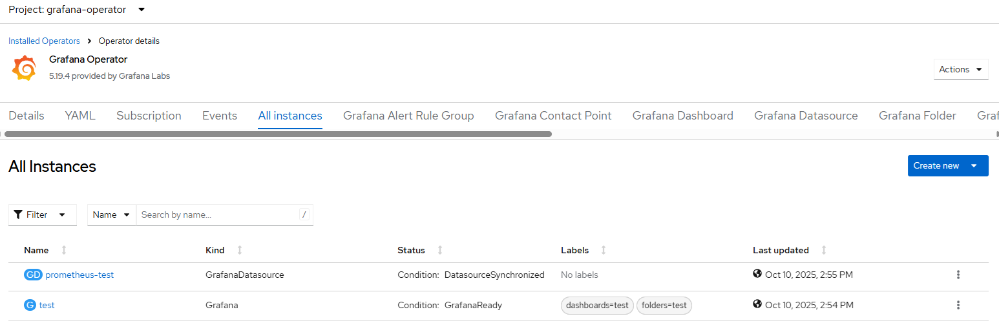
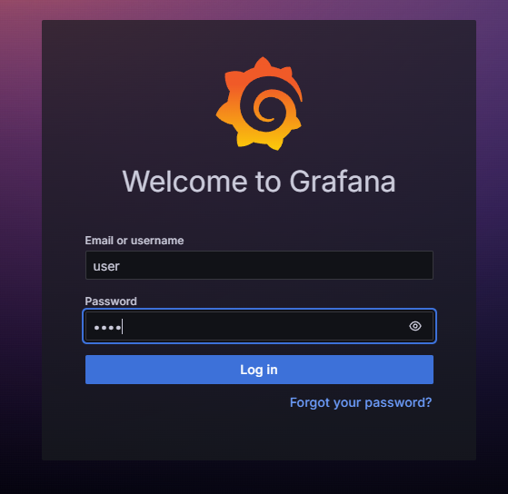
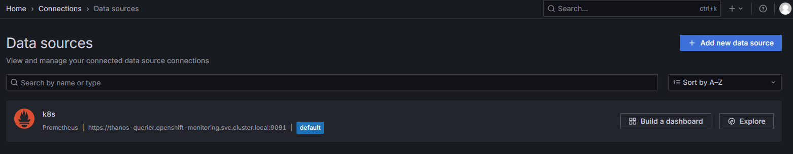

# Grafana Operator - Create Instance

## Workflow

- create grafana instance with authenticated access
- add cluster role binding for role:cluster-monitoring-view to service account of grafana instance
- get service account token for prometheus access
- create prometheus data source associated with the grafana instance if --prometheus flag

## Requirements

- Grafana operator [created](./create_operator.md)
- User-workload monitoring [enabled](../prometheus/enable_user_workload_monitoring.md) in case of --prometheus flag

## Configurable options

```
# iserver set ocp grafana --mode instance
  --cluster TEXT                  Cluster Name
  --instance TEXT                 Grafana instance name
  --username TEXT                 Grafana instance admin username
  --password TEXT                 Grafana instance admin password
  --prometheus                    Enable prometheus data source
  --datasource TEXT               Prometheus data source name  [default: my-prometheus]
  --no-confirm                    Confirmation mode
```

## Expected outcome









## Example

```
# iserver set ocp grafana --mode instance --cluster bm1 --instance test --username user --password pass --prometheus --datasource k8s 


OpenShift Workflow - Grafana Operator - Create Instance
=======================================================

OpenShift Cluster: bm1

Create Grafana Instance
-----------------------

~~~
apiVersion: grafana.integreatly.org/v1beta1
kind: Grafana
metadata:
  labels:
    dashboards: test
    folders: test
  name: test
  namespace: grafana-operator
spec:
  config:
    auth:
      disable_login_form: 'false'
    log:
      mode: console
    security:
      admin_password: pass
      admin_user: user
  route:
    spec: {}

~~~
Wait until grafana found [timeout:60s]...
Wait until grafana resources [timeout:60s]...
Wait for deployments ready (optional: False, allow zero replicas: False)...
- grafana-operator/test-deployment
Wait for service account...
Grafana instance route [test-route-grafana-operator.apps.bm1.domain.com]

Check User Workload Monitoring
------------------------------
- config map namespace: openshift-monitoring
- config map name: cluster-monitoring-config
- enableUserWorkload enabled

Cluster Role Binding
--------------------
Service Account [test-sa] is not yet associated with role [cluster-monitoring-view]
Cluster role binding created: test-sa-view

Create Grafana Datasource
-------------------------
- instance: test
- get service account token for grafana instance

~~~
apiVersion: grafana.integreatly.org/v1beta1
kind: GrafanaDatasource
metadata:
  name: test-thanos
  namespace: grafana-operator
spec:
  datasource:
    access: proxy
    editable: true
    isDefault: true
    jsonData:
      httpHeaderName1: Authorization
      timeInterval: 5s
      tlsSkipVerify: true
    name: k8s
    secureJsonData:
      httpHeaderValue1: Bearer ...
    type: prometheus
    url: https://thanos-querier.openshift-monitoring.svc.cluster.local:9091
  instanceSelector:
    matchLabels:
      dashboards: test

~~~
Wait until grafana found [timeout:60s]...

Grafana datasource created
- grafana-operator/test-thanos
- type: prometheus
- name: k8s
- token: service account [grafana-operator/test-sa]
- dashboards: test


Completed tasks
---------------
- Grafana instance defined
- Prometheus data source created
```

[[Back]](./README.md)