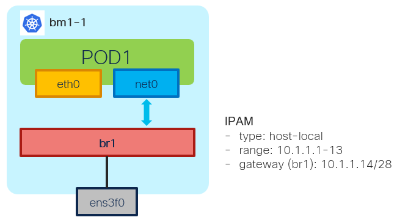

# Bridge NAD - Example - L2 Mode with VLAN w/NNCP

[[Back]](./example-bridge.md) [[Prev]](./example-bridge-l2-vlan.md) [[Next]](./example-bridge-1pod-ipam-static.md)



This change on top of [bridge l2 with vlan scenario](./example-bridge-l2-vlan.md) with Linux bridge being pre-provisioned using NMState NNCP. 

> [!NOTE]
> No need for extra Linux commands.

## Provision

```
apiVersion: nmstate.io/v1
kind: NodeNetworkConfigurationPolicy
metadata:
  name: policy
spec:
  nodeSelector:
    kubernetes.io/hostname: bm1-1
  desiredState:
    interfaces:
    - bridge:
        options:
          stp:
            enabled: false
        port:
        - name: ens3f0
      name: br666
      state: up
      type: linux-bridge
```

```
apiVersion: k8s.cni.cncf.io/v1
kind: NetworkAttachmentDefinition
metadata:
  name: test
  namespace: default
spec:
  config: |-
    {
      "cniVersion": "0.3.1",
      "type": "bridge",
      "name": "br666",
      "bridge": "br666",
      "vlan": 666,
      "ipam": {
        "type": "host-local",
        "subnet": "10.1.1.0/28",
        "rangeStart": "10.1.1.1",
        "rangeEnd": "10.1.1.13",
        "routes": [
          {
            "dst": "10.1.2.0/28",
            "gw": "10.1.1.14"
          }
        ]
      }
    }
---
apiVersion: v1
kind: Pod
metadata:
  annotations:
    k8s.v1.cni.cncf.io/networks: test
  name: pod1
spec:
  containers:
  - command:
    - sleep
    - infinite
    image: nicolaka/netshoot:latest
    securityContext:
      runAsUser: 0
      capabilities:
        add: ["IPC_LOCK","SYS_RESOURCE","NET_RAW"]
    name: netshoot
  nodeName: bm1-1
```

> [!CAUTION]
> Bridge delete with nncp as below

```
apiVersion: nmstate.io/v1
kind: NodeNetworkConfigurationPolicy
metadata:
  name: no-bridge
spec:
  nodeSelector:
    kubernetes.io/hostname: bm1-1
  desiredState:
    interfaces:
    - name: br666
      state: absent
      type: linux-bridge
```

## L2

> [!NOTE]
> Ping not working since there is nobody to respond, just checking L2 forwarding out

```
$ oc exec pod1 -- ping -c 1 10.1.1.14
PING 10.1.1.14 (10.1.1.14) 56(84) bytes of data.
...
```

```
# tcpdump -i ens3f0 -e -n -nn -s 1500 -v -vv arp
32:78:12:0f:71:b7 > ff:ff:ff:ff:ff:ff, ethertype 802.1Q (0x8100), length 46: vlan 666, p 0, ethertype ARP (0x0806), Ethernet (len 6), IPv4 (len 4),
   Request who-has 10.1.1.14 tell 10.1.1.2, length 28
```

[[Back]](./example-bridge.md) [[Prev]](./example-bridge-l2-vlan.md) [[Next]](./example-bridge-1pod-ipam-static.md)