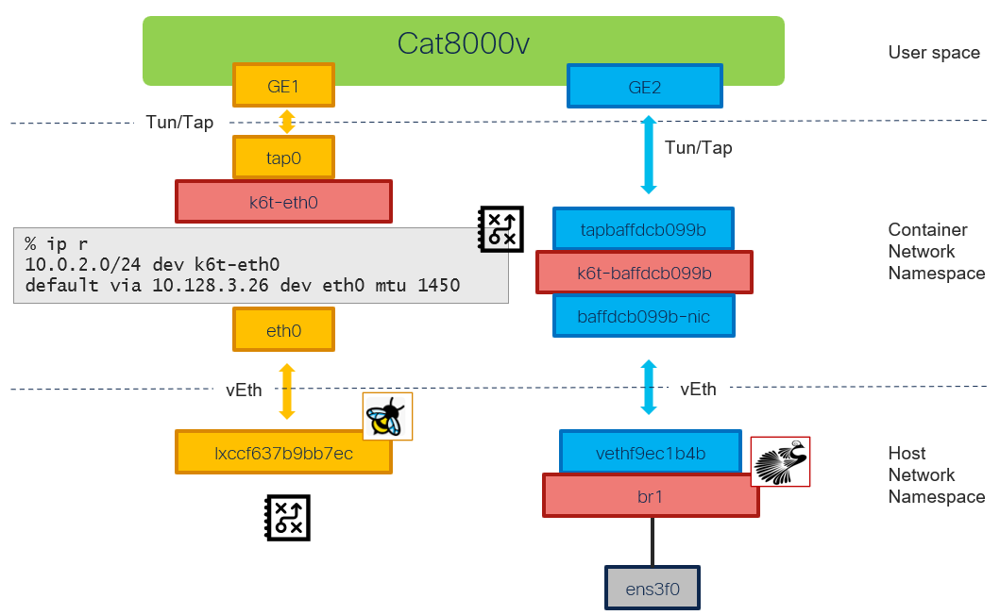

# Cat8000v: extra interface in l3 bridge (multus)

[[Back]](./README.md) [[KubeVirt Networking]](./example-cat8k-2nd-bridge-l3-provisioning.md)



## Guest

Interfaces
- GigabitEthernet1 connected to POD network in masquerade mode
- GibabitEthernet2 connected to Multus network

```
c8kv1#show interfaces
GigabitEthernet1 is up, line protocol is up
  Hardware is vNIC, address is 0221.6600.0000 (bia 0221.6600.0000)
  Internet address is 10.0.2.2/24
GigabitEthernet2 is up, line protocol is up
  Hardware is vNIC, address is 0221.6600.0001 (bia 0221.6600.0001)
  Internet address is 15.20.20.20/24
```

```
c8kv1#show ip route vrf Mgmt-intf
S*    0.0.0.0/0 [254/0] via 10.0.2.1
      10.0.0.0/8 is variably subnetted, 3 subnets, 2 masks
C        10.0.2.0/24 is directly connected, GigabitEthernet1
S        10.0.2.1/32 [254/0] via 10.0.2.1, GigabitEthernet1
L        10.0.2.2/32 is directly connected, GigabitEthernet1
```

## KVM Guest Virtual Machine (Domain)

```
$ oc exec virt-launcher-cat8000v-inst1-xxx -- virsh dumpxml default_c8kv1
<domain type='kvm' id='1'>
  <devices>
    <interface type='ethernet'>
      <mac address='02:21:66:00:00:00'/>
      <target dev='tap0' managed='no'/>
    </interface>
    <interface type='ethernet'>
      <mac address='02:21:66:00:00:01'/>
      <target dev='tapbaffdcb099b' managed='no'/>
    </interface>
  </devices>
</domain>
```

> [!NOTE]
> TUN/TAP connects user-space application container (virt-launcher) network namespace

## Virt-launcher container

### IP Route

```
c8kv1% ip r
default via 10.128.3.26 dev eth0 mtu 1450
10.0.2.0/24 dev k6t-eth0 proto kernel scope link src 10.0.2.1
10.128.3.26 dev eth0 scope link
```

### Linux Bridge

```
c8kv1% brctl show
bridge name             bridge id               STP enabled     interfaces
k6t-baffdcb099b         8000.0a0732d06f5f       no              baffdcb099b-nic
                                                                tapbaffdcb099b
k6t-eth0                8000.020000000000       no              tap0
```

```
c8kv1% bridge -d link
2: baffdcb099b-nic@if176: <BROADCAST,MULTICAST,UP,LOWER_UP> mtu 1500 master k6t-baffdcb099b state forwarding priority 32 cost 2
    hairpin off guard off root_block off fastleave off learning off flood on mcast_flood on bcast_flood on mcast_router 1 mcast_to_unicast off neigh_suppress off neigh_vlan_suppress off vlan_tunnel off isolated off locked off mab off mcast_n_groups 0 mcast_max_groups 0
4: tap0: <BROADCAST,MULTICAST,UP,LOWER_UP> mtu 1500 master k6t-eth0 state forwarding priority 32 cost 100
    hairpin off guard off root_block off fastleave off learning on flood on mcast_flood on bcast_flood on mcast_router 1 mcast_to_unicast off neigh_suppress off neigh_vlan_suppress off vlan_tunnel off isolated off locked off mab off mcast_n_groups 0 mcast_max_groups 0
6: tapbaffdcb099b: <BROADCAST,MULTICAST,UP,LOWER_UP> mtu 1500 master k6t-baffdcb099b state forwarding priority 32 cost 100
    hairpin off guard off root_block off fastleave off learning on flood on mcast_flood on bcast_flood on mcast_router 1 mcast_to_unicast off neigh_suppress off neigh_vlan_suppress off vlan_tunnel off isolated off locked off mab off mcast_n_groups 0 mcast_max_groups 0
```

### Interface details

#### Lo (if:1)

```
c8kv1% ip a l lo
1: lo: <LOOPBACK,UP,LOWER_UP> mtu 65536 qdisc noqueue state UNKNOWN group default qlen 1000
    link/loopback 00:00:00:00:00:00 brd 00:00:00:00:00:00
    inet 127.0.0.1/8 scope host lo
```

#### baffdcb099b-nic (if:2)

Virtual Ethernet
- connects k6t-baffdcb099b (multus) linux bridge to host network namespace
- ip unnumbered

```
c8kv1% ip -details link show baffdcb099b-nic
2: baffdcb099b-nic@if176: <BROADCAST,MULTICAST,UP,LOWER_UP> mtu 1500 qdisc noqueue master k6t-baffdcb099b
    link/ether 1a:0e:32:79:ad:38 brd ff:ff:ff:ff:ff:ff link-netnsid 0
    veth
```

```
c8kv1% ip a l baffdcb099b-nic
2: baffdcb099b-nic@if176: <BROADCAST,MULTICAST,UP,LOWER_UP> mtu 1500 qdisc noqueue master k6t-baffdcb099b
    link/ether 1a:0e:32:79:ad:38 brd ff:ff:ff:ff:ff:ff link-netnsid 0
```

#### k6t-eth0 (if:3)

Linux bridge
- connects to KVM VM via tap0 interface
- used as the default gateway for KVM VM
- routes traffic received via tap0 interface following the container's network namespace route table with eth0 being the default gateway

```
c8kv1% ip -details link show k6t-eth0
3: k6t-eth0: <BROADCAST,MULTICAST,UP,LOWER_UP> mtu 1500
    link/ether 02:00:00:00:00:00 brd ff:ff:ff:ff:ff:ff 
    vlan_protocol 802.1Q bridge_id 8000.02:00:00:00:00:00 designated_root 8000.02:00:00:00:00:00
```

```
c8kv1% ip a l k6t-eth0
3: k6t-eth0: <BROADCAST,MULTICAST,UP,LOWER_UP> mtu 1500 qdisc noqueue state UP group default qlen 1000
    link/ether 02:00:00:00:00:00 brd ff:ff:ff:ff:ff:ff
    inet 10.0.2.1/24 brd 10.0.2.255 scope global k6t-eth0
```

#### tap0 (if:4)

Tun/tap
- connects user space with container network namespace
- used for primary VM interface
- plugs into k6t-eth0 (Pod) linux bridge
- ip unnumbered

```
c8kv1% ip -details link show tap0
4: tap0: <BROADCAST,MULTICAST,UP,LOWER_UP> mtu 1500 qdisc fq_codel master k6t-eth0 state UP
    link/ether 02:e8:7d:68:98:cf brd ff:ff:ff:ff:ff:ff promiscuity 1 allmulti 1 minmtu 68 maxmtu 65521
    tun type tap 
```

```
c8kv1% ip a l tap0
4: tap0: <BROADCAST,MULTICAST,UP,LOWER_UP> mtu 1500 qdisc fq_codel master k6t-eth0 state UP
    link/ether 02:e8:7d:68:98:cf brd ff:ff:ff:ff:ff:ff
```

#### k6t-baffdcb099b (if:5)

Linux bridge
- connects to KVM VM via tapbaffdcb099b tun/tap interface
- connects to host network namespace via baffdcb099b-nic virtual ethernet
- Non-routable link-local IP address assigned (169.254.0.0/16)

```
c8kv1% ip -details link show k6t-baffdcb099b
5: k6t-baffdcb099b: <BROADCAST,MULTICAST,UP,LOWER_UP> mtu 1500 
    link/ether 0a:07:32:d0:6f:5f brd ff:ff:ff:ff:ff:ff promiscuity 0 allmulti 0 minmtu 68 maxmtu 65535
    bridge 
    vlan_protocol 802.1Q bridge_id 8000.0A:07:32:D0:6F:5F designated_root 8000.0A:07:32:D0:6F:5F
```

```
c8kv1% ip a l k6t-baffdcb099b
5: k6t-baffdcb099b: <BROADCAST,MULTICAST,UP,LOWER_UP> mtu 1500 qdisc noqueue state UP group default qlen 1000
    link/ether 0a:07:32:d0:6f:5f brd ff:ff:ff:ff:ff:ff
    inet 169.254.75.11/32 scope global k6t-baffdcb099b
```

#### tapbaffdcb099b (if:6)

Tun/tap
- connects user space with container network namespace
- used for secondary interface of VM
- plugs into k6t-baffdcb099b (multus) linux bridge
- ip unnumbered

```
c8kv1% ip -details link show tapbaffdcb099b
6: tapbaffdcb099b: <BROADCAST,MULTICAST,UP,LOWER_UP> mtu 1500 qdisc fq_codel master k6t-baffdcb099b 
    link/ether 0a:07:32:d0:6f:5f brd ff:ff:ff:ff:ff:ff promiscuity 1 allmulti 1 minmtu 68 maxmtu 65521
    tun type tap 
```

```
c8kv1% ip a l tapbaffdcb099b
6: tapbaffdcb099b: <BROADCAST,MULTICAST,UP,LOWER_UP> mtu 1500 qdisc fq_codel master k6t-baffdcb099b
    link/ether 0a:07:32:d0:6f:5f brd ff:ff:ff:ff:ff:ff
```

#### podbaffdcb099b (if:7)

Dummy
- represents IP and MAC addresses of the secondary (multus) interface

```
c8kv1% ip -details link show podbaffdcb099b
7: podbaffdcb099b: <BROADCAST,NOARP> mtu 1500 qdisc noop state DOWN mode DEFAULT group default qlen 1000
    link/ether 02:21:66:00:00:01 brd ff:ff:ff:ff:ff:ff promiscuity 0 allmulti 0 minmtu 0 maxmtu 0
    dummy 
```

```
c8kv1% ip a l podbaffdcb099b
7: podbaffdcb099b: <BROADCAST,NOARP> mtu 1500 qdisc noop state DOWN group default qlen 1000
    link/ether 02:21:66:00:00:01 brd ff:ff:ff:ff:ff:ff
    inet 15.20.20.20/24 brd 15.20.20.255 scope global podbaffdcb099b
```

#### eth0 (if:173)

Virtual Ethernet
- connects contaier network namespace to host network namespace
- container's default route via eth0
- provisioned with IP address of the Kubernetes pod (virt-launcher)

```
c8kv1% ip -details link show eth0
173: eth0@if174: <BROADCAST,MULTICAST,UP,LOWER_UP> mtu 1500 qdisc noqueue state UP mode DEFAULT
    link/ether 46:95:4e:3d:23:9d brd ff:ff:ff:ff:ff:ff link-netnsid 0 promiscuity 0 allmulti 0 minmtu 68 maxmtu 65535
    veth 
```

```
c8kv1% ip a l eth0
173: eth0@if174: <BROADCAST,MULTICAST,UP,LOWER_UP> mtu 1500 qdisc noqueue state UP group default qlen 1000
    link/ether 46:95:4e:3d:23:9d brd ff:ff:ff:ff:ff:ff link-netnsid 0
    inet 10.128.3.137/32 scope global eth0
```

### Masqurade

- IP Masquerade (NAT) translates between the IP address seen by the virtual machine i.e. 10.0.2.2; and the IP address of the POD
- implemented using nftables that are provisioned automatically
- masquerade is not working on multus interface

```
$ oc debug node/bm1-1
sh-5.1# NAME=virt-launcher-cat8000v-inst1-xxx
sh-5.1# NAMESPACE=default
sh-5.1# pod_id=$(chroot /host crictl pods --namespace ${NAMESPACE} --name ${NAME} -q)
sh-5.1# ns_path="/host/$(chroot /host bash -c "crictl inspectp $pod_id | jq '.info.runtimeSpec.linux.namespaces[]|select(.type==\"network\").path' -r")"
sh-5.1# nsenter_parameters="--net=${ns_path}"
sh-5.1# nsenter $nsenter_parameters -- chroot /host nft list ruleset
table ip nat {
        chain prerouting {
                type nat hook prerouting priority dstnat; policy accept;
                iifname "eth0" counter packets 1 bytes 60 jump KUBEVIRT_PREINBOUND
        }

        chain input {
                type nat hook input priority srcnat; policy accept;
        }

        chain output {
                type nat hook output priority dstnat; policy accept;
                ip daddr 127.0.0.1 counter packets 0 bytes 0 dnat to 10.0.2.2
        }

        chain postrouting {
                type nat hook postrouting priority srcnat; policy accept;
                ip saddr 10.0.2.2 counter packets 0 bytes 0 masquerade
                oifname "k6t-eth0" counter packets 3 bytes 550 jump KUBEVIRT_POSTINBOUND
        }

        chain KUBEVIRT_PREINBOUND {
                counter packets 1 bytes 60 dnat to 10.0.2.2
        }

        chain KUBEVIRT_POSTINBOUND {
                ip saddr 127.0.0.1 counter packets 0 bytes 0 snat to 10.0.2.1
        }
}
```

### DHCP

DHCP server is running inside virt-launcher pod for each virtual machine and is preconfigured 

```
$ oc rsh virt-launcher-cat8000v-inst1-xxx
sh-5.1$ ss -tunlp
Netid           State            Recv-Q           Send-Q      Local Address:Port         Peer Address:Port
udp             UNCONN           0                0           0.0.0.0:67                 0.0.0.0:*
```

## Host

### br1

Linux bridge
- created by NetworkAttachmentDefinition (this example) or using NMState NNCP
- IP address assigned as per NAD configuration <=> forwarding traffic out follows ip routing table
- if created via NAD, upstream interface for the bridge needs to be configured using `ip` command
- Virtual Ethernet interface plugged into the bridge to handle secondary interface (multus) traffic
- no associated ebpf program

```
175: br1: <BROADCAST,MULTICAST,UP,LOWER_UP> mtu 1500 qdisc noqueue state UP group default qlen 1000
    link/ether 12:8b:9e:d1:a2:7d brd ff:ff:ff:ff:ff:ff
    inet 15.20.20.254/24 brd 15.20.20.255 scope global br1
```

```
$ bridge link
8: ens3f0: <BROADCAST,MULTICAST,UP,LOWER_UP> mtu 1500 master br1 state forwarding priority 32 cost 2
176: vethf9ec1b4b@eno5: <BROADCAST,MULTICAST,UP,LOWER_UP> mtu 1500 master br1 state forwarding priority 32 cost 2
```

### vethf9ec1b4b

Virtual Ethernet
- connects host network namespace to contaier network namespace
- paired with interface carrying secondary (multus) traffic
- plugs into br1 linux bridge
- ip unnumbered
- no ebpf program loaded on ingress

```
[core@bm1-1 ~]$ ip -details link show vethf9ec1b4b
176: vethf9ec1b4b@if2: <BROADCAST,MULTICAST,UP,LOWER_UP> mtu 1500 qdisc noqueue master br1 
    link/ether 16:71:fa:5e:78:d0 brd ff:ff:ff:ff:ff:ff link-netns d17ebfd6-98aa-4dfd-b754-984a8207e0c9 promiscuity 1
    veth
```

### lxccf637b9bb7ec

Virtual Ethernet
- connects host network namespace to contaier network namespace
- ip unnumbered
- ebpf program loaded on ingress i.e. traffic from container

```
$ ip -details link show lxccf637b9bb7ec
174: lxccf637b9bb7ec@if173: <BROADCAST,MULTICAST,UP,LOWER_UP> mtu 1500 
    link/ether 3e:65:03:84:f5:8b brd ff:ff:ff:ff:ff:ff link-netns d17ebfd6-98aa-4dfd-b754-984a8207e0c9 promiscuity 0  
    veth 
```

```
$ ip a l lxccf637b9bb7ec
174: lxccf637b9bb7ec@if173: <BROADCAST,MULTICAST,UP,LOWER_UP> mtu 1500 qdisc noqueue state UP group default qlen 1000
    link/ether 3e:65:03:84:f5:8b brd ff:ff:ff:ff:ff:ff link-netns d17ebfd6-98aa-4dfd-b754-984a8207e0c9
```

```
$ oc exec -n cilium cilium-hfxkb -- bpftool net 
lxccf637b9bb7ec(174) tcx/ingress cil_from_container prog_id 858701 link_id 86
```

[[Back]](./example-bridge.md) [[KubeVirt Networking]](./example-cat8k-2nd-bridge-l3-provisioning.md)