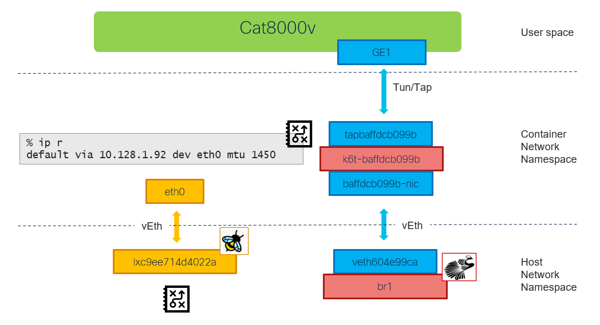

# Cat8000v: management in l3 bridge (multus)

[[Back]](./README.md) [[Provisioning]](./example-cat8k-bridge-l3-provisioning.md)



## Guest

Interfaces
- GigabitEthernet1 connected to bridge without masquerade inside virt-launcher container 

```
GigabitEthernet1 is up, line protocol is up
  Hardware is vNIC, address is 0221.6600.0005 (bia 0221.6600.0005)
  Internet address is 15.25.25.25/24
```

```
c8kv1#show ip route vrf Mgmt-intf
S*    0.0.0.0/0 [254/0] via 15.25.25.254
      15.0.0.0/8 is variably subnetted, 2 subnets, 2 masks
C        15.25.25.0/24 is directly connected, GigabitEthernet1
L        15.25.25.25/32 is directly connected, GigabitEthernet1
```

## KVM Guest Virtual Machine (Domain)

```
$ oc exec virt-launcher-c8kv1-xxx -- virsh dumpxml default_c8kv1
<domain type='kvm' id='1'>
  <devices>
    <interface type='ethernet'>
      <mac address='02:21:66:00:00:05'/>
      <target dev='tapbaffdcb099b' managed='no'/>
    </interface>
  </devices>
</domain>
```

> [!NOTE]
> TUN/TAP connects user-space application container (virt-launcher) network namespace

## Virt-launcher container

```
# kubectl debug virt-launcher-c8kv1-xxx -it --image=nicolaka/netshoot
```

### IP Route

```
c8kv1% ip r
default via 10.128.1.92 dev eth0 mtu 1450
10.128.1.92 dev eth0 scope link
```

### Linux Bridge

```
c8kv1% brctl show
bridge name         bridge id               STP enabled     interfaces
k6t-baffdcb099b     8000.768b4e01ca94       no              baffdcb099b-nic
                                                            tapbaffdcb099b
```

```
c8kv1% bridge -d link
2: baffdcb099b-nic@if4371: <BROADCAST,MULTICAST,UP,LOWER_UP> mtu 1500 master k6t-baffdcb099b state forwarding
4: tapbaffdcb099b: <BROADCAST,MULTICAST,UP,LOWER_UP> mtu 1500 master k6t-baffdcb099b state forwarding
```

### Interface details

#### Lo (if:1)

```
% ip a l lo
1: lo: <LOOPBACK,UP,LOWER_UP> mtu 65536 qdisc noqueue state UNKNOWN group default qlen 1000
    link/loopback 00:00:00:00:00:00 brd 00:00:00:00:00:00
    inet 127.0.0.1/8 scope host lo
```

#### baffdcb099b-nic (if:2)

Virtual Ethernet
- connects k6t-baffdcb099b (multus) linux bridge to host network namespace
- ip unnumbered

```
c8kv1% % ip -details link show baffdcb099b-nic
2: baffdcb099b-nic@if4371: <BROADCAST,MULTICAST,UP,LOWER_UP> mtu 1500 qdisc noqueue master k6t-baffdcb099b 
    link/ether 9a:e3:7e:07:64:2e brd ff:ff:ff:ff:ff:ff link-netnsid 0 
    veth
```

```
c8kv1% % ip a l baffdcb099b-nic
2: baffdcb099b-nic@if4371: <BROADCAST,MULTICAST,UP,LOWER_UP> mtu 1500 qdisc noqueue master k6t-baffdcb099b
    link/ether 9a:e3:7e:07:64:2e brd ff:ff:ff:ff:ff:ff link-netnsid 0
```

#### k6t-baffdcb099b (if:3)

Linux bridge
- connects to KVM VM via tapbaffdcb099b tun/tap interface
- connects to host network namespace via baffdcb099b-nic virtual ethernet
- Non-routable link-local IP address assigned (169.254.0.0/16)

```
c8kv1% ip -details link show k6t-baffdcb099b
3: k6t-baffdcb099b: <BROADCAST,MULTICAST,UP,LOWER_UP> mtu 1500
    link/ether 76:8b:4e:01:ca:94 brd ff:ff:ff:ff:ff:ff 
    bridge 
```

```
c8kv1% ip a l k6t-baffdcb099b
3: k6t-baffdcb099b: <BROADCAST,MULTICAST,UP,LOWER_UP> mtu 1500
    link/ether 76:8b:4e:01:ca:94 brd ff:ff:ff:ff:ff:ff
    inet 169.254.75.10/32 scope global k6t-baffdcb099b
```

#### tapbaffdcb099b (if:4)

Tun/tap
- connects user space with container network namespace
- used for secondary interface of VM
- plugs into k6t-baffdcb099b (multus) linux bridge
- ip unnumbered

```
c8kv1% ip -details link show tapbaffdcb099b
4: tapbaffdcb099b: <BROADCAST,MULTICAST,UP,LOWER_UP> mtu 1500 qdisc fq_codel master k6t-baffdcb099b
    link/ether 76:8b:4e:01:ca:94 brd ff:ff:ff:ff:ff:ff
    tun type tap 
```

```
c8kv1% ip a l tapbaffdcb099b
4: tapbaffdcb099b: <BROADCAST,MULTICAST,UP,LOWER_UP> mtu 1500 qdisc fq_codel master k6t-baffdcb099b
    link/ether 76:8b:4e:01:ca:94 brd ff:ff:ff:ff:ff:ff
```

#### podbaffdcb099b (if:5)

Dummy
- represents IP and MAC addresses of the secondary (multus) interface as assigned by IPAM CNI

```
% ip -details link show podbaffdcb099b
7: podbaffdcb099b: <BROADCAST,NOARP> mtu 1500 qdisc noop state DOWN mode DEFAULT group default qlen 1000
    link/ether 02:21:66:00:00:05 brd ff:ff:ff:ff:ff:ff 
    dummy
```

```
% ip a l podbaffdcb099b
7: podbaffdcb099b: <BROADCAST,NOARP> mtu 1500 qdisc noop state DOWN group default qlen 1000
    link/ether 02:21:66:00:00:05 brd ff:ff:ff:ff:ff:ff
    inet 15.25.25.25/24 brd 15.25.25.255 scope global podbaffdcb099b
```

#### eth0 (if:4368)

Virtual Ethernet
- connects contaier network namespace to host network namespace
- container's default route via eth0
- provisioned with IP address of the Kubernetes pod (virt-launcher)
- since virtual machine's interface connects differently, eth0 does not carry any of the virtual machine packets

```
% ip -details link show eth0
4368: eth0@if4369: <BROADCAST,MULTICAST,UP,LOWER_UP> mtu 1500
    link/ether ca:f9:12:b3:f5:a9 brd ff:ff:ff:ff:ff:ff link-netnsid 0
    veth
```

```
% ip a l eth0
4368: eth0@if4369: <BROADCAST,MULTICAST,UP,LOWER_UP> mtu 1500 qdisc noqueue state UP group default qlen 1000
    link/ether ca:f9:12:b3:f5:a9 brd ff:ff:ff:ff:ff:ff link-netnsid 0
    inet 10.128.0.170/32 scope global eth0
```

### Masqurade

- IP Masquerade (NAT) is not configured

```
$ oc debug node/bm1-1
sh-5.1# NAME=virt-launcher-c8kv1-xxx
sh-5.1# NAMESPACE=default
sh-5.1# pod_id=$(chroot /host crictl pods --namespace ${NAMESPACE} --name ${NAME} -q)
sh-5.1# ns_path="/host/$(chroot /host bash -c "crictl inspectp $pod_id | jq '.info.runtimeSpec.linux.namespaces[]|select(.type==\"network\").path' -r")"
sh-5.1# nsenter_parameters="--net=${ns_path}"
sh-5.1# nsenter $nsenter_parameters -- chroot /host nft list ruleset
sh-5.1#
```

### DHCP

DHCP server is running inside virt-launcher pod for each virtual machine and is preconfigured; however in this setup is not really used

```
$ oc rsh virt-launcher-c8kv1-xxx
sh-5.1$ ss -tunlp
Netid           State            Recv-Q           Send-Q     Local Address:Port        Peer Address:Port
udp             UNCONN           0                0                  0.0.0.0:67                0.0.0.0:*
```

## Host

### lxc9ee714d4022a

Virtual Ethernet
- connects host network namespace to contanier network namespace (pod network)
- ip unnumbered
- ebpf program *loaded* on ingress i.e. traffic from container
- virtual machine traffic *does not flow* here

```
$ ip -details link show lxc9ee714d4022a
4369: lxc9ee714d4022a@if4368: <BROADCAST,MULTICAST,UP,LOWER_UP> mtu 1500
    link/ether ce:5e:78:d6:53:2a brd ff:ff:ff:ff:ff:ff link-netns 29826988-55a4-4bef-b216-8aa0dab84458
    veth
```

```
$ ip a l lxc9ee714d4022a
4369: lxc9ee714d4022a@if4368: <BROADCAST,MULTICAST,UP,LOWER_UP> mtu 1500
    link/ether ce:5e:78:d6:53:2a brd ff:ff:ff:ff:ff:ff link-netns 29826988-55a4-4bef-b216-8aa0dab84458
```

```
$ oc exec -n cilium cilium-xjs8k -- bpftool net
lxc9ee714d4022a(4369) tcx/ingress cil_from_container prog_id 320188 link_id 2183
```

### veth604e99ca

Virtual Ethernet
- connects host network namespace to contanier network namespace (multus)
- ip unnumbered
- ebpf program *not loaded* on ingress
- virtual machine traffic *flows* here
- connects to bridge provisioned with NetworkAttachmentDefinition (NAD)

```
$ ip -details link show veth604e99ca
4371: veth604e99ca@if2: <BROADCAST,MULTICAST,UP,LOWER_UP> mtu 1500 qdisc noqueue master br1
    link/ether 3e:92:ad:aa:1d:0e brd ff:ff:ff:ff:ff:ff link-netns 29826988-55a4-4bef-b216-8aa0dab84458
    veth
```

```
$ ip a l veth604e99ca
4371: veth604e99ca@if2: <BROADCAST,MULTICAST,UP,LOWER_UP> mtu 1500 qdisc noqueue master br1
    link/ether 3e:92:ad:aa:1d:0e brd ff:ff:ff:ff:ff:ff link-netns 29826988-55a4-4bef-b216-8aa0dab84458
```

### br1

Linux bridge
- created by NetworkAttachmentDefinition (this example) or using NMState NNCP
- IP address assigned as per NAD configuration <=> forwarding traffic out follows ip routing table
- if created via NAD, upstream interface for the bridge needs to be configured using `ip` command
- Virtual Ethernet interface plugged into the bridge to handle secondary interface (multus) traffic
- no associated ebpf program

```
$ ip -details link show br1
4370: br1: <BROADCAST,MULTICAST,UP,LOWER_UP> mtu 1500
    link/ether 7a:44:f0:09:2b:16 brd ff:ff:ff:ff:ff:ff
    bridge
```

```
$ ip a l br1
4370: br1: <BROADCAST,MULTICAST,UP,LOWER_UP> mtu 1500
    link/ether 7a:44:f0:09:2b:16 brd ff:ff:ff:ff:ff:ff
    inet 15.25.25.254/24 brd 15.25.25.255 scope global br1
```

[[Back]](./README.md) [[Provisioning]](./example-cat8k-bridge-l3-provisioning.md)