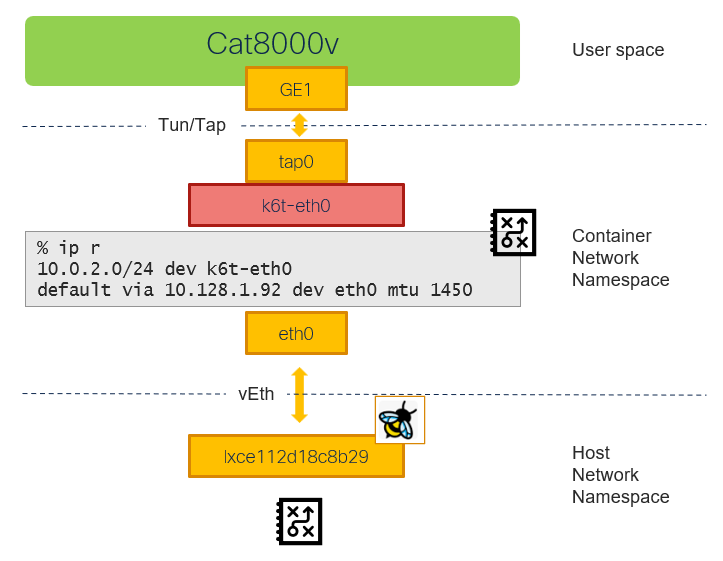

# Cat8000v: management in pod network

[[Back]](./README.md) [[Provisioning]](./example-cat8k-pod-provisioning.md)



## Guest

Interfaces
- GigabitEthernet1 connected to POD network in masquerade mode

```
c8kv1#show interfaces
  Hardware is vNIC, address is 0221.6600.0002 (bia 0221.6600.0002)
  Internet address is 10.0.2.2/24
```

```
c8kv1#show ip route vrf Mgmt-intf
S*    0.0.0.0/0 [254/0] via 10.0.2.1
      10.0.0.0/8 is variably subnetted, 3 subnets, 2 masks
C        10.0.2.0/24 is directly connected, GigabitEthernet1
S        10.0.2.1/32 [254/0] via 10.0.2.1, GigabitEthernet1
L        10.0.2.2/32 is directly connected, GigabitEthernet1
```

## KVM Guest Virtual Machine (Domain)

```
$ oc exec virt-launcher-c8kv1-xxx -- virsh dumpxml default_c8kv1
<domain type='kvm' id='1'>
  <devices>
    <interface type='ethernet'>
      <mac address='02:21:66:00:00:02'/>
      <target dev='tap0' managed='no'/>
    </interface>
  </devices>
</domain>
```

> [!NOTE]
> TUN/TAP connects user-space application container (virt-launcher) network namespace

## Virt-launcher container

```
# kubectl debug virt-launcher-c8kv1-xxx -it --image=nicolaka/netshoot
```

### IP Route

```
c8kv1% ip r
default via 10.128.1.92 dev eth0 mtu 1450
10.0.2.0/24 dev k6t-eth0 proto kernel scope link src 10.0.2.1
10.128.1.92 dev eth0 scope link
```

### Linux Bridge

```
c8kv1% brctl show
bridge name     bridge id               STP enabled     interfaces
k6t-eth0        8000.020000000000       no              tap0
```

```
c8kv1% bridge -d link
3: tap0: <BROADCAST,MULTICAST,UP,LOWER_UP> mtu 1500 master k6t-eth0 state forwarding priority 32 cost 100
```

### Interface details

#### Lo (if:1)

```
% ip a l lo
1: lo: <LOOPBACK,UP,LOWER_UP> mtu 65536 qdisc noqueue state UNKNOWN group default qlen 1000
    link/loopback 00:00:00:00:00:00 brd 00:00:00:00:00:00
    inet 127.0.0.1/8 scope host lo
```

#### k6t-eth0 (if:2)

Linux bridge
- connects to KVM VM via tap0 interface
- used as the default gateway for KVM VM
- routes traffic received via tap0 interface following the container's network namespace route table with eth0 being the default gateway

```
c8kv1% ip -details link show k6t-eth0
2: k6t-eth0: <BROADCAST,MULTICAST,UP,LOWER_UP> mtu 1500
    link/ether 02:00:00:00:00:00 brd ff:ff:ff:ff:ff:ff 
    vlan_protocol 802.1Q bridge_id 8000.02:00:00:00:00:00 designated_root 8000.02:00:00:00:00:00
```

```
c8kv1% ip a l k6t-eth0
2: k6t-eth0: <BROADCAST,MULTICAST,UP,LOWER_UP> mtu 1500 
    link/ether 02:00:00:00:00:00 brd ff:ff:ff:ff:ff:ff
    inet 10.0.2.1/24 brd 10.0.2.255 scope global k6t-eth0
```

#### tap0 (if:3)

Tun/tap
- connects user space with container network namespace
- used for VM interface
- plugs into k6t-eth0 linux bridge
- ip unnumbered

```
c8kv1% ip -details link show tap0
3: tap0: <BROADCAST,MULTICAST,UP,LOWER_UP> mtu 1500 qdisc fq_codel master k6t-eth0 state UP
    link/ether 4e:3b:74:f0:4b:07 brd ff:ff:ff:ff:ff:ff
    tun type tap 
```

```
c8kv1% ip a l tap0
3: tap0: <BROADCAST,MULTICAST,UP,LOWER_UP> mtu 1500 qdisc fq_codel master k6t-eth0 state UP
    link/ether 4e:3b:74:f0:4b:07 brd ff:ff:ff:ff:ff:ff
```

#### eth0 (if:3593)

Virtual Ethernet
- connects contaier network namespace to host network namespace
- container's default route via eth0
- provisioned with IP and MAC address of the Kubernetes pod (virt-launcher)

```
c8kv1% ip -details link show eth0
3593: eth0@if3594: <BROADCAST,MULTICAST,UP,LOWER_UP> mtu 1500
    link/ether d6:17:85:c9:76:16 brd ff:ff:ff:ff:ff:ff link-netnsid 0
    veth 
```

```
c8kv1% ip a l eth0
3593: eth0@if3594: <BROADCAST,MULTICAST,UP,LOWER_UP> mtu 1500
    link/ether d6:17:85:c9:76:16 brd ff:ff:ff:ff:ff:ff link-netnsid 0
    inet 10.128.1.24/32 scope global eth0
```

```
$ oc get pod virt-launcher-c8kv1-xxx -o yaml
apiVersion: v1
kind: Pod
metadata:
  annotations:
    k8s.v1.cni.cncf.io/network-status: |-
      [{
          "name": "portmap",
          "interface": "eth0",
          "ips": [
              "10.128.1.24"
          ],
          "mac": "d6:17:85:c9:76:16",
          "default": true,
          "dns": {},
          "gateway": [
              "10.128.1.92"
          ]
      }]
```

### Masqurade

- IP Masquerade (NAT) translates between the IP address seen by the virtual machine i.e. 10.0.2.2; and the IP address of the POD
- implemented using nftables that are provisioned automatically
- masquerade is not working on multus interface

```
$ oc debug node/bm1-1
sh-5.1# NAME=virt-launcher-c8kv1-xxx
sh-5.1# NAMESPACE=default
sh-5.1# pod_id=$(chroot /host crictl pods --namespace ${NAMESPACE} --name ${NAME} -q)
sh-5.1# ns_path="/host/$(chroot /host bash -c "crictl inspectp $pod_id | jq '.info.runtimeSpec.linux.namespaces[]|select(.type==\"network\").path' -r")"
sh-5.1# nsenter_parameters="--net=${ns_path}"
sh-5.1# nsenter $nsenter_parameters -- chroot /host nft list ruleset
table ip nat {
        chain prerouting {
                type nat hook prerouting priority dstnat; policy accept;
                iifname "eth0" counter packets 1 bytes 60 jump KUBEVIRT_PREINBOUND
        }

        chain input {
                type nat hook input priority srcnat; policy accept;
        }

        chain output {
                type nat hook output priority dstnat; policy accept;
                ip daddr 127.0.0.1 counter packets 0 bytes 0 dnat to 10.0.2.2
        }

        chain postrouting {
                type nat hook postrouting priority srcnat; policy accept;
                ip saddr 10.0.2.2 counter packets 0 bytes 0 masquerade
                oifname "k6t-eth0" counter packets 3 bytes 550 jump KUBEVIRT_POSTINBOUND
        }

        chain KUBEVIRT_PREINBOUND {
                counter packets 1 bytes 60 dnat to 10.0.2.2
        }

        chain KUBEVIRT_POSTINBOUND {
                ip saddr 127.0.0.1 counter packets 0 bytes 0 snat to 10.0.2.1
        }
}
```

### DHCP

DHCP server is running inside virt-launcher pod for each virtual machine and is preconfigured 

```
$ oc rsh virt-launcher-c8kv1-xxx
sh-5.1$ ss -tunlp
Netid           State            Recv-Q           Send-Q     Local Address:Port        Peer Address:Port
udp             UNCONN           0                0                  0.0.0.0:67                0.0.0.0:*
udp             UNCONN           0                0                  0.0.0.0:67                0.0.0.0:*
```

## Host

### lxce112d18c8b29

Virtual Ethernet
- connects host network namespace to contaier network namespace
- ip unnumbered
- ebpf program loaded on ingress i.e. traffic from container

```
$ ip -details link show lxce112d18c8b29
3594: lxce112d18c8b29@if3593: <BROADCAST,MULTICAST,UP,LOWER_UP> mtu 1500 
    link/ether 3a:96:1c:e9:de:2d brd ff:ff:ff:ff:ff:ff link-netns 7378255a-fe0e-4dd3-bb5a-8a6e267c21bd 
    veth 
```

```
$ ip a l lxce112d18c8b29
3594: lxce112d18c8b29@if3593: <BROADCAST,MULTICAST,UP,LOWER_UP> mtu 1500
    link/ether 3a:96:1c:e9:de:2d brd ff:ff:ff:ff:ff:ff link-netns 7378255a-fe0e-4dd3-bb5a-8a6e267c21bd
```

```
$ oc exec -n cilium cilium-xjs8k -- bpftool net
lxce112d18c8b29(3594) tcx/ingress cil_from_container prog_id 313186 link_id 1797
```

[[Back]](./README.md) [[Provisioning]](./example-cat8k-pod-provisioning.md)