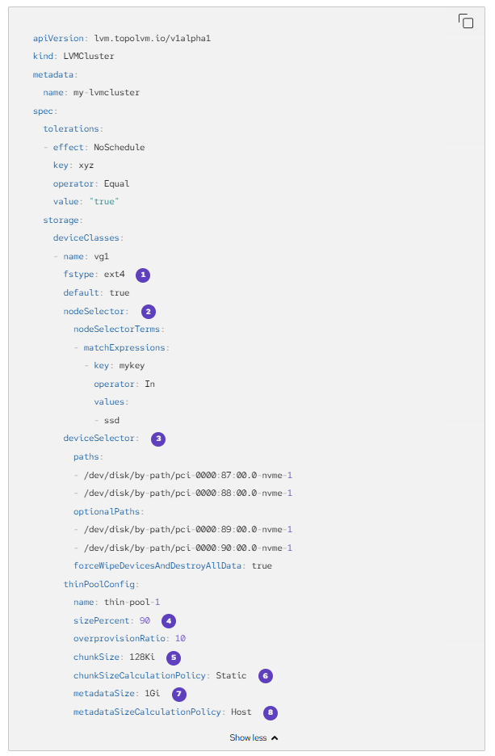
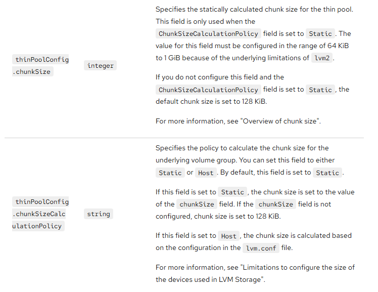

# LVM Storage - Chunk Size

LVMCluster custom resource controls LVM volume group creation as per [documentation](https://docs.redhat.com/en/documentation/openshift_container_platform/4.20/html/storage/persistent-storage-using-local-storage).

LVMCluster contains an optional chunkSize parameter that defaults to 128Ki and should be in 64Ki - 1GiB range. 

[Migration Toolkit for Virtualization](../mtv/README.md) has a [bug](https://issues.redhat.com/browse/RHEL-139390) with the default LVM Cluster chunk size. Until the bug is resolved, chunkSize must be set to 64Ki value.

## LVMCluster CR

## Chunk Size

[[Back]](./create_cluster.md)