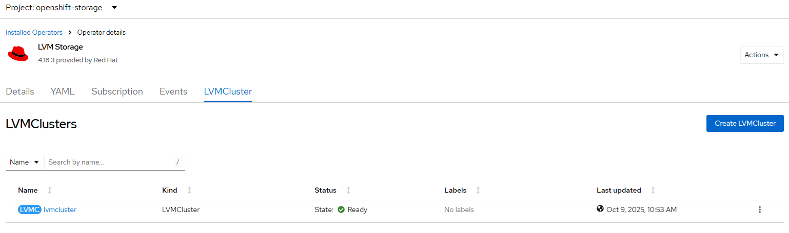

# LVM Storage - Create cluster

[[Back]](./README.md) [[kb]](./kb/cluster.md)

## Workflow

The desired state of LVM subsystem is controlled with **single** LVMCluster CRD
- Create LVM volume groups that you can use to provision persistent volume claims (PVCs).
- Configure a list of devices that you want to add to the LVM volume groups.
- Configure the requirements to select the nodes on which you want to create an LVM volume group, and the thin pool configuration for the volume group.
- Force wipe the selected devices

## Requirements

- LVM storage operator must be installed and ready
- LVM cluster instance must not be defined
- Storage class for LVM storage must not be defined
- if LVMCluster is generated based on --device input, ssh access to cluster is required

## Configurable options

```
# iserver set ocp lvm --mode cluster
  --cluster TEXT                  Cluster Name
  --filename TEXT                 LVM Cluster
  --device TEXT                   Device names for lvm storage
  --chunk TEXT                    Chunk size  
  --no-confirm                    Confirmation mode
```

Command | Intent | Details
--- | --- | ---
iserver set ocp lvm --mode cluster | generated LVMCluster CRD with dynamic resource discovery | [Link](./create_cluster_discovery.md)
iserver set ocp lvm --mode cluster --device | generated LVMCluster CRD with selected disk devices | [Link](./create_cluster_device.md)
iserver set ocp lvm --mode cluster --filename | user-provided LVMCluster CRD | [Link](./create_cluster_explicit.md)

Note on [chunk](./chunk_size.md) parameter

## Expected outcome



[[Back]](./README.md) [[kb]](./kb/cluster.md)