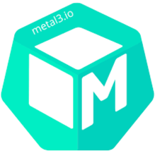

# Metal Kubed

[[Back]](../Operations.md)

 

[Metal3](https://metal3.io/) aka "Metal Kubed" is an open-source project that provides a set of tools for managing bare-metal infrastructure using Kubernetes. 
- Cluster API Provider - brings declarative, Kubernetes-style APIs to cluster creation, configuration and management
- Bare Metal Operator
    - inspects the host’s hardware and reports the details on the corresponding [BareMetalHost](./kb/crd/baremetalhost.md). This includes information about CPUs, RAM, disks, NICs, and more.
    - prepares the host by configuring RAID, changing firmware settings or updating the system and/or BMC firmware.
    - provisions the host with a desired image
    - cleans the host’s disk contents before and after provisioning.
- Ironic - the core component in Metal3 responsible for the provisioning and management of bare metal servers

Metal3 is built-in component in OpenShift cluster with functionality exposed via Console UI and range of crds. 

## Knowledge Base

> [!CAUTION]
> **DO MAKE SURE** your proxy settings are [defined](./kb/proxy.md) to keep bmc and os address range in `noProxy`

Operations
- Define host to be managed a.k.a. [registration](./kb/register.md)
- [Inspect](./kb/inspect.md) the host with [hardware inventory](./kb/hardware_inspection.md) outcome to enable provisioning, bios and firwmare changes
- BIOS settings [check](./kb/crd/hostfirmwaresettings.md) or [change](./kb/change_bios_settings.md)
- [Change firmware](./kb/firmware_upgrade.md)
- Install OS a.k.a. [provision](./kb/provisioned.md)
- Clean the host a.k.a. [deprovision](./kb/deprovision.md)
- Deleting the host information from Ironic without triggering deprovisioning a.k.a. [detach](./kb/detach.md)
- [Reinstall OS](./kb/reprovisiong.md)
- Host power control: [on](./kb/power_on.md), [off](./kb/power_off.md), [reboot](./kb/reboot.md)
- [Troubleshooting](./kb/troubleshooting.md)

OS | BareMetalHost | BMC Credentials | preprovisioningNetworkData | networkData | userData 
--- | --- | --- | --- | --- | --- 
[RHEL 8.10](./kb/rhel810/README.md) | [Link](./kb/rhel810/bmh.yaml) | [Link](./kb/rhel810/secret.yaml) | [Link](./kb/rhel810/pre.yaml) | [Link](./kb/rhel810/net.yaml) | [Link](./kb/rhel810/user.yaml)
[RHEL 9.8](./kb/rhel98/README.md) | [Link](./kb/rhel98/bmh.yaml) | [Link](./kb/rhel98/secret.yaml) | [Link](./kb/rhel98/pre.yaml) | [Link](./kb/rhel98/net.yaml) | [Link](./kb/rhel98/user.yaml)
[RHEL 10.2](./kb/rhel102/README.md) | [Link](./kb/rhel102/bmh.yaml) | [Link](./kb/rhel102/secret.yaml) | [Link](./kb/rhel102/pre.yaml) | [Link](./kb/rhel102/net.yaml) | [Link](./kb/rhel102/user.yaml)
[Ubuntu 26.04LTS](./kb/ubuntu2604/README.md) | [Link](./kb/ubuntu2604/bmh.yaml) | [Link](./kb/ubuntu2604/secret.yaml) | [Link](./kb/ubuntu2604/pre.yaml) | [Link](./kb/ubuntu2604/net.yaml) | [Link](./kb/ubuntu2604/user.yaml)

Host state
- [provisioning](./kb/provisioning_state.md)
- [operational](./kb/operational_state.md)

CRD
- [BareMetalHost](./kb/crd/baremetalhost.md) - Define host bmc access and desired state
- [FirmwareSchema](./kb/crd/firmwareschema.md) - Ironic-detected BIOS settings allowed values
- [HardwareData](./kb/crd/hardwaredata.md) - Hardware inventory as detected during inspection
- [HostFirmwareSettings](./kb/crd/hostfirmwaresettings.md) - Ironic-detected current BIOS settings
- [Provisioning](./kb/crd/provisioning.md) - cluster-wide Ironic configuration

Limitations
- [Redfish requirements](./kb/ironic_redfish.md)
- power management actions are **not** kubernetes friendly, refer to [node power management](../node-power/README.md)
- bios settings change depend on redfish property requirements
- bmo firmware upgrade applicable to subset of firmware components, consider host upgrade utility for complete upgrade instead

## Commands

Command | Intent | Details
--- | --- | ---
iserver get ocp bmh | get state | [Link](./get.md)
iserver set ocp bmh --mode node | create node | [Link](./create_node.md)
iserver set ocp bmh --mode bmc | node registration | [Link](./register.md)
iserver set ocp bmh --mode attach | attach host to provisioner | [Link](./attach.md)
iserver set ocp bmh --mode detach | detach host from provisioner | [Link](./detach.md)
iserver set ocp bmh --mode inspect | inspect host | [Link](./inspect.md)
iserver set ocp bmh --mode on | power on the node | [Link](./power_on.md)
iserver set ocp bmh --mode off | power off the node | [Link](./power_off.md)
iserver set ocp bmh --mode reboot | reboot the node | [Link](./reboot.md)
iserver delete ocp bmh --mode node | delete node | [Link](./delete_node.md)

[[Back]](../Operations.md)