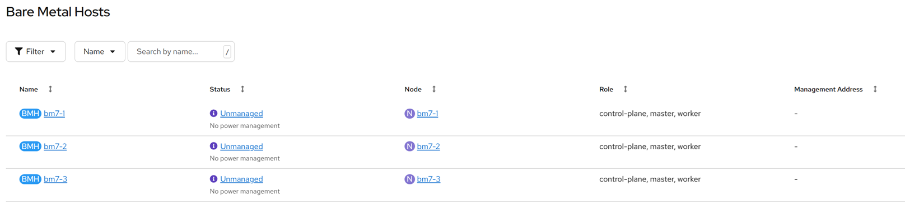
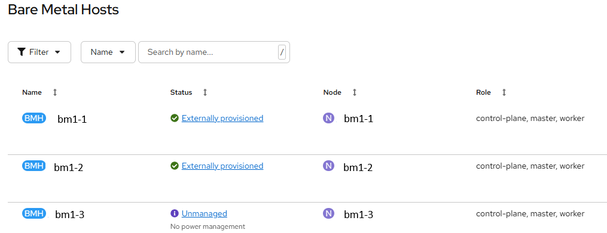

# Assisted installer cluster

[[Back]](../README.md)

In case of OpenShift cluster installed with [assisted installer](./assisted_installer.md), all hosts are automatically registered with `BareMetalHost` object 

Hosts spec
- no bmc address
- `externallyProvisioned: true`

Host status has all hardware details pre-populated **without** the need to run [hardware inspection](./inspect.md)

If bmc credentials are updated, host registration workflow will move the host to [externally provisioned](./externally_provisioned.md) state that enables power management oparations.

[[Back]](../README.md)