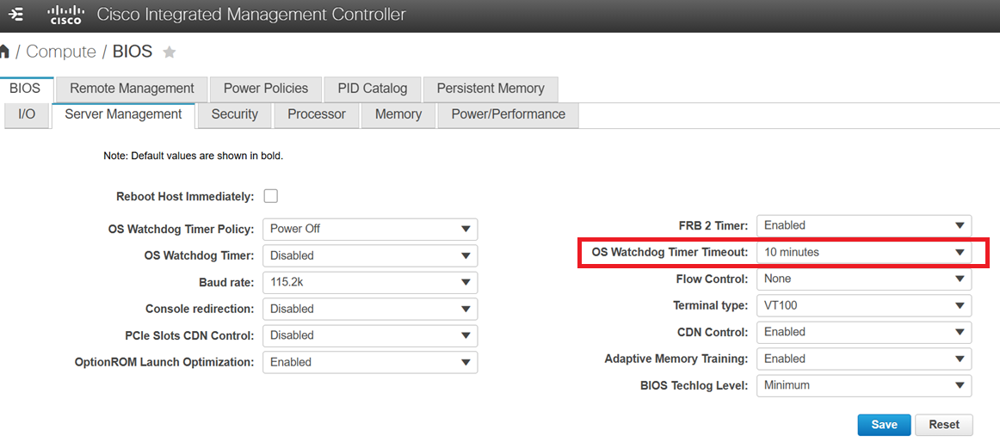
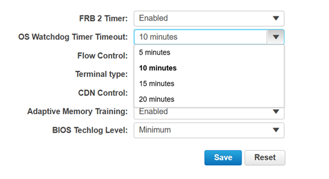

# Changing BIOS settings

[[Back]](../README.md)

Host firmware (bios) settings are detected during [inspection](./inspect.md) and exposed in [HostFirmwareSettings](./crd/hostfirmwaresettings.md) object.

>[!CAUTION]
>Host **must** be in [available](./available.md) state to make any BIOS change

Let's as an example try changing 'OS Watchdog Timer Timeout' BIOS settings

## Check current value



```yaml
apiVersion: metal3.io/v1alpha1
kind: HostFirmwareSettings
metadata:
  name: test2
  namespace: openshift-machine-api
  ownerReferences:
  - apiVersion: metal3.io/v1alpha1
    kind: BareMetalHost
    name: test2
spec:
  settings: {}
status:
  schema:
    name: schema-8f6cb13b
    namespace: openshift-machine-api
  settings:
    OSBootWatchdogTimerTimeout: 10 minutes
    ...
```

## What is the allowed value



```yaml
apiVersion: metal3.io/v1alpha1
kind: FirmwareSchema
metadata:
  name: schema-8f6cb13b
  namespace: openshift-machine-api
  ownerReferences:
  - apiVersion: metal3.io/v1alpha1
    kind: HostFirmwareSettings
    name: test2
spec:
  schema:
    OSBootWatchdogTimerTimeout:
      allowable_values:
      - 5 minutes
      - 10 minutes
      - 15 minutes
      - 20 minutes
      attribute_type: Enumeration
      max_length: 64
      min_length: 1
      read_only: false
      unique: true
    ...
```

## Change 

Update HostFirmwareSettings `spec.settings` field e.g.

```yaml
apiVersion: metal3.io/v1alpha1
kind: HostFirmwareSettings
metadata:
  creationTimestamp: "2026-08-13T19:08:29Z"
  generation: 2
  name: test2
  namespace: openshift-machine-api
  ownerReferences:
  - apiVersion: metal3.io/v1alpha1
    blockOwnerDeletion: true
    controller: true
    kind: BareMetalHost
    name: test2
    uid: 25ac6e25-6561-4a83-a4e8-5504d527dc17
  resourceVersion: "28989530"
  uid: 8006b8e7-6f0d-4ed1-93a5-5a4209e01ace
spec:
  settings:
    OSBootWatchdogTimerTimeout: 15 minutes
```

the status should should confirm change is valid and change detection successful

```yaml
status:
  conditions:
  - lastTransitionTime: "2026-08-13T20:01:29Z"
    message: ""
    observedGeneration: 2
    reason: Success
    status: "True"
    type: ChangeDetected
  - lastTransitionTime: "2026-08-13T20:01:29Z"
    message: ""
    observedGeneration: 2
    reason: Success
    status: "True"
    type: Valid
```

the host should enter `preparing` provisioning state and firmware settings should be eventually applied

## Troubleshooting

It is possible that BIOS settings will fail like below, based on bare metal host status

```yaml
status:
  errorCount: 1
  errorMessage: 'Node b2a8e9ff-168d-4b50-be8b-8a6a480a8256 failed step {''args'':
    {''settings'': [{''name'': ''OSBootWatchdogTimerTimeout'', ''value'': ''15 minutes''}]},
    ''interface'': ''bios'', ''step'': ''apply_configuration'', ''abortable'': False,
    ''priority'': 0}: ''NoneType'' object has no attribute ''commit'''
  errorType: preparation error
```

In order to troubleshoot it furter, check metal3-ironic logs e.g.

```
$ oc logs -n openshift-machine-api metal3-6ccc5f5658-v762q -c metal3-ironic 
```

Look for traceback like this and contact RedHat for support to figure out if the problem is on Ironic or compute firmware side

```
2026-08-13 20:02:32.207 47 DEBUG ironic.drivers.modules.redfish.bios [None req-ae84b63a-9ac1-406e-a7e9-262f8dc54b94 - - - - - -] Apply BIOS configuration for node b2a8e9ff-168d-4b50-be8b-8a6a480a8256: [{'name': 'OSBootWatchdogTimerTimeout', 'value': '15 minutes'}] apply_configuration /usr/lib/python3.12/site-packages/ironic/drivers/modules/redfish/bios.py:268
2026-08-13 20:02:32.207 47 WARNING ironic.drivers.modules.redfish.bios [None req-ae84b63a-9ac1-406e-a7e9-262f8dc54b94 - - - - - -] SupportedApplyTimes attribute missing for BIOS configuration on node b2a8e9ff-168d-4b50-be8b-8a6a480a8256: 
2026-08-13 20:02:32.207 47 ERROR ironic.conductor.utils [None req-ae84b63a-9ac1-406e-a7e9-262f8dc54b94 - - - - - -] Node b2a8e9ff-168d-4b50-be8b-8a6a480a8256 failed step {'args': {'settings': [{'name': 'OSBootWatchdogTimerTimeout', 'value': '15 minutes'}]}, 'interface': 'bios', 'step': 'apply_configuration', 'abortable': False, 'priority': 0}: 'NoneType' object has no attribute 'commit': AttributeError: 'NoneType' object has no attribute 'commit'
2026-08-13 20:02:32.207 47 ERROR ironic.conductor.utils Traceback (most recent call last):
2026-08-13 20:02:32.207 47 ERROR ironic.conductor.utils   File "/usr/lib/python3.12/site-packages/ironic/conductor/cleaning.py", line 278, in do_next_clean_step
2026-08-13 20:02:32.207 47 ERROR ironic.conductor.utils     result = interface.execute_clean_step(task, step)
2026-08-13 20:02:32.207 47 ERROR ironic.conductor.utils              ^^^^^^^^^^^^^^^^^^^^^^^^^^^^^^^^^^^^^^^^
2026-08-13 20:02:32.207 47 ERROR ironic.conductor.utils   File "/usr/lib/python3.12/site-packages/ironic/drivers/base.py", line 358, in execute_clean_step
2026-08-13 20:02:32.207 47 ERROR ironic.conductor.utils     return self._execute_step(task, step)
2026-08-13 20:02:32.207 47 ERROR ironic.conductor.utils            ^^^^^^^^^^^^^^^^^^^^^^^^^^^^^^
2026-08-13 20:02:32.207 47 ERROR ironic.conductor.utils   File "/usr/lib/python3.12/site-packages/ironic/drivers/base.py", line 318, in _execute_step
2026-08-13 20:02:32.207 47 ERROR ironic.conductor.utils     return getattr(self, step['step'])(task, **args)
2026-08-13 20:02:32.207 47 ERROR ironic.conductor.utils            ^^^^^^^^^^^^^^^^^^^^^^^^^^^^^^^^^^^^^^^^^
2026-08-13 20:02:32.207 47 ERROR ironic.conductor.utils   File "/usr/lib/python3.12/site-packages/ironic/drivers/base.py", line 1457, in wrapped
2026-08-13 20:02:32.207 47 ERROR ironic.conductor.utils     result = func(self, task, *args, **kwargs)
2026-08-13 20:02:32.207 47 ERROR ironic.conductor.utils              ^^^^^^^^^^^^^^^^^^^^^^^^^^^^^^^^^
2026-08-13 20:02:32.207 47 ERROR ironic.conductor.utils   File "/usr/lib/python3.12/site-packages/ironic/drivers/modules/redfish/bios.py", line 283, in apply_configuration
2026-08-13 20:02:32.207 47 ERROR ironic.conductor.utils     bios.set_attributes(attributes, apply_time=apply_time)
2026-08-13 20:02:32.207 47 ERROR ironic.conductor.utils   File "/usr/lib/python3.12/site-packages/sushy/resources/system/bios.py", line 156, in set_attributes
2026-08-13 20:02:32.207 47 ERROR ironic.conductor.utils     self._settings.commit(self._conn,
2026-08-13 20:02:32.207 47 ERROR ironic.conductor.utils     ^^^^^^^^^^^^^^^^^^^^^
2026-08-13 20:02:32.207 47 ERROR ironic.conductor.utils AttributeError: 'NoneType' object has no attribute 'commit'
2026-08-13 20:02:32.207 47 ERROR ironic.conductor.utils 
```

Checking [IronicProfile v1.1.0](./OpenStackIronicProfile.v1_1_0.json), `SupportedApplyTimes` property is recommended, not mandatory...

```yaml
  "Resources": {
      "Bios": {
          "Purpose": "Allows reading or changing BIOS settings.",
          "ReadRequirement": "Recommended",
          "PropertyRequirements": {
              "@Redfish.Settings": {
                  "PropertyRequirements": {
                      "SupportedApplyTimes": {
                          "Purpose": "Determines whether update is immediate or needs a reboot.",
                          "ReadRequirement": "Recommended",
                          "MinSupportValues": [
                              "OnReset"
                          ]
                      }
                  }
              }
          }
      }
  }
```

[[Back]](../README.md)