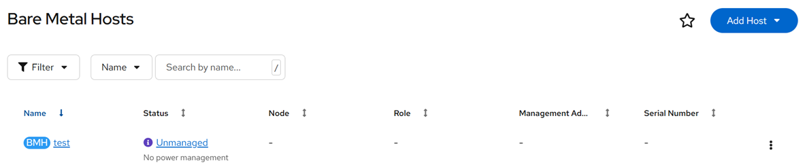
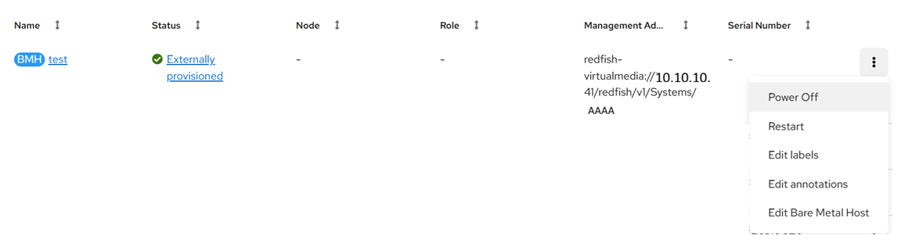

# BareMetalHost CRD

[[Back]](../../README.md)

`BareMetalHost` resource defines a physical host incl. redfish credentials and desired state. Refer to [crd details](https://doc.crds.dev/github.com/metal3-io/baremetal-operator/metal3.io/BareMetalHost/v1alpha1).

## Minimum

- `BareMetalHost` object expected to be in `openshift-machine-api` namespace
- `spec:online` is the only required parameter that defines desired power-on state in case when host is in stable `provisioned`provisionining state

```yaml
apiVersion: metal3.io/v1alpha1
kind: BareMetalHost
metadata:
  name: test
  namespace: openshift-machine-api
spec:
  online: true
```

 

Provisioning state := unmanaged
Operational state := discovered

Status Condition | Value | Reason
--- | --- | ---
Ready | False | NotProvisioned
Provisioned | False | 
AvailableForProvisioning | False | NotAvailable
Healthy | Unknown | Unknown
Manageable | False | NotManaged
Progressing | False | NotProgressing

```yaml
$ oc get bmh -n openshift-machine-api test -o yaml
apiVersion: metal3.io/v1alpha1
kind: BareMetalHost
metadata:
  finalizers:
  - baremetalhost.metal3.io
  generation: 2
  name: test
  namespace: openshift-machine-api
spec:
  automatedCleaningMode: metadata
  bmc:
    address: ""
    credentialsName: ""
  online: true
status:
  conditions:
  - lastTransitionTime: "2026-08-12T12:28:58Z"
    message: ""
    observedGeneration: 2
    reason: NotProvisioned
    status: "False"
    type: Ready
  - lastTransitionTime: "2026-08-12T12:28:58Z"
    message: ""
    observedGeneration: 2
    reason: NotAvailable
    status: "False"
    type: AvailableForProvisioning
  - lastTransitionTime: "2026-08-12T12:28:58Z"
    message: ""
    observedGeneration: 2
    reason: Unknown
    status: Unknown
    type: Healthy
  - lastTransitionTime: "2026-08-12T12:28:58Z"
    message: ""
    observedGeneration: 2
    reason: NotManaged
    status: "False"
    type: Manageable
  - lastTransitionTime: "2026-08-12T12:28:58Z"
    message: ""
    observedGeneration: 2
    reason: NotProgressing
    status: "False"
    type: Progressing
  - lastTransitionTime: "2026-08-12T12:28:58Z"
    message: ""
    observedGeneration: 2
    reason: NotProvisioned
    status: "False"
    type: Provisioned
  errorCount: 0
  errorMessage: ""
  goodCredentials: {}
  lastUpdated: "2026-08-12T12:28:58Z"
  operationHistory:
    deprovision:
      end: null
      start: null
    inspect:
      end: null
      start: null
    provision:
      end: null
      start: null
    register:
      end: null
      start: null
  operationalStatus: discovered
  poweredOn: false
  provisioning:
    ID: ""
    image:
      url: ""
    state: unmanaged
  triedCredentials: {}
```

Events

```
$ oc -n openshift-machine-api get events -w
LAST SEEN   TYPE     REASON       OBJECT               MESSAGE
0s          Normal   Discovered   baremetalhost/test   Discovered host with no BMC details
```

## Externally provisioned hosts

Bmc access follows **hardware dependent address format** as explained [here](https://book.metal3.io/bmo/supported_hardware.html).

Redfish credentials trigger [host registration](../register.md) workflow that is expected to move host into [externally provisioned](../externally_provisioned.md) state that allows for power management operations only.

```yaml
apiVersion: v1
kind: Secret
metadata:
  name: test-bmc-secret
  namespace: openshift-machine-api
  labels:
    environment.metal3.io: baremetal
type: Opaque
data:
  username: YWRtaW4=
  password: cGFzc3dvcmQ=
---
apiVersion: metal3.io/v1alpha1
kind: BareMetalHost
metadata:
  name: test
  namespace: openshift-machine-api
spec:
  online: true
  externallyProvisioned: true
  bmc:
    address: redfish-virtualmedia://10.10.10.10/redfish/v1/Systems/AAA
    credentialsName: test-bmc-secret
    disableCertificateVerification: true
```

 

Provisioning state := externally provisioned
Operational state := OK

Status Condition | Value | Reason
--- | --- | ---
Ready | True | Provisioned
Provisioned | True | Provisioned
AvailableForProvisioning | False | NotAvailable
Healthy | Unknown | Unknown
Manageable | True | Manageable
Progressing | False | NotProgressing

```yaml
$ oc get bmh -n openshift-machine-api test -o yaml
apiVersion: metal3.io/v1alpha1
kind: BareMetalHost
metadata:
  finalizers:
  - baremetalhost.metal3.io
  generation: 1
  name: test
  namespace: openshift-machine-api
spec:
  automatedCleaningMode: metadata
  bmc:
    address: redfish-virtualmedia://10.10.10.10/redfish/v1/Systems/AAA
    credentialsName: test-bmc-secret
    disableCertificateVerification: true
  externallyProvisioned: true
  online: true
status:
  conditions:
  - lastTransitionTime: "2026-08-12T18:13:13Z"
    message: ""
    observedGeneration: 1
    reason: Provisioned
    status: "True"
    type: Ready
  - lastTransitionTime: "2026-08-12T18:12:52Z"
    message: ""
    observedGeneration: 1
    reason: NotAvailable
    status: "False"
    type: AvailableForProvisioning
  - lastTransitionTime: "2026-08-12T18:12:52Z"
    message: ""
    observedGeneration: 1
    reason: Unknown
    status: Unknown
    type: Healthy
  - lastTransitionTime: "2026-08-12T18:13:13Z"
    message: ""
    observedGeneration: 1
    reason: Manageable
    status: "True"
    type: Manageable
  - lastTransitionTime: "2026-08-12T18:13:13Z"
    message: ""
    observedGeneration: 1
    reason: NotProgressing
    status: "False"
    type: Progressing
  - lastTransitionTime: "2026-08-12T18:13:13Z"
    message: ""
    observedGeneration: 1
    reason: Provisioned
    status: "True"
    type: Provisioned
  errorCount: 0
  errorMessage: ""
  goodCredentials:
    credentials:
      name: test-bmc-secret
      namespace: openshift-machine-api
    credentialsVersion: "28059803"
  hardwareProfile: unknown
  lastUpdated: "2026-08-12T18:13:43Z"
  operationHistory:
    deprovision:
      end: null
      start: null
    inspect:
      end: null
      start: null
    provision:
      end: null
      start: null
    register:
      end: "2026-08-12T18:13:13Z"
      start: "2026-08-12T18:12:52Z"
  operationalStatus: OK
  poweredOn: true
  provisioning:
    ID: fd2c2915-7dd3-43d4-9b44-54d16949c4c5
    bootMode: UEFI
    image:
      url: ""
    rootDeviceHints:
      deviceName: /dev/sda
    state: externally provisioned
  triedCredentials:
    credentials:
      name: test-bmc-secret
      namespace: openshift-machine-api
    credentialsVersion: "28059803"
```

## Provisioning-ready hosts

If `spec:externallyProvisioned` is unset or set to `false` value, then 

>[!CAUTION]
>`spec:preprovisioningNetworkDataName` may be required as explained [here](../inspect.md#preprovisioning-network-data)

```yaml
apiVersion: v1
kind: Secret
metadata:
  name: test-bmc-secret
  namespace: openshift-machine-api
  labels:
    environment.metal3.io: baremetal
type: Opaque
data:
  username: YWRtaW4=
  password: cGFzc3dvcmQ=
---
apiVersion: metal3.io/v1alpha1
kind: BareMetalHost
metadata:
  name: test
  namespace: openshift-machine-api
spec:
  online: true
  bmc:
    address: redfish-virtualmedia://10.10.10.10/redfish/v1/Systems/AAA
    credentialsName: test-bmc-secret
    disableCertificateVerification: true
```

Provisioning state := available
Operational state := OK

Status Condition | Value | Reason
--- | --- | ---
Ready | False | NotProvisioned
Provisioned | True | Provisioned
AvailableForProvisioning | True | Available
Healthy | Unknown | Unknown
Manageable | True | Manageable
Progressing | False | NotProgressing

[[Back]](../../README.md)