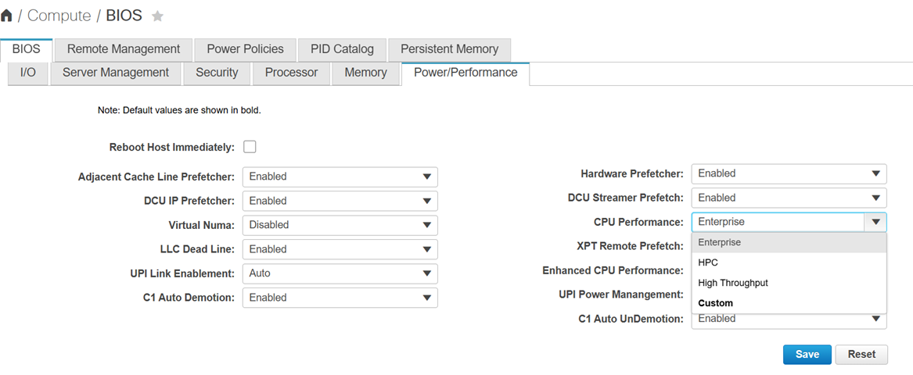

# FirmwareSchema

One or more `FirmwareSchema` resources are created for hosts that support firmware settings. This happens during [inspection](../inspect.md) and done by Ironic. Each schema object represents a list of possible settings and limits on their values.

Firmware schema resource is owned by one or more [HostFirmwareSettings](./hostfirmwaresettings.md) objects, that represent the bios settings state of every registered and hardware inspected host. 

>[!NOTE]
>Multiple hosts can own the same firmware schema if the schema is identical

## Example

```yaml
spec:
  schema:
    CPUPerformance:
      allowable_values:
      - Enterprise
      - HPC
      - High Throughput
      - Custom
      attribute_type: Enumeration
      max_length: 64
      min_length: 1
      read_only: false
      unique: true
```

 

## Full schema for sample server

```yaml
 apiVersion: metal3.io/v1alpha1
kind: FirmwareSchema
metadata:
  creationTimestamp: "2026-08-13T18:33:00Z"
  generation: 1
  name: schema-8f6cb13b
  namespace: openshift-machine-api
  ownerReferences:
  - apiVersion: metal3.io/v1alpha1
    kind: HostFirmwareSettings
    name: test
    uid: 8d5bb16b-93df-44c8-85fd-4aa4467e0835
  - apiVersion: metal3.io/v1alpha1
    kind: HostFirmwareSettings
    name: test2
    uid: 8006b8e7-6f0d-4ed1-93a5-5a4209e01ace
  resourceVersion: "28957714"
  uid: 7fb0a436-59a1-4317-a499-7fdc7be32c0b
spec:
  schema:
    ATS:
      allowable_values:
      - Enabled
      - Disabled
      attribute_type: Enumeration
      max_length: 64
      min_length: 1
      read_only: false
      unique: true
    AdjacentCacheLinePrefetch:
      allowable_values:
      - Enabled
      - Disabled
      attribute_type: Enumeration
      max_length: 64
      min_length: 1
      read_only: false
      unique: true
    AdvancedMemTest:
      allowable_values:
      - Disabled
      - Enabled
      - Auto
      attribute_type: Enumeration
      max_length: 64
      min_length: 1
      read_only: false
      unique: true
    AllLomPortControl:
      allowable_values:
      - Disabled
      - Enabled
      attribute_type: Enumeration
      max_length: 64
      min_length: 1
      read_only: false
      unique: true
    AutoCCState:
      allowable_values:
      - Disabled
      - Enabled
      attribute_type: Enumeration
      max_length: 64
      min_length: 1
      read_only: false
      unique: true
    BaudRate:
      allowable_values:
      - 9.6k
      - 19.2k
      - 38.4k
      - 57.6k
      - 115.2k
      attribute_type: Enumeration
      max_length: 64
      min_length: 1
      read_only: false
      unique: true
    BmeDmaMitigation:
      allowable_values:
      - Disabled
      - Enabled
      attribute_type: Enumeration
      max_length: 64
      min_length: 1
      read_only: false
      unique: true
    BootPerformanceMode:
      allowable_values:
      - Max Performance
      - Max Efficient
      - Set by Intel NM
      attribute_type: Enumeration
      max_length: 64
      min_length: 1
      read_only: false
      unique: true
    C1AutoDemotion:
      allowable_values:
      - Disabled
      - Enabled
      attribute_type: Enumeration
      max_length: 64
      min_length: 1
      read_only: false
      unique: true
    C1AutoUnDemotion:
      allowable_values:
      - Disabled
      - Enabled
      attribute_type: Enumeration
      max_length: 64
      min_length: 1
      read_only: false
      unique: true
    CPUPerformance:
      allowable_values:
      - Enterprise
      - HPC
      - High Throughput
      - Custom
      attribute_type: Enumeration
      max_length: 64
      min_length: 1
      read_only: false
      unique: true
    CRQos:
      allowable_values:
      - Mode 0 - Disable the PMem QoS Feature
      - Mode 1 - M2M QoS Enable;CHA QoS Disable
      - Mode 2 - M2M QoS Enable;CHA QoS Enable
      attribute_type: Enumeration
      max_length: 64
      min_length: 1
      read_only: false
      unique: true
    CiscoAdaptiveMemTraining:
      allowable_values:
      - Enabled
      - Disabled
      attribute_type: Enumeration
      max_length: 64
      min_length: 1
      read_only: false
      unique: true
    CiscoDebugLevel:
      allowable_values:
      - Maximum
      - Normal
      - Minimum
      attribute_type: Enumeration
      max_length: 64
      min_length: 1
      read_only: false
      unique: true
    CiscoOpromLaunchOptimization:
      allowable_values:
      - Enabled
      - Disabled
      attribute_type: Enumeration
      max_length: 64
      min_length: 1
      read_only: false
      unique: true
    CoherencySupport:
      allowable_values:
      - Enabled
      - Disabled
      attribute_type: Enumeration
      max_length: 64
      min_length: 1
      read_only: false
      unique: true
    ConfigTDPLevel:
      allowable_values:
      - Normal
      - Level 1
      - Level 2
      attribute_type: Enumeration
      max_length: 64
      min_length: 1
      read_only: false
      unique: true
    ConsoleRedir:
      allowable_values:
      - COM 0
      - COM 1
      - Disabled
      attribute_type: Enumeration
      max_length: 64
      min_length: 1
      read_only: false
      unique: true
    CoreMultiProcessing:
      allowable_values:
      - All
      - "1"
      - "2"
      - "3"
      - "4"
      - "5"
      - "6"
      - "7"
      - "8"
      - "9"
      - "10"
      - "11"
      - "12"
      - "13"
      - "14"
      - "15"
      - "16"
      - "17"
      - "18"
      - "19"
      - "20"
      - "21"
      - "22"
      - "23"
      - "24"
      - "25"
      - "26"
      - "27"
      - "28"
      - "29"
      - "30"
      - "31"
      - "32"
      - "33"
      - "34"
      - "35"
      - "36"
      - "37"
      - "38"
      - "39"
      - "40"
      - "41"
      - "42"
      - "43"
      - "44"
      - "45"
      - "46"
      - "47"
      - "48"
      attribute_type: Enumeration
      max_length: 64
      min_length: 1
      read_only: false
      unique: true
    CpuEngPerfBias:
      allowable_values:
      - Performance
      - Balanced Performance
      - Balanced Power
      - Power
      attribute_type: Enumeration
      max_length: 64
      min_length: 1
      read_only: false
      unique: true
    CpuHWPM:
      allowable_values:
      - Disabled
      - HWPM Native Mode
      - HWPM OOB Mode
      - Native Mode with no Legacy
      attribute_type: Enumeration
      max_length: 64
      min_length: 1
      read_only: false
      unique: true
    CpuPaLimit:
      allowable_values:
      - Enabled
      - Disabled
      attribute_type: Enumeration
      max_length: 64
      min_length: 1
      read_only: false
      unique: true
    CpuPerfEnhancement:
      allowable_values:
      - Disabled
      - Auto
      attribute_type: Enumeration
      max_length: 64
      min_length: 1
      read_only: false
      unique: true
    CrfastgoConfig:
      allowable_values:
      - Enable optimization
      - Disable optimization
      - Auto
      attribute_type: Enumeration
      max_length: 64
      min_length: 1
      read_only: false
      unique: true
    DCPMMFirmwareDowngrade:
      allowable_values:
      - Enabled
      - Disabled
      attribute_type: Enumeration
      max_length: 64
      min_length: 1
      read_only: false
      unique: true
    DcuIpPrefetch:
      allowable_values:
      - Enabled
      - Disabled
      attribute_type: Enumeration
      max_length: 64
      min_length: 1
      read_only: false
      unique: true
    DcuStreamerPrefetch:
      allowable_values:
      - Enabled
      - Disabled
      attribute_type: Enumeration
      max_length: 64
      min_length: 1
      read_only: false
      unique: true
    DmaCtrlOptIn:
      allowable_values:
      - Disabled
      - Enabled
      attribute_type: Enumeration
      max_length: 64
      min_length: 1
      read_only: false
      unique: true
    EPPProfile:
      allowable_values:
      - Performance
      - Balanced Performance
      - Balanced Power
      - Power
      attribute_type: Enumeration
      max_length: 64
      min_length: 1
      read_only: false
      unique: true
    EadrSupport:
      allowable_values:
      - Disabled
      - Enabled
      - Auto
      attribute_type: Enumeration
      max_length: 64
      min_length: 1
      read_only: false
      unique: true
    EdpcEn:
      allowable_values:
      - Disabled
      - On Fatal Error
      - On Fatal and Non-Fatal Errors
      attribute_type: Enumeration
      max_length: 64
      min_length: 1
      read_only: false
      unique: true
    EnableClockSpreadSpec:
      allowable_values:
      - Disabled
      - Enabled
      attribute_type: Enumeration
      max_length: 64
      min_length: 1
      read_only: false
      unique: true
    EnableMktme:
      allowable_values:
      - Enabled
      - Disabled
      attribute_type: Enumeration
      max_length: 64
      min_length: 1
      read_only: false
      unique: true
    EnableSgx:
      allowable_values:
      - Enabled
      - Disabled
      attribute_type: Enumeration
      max_length: 64
      min_length: 1
      read_only: false
      unique: true
    EnableTme:
      allowable_values:
      - Enabled
      - Disabled
      attribute_type: Enumeration
      max_length: 64
      min_length: 1
      read_only: false
      unique: true
    EnergyEfficientTurbo:
      allowable_values:
      - Disabled
      - Enabled
      attribute_type: Enumeration
      max_length: 64
      min_length: 1
      read_only: false
      unique: true
    EnhancedIntelSpeedStep:
      allowable_values:
      - Enabled
      - Disabled
      attribute_type: Enumeration
      max_length: 64
      min_length: 1
      read_only: false
      unique: true
    EpochUpdate:
      allowable_values:
      - SGX Owner EPOCH activated
      - Change to New Random Owner EPOCHs
      - Manual User Defined Owner EPOCHs
      attribute_type: Enumeration
      max_length: 64
      min_length: 1
      read_only: false
      unique: true
    FRB_2:
      allowable_values:
      - Enabled
      - Disabled
      attribute_type: Enumeration
      max_length: 64
      min_length: 1
      read_only: false
      unique: true
    FlowCtrl:
      allowable_values:
      - None
      - RTS-CTS
      attribute_type: Enumeration
      max_length: 64
      min_length: 1
      read_only: false
      unique: true
    HardwarePrefetch:
      allowable_values:
      - Enabled
      - Disabled
      attribute_type: Enumeration
      max_length: 64
      min_length: 1
      read_only: false
      unique: true
    IPV4HTTP:
      allowable_values:
      - Disabled
      - Enabled
      attribute_type: Enumeration
      max_length: 64
      min_length: 1
      read_only: false
      unique: true
    IPV4PXE:
      allowable_values:
      - Enabled
      - Disabled
      attribute_type: Enumeration
      max_length: 64
      min_length: 1
      read_only: false
      unique: true
    IPV6HTTP:
      allowable_values:
      - Disabled
      - Enabled
      attribute_type: Enumeration
      max_length: 64
      min_length: 1
      read_only: false
      unique: true
    IPV6PXE:
      allowable_values:
      - Disabled
      - Enabled
      attribute_type: Enumeration
      max_length: 64
      min_length: 1
      read_only: false
      unique: true
    IntelDynamicSpeedSelect:
      allowable_values:
      - Enabled
      - Disabled
      attribute_type: Enumeration
      max_length: 64
      min_length: 1
      read_only: false
      unique: true
    IntelHyperThread:
      allowable_values:
      - Enabled
      - Disabled
      attribute_type: Enumeration
      max_length: 64
      min_length: 1
      read_only: false
      unique: true
    IntelSpeedSelect:
      allowable_values:
      - Base
      - Config 3
      - Config 4
      attribute_type: Enumeration
      max_length: 64
      min_length: 1
      read_only: false
      unique: true
    IntelTurboBoostTech:
      allowable_values:
      - Enabled
      - Disabled
      attribute_type: Enumeration
      max_length: 64
      min_length: 1
      read_only: false
      unique: true
    IntelVT:
      allowable_values:
      - Enabled
      - Disabled
      attribute_type: Enumeration
      max_length: 64
      min_length: 1
      read_only: false
      unique: true
    IntelVTD:
      allowable_values:
      - Enabled
      - Disabled
      attribute_type: Enumeration
      max_length: 64
      min_length: 1
      read_only: false
      unique: true
    KTIPrefetch:
      allowable_values:
      - Disabled
      - Enabled
      - Auto
      attribute_type: Enumeration
      max_length: 64
      min_length: 1
      read_only: false
      unique: true
    LLCAlloc:
      allowable_values:
      - Disabled
      - Enabled
      - Auto
      attribute_type: Enumeration
      max_length: 64
      min_length: 1
      read_only: false
      unique: true
    LLCPrefetch:
      allowable_values:
      - Enabled
      - Disabled
      attribute_type: Enumeration
      max_length: 64
      min_length: 1
      read_only: false
      unique: true
    LocalX2Apic:
      allowable_values:
      - Enabled
      - Disabled
      attribute_type: Enumeration
      max_length: 64
      min_length: 1
      read_only: false
      unique: true
    LomOpromControlPort0:
      allowable_values:
      - Disabled
      - Enabled
      attribute_type: Enumeration
      max_length: 64
      min_length: 1
      read_only: false
      unique: true
    LomOpromControlPort1:
      allowable_values:
      - Disabled
      - Enabled
      attribute_type: Enumeration
      max_length: 64
      min_length: 1
      read_only: false
      unique: true
    MemoryBandwidthBoost:
      allowable_values:
      - Enabled
      - Disabled
      attribute_type: Enumeration
      max_length: 64
      min_length: 1
      read_only: false
      unique: true
    MemoryMappedIOAbove4GB:
      allowable_values:
      - Enabled
      - Disabled
      attribute_type: Enumeration
      max_length: 64
      min_length: 1
      read_only: false
      unique: true
    MemoryRefreshRate:
      allowable_values:
      - 1x Refresh
      - 2x Refresh
      attribute_type: Enumeration
      max_length: 64
      min_length: 1
      read_only: false
      unique: true
    MemorySizeLimit:
      attribute_type: Integer
      lower_bound: 0
      max_length: 64
      min_length: 1
      read_only: false
      unique: true
      upper_bound: 65535
    MemoryThermalThrottling:
      allowable_values:
      - Disabled
      - CLTT with PECI
      attribute_type: Enumeration
      max_length: 64
      min_length: 1
      read_only: false
      unique: true
    NUMAOptimize:
      allowable_values:
      - Enabled
      - Disabled
      attribute_type: Enumeration
      max_length: 64
      min_length: 1
      read_only: false
      unique: true
    NetworkStack:
      allowable_values:
      - Enabled
      - Disabled
      attribute_type: Enumeration
      max_length: 64
      min_length: 1
      read_only: false
      unique: true
    NvmdimmPerformConfig:
      allowable_values:
      - BW Optimized
      - Balanced Profile
      attribute_type: Enumeration
      max_length: 64
      min_length: 1
      read_only: false
      unique: true
    OSBootWatchdogTimer:
      allowable_values:
      - Enabled
      - Disabled
      attribute_type: Enumeration
      max_length: 64
      min_length: 1
      read_only: false
      unique: true
    OSBootWatchdogTimerPolicy:
      allowable_values:
      - Power Off
      - Reset
      attribute_type: Enumeration
      max_length: 64
      min_length: 1
      read_only: false
      unique: true
    OSBootWatchdogTimerTimeout:
      allowable_values:
      - 5 minutes
      - 10 minutes
      - 15 minutes
      - 20 minutes
      attribute_type: Enumeration
      max_length: 64
      min_length: 1
      read_only: false
      unique: true
    PCIeRASSupport:
      allowable_values:
      - Disabled
      - Enabled
      attribute_type: Enumeration
      max_length: 64
      min_length: 1
      read_only: false
      unique: true
    PackageCstateLimit:
      allowable_values:
      - No Limit
      - Auto
      - C0 C1 State
      - C2
      - C6 Non Retention
      - C6 Retention
      attribute_type: Enumeration
      max_length: 64
      min_length: 1
      read_only: false
      unique: true
    PanicHighWatermark:
      allowable_values:
      - High
      - Low
      attribute_type: Enumeration
      max_length: 64
      min_length: 1
      read_only: false
      unique: true
    PartialCacheLineSparing:
      allowable_values:
      - Enabled
      - Disabled
      attribute_type: Enumeration
      max_length: 64
      min_length: 1
      read_only: false
      unique: true
    PartialMirrorModeConfig:
      allowable_values:
      - Percentage
      - Value in GB
      - Disabled
      attribute_type: Enumeration
      max_length: 64
      min_length: 1
      read_only: false
      unique: true
    PartialMirrorPercent:
      attribute_type: Integer
      lower_bound: 0
      max_length: 64
      min_length: 1
      read_only: false
      unique: true
      upper_bound: 50
    PartialMirrorValue1:
      attribute_type: Integer
      lower_bound: 0
      max_length: 64
      min_length: 1
      read_only: false
      unique: true
      upper_bound: 65535
    PartialMirrorValue2:
      attribute_type: Integer
      lower_bound: 0
      max_length: 64
      min_length: 1
      read_only: false
      unique: true
      upper_bound: 65535
    PartialMirrorValue3:
      attribute_type: Integer
      lower_bound: 0
      max_length: 64
      min_length: 1
      read_only: false
      unique: true
      upper_bound: 65535
    PartialMirrorValue4:
      attribute_type: Integer
      lower_bound: 0
      max_length: 64
      min_length: 1
      read_only: false
      unique: true
      upper_bound: 65535
    PatrolScrub:
      allowable_values:
      - Disabled
      - Enabled
      - Enable at End of POST
      attribute_type: Enumeration
      max_length: 64
      min_length: 1
      read_only: false
      unique: true
    PciePllSsc:
      allowable_values:
      - Auto
      - Disabled
      - ZeroPointFive
      attribute_type: Enumeration
      max_length: 64
      min_length: 1
      read_only: false
      unique: true
    PcieSlot1LinkSpeed:
      allowable_values:
      - Disabled
      - Auto
      - GEN1
      - GEN2
      - GEN3
      - GEN4
      attribute_type: Enumeration
      max_length: 64
      min_length: 1
      read_only: false
      unique: true
    PcieSlot1OptionROM:
      allowable_values:
      - Disabled
      - Enabled
      attribute_type: Enumeration
      max_length: 64
      min_length: 1
      read_only: false
      unique: true
    PcieSlot2LinkSpeed:
      allowable_values:
      - Disabled
      - Auto
      - GEN1
      - GEN2
      - GEN3
      - GEN4
      attribute_type: Enumeration
      max_length: 64
      min_length: 1
      read_only: false
      unique: true
    PcieSlot2OptionROM:
      allowable_values:
      - Disabled
      - Enabled
      attribute_type: Enumeration
      max_length: 64
      min_length: 1
      read_only: false
      unique: true
    PcieSlot3LinkSpeed:
      allowable_values:
      - Disabled
      - Auto
      - GEN1
      - GEN2
      - GEN3
      - GEN4
      attribute_type: Enumeration
      max_length: 64
      min_length: 1
      read_only: false
      unique: true
    PcieSlot3OptionROM:
      allowable_values:
      - Disabled
      - Enabled
      attribute_type: Enumeration
      max_length: 64
      min_length: 1
      read_only: false
      unique: true
    PcieSlot4LinkSpeed:
      allowable_values:
      - Disabled
      - Auto
      - GEN1
      - GEN2
      - GEN3
      - GEN4
      attribute_type: Enumeration
      max_length: 64
      min_length: 1
      read_only: false
      unique: true
    PcieSlot4OptionROM:
      allowable_values:
      - Disabled
      - Enabled
      attribute_type: Enumeration
      max_length: 64
      min_length: 1
      read_only: false
      unique: true
    PcieSlot5LinkSpeed:
      allowable_values:
      - Disabled
      - Auto
      - GEN1
      - GEN2
      - GEN3
      - GEN4
      attribute_type: Enumeration
      max_length: 64
      min_length: 1
      read_only: false
      unique: true
    PcieSlot5OptionROM:
      allowable_values:
      - Disabled
      - Enabled
      attribute_type: Enumeration
      max_length: 64
      min_length: 1
      read_only: false
      unique: true
    PcieSlot6LinkSpeed:
      allowable_values:
      - Disabled
      - Auto
      - GEN1
      - GEN2
      - GEN3
      - GEN4
      attribute_type: Enumeration
      max_length: 64
      min_length: 1
      read_only: false
      unique: true
    PcieSlot6OptionROM:
      allowable_values:
      - Disabled
      - Enabled
      attribute_type: Enumeration
      max_length: 64
      min_length: 1
      read_only: false
      unique: true
    PcieSlotFrontNvme1LinkSpeed:
      allowable_values:
      - Disabled
      - Auto
      - GEN1
      - GEN2
      - GEN3
      - GEN4
      attribute_type: Enumeration
      max_length: 64
      min_length: 1
      read_only: false
      unique: true
    PcieSlotFrontNvme1OptionROM:
      allowable_values:
      - Disabled
      - Enabled
      attribute_type: Enumeration
      max_length: 64
      min_length: 1
      read_only: false
      unique: true
    PcieSlotFrontNvme2LinkSpeed:
      allowable_values:
      - Disabled
      - Auto
      - GEN1
      - GEN2
      - GEN3
      - GEN4
      attribute_type: Enumeration
      max_length: 64
      min_length: 1
      read_only: false
      unique: true
    PcieSlotFrontNvme2OptionROM:
      allowable_values:
      - Disabled
      - Enabled
      attribute_type: Enumeration
      max_length: 64
      min_length: 1
      read_only: false
      unique: true
    PcieSlotFrontNvme3LinkSpeed:
      allowable_values:
      - Disabled
      - Auto
      - GEN1
      - GEN2
      - GEN3
      - GEN4
      attribute_type: Enumeration
      max_length: 64
      min_length: 1
      read_only: false
      unique: true
    PcieSlotFrontNvme3OptionROM:
      allowable_values:
      - Disabled
      - Enabled
      attribute_type: Enumeration
      max_length: 64
      min_length: 1
      read_only: false
      unique: true
    PcieSlotFrontNvme4LinkSpeed:
      allowable_values:
      - Disabled
      - Auto
      - GEN1
      - GEN2
      - GEN3
      - GEN4
      attribute_type: Enumeration
      max_length: 64
      min_length: 1
      read_only: false
      unique: true
    PcieSlotFrontNvme4OptionROM:
      allowable_values:
      - Disabled
      - Enabled
      attribute_type: Enumeration
      max_length: 64
      min_length: 1
      read_only: false
      unique: true
    PcieSlotFrontNvme5LinkSpeed:
      allowable_values:
      - Disabled
      - Auto
      - GEN1
      - GEN2
      - GEN3
      - GEN4
      attribute_type: Enumeration
      max_length: 64
      min_length: 1
      read_only: false
      unique: true
    PcieSlotFrontNvme5OptionROM:
      allowable_values:
      - Disabled
      - Enabled
      attribute_type: Enumeration
      max_length: 64
      min_length: 1
      read_only: false
      unique: true
    PcieSlotFrontNvme6LinkSpeed:
      allowable_values:
      - Disabled
      - Auto
      - GEN1
      - GEN2
      - GEN3
      - GEN4
      attribute_type: Enumeration
      max_length: 64
      min_length: 1
      read_only: false
      unique: true
    PcieSlotFrontNvme6OptionROM:
      allowable_values:
      - Disabled
      - Enabled
      attribute_type: Enumeration
      max_length: 64
      min_length: 1
      read_only: false
      unique: true
    PcieSlotFrontNvme7LinkSpeed:
      allowable_values:
      - Disabled
      - Auto
      - GEN1
      - GEN2
      - GEN3
      - GEN4
      attribute_type: Enumeration
      max_length: 64
      min_length: 1
      read_only: false
      unique: true
    PcieSlotFrontNvme7OptionROM:
      allowable_values:
      - Disabled
      - Enabled
      attribute_type: Enumeration
      max_length: 64
      min_length: 1
      read_only: false
      unique: true
    PcieSlotFrontNvme8LinkSpeed:
      allowable_values:
      - Disabled
      - Auto
      - GEN1
      - GEN2
      - GEN3
      - GEN4
      attribute_type: Enumeration
      max_length: 64
      min_length: 1
      read_only: false
      unique: true
    PcieSlotFrontNvme8OptionROM:
      allowable_values:
      - Disabled
      - Enabled
      attribute_type: Enumeration
      max_length: 64
      min_length: 1
      read_only: false
      unique: true
    PcieSlotFrontNvme9LinkSpeed:
      allowable_values:
      - Disabled
      - Auto
      - GEN1
      - GEN2
      - GEN3
      - GEN4
      attribute_type: Enumeration
      max_length: 64
      min_length: 1
      read_only: false
      unique: true
    PcieSlotFrontNvme9OptionROM:
      allowable_values:
      - Disabled
      - Enabled
      attribute_type: Enumeration
      max_length: 64
      min_length: 1
      read_only: false
      unique: true
    PcieSlotFrontNvme10LinkSpeed:
      allowable_values:
      - Disabled
      - Auto
      - GEN1
      - GEN2
      - GEN3
      - GEN4
      attribute_type: Enumeration
      max_length: 64
      min_length: 1
      read_only: false
      unique: true
    PcieSlotFrontNvme10OptionROM:
      allowable_values:
      - Disabled
      - Enabled
      attribute_type: Enumeration
      max_length: 64
      min_length: 1
      read_only: false
      unique: true
    PcieSlotFrontNvme11LinkSpeed:
      allowable_values:
      - Disabled
      - Auto
      - GEN1
      - GEN2
      - GEN3
      - GEN4
      attribute_type: Enumeration
      max_length: 64
      min_length: 1
      read_only: false
      unique: true
    PcieSlotFrontNvme11OptionROM:
      allowable_values:
      - Disabled
      - Enabled
      attribute_type: Enumeration
      max_length: 64
      min_length: 1
      read_only: false
      unique: true
    PcieSlotFrontNvme12LinkSpeed:
      allowable_values:
      - Disabled
      - Auto
      - GEN1
      - GEN2
      - GEN3
      - GEN4
      attribute_type: Enumeration
      max_length: 64
      min_length: 1
      read_only: false
      unique: true
    PcieSlotFrontNvme12OptionROM:
      allowable_values:
      - Disabled
      - Enabled
      attribute_type: Enumeration
      max_length: 64
      min_length: 1
      read_only: false
      unique: true
    PcieSlotMLOMLinkSpeed:
      allowable_values:
      - Disabled
      - Auto
      - GEN1
      - GEN2
      - GEN3
      - GEN4
      attribute_type: Enumeration
      max_length: 64
      min_length: 1
      read_only: false
      unique: true
    PcieSlotMLOMOptionROM:
      allowable_values:
      - Disabled
      - Enabled
      attribute_type: Enumeration
      max_length: 64
      min_length: 1
      read_only: false
      unique: true
    PcieSlotMSTORRAIDOptionROM:
      allowable_values:
      - Disabled
      - Enabled
      attribute_type: Enumeration
      max_length: 64
      min_length: 1
      read_only: false
      unique: true
    PcieSlotsCdnEnable:
      allowable_values:
      - Disabled
      - Enabled
      attribute_type: Enumeration
      max_length: 64
      min_length: 1
      read_only: false
      unique: true
    PrmrrSize:
      allowable_values:
      - Invalid Config.
      - 1G
      - 2G
      - 4G
      - 8G
      - 16G
      - 32G
      - 64G
      - 128G
      - 256G
      - 512G
      attribute_type: Enumeration
      max_length: 64
      min_length: 1
      read_only: false
      unique: true
    ProcessorC1E:
      allowable_values:
      - Enabled
      - Disabled
      attribute_type: Enumeration
      max_length: 64
      min_length: 1
      read_only: false
      unique: true
    ProcessorC6Report:
      allowable_values:
      - Enabled
      - Disabled
      attribute_type: Enumeration
      max_length: 64
      min_length: 1
      read_only: false
      unique: true
    ProcessorCMCI:
      allowable_values:
      - Enabled
      - Disabled
      attribute_type: Enumeration
      max_length: 64
      min_length: 1
      read_only: false
      unique: true
    PsdCoordType:
      allowable_values:
      - HW ALL
      - SW ALL
      attribute_type: Enumeration
      max_length: 64
      min_length: 1
      read_only: false
      unique: true
    PwrPerfTuning:
      allowable_values:
      - OS
      - BIOS
      - PECI
      attribute_type: Enumeration
      max_length: 64
      min_length: 1
      read_only: false
      unique: true
    QpiLinkSpeed:
      allowable_values:
      - 9.6GT/s
      - 10.4GT/s
      - 11.2GT/s
      - Auto
      attribute_type: Enumeration
      max_length: 64
      min_length: 1
      read_only: false
      unique: true
    SHA1PCRBank:
      allowable_values:
      - Enabled
      - Disabled
      attribute_type: Enumeration
      max_length: 64
      min_length: 1
      read_only: false
      unique: true
    SHA256PCRBank:
      allowable_values:
      - Enabled
      - Disabled
      attribute_type: Enumeration
      max_length: 64
      min_length: 1
      read_only: false
      unique: true
    SNC:
      allowable_values:
      - Enabled
      - Disabled
      attribute_type: Enumeration
      max_length: 64
      min_length: 1
      read_only: false
      unique: true
    SelectMemoryRAS:
      allowable_values:
      - Mirror Mode 1LM
      - ADDDC Sparing
      - Partial Mirror mode 1LM
      - Maximum Performance
      attribute_type: Enumeration
      max_length: 64
      min_length: 1
      read_only: false
      unique: true
    SelectPprType:
      allowable_values:
      - Disabled
      - Hard PPR
      attribute_type: Enumeration
      max_length: 64
      min_length: 1
      read_only: false
      unique: true
    SgxAutoRegistrationAgent:
      allowable_values:
      - Enabled
      - Disabled
      attribute_type: Enumeration
      max_length: 64
      min_length: 1
      read_only: false
      unique: true
    SgxEpoch0:
      attribute_type: String
      max_length: 64
      min_length: 1
      read_only: false
      unique: true
    SgxEpoch1:
      attribute_type: String
      max_length: 64
      min_length: 1
      read_only: false
      unique: true
    SgxFactoryReset:
      allowable_values:
      - Enabled
      - Disabled
      attribute_type: Enumeration
      max_length: 64
      min_length: 1
      read_only: false
      unique: true
    SgxLePubKeyHash0:
      attribute_type: String
      max_length: 64
      min_length: 1
      read_only: false
      unique: true
    SgxLePubKeyHash1:
      attribute_type: String
      max_length: 64
      min_length: 1
      read_only: false
      unique: true
    SgxLePubKeyHash2:
      attribute_type: String
      max_length: 64
      min_length: 1
      read_only: false
      unique: true
    SgxLePubKeyHash3:
      attribute_type: String
      max_length: 64
      min_length: 1
      read_only: false
      unique: true
    SgxLeWr:
      allowable_values:
      - Enabled
      - Disabled
      attribute_type: Enumeration
      max_length: 64
      min_length: 1
      read_only: false
      unique: true
    SgxPackageInfoInBandAccess:
      allowable_values:
      - Enabled
      - Disabled
      attribute_type: Enumeration
      max_length: 64
      min_length: 1
      read_only: false
      unique: true
    SgxQoS:
      allowable_values:
      - Enabled
      - Disabled
      attribute_type: Enumeration
      max_length: 64
      min_length: 1
      read_only: false
      unique: true
    SnoopyModeFor2LM:
      allowable_values:
      - Enabled
      - Disabled
      attribute_type: Enumeration
      max_length: 64
      min_length: 1
      read_only: false
      unique: true
    SnoopyModeForAD:
      allowable_values:
      - Enabled
      - Disabled
      attribute_type: Enumeration
      max_length: 64
      min_length: 1
      read_only: false
      unique: true
    TPMControl:
      allowable_values:
      - Enabled
      - Disabled
      attribute_type: Enumeration
      max_length: 64
      min_length: 1
      read_only: false
      unique: true
    TPMPendingOperation:
      allowable_values:
      - None
      - TpmClear
      attribute_type: Enumeration
      max_length: 64
      min_length: 1
      read_only: false
      unique: true
    TXTSupport:
      allowable_values:
      - Enabled
      - Disabled
      attribute_type: Enumeration
      max_length: 64
      min_length: 1
      read_only: false
      unique: true
    TerminalType:
      allowable_values:
      - PC-ANSI
      - VT100
      - VT100-PLUS
      - VT-UTF8
      attribute_type: Enumeration
      max_length: 64
      min_length: 1
      read_only: false
      unique: true
    TpmPpiRequired:
      allowable_values:
      - Enabled
      - Disabled
      attribute_type: Enumeration
      max_length: 64
      min_length: 1
      read_only: false
      unique: true
    TpmSupport:
      allowable_values:
      - Enabled
      - Disabled
      attribute_type: Enumeration
      max_length: 64
      min_length: 1
      read_only: false
      unique: true
    UFSDisable:
      allowable_values:
      - Enabled
      - Disabled
      attribute_type: Enumeration
      max_length: 64
      min_length: 1
      read_only: false
      unique: true
    UPILinkEnablement:
      allowable_values:
      - Auto
      - "1"
      - "2"
      attribute_type: Enumeration
      max_length: 64
      min_length: 1
      read_only: false
      unique: true
    UPIPowerManagement:
      allowable_values:
      - Disabled
      - Enabled
      attribute_type: Enumeration
      max_length: 64
      min_length: 1
      read_only: false
      unique: true
    UmaBasedClustering:
      allowable_values:
      - Hemisphere(2-clusters)
      - Disable(All2All)
      attribute_type: Enumeration
      max_length: 64
      min_length: 1
      read_only: false
      unique: true
    UsbLegacySupport:
      allowable_values:
      - Disabled
      - Enabled
      - Auto
      attribute_type: Enumeration
      max_length: 64
      min_length: 1
      read_only: false
      unique: true
    UsbPortInt:
      allowable_values:
      - Enabled
      - Disabled
      attribute_type: Enumeration
      max_length: 64
      min_length: 1
      read_only: false
      unique: true
    UsbPortRear:
      allowable_values:
      - Enabled
      - Disabled
      attribute_type: Enumeration
      max_length: 64
      min_length: 1
      read_only: false
      unique: true
    VMDEnable:
      allowable_values:
      - Disabled
      - Enabled
      attribute_type: Enumeration
      max_length: 64
      min_length: 1
      read_only: false
      unique: true
    VgaPriority:
      allowable_values:
      - Onboard
      - Offboard
      - Onboard VGA Disabled
      attribute_type: Enumeration
      max_length: 64
      min_length: 1
      read_only: false
      unique: true
    VirtualNuma:
      allowable_values:
      - Enabled
      - Disabled
      attribute_type: Enumeration
      max_length: 64
      min_length: 1
      read_only: false
      unique: true
    VolMemoryMode:
      allowable_values:
      - 2LM
      - 1LM
      attribute_type: Enumeration
      max_length: 64
      min_length: 1
      read_only: false
      unique: true
    WorkLdConfig:
      allowable_values:
      - Balanced
      - IO Sensitive
      attribute_type: Enumeration
      max_length: 64
      min_length: 1
      read_only: false
      unique: true
    X2ApicOptOut:
      allowable_values:
      - Disabled
      - Enabled
      attribute_type: Enumeration
      max_length: 64
      min_length: 1
      read_only: false
      unique: true
    XPTPrefetch:
      allowable_values:
      - Enabled
      - Disabled
      - Auto
      attribute_type: Enumeration
      max_length: 64
      min_length: 1
      read_only: false
      unique: true
    XPTRemotePrefetch:
      allowable_values:
      - Disabled
      - Enabled
      - Auto
      attribute_type: Enumeration
      max_length: 64
      min_length: 1
      read_only: false
      unique: true
    cdnEnable:
      allowable_values:
      - Enabled
      - Disabled
      attribute_type: Enumeration
      max_length: 64
      min_length: 1
      read_only: false
      unique: true
```