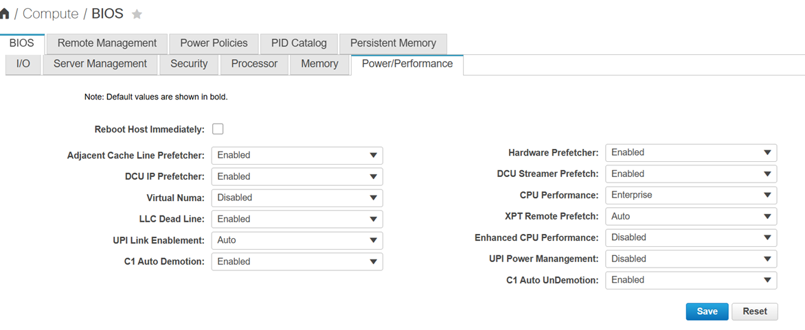

# HostFirmwareSettings (BIOS Settings)

[[Back]](../../README.md)

A `HostFirmwareSettings` resource is automatically created during [inspection](../inspect.md) for each host that supports firmware settings with the same name and in the same namespace as host. 

>[!CAUTION]
>Ironic does not constantly update the current settings to avoid an unnecessary load on the host’s BMC. The current settings are updated on enrollment, provisioning and deprovisioning only.

Fields
- `status.settings` store current BIOS settings as detected by Ironic
- `spec.settings` keeps the change requested by the user, initial mappting is empty
- `status.schema` contains a link to the [firmware schema](./firmwareschema.md)
- `status.conditions`
    - `Valid` indicates `spec.settings` validity according to the host’s [FirmwareSchema](./firmwareschema.md)
    - `ChangeDetected` indicates if the desired settings and the real settings do not diverge

## Example

Bare Metal Host called `test2` has been defined with bmc credentials and preprovisioningNetworkDataName to allow for successful [inspection](../inspect.md). 

The values below are aligned with BIOS settings that you can find in CIMC GUI

 

```yaml
apiVersion: metal3.io/v1alpha1
kind: BareMetalHost
metadata:
  name: test2
  namespace: openshift-machine-api
spec:
  online: true
  preprovisioningNetworkDataName: test2-network
  bmc:
    address: redfish-virtualmedia://10.10.10.10/redfish/v1/Systems/AAA
    credentialsName: test2-bmc-secret
    disableCertificateVerification: true
```

As soon as host passed the [registration](../register.md) phase, inspection starts. Then ironic collects bios or firmware settings and `HostFirmwareSettings` object is populated accordingly

```yaml
apiVersion: metal3.io/v1alpha1
kind: HostFirmwareSettings
metadata:
  creationTimestamp: "2026-08-13T19:08:29Z"
  generation: 1
  name: test2
  namespace: openshift-machine-api
  ownerReferences:
  - apiVersion: metal3.io/v1alpha1
    blockOwnerDeletion: true
    controller: true
    kind: BareMetalHost
    name: test2
    uid: 25ac6e25-6561-4a83-a4e8-5504d527dc17
  resourceVersion: "28957717"
  uid: 8006b8e7-6f0d-4ed1-93a5-5a4209e01ace
spec:
  settings: {}
status:
  conditions:
  - lastTransitionTime: "2026-08-13T19:08:29Z"
    message: ""
    observedGeneration: 1
    reason: Success
    status: "True"
    type: Valid
  - lastTransitionTime: "2026-08-13T19:08:29Z"
    message: ""
    observedGeneration: 1
    reason: Success
    status: "False"
    type: ChangeDetected
  lastUpdated: "2026-08-13T19:08:29Z"
  schema:
    name: schema-8f6cb13b
    namespace: openshift-machine-api
  settings:
    ATS: Enabled
    AdjacentCacheLinePrefetch: Enabled
    AdvancedMemTest: Auto
    AllLomPortControl: Enabled
    AutoCCState: Disabled
    BaudRate: 115.2k
    BmeDmaMitigation: Disabled
    BootPerformanceMode: Max Performance
    C1AutoDemotion: Enabled
    C1AutoUnDemotion: Enabled
    CPUPerformance: Enterprise
    CRQos: Mode 0 - Disable the PMem QoS Feature
    CiscoAdaptiveMemTraining: Enabled
    CiscoDebugLevel: Minimum
    CiscoOpromLaunchOptimization: Enabled
    CoherencySupport: Disabled
    ConfigTDPLevel: Normal
    ConsoleRedir: Disabled
    CoreMultiProcessing: All
    CpuEngPerfBias: Balanced Performance
    CpuHWPM: HWPM Native Mode
    CpuPaLimit: Enabled
    CpuPerfEnhancement: Disabled
    CrfastgoConfig: Auto
    DCPMMFirmwareDowngrade: Disabled
    DcuIpPrefetch: Enabled
    DcuStreamerPrefetch: Enabled
    DmaCtrlOptIn: Disabled
    EPPProfile: Balanced Performance
    EadrSupport: Disabled
    EdpcEn: On Fatal and Non-Fatal Errors
    EnableClockSpreadSpec: Enabled
    EnableMktme: Disabled
    EnableSgx: Disabled
    EnableTme: Disabled
    EnergyEfficientTurbo: Disabled
    EnhancedIntelSpeedStep: Enabled
    EpochUpdate: Manual User Defined Owner EPOCHs
    FRB_2: Enabled
    FlowCtrl: None
    HardwarePrefetch: Enabled
    IPV4HTTP: Enabled
    IPV4PXE: Enabled
    IPV6HTTP: Enabled
    IPV6PXE: Disabled
    IntelDynamicSpeedSelect: Disabled
    IntelHyperThread: Enabled
    IntelSpeedSelect: Base
    IntelTurboBoostTech: Enabled
    IntelVT: Enabled
    IntelVTD: Enabled
    KTIPrefetch: Auto
    LLCAlloc: Enabled
    LLCPrefetch: Enabled
    LocalX2Apic: Disabled
    LomOpromControlPort0: Enabled
    LomOpromControlPort1: Enabled
    MemoryBandwidthBoost: Enabled
    MemoryMappedIOAbove4GB: Enabled
    MemoryRefreshRate: 2x Refresh
    MemorySizeLimit: "0"
    MemoryThermalThrottling: CLTT with PECI
    NUMAOptimize: Enabled
    NetworkStack: Enabled
    NvmdimmPerformConfig: BW Optimized
    OSBootWatchdogTimer: Disabled
    OSBootWatchdogTimerPolicy: Power Off
    OSBootWatchdogTimerTimeout: 10 minutes
    PCIeRASSupport: Enabled
    PackageCstateLimit: C0 C1 State
    PanicHighWatermark: Low
    PartialCacheLineSparing: Enabled
    PartialMirrorModeConfig: Disabled
    PartialMirrorPercent: "0.00"
    PartialMirrorValue1: "0"
    PartialMirrorValue2: "0"
    PartialMirrorValue3: "0"
    PartialMirrorValue4: "0"
    PatrolScrub: Enabled
    PciePllSsc: Auto
    PcieSlot1LinkSpeed: Auto
    PcieSlot1OptionROM: Enabled
    PcieSlot2LinkSpeed: Auto
    PcieSlot2OptionROM: Enabled
    PcieSlot3LinkSpeed: Auto
    PcieSlot3OptionROM: Enabled
    PcieSlot4LinkSpeed: Auto
    PcieSlot4OptionROM: Enabled
    PcieSlot5LinkSpeed: Auto
    PcieSlot5OptionROM: Enabled
    PcieSlot6LinkSpeed: Auto
    PcieSlot6OptionROM: Enabled
    PcieSlotFrontNvme1LinkSpeed: Auto
    PcieSlotFrontNvme1OptionROM: Enabled
    PcieSlotFrontNvme2LinkSpeed: Auto
    PcieSlotFrontNvme2OptionROM: Enabled
    PcieSlotFrontNvme3LinkSpeed: Auto
    PcieSlotFrontNvme3OptionROM: Enabled
    PcieSlotFrontNvme4LinkSpeed: Auto
    PcieSlotFrontNvme4OptionROM: Enabled
    PcieSlotFrontNvme5LinkSpeed: Auto
    PcieSlotFrontNvme5OptionROM: Enabled
    PcieSlotFrontNvme6LinkSpeed: Auto
    PcieSlotFrontNvme6OptionROM: Enabled
    PcieSlotFrontNvme7LinkSpeed: Auto
    PcieSlotFrontNvme7OptionROM: Enabled
    PcieSlotFrontNvme8LinkSpeed: Auto
    PcieSlotFrontNvme8OptionROM: Enabled
    PcieSlotFrontNvme9LinkSpeed: Auto
    PcieSlotFrontNvme9OptionROM: Enabled
    PcieSlotFrontNvme10LinkSpeed: Auto
    PcieSlotFrontNvme10OptionROM: Enabled
    PcieSlotFrontNvme11LinkSpeed: Auto
    PcieSlotFrontNvme11OptionROM: Enabled
    PcieSlotFrontNvme12LinkSpeed: Auto
    PcieSlotFrontNvme12OptionROM: Enabled
    PcieSlotMLOMLinkSpeed: Auto
    PcieSlotMLOMOptionROM: Enabled
    PcieSlotMSTORRAIDOptionROM: Enabled
    PcieSlotsCdnEnable: Disabled
    PrmrrSize: Invalid Config.
    ProcessorC1E: Disabled
    ProcessorC6Report: Disabled
    ProcessorCMCI: Enabled
    PsdCoordType: HW ALL
    PwrPerfTuning: OS
    QpiLinkSpeed: Auto
    SHA1PCRBank: Enabled
    SHA256PCRBank: Enabled
    SNC: Disabled
    SelectMemoryRAS: ADDDC Sparing
    SelectPprType: Hard PPR
    SgxAutoRegistrationAgent: Disabled
    SgxEpoch0: "0"
    SgxEpoch1: "0"
    SgxFactoryReset: Disabled
    SgxLePubKeyHash0: "0"
    SgxLePubKeyHash1: "0"
    SgxLePubKeyHash2: "0"
    SgxLePubKeyHash3: "0"
    SgxLeWr: Enabled
    SgxPackageInfoInBandAccess: Disabled
    SgxQoS: Enabled
    SnoopyModeFor2LM: Disabled
    SnoopyModeForAD: Disabled
    TPMControl: Enabled
    TPMPendingOperation: None
    TXTSupport: Disabled
    TerminalType: VT100
    TpmPpiRequired: Disabled
    TpmSupport: Enabled
    UFSDisable: Enabled
    UPILinkEnablement: Auto
    UPIPowerManagement: Disabled
    UmaBasedClustering: Hemisphere(2-clusters)
    UsbLegacySupport: Enabled
    UsbPortInt: Enabled
    UsbPortRear: Enabled
    VMDEnable: Disabled
    VgaPriority: Onboard
    VirtualNuma: Disabled
    VolMemoryMode: 2LM
    WorkLdConfig: IO Sensitive
    X2ApicOptOut: Disabled
    XPTPrefetch: Auto
    XPTRemotePrefetch: Auto
    cdnEnable: Enabled
```

[[Back]](../../README.md)