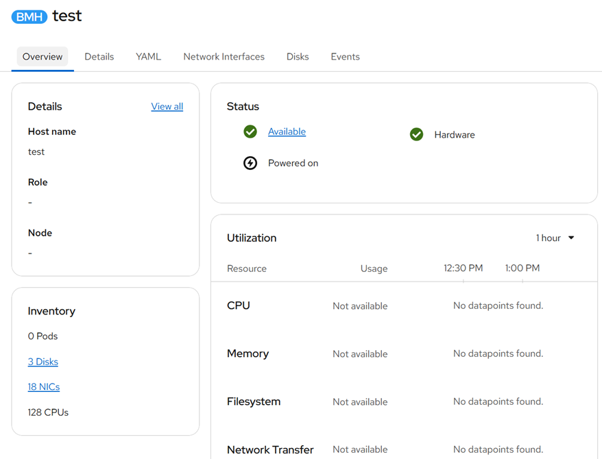

# Hardware inspection

[[Back]](../README.md)

The outcome of [inspection](./inspect.md) is the hardware data exposed in `status.hardware` of [[BareMetalHost]](./crd/baremetalhost.md), [HardwareData](./crd/hardwaredata.md) object, as well as on Console UI



```yaml
status:
  hardware:
    cpu:
      arch: x86_64
      clockMegahertz: 3200
      count: 128
      flags:
      - 3dnowprefetch
      - abm
      - acpi
      - adx
      - aes
      - aperfmperf
      - apic
      - arat
      - arch_capabilities
      - arch_perfmon
      - art
      - avx
      - avx2
      - avx512_bitalg
      - avx512_vbmi2
      - avx512_vnni
      - avx512_vpopcntdq
      - avx512bw
      - avx512cd
      - avx512dq
      - avx512f
      - avx512ifma
      - avx512vbmi
      - avx512vl
      - bmi1
      - bmi2
      - bts
      - cat_l3
      - clflush
      - clflushopt
      - clwb
      - cmov
      - constant_tsc
      - cpuid
      - cpuid_fault
      - cqm
      - cqm_llc
      - cqm_mbm_local
      - cqm_mbm_total
      - cqm_occup_llc
      - cx16
      - cx8
      - dca
      - de
      - ds_cpl
      - dtes64
      - dtherm
      - dts
      - epb
      - ept
      - ept_ad
      - erms
      - est
      - f16c
      - flexpriority
      - flush_l1d
      - fma
      - fpu
      - fsgsbase
      - fsrm
      - fxsr
      - gfni
      - ht
      - hwp
      - hwp_act_window
      - hwp_epp
      - hwp_pkg_req
      - ibpb
      - ibrs
      - ibrs_enhanced
      - ida
      - intel_ppin
      - intel_pt
      - invpcid
      - la57
      - lahf_lm
      - lm
      - mba
      - mca
      - mce
      - md_clear
      - mmx
      - monitor
      - movbe
      - msr
      - mtrr
      - nonstop_tsc
      - nopl
      - nx
      - ospke
      - pae
      - pat
      - pbe
      - pcid
      - pclmulqdq
      - pconfig
      - pdcm
      - pdpe1gb
      - pebs
      - pge
      - pku
      - pln
      - pni
      - popcnt
      - pse
      - pse36
      - pts
      - rdpid
      - rdrand
      - rdseed
      - rdt_a
      - rdtscp
      - rep_good
      - sdbg
      - sep
      - sha_ni
      - smap
      - smep
      - smx
      - split_lock_detect
      - ss
      - ssbd
      - sse
      - sse2
      - sse4_1
      - sse4_2
      - ssse3
      - stibp
      - syscall
      - tm
      - tm2
      - tpr_shadow
      - tsc
      - tsc_adjust
      - tsc_deadline_timer
      - umip
      - vaes
      - vme
      - vmx
      - vnmi
      - vpclmulqdq
      - vpid
      - wbnoinvd
      - x2apic
      - xgetbv1
      - xsave
      - xsavec
      - xsaveopt
      - xsaves
      - xtopology
      - xtpr
      model: Intel(R) Xeon(R) Gold 6338 CPU @ 2.00GHz
    firmware:
      bios:
        date: 04/26/2024
        vendor: Cisco Systems, Inc.
        version: C240M6.xyz
    hostname: test
    nics:
    - mac: ..:..:..:..:..:..
      model: 0x8086 0x1563
      name: enp1s0f0
      pciAddress: "0000:01:00.0"
      speedGbps: 10
    - lldp:
        portID: Ethernet1/28/1
        switchID: ..:..:..:..:..:..
        switchSystemName: sw1
      mac: ..:..:..:..:..:..
      model: 0x8086 0x1572
      name: ens10f3
      pciAddress: 0000:4b:00.3
    - lldp:
        portID: Ethernet1/1
        switchID: ..:..:..:..:..:..
        switchSystemName: sw2
      mac: ..:..:..:..:..:..
      model: 0x1137 0x0043
      name: eno6
      pciAddress: 0000:1c:00.1
    - lldp:
        portID: Eth1/28/1
        switchID: ..:..:..:..:..:..
        switchSystemName: sw3
      mac: ..:..:..:..:..:..
      model: 0x8086 0x1572
      name: ens10f1
      pciAddress: 0000:4b:00.1
    - mac: ..:..:..:..:..:..
      model: 0x1137 0x0043
      name: eno13
      pciAddress: 0000:9d:00.6
      speedGbps: 10
    - mac: ..:..:..:..:..:..
      model: 0x1137 0x0043
      name: eno11
      pciAddress: 0000:9d:00.4
      speedGbps: 10
    - mac: ..:..:..:..:..:..
      model: 0x1137 0x0043
      name: eno9
      pciAddress: 0000:9d:00.2
      speedGbps: 10
    - mac: ..:..:..:..:..:..
      model: 0x8086 0x1563
      name: enp1s0f1
      pciAddress: "0000:01:00.1"
      speedGbps: 10
    - mac: ..:..:..:..:..:..
      model: 0x1137 0x0043
      name: eno7
      pciAddress: 0000:9d:00.0
      speedGbps: 10
    - mac: ..:..:..:..:..:..
      model: 0x8086 0x1572
      name: ens10f2
      pciAddress: 0000:4b:00.2
    - lldp:
        portID: Ethernet1/1
        switchID: ..:..:..:..:..:..
        switchSystemName: sw5
      mac: ..:..:..:..:..:..
      model: 0x1137 0x0043
      name: eno5
      pciAddress: 0000:1c:00.0
    - mac: ..:..:..:..:..:..
      model: 0x1137 0x0043
      name: eno14
      pciAddress: 0000:9d:00.7
      speedGbps: 10
    - lldp:
        portID: Eth1/28/1
        switchID: ..:..:..:..:..:..
        switchSystemName: sw6
      mac: ..:..:..:..:..:..
      model: 0x8086 0x1572
      name: ens10f0
      pciAddress: 0000:4b:00.0
    - ip: 10.10.10.65
      mac: ..:..:..:..:..:..
      name: bond0.666
    - mac: ..:..:..:..:..:..
      model: 0x1137 0x0043
      name: eno12
      pciAddress: 0000:9d:00.5
      speedGbps: 10
    - mac: ..:..:..:..:..:..
      model: 0x1137 0x0043
      name: eno10
      pciAddress: 0000:9d:00.3
      speedGbps: 10
    - lldp:
        portID: Ethernet1/1
        switchID: ..:..:..:..:..:..
        switchSystemName: sw7
      mac: ..:..:..:..:..:..
      name: bond0
    - mac: ..:..:..:..:..:..
      model: 0x1137 0x0043
      name: eno8
      pciAddress: 0000:9d:00.1
      speedGbps: 10
    ramMebibytes: 524288
    storage:
    - alternateNames:
      - /dev/sde
      - /dev/disk/by-path/pci-0000:04:00.0-ata-1
      hctl: "17:0:0:0"
      model: CISCO VD
      name: /dev/disk/by-path/pci-0000:04:00.0-ata-1
      rotational: true
      serialNumber: 123456
      sizeBytes: 1920316276736
      type: HDD
      vendor: ATA
    - alternateNames:
      - /dev/nvme1n1
      - /dev/disk/by-path/pci-0000:cb:00.0-nvme-1
      model: INTEL SSD...
      name: /dev/disk/by-path/pci-0000:cb:00.0-nvme-1
      serialNumber: 123456
      sizeBytes: 1920383410176
      type: NVME
      wwn: eui.01000000000000005cd2e4dcdc775551
    - alternateNames:
      - /dev/nvme0n1
      - /dev/disk/by-path/pci-0000:ca:00.0-nvme-1
      model: INTEL SSD...
      name: /dev/disk/by-path/pci-0000:ca:00.0-nvme-1
      serialNumber: 123456
      sizeBytes: 1920383410176
      type: NVME
      wwn: eui.01000000000000005cd2e40121715551
    systemVendor:
      manufacturer: Cisco Systems Inc
      productName: UCSC-C240-M6N
      serialNumber: AAAA
```

[[Back]](../README.md)