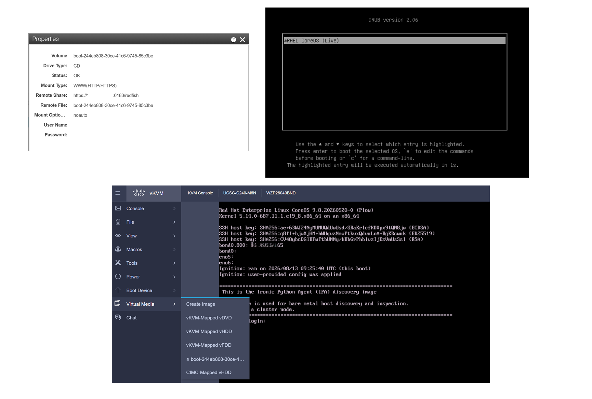
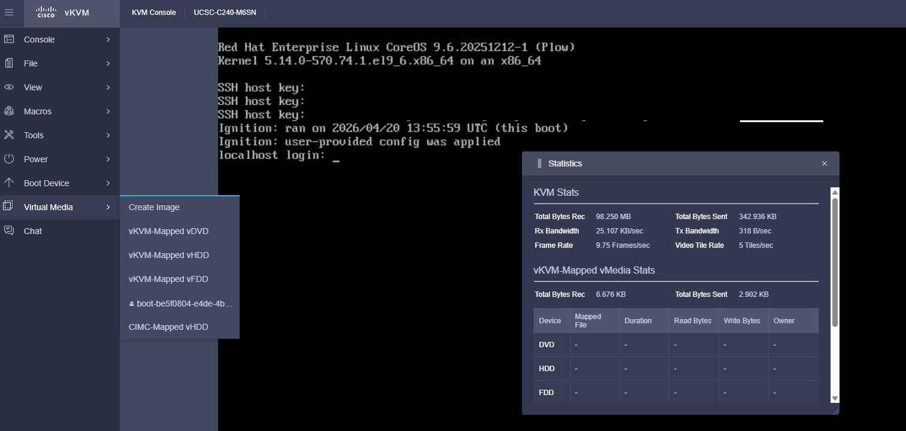

# Host inspection

[[Back]](../README.md)

## Prerequisite

Make sure that there is no virtual media mounted on the host, or inspection will fail to start with event like below

```
5s          Normal    InspectionError        baremetalhost/test                                Failed to inspect hardware. Reason: unable to start inspection: All virtual media mount attempts failed. Error encountered: Inserting virtual media into VirtualMediaType.CD failed for node 65f4f9de-4971-49fc-bb51-7f09d22fe4e2, moving to next virtual media device, if available. HTTP POST https://10.10.10.41/redfish/v1/Managers/CIMC/VirtualMedia/0/Actions/VirtualMedia.InsertMedia returned code 400. Base.1.13.0.GeneralError: Insert operation is not possible as Image is already present on the media. Please eject the existing image to insert new image Extended information: [{'@odata.type': '#Message.v1_1_1.Message', 'MessageId': 'Base.1.13.0.GeneralError', 'Message': 'Insert operation is not possible as Image is already present on the media. Please eject the existing image to insert new image', 'MessageArgs': [], 'Severity': 'Critical'}]
```

## Automatic inspection

When new `BareMetalHost` is created and `spec.externallyProvisioned` field is set to  `false` or undefined, the server boots via virtual media prepared image from one of the cluster nodes, ironic agent collects information about the available hardware components and sends it back to Metal3. The host will stay in the inspecting state until this process is completed.

## Inspection-per-request

Inspection can be initiated by [annotation](https://book.metal3.io/bmo/inspect_annotation.html). Once inspection is requested, you should see the `BareMetalHost` in inspecting state until inspection is completed, and by the end of inspection the inspect.metal3.io annotation will be removed automatically.

```
$ oc annotate bmh -n openshift-machine-api bm1-1 inspect.metal3.io=''
baremetalhost.metal3.io/bm1-1 annotated
```

## Inspection workflow



- parse [preprovisioning network data](#preprovisioning-network-data) secret if defined
- generate boot iso with network data either user-configured or dhcp-based
- expose boot iso on one of the cluster nodes
- configure virtual media boot on the inspected node and configure one time boot order via Redfish
- power on the host via Redfish
- host should boot from the Ironic Python Agent (IPA) discovery image
- that image is likely pre-configured to call-back-home and report hardware inventory data collected locally to metal3 
- ip address acqusition as per network data as well as network connectivity between the host and openshift cluster node is required
- once the inventory data is collected
  - inspection is finished and [hardware data collected](./hardware_inspection.md)
  - virtual media unmounted
  - host transitions into `available` state 
  - host is not power cycled and keeps on running discovery image

### Example

- `BareMetalHost` created
- ironic inspection triggered
- collection of server parameters via Redfish: systems, cimc, chassis, network adapters
- system powered off using Systems/DDDD/Actions/ComputerSystem.Reset with {'ResetType': 'ForceOff'} body
- VirtualMedia EjectMedia
- VirtualMedia InsertMedia errors but ironic recovers with the expected set of parameters

> [!NOTE]
> Image is hosted on `metal3` pod running on one of the cluster nodes

```
    "@odata.id": "/redfish/v1/Managers/CIMC/VirtualMedia/0",
    "Image": "https://20.20.20.20:6183/redfish/boot-be5f0804-e4de-4b15-9ebe-8d4f885485c7.iso?noauto",
    "TransferMethod": "Stream",
    "TransferProtocolType": "HTTPS",
    "WriteProtected": true,
    "Inserted": true,
    "ConnectedVia": "URI",
    "ImageName": "boot-be5f0804-e4de-4b15-9ebe-8d4f885485c7.iso",
    "Status": {
        "State": "Enabled",
        "Health": "OK"
    },
    "Id": "0",
    "Name": "Virtual CD",
    "MediaTypes": [
        "CD",
        "DVD"
    ],
```

- BootSourceOverrideMode critical error that is also highlited-red by redfish-interop-validator
- BootSourceOverrideTarget set to Cd
- Reset with Systems/DDDD/Actions/ComputerSystem.Reset {'ResetType': 'On'}
- Server boots from iso



- the logs below every now-and-then, the server keeps on reading data from mounted iso

```
2026-04-21 07:32:51.267 HTTP request: GET https://10.10.10.13/redfish/v1/Systems/DDDD; headers: {'OData-Version': '4.0', 'Accept-Encoding': 'identity'}; body: None; blocking: False; timeout: 60; session arguments: {}; _op /usr/lib/python3.12/site-packages/sushy/connector.py:167
2026-04-21 07:32:51.432 HTTP response for GET https://10.10.10.13/redfish/v1/Systems/DDDD: status code: 200 _op /usr/lib/python3.12/site-packages/sushy/connector.py:331       
...
```

- Loop (3x every 30mins): redfish triggered power off, eject media, insert media, boot from cd, power on, server boots from vmedia
- inspection finishes with error

```
status:
  errorCount: 4
  errorMessage: timeout reached while inspecting the node
  errorType: inspection error
```

### EjectMedia

```
2026-04-20 12:55:47.361 HTTP request: POST https://10.10.10.13/redfish/v1/Managers/CIMC/VirtualMedia/0/Actions/VirtualMedia.EjectMedia; headers: {'OData-Version': '4.0', 'Accept-Encoding': 'identity'}; body: None; blocking: False; timeout: 60; session arguments: {}; _op /usr/lib/python3.12/site-packages/sushy/connector.py:167
2026-04-20 12:55:47.827 HTTP response for POST https://10.10.10.13/redfish/v1/Managers/CIMC/VirtualMedia/0/Actions/VirtualMedia.EjectMedia: status code: 204 _op /usr/lib/python3.12/site-packages/sushy/connector.py:331
```

### InsertMedia

Managers/CIMC/VirtualMedia/0/Actions/VirtualMedia.InsertMedia
- TransferProtocolType missing
- TransferMethod missing

metal3-ironic adapts to the responses from UCSC and final InsertMedia is processed with 202 response

```
2026-04-20 12:55:48.294 HTTP request: POST https://10.10.10.13/redfish/v1/Managers/CIMC/VirtualMedia/0/Actions/VirtualMedia.InsertMedia; headers: {'Content-Type': 'application/json', 'OData-Version': '4.0', 'Accept-Encoding': 'identity'}; body: {'Image': 'https://10.10.10.71:6183/redfish/boot-be5f0804-e4de-4b15-9ebe-8d4f885485c7.iso'}; blocking: False; timeout: 60; session arguments: {}; _op /usr/lib/python3.12/site-packages/sushy/connector.py:167
2026-04-20 12:55:48.558 56 DEBUG sushy.exceptions [None req-d76c4957-f60d-4bb8-bc4a-ffc0cd78dea8 - - - - - -] HTTP response for POST https://10.10.10.13/redfish/v1/Managers/CIMC/VirtualMedia/0/Actions/VirtualMedia.InsertMedia: status code: 400, error: Base.1.4.0.GeneralError: 'TransferProtocolType' property which is mandatory to complete the action is missing in the request body., extended: [{'@odata.type': '#Message.v1_1_1.Message', 'MessageId': 'Base.1.4.0.GeneralError', 'Message': "'TransferProtocolType' property which is mandatory to complete the action is missing in the request body.", 'MessageArgs': [], 'Severity': 'Critical'}] __init__ /usr/lib/python3.12/site-packages/sushy/exceptions.py:122

2026-04-20 12:55:48.558 HTTP request: POST https://10.10.10.13/redfish/v1/Managers/CIMC/VirtualMedia/0/Actions/VirtualMedia.InsertMedia; headers: {'Content-Type': 'application/json', 'OData-Version': '4.0', 'Accept-Encoding': 'identity'}; body: {'Image': 'https://10.10.10.71:6183/redfish/boot-be5f0804-e4de-4b15-9ebe-8d4f885485c7.iso', 'TransferProtocolType': 'HTTPS'}; blocking: False; timeout: 60; session arguments: {}; _op /usr/lib/python3.12/site-packages/sushy/connector.py:167
2026-04-20 12:55:48.742 56 DEBUG sushy.exceptions [None req-d76c4957-f60d-4bb8-bc4a-ffc0cd78dea8 - - - - - -] HTTP response for POST https://10.10.10.13/redfish/v1/Managers/CIMC/VirtualMedia/0/Actions/VirtualMedia.InsertMedia: status code: 400, error: Base.1.4.0.GeneralError: 'TransferMethod' property which is mandatory to complete the action is missing in the request body., extended: [{'@odata.type': '#Message.v1_1_1.Message', 'MessageId': 'Base.1.4.0.GeneralError', 'Message': "'TransferMethod' property which is mandatory to complete the action is missing in the request body.", 'MessageArgs': [], 'Severity': 'Critical'}] __init__ /usr/lib/python3.12/site-packages/sushy/exceptions.py:122

2026-04-20 12:55:48.743 HTTP request: POST https://10.10.10.13/redfish/v1/Managers/CIMC/VirtualMedia/0/Actions/VirtualMedia.InsertMedia; headers: {'Content-Type': 'application/json', 'OData-Version': '4.0', 'Accept-Encoding': 'identity'}; body: {'Image': 'https://10.10.10.71:6183/redfish/boot-be5f0804-e4de-4b15-9ebe-8d4f885485c7.iso', 'TransferProtocolType': 'HTTPS', 'TransferMethod': 'Stream'}; blocking: False; timeout: 60; session arguments: {}; _op /usr/lib/python3.12/site-packages/sushy/connector.py:167
2026-04-20 12:55:50.133 HTTP response for POST https://10.10.10.13/redfish/v1/Managers/CIMC/VirtualMedia/0/Actions/VirtualMedia.InsertMedia: status code: 202 _op /usr/lib/python3.12/site-packages/sushy/connector.py:331
```

### Boot from Cd

```
2026-04-20 12:55:51.548 HTTP request: PATCH https://10.10.10.13/redfish/v1/Systems/DDDD; headers: {'Content-Type': 'application/json', 'OData-Version': '4.0', 'Accept-Encoding': 'identity'}; body: {'Boot': {'BootSourceOverrideTarget': 'Cd'}}; blocking: False; timeout: 60; session arguments: {}; _op /usr/lib/python3.12/site-packages/sushy/connector.py:167
2026-04-20 12:55:51.877 HTTP response for PATCH https://10.10.10.13/redfish/v1/Systems/DDDD: status code: 200 _op /usr/lib/python3.12/site-packages/sushy/connector.py:331     
2026-04-20 12:55:52.644 HTTP request: POST https://10.10.10.13/redfish/v1/Systems/DDDD/Actions/ComputerSystem.Reset; headers: {'Content-Type': 'application/json', 'OData-Version': '4.0', 'Accept-Encoding': 'identity'}; body: {'ResetType': 'On'}; blocking: False; timeout: 60; session arguments: {}; _op /usr/lib/python3.12/site-packages/sushy/connector.py:167
2026-04-20 12:55:52.874 HTTP response for POST https://10.10.10.13/redfish/v1/Systems/DDDD/Actions/ComputerSystem.Reset: status code: 204 _op /usr/lib/python3.12/site-packages/sushy/connector.py:331
```

### BootSourceOverrideMode

Systems/DDDD/BootSourceOverrideMode
- property update fails
- "Setting boot mode to uefi failed for node"
- Critical error

```
2026-04-20 12:55:50.930 HTTP request: PATCH https://10.10.10.13/redfish/v1/Systems/DDDD; headers: {'Content-Type': 'application/json', 'OData-Version': '4.0', 'Accept-Encoding': 'identity'}; body: {'Boot': {'BootSourceOverrideMode': 'UEFI'}}; blocking: False; timeout: 60; session arguments: {}; _op /usr/lib/python3.12/site-packages/sushy/connector.py:167
2026-04-20 12:55:51.119 56 DEBUG sushy.exceptions [None req-d76c4957-f60d-4bb8-bc4a-ffc0cd78dea8 - - - - - -] HTTP response for PATCH https://10.10.10.13/redfish/v1/Systems/DDDD: status code: 400, error: Base.1.4.0.GeneralError: Following properties in the request body cannot be updated because they are either read only, unknown or unsupported : "BootSourceOverrideMode", extended: [{'@odata.type': '#Message.v1_1_1.Message', 'MessageId': 'Base.1.4.0.GeneralError', 'RelatedProperties': ['BootSourceOverrideMode'], 'Message': 'Following properties in the request body cannot be updated because they are either read only, unknown or unsupported : "BootSourceOverrideMode"', 'MessageArgs': [], 'Severity': 'Critical'}] __init__ /usr/lib/python3.12/site-packages/sushy/exceptions.py:122
2026-04-20 12:55:51.119 56 WARNING sushy.connector [None req-d76c4957-f60d-4bb8-bc4a-ffc0cd78dea8 - - - - - -] Initial request with eTag failed: HTTP PATCH https://10.10.10.13/redfish/v1/Systems/DDDD returned code 400. Base.1.4.0.GeneralError: Following properties in the request body cannot be updated because they are either read only, unknown or unsupported : "BootSourceOverrideMode" Extended information: [{'@odata.type': '#Message.v1_1_1.Message', 'MessageId': 'Base.1.4.0.GeneralError', 'RelatedProperties': ['BootSourceOverrideMode'], 'Message': 'Following properties in the request body cannot be updated because they are either read only, unknown or unsupported : "BootSourceOverrideMode"', 'MessageArgs': [], 'Severity': 'Critical'}]: sushy.exceptions.BadRequestError: HTTP PATCH https://10.10.10.13/redfish/v1/Systems/DDDD returned code 400. Base.1.4.0.GeneralError: Following properties in the request body cannot be updated because they are either read only, unknown or unsupported : "BootSourceOverrideMode" Extended information: [{'@odata.type': '#Message.v1_1_1.Message', 'MessageId': 'Base.1.4.0.GeneralError', 'RelatedProperties': ['BootSourceOverrideMode'], 'Message': 'Following properties in the request body cannot be updated because they are either read only, unknown or unsupported : "BootSourceOverrideMode"', 'MessageArgs': [], 'Severity': 'Critical'}]
2026-04-20 12:55:51.119 56 ERROR ironic.drivers.modules.redfish.management [None req-d76c4957-f60d-4bb8-bc4a-ffc0cd78dea8 - - - - - -] Setting boot mode to uefi failed for node be5f0804-e4de-4b15-9ebe-8d4f885485c7. Error: HTTP PATCH https://10.10.10.13/redfish/v1/Systems/DDDD returned code 400. Base.1.4.0.GeneralError: Following properties in the request body cannot be updated because they are either read only, unknown or unsupported : "BootSourceOverrideMode" Extended information: [{'@odata.type': '#Message.v1_1_1.Message', 'MessageId': 'Base.1.4.0.GeneralError', 'RelatedProperties': ['BootSourceOverrideMode'], 'Message': 'Following properties in the request body cannot be updated because they are either read only, unknown or unsupported : "BootSourceOverrideMode"', 'MessageArgs': [], 'Severity': 'Critical'}]: sushy.exceptions.BadRequestError: HTTP PATCH https://10.10.10.13/redfish/v1/Systems/DDDD returned code 400. Base.1.4.0.GeneralError: Following properties in the request body cannot be updated because they are either read only, unknown or unsupported : "BootSourceOverrideMode" Extended information: [{'@odata.type': '#Message.v1_1_1.Message', 'MessageId': 'Base.1.4.0.GeneralError', 'RelatedProperties': ['BootSourceOverrideMode'], 'Message': 'Following properties in the request body cannot be updated because they are either read only, unknown or unsupported : "BootSourceOverrideMode"', 'MessageArgs': [], 'Severity': 'Critical'}]
```

## PreProvisioning Network Data

If your environment is not dhcp friendly and/or you need any special config for ip/vlan/bonding/routing, then you **must** configure preprovisionging network data, or inspection phase will not work, timeout and eventually fail.

Example

```yaml
apiVersion: v1
kind: Secret
metadata:
  name: test-network
  namespace: openshift-machine-api
type: Opaque
stringData:
  nmstate: |
    interfaces:
      - name: eno5
        type: ethernet
        state: up
        ipv4:
          enabled: false
        ipv6:
          enabled: false
      - name: eno6
        type: ethernet
        state: up
        ipv4:
          enabled: false
        ipv6:
          enabled: false
      - name: bond0
        type: bond
        state: up
        link-aggregation:
          mode: 802.3ad
          options:
            lacp_rate: slow
          port:
          - eno5
          - eno6
      - name: bond0.666
        type: vlan
        state: up
        vlan:
          base-iface: bond0
          id: 666
        ipv4:
          enabled: true
          dhcp: false
          address:
          - ip: 10.10.10.65
            prefix-length: 24
        ipv6:
          enabled: false
    dns-resolver:
      config:
        server:
        - 20.20.20.20
    routes:
      config:
      - destination: 0.0.0.0/0
        next-hop-address: 10.10.10.254
        next-hop-interface: bond0.666
        table-id: 254
---
apiVersion: metal3.io/v1alpha1
kind: BareMetalHost
metadata:
  name: test
  namespace: openshift-machine-api
spec:
  preprovisioningNetworkDataName: test-network
```

## Troubleshooting

### nmstate error

If you make any mistake in nmstate preprovisioning network data, the ironic iso boot image generation should fail with an event e.g.,

```
$ oc -n openshift-machine-api get events -w
LAST SEEN   TYPE     REASON               OBJECT               MESSAGE
14s         Normal   RegistrationError    baremetalhost/test   Cannot generate image: [2026-08-13T09:02:34Z INFO  nmstatectl] Nmstate version: 2.2.60..
```

Extra details can be found in `metal3-baremetal-operator` log e.g.,

```
    "LastError":"
      Cannot generate image: [2026-08-13T09:02:34Z INFO  nmstatectl] 
      Nmstate version: 2.2.60
      NmstateError: 
        InvalidArgument: 
          Route 'destination: 0.0.0.0/0 next-hop-interface: bond0.666 next-hop-address: 10.10.10.254 table-id: 254': 
            next hop interface bond0.666 not found
```

### Inspection logs

Inspection is performed by metal3 ironic container e.g.,

```
$ oc logs -n openshift-machine-api metal3-xyz -c metal3-ironic
2026-04-17 16:19:01.959 56 DEBUG sushy.connector [None req-d76c4957-f60d-4bb8-bc4a-ffc0cd78dea8 - - - - - -] 
  HTTP request: 
    GET https://10.10.10.10/redfish/v1/Systems/AAAA; 
    headers: {'OData-Version': '4.0', 'Accept-Encoding': 'identity'}; 
    body: None; 
    blocking: False; 
    timeout: 60; 
    session arguments: {}; 
    _op /usr/lib/python3.12/site-packages/sushy/connector.py:167
```

Inspection communication can be checked in metal3 ramdisk logs container e.g.,

```
$ oc logs -n openshift-machine-api metal3-78bb74984-7j84m -c metal3-ramdisk-logs
```

[[Back]](../README.md)