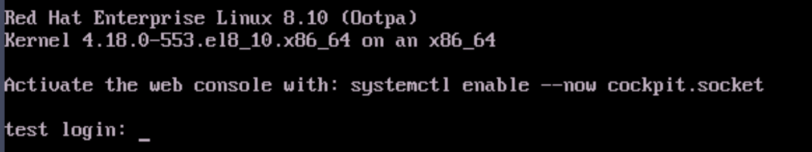

# Provisioning RHEL 8.10

[[Back]](../../README.md)

## Deployment files

- [BareMetalHost](./bmh.yaml)
- [bmc credentials](./secret.yaml)
- [preprovisioning network data](./pre.yaml)
- [network data](./net.yaml)
- [user data](./user.yaml)

Note: qcow image [link](https://access.redhat.com/downloads/content/rhel)

## KVM Console

 

## Operating System

```bash
# cat /etc/redhat-release
Red Hat Enterprise Linux release 8.10 (Ootpa)
```

## Networking

```bash
# ip link show bond0
18: bond0: <BROADCAST,MULTICAST,MASTER,UP,LOWER_UP> mtu 1500 qdisc noqueue state UP mode DEFAULT group default qlen 1000
    link/ether aa:aa:aa:aa:aa:aa brd ff:ff:ff:ff:ff:ff
```

```bash
# ip a l eno5
2: eth0: <BROADCAST,MULTICAST,SLAVE,UP,LOWER_UP> mtu 1500 qdisc mq master bond0 state UP group default qlen 1000
    link/ether aa:aa:aa:aa:aa:aa brd ff:ff:ff:ff:ff:ff
    altname eno5
    altname enp28s0f0
    altname ens1f0
```

```bash
# ip a l eno6
3: eth1: <BROADCAST,MULTICAST,SLAVE,UP,LOWER_UP> mtu 1500 qdisc mq master bond0 state UP group default qlen 1000
    link/ether aa:aa:aa:aa:aa:aa brd ff:ff:ff:ff:ff:ff permaddr bb:bb:bb:bb:bb:bb
    altname eno6
    altname enp28s0f1
    altname ens1f1
```

```bash
# cat /proc/net/bonding/bond0
Ethernet Channel Bonding Driver: v3.7.1 (April 27, 2011)

Bonding Mode: IEEE 802.3ad Dynamic link aggregation
Transmit Hash Policy: layer2 (0)
MII Status: up
MII Polling Interval (ms): 100
Up Delay (ms): 0
Down Delay (ms): 0
Peer Notification Delay (ms): 0

802.3ad info
LACP active: on
LACP rate: slow
Min links: 0
Aggregator selection policy (ad_select): stable
System priority: 65535
System MAC address: aa:aa:aa:aa:aa:aa
Active Aggregator Info:
        Aggregator ID: 1
        Number of ports: 2
        Actor Key: 29
        Partner Key: 33568
        Partner Mac Address: ...

Slave Interface: eth0
MII Status: up
Speed: 100000 Mbps
Duplex: full
Link Failure Count: 0
Permanent HW addr: aa:aa:aa:aa:aa:aa
Slave queue ID: 0
Aggregator ID: 1
Actor Churn State: none
Partner Churn State: none
Actor Churned Count: 0
Partner Churned Count: 0
details actor lacp pdu:
    system priority: 65535
    system mac address: aa:aa:aa:aa:aa:aa
    port key: 29
    port priority: 255
    port number: 1
    port state: 61
details partner lacp pdu:
    system priority: 32667
    system mac address: ...
    oper key: 33568
    port priority: 32768
    port number: 257
    port state: 61

Slave Interface: eth1
MII Status: up
Speed: 100000 Mbps
Duplex: full
Link Failure Count: 0
Permanent HW addr: bb:bb:bb:bb:bb:bb
Slave queue ID: 0
Aggregator ID: 1
Actor Churn State: none
Partner Churn State: none
Actor Churned Count: 0
Partner Churned Count: 0
details actor lacp pdu:
    system priority: 65535
    system mac address: aa:aa:aa:aa:aa:aa
    port key: 29
    port priority: 255
    port number: 2
    port state: 61
details partner lacp pdu:
    system priority: 32667
    system mac address: ...
    oper key: 33568
    port priority: 32768
    port number: 16641
    port state: 61
```

```bash
# ip r
default via 10.10.10.78 dev bond0.666 proto static metric 400
10.10.10.64/28 dev bond0.666 proto kernel scope link src 10.10.10.65 metric 400
```

## Authentication

```bash
# cat /etc/shadow
root:...
cloud-user:...
```

```bash
# ls /root/.ssh/
authorized_keys
```

```bash
# ls /home/cloud-user/.ssh/
authorized_keys
```

[[Back]](../../README.md)