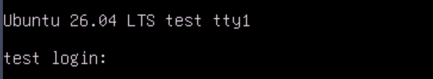

# Provisioning Ubuntu 26.04LTS

[[Back]](../../README.md)

## Deployment files

- [BareMetalHost](./bmh.yaml)
- [bmc credentials](./secret.yaml)
- [preprovisioning network data](./pre.yaml)
- [network data](./net.yaml)
- [user data](./user.yaml)

Note: cloud qcow image [link](https://cloud-images.ubuntu.com/releases/resolute/release/ubuntu-26.04-server-cloudimg-amd64.img)

## KVM Console

 

## Operating System

```bash
$ cat /etc/lsb-release
DISTRIB_ID=Ubuntu
DISTRIB_RELEASE=26.04
DISTRIB_CODENAME=resolute
DISTRIB_DESCRIPTION="Ubuntu 26.04 LTS"
```

## Networking

```bash
$ ip link show bond0
18: bond0: <BROADCAST,MULTICAST,MASTER,UP,LOWER_UP> mtu 1500 qdisc noqueue state UP mode DEFAULT group default qlen 1000
    link/ether cc:cc:cc:cc:cc:cc brd ff:ff:ff:ff:ff:ff
```

```bash
$ ip a l eno5
2: eno5: <BROADCAST,MULTICAST,SLAVE,UP,LOWER_UP> mtu 1500 qdisc mq master bond0 state UP group default qlen 1000
    link/ether cc:cc:cc:cc:cc:cc brd ff:ff:ff:ff:ff:ff permaddr aa:aa:aa:aa:aa:aa
    altname enp28s0f0
    altname enx3c26e41e03c4
```

```bash
$ ip a l eno6
3: eno6: <BROADCAST,MULTICAST,SLAVE,UP,LOWER_UP> mtu 1500 qdisc mq master bond0 state UP group default qlen 1000
    link/ether cc:cc:cc:cc:cc:cc brd ff:ff:ff:ff:ff:ff permaddr bb:bb:bb:bb:bb:bb
    altname enp28s0f1
    altname enx3c26e41e03c5
```

```bash
$ cat /proc/net/bonding/bond0
Ethernet Channel Bonding Driver: v7.0.0-30-generic

Bonding Mode: IEEE 802.3ad Dynamic link aggregation
Transmit Hash Policy: layer2 (0)
MII Status: up
MII Polling Interval (ms): 100
Up Delay (ms): 0
Down Delay (ms): 0
Peer Notification Delay (ms): 0

802.3ad info
LACP active: on
LACP rate: slow
Min links: 0
Aggregator selection policy (ad_select): stable

Slave Interface: eno5
MII Status: up
Speed: 100000 Mbps
Duplex: full
Link Failure Count: 0
Permanent HW addr: aa:aa:aa:aa:aa:aa
Slave queue ID: 0
Aggregator ID: 1
Actor Churn State: none
Partner Churn State: none
Actor Churned Count: 0
Partner Churned Count: 0

Slave Interface: eno6
MII Status: up
Speed: 100000 Mbps
Duplex: full
Link Failure Count: 0
Permanent HW addr: bb:bb:bb:bb:bb:bb
Slave queue ID: 0
Aggregator ID: 1
Actor Churn State: none
Partner Churn State: none
Actor Churned Count: 0
Partner Churned Count: 0
```

```bash
# ip r
default via 10.10.10.78 dev bond0.666 proto static metric 400
10.10.10.64/28 dev bond0.666 proto kernel scope link src 10.10.10.65 metric 400
```

## Authentication

```bash
# cat /etc/shadow
root:...
ubuntu:...
```

```bash
# ls /root/.ssh/
authorized_keys
```

```bash
# ls /home/ubuntu/.ssh/
authorized_keys
```

[[Back]](../../README.md)