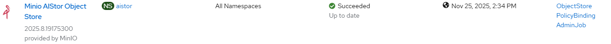

# MinIO AIStor Operator - Create via Task

## Input

```
[
    {
        "minio": {
            "operator": {
                "channel": "__default__"
            }
        }
    }
]
```

Notes:
- [operator](./create_operator.md) trigger workflow execution with optional input parameters

## Requirements

None

## Expected outcome



## Configurable options

```
# iserver set ocp task 
  --cluster TEXT   Cluster Name
  --filename TEXT  Tasks filename
  --validate       Validate only
  --break          Break on error
  --no-confirm     Confirmation mode
```

## Example

```
# iserver set ocp task --filename C:\tmp\task.json --no-confirm --cluster bm1

```

[[Back]](./README.md)