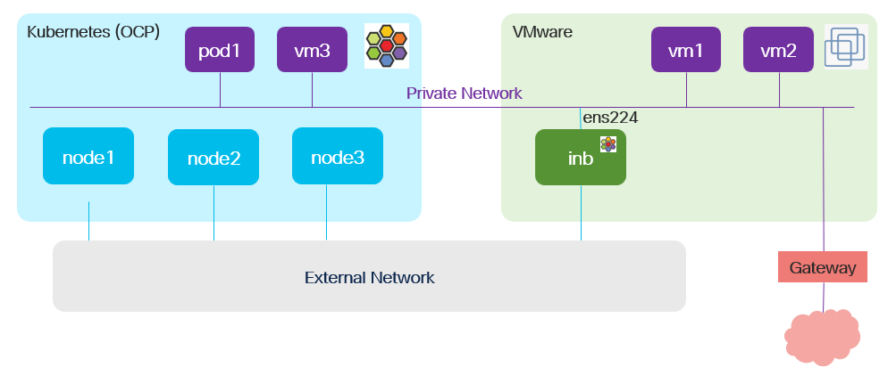

# Migration Toolkit for Virtualization with Isovalent Network Bridge

The virtual machine migration from VMware to OpenShift has an implication for networking i.e.,
- can migrated virtual machine can have the same IP/MAC; refer [here](./static-ip.md) for details
- where it should connect to?
- how it communicates with VMware domain post migration?
- how to control security, policy and isolation for the migrated virtual machine?

[Isovalent Network Bridge](../cilium-inb/README.md) allows you to bridge Isovalent Private Network into existing external networks, enabling seamless, secure communication between different hypervisors, making it easier to migrate workloads with downtime or the requirement to change IP addresses.

## Virtualization domains

OpenShift cluster with
- Cilium CNI
- [Container Virtualization](../cnv/README.md) enabled
- [LVM Storage](../lvm/README.md) configured
- [Migration Toolking for Virtualization](./README.md) enabled

VMware cluster
- Distributed port group with virtual machines connected to it
- Virtual machines with static IP address configured via *nix configuration files

## Goal

- Migrate one virtual machine from VMware to OpenShift Virtualization
- Do not change IP configuration settings in *nix configuration files
- Virtual machines can still communicate even if deployed on different virtualization domains 

## VMware preparation

Isovalent network bridge virtual machine deployed from ova and connected to two port groups
- management network over which inb vm can be accessed with SSH
- the port group where to-be-migrated-virtual-machine connects to

Contact Cisco for inb ova access.

## OpenShift preparation

- [enable private network feature](../cilium-pnet/enable.md)
- [create private network](../cilium-pnet/create_network.md) with the same name as VMware port group where to-be-migrated-virtual-machine connects to as well as matching IP subnet configuration
- [enable isovalent network bridge feature set](../cilium-inb/README.md)
- [enable webhook](../cilium-pnet/enable_webhook.md)

## Virtual Machine Migration

Run virtual machine migration incl.
- [vCenter provider configuration](./create_provider.md)
- [network map definition](./create_network_map.md)
- [storage map definition](./create_storage_map.md)
- [migration plan definition](./create_plan.md)

Finally [run migration plan](./run_plan.md). 

All these tasks can be performed exactly the same way in case of "normal" migration as well as migration powered with Isovalent Network Bridge. In case where both OpenShift and VMware cluster are inb-ready and webhook is enabled, migrated virtual machine will connect to private network based on port group name in VMware.

[[Back]](./README.md)