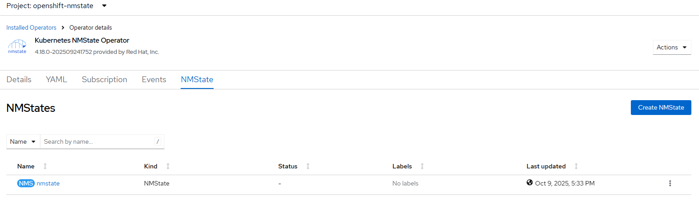
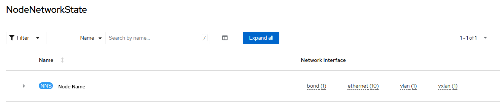

# MMState Operator - Create Instance

[[Back]](./README.md)

## Workflow

- create openshift-nmstate namespace
- create operator group
- create subscription with user controlled channel or defaultChannelName
- create nmstate instance based on default package information or user-provided file with NMState CRD
- wait for nmstate node network states for all cluster nodes

## Requirements

None

## Expected outcome





## Configurable options

```
# iserver set ocp nmstate --mode instance
  --cluster TEXT              Cluster Name
  --filename TEXT             NMState CRD
  --no-confirm                Confirmation mode
```

## Example

```
# iserver set ocp nmstate --mode instance --cluster bm1 --no-confirm

OpenShift Workflow - NMState Operator - Create Instance
=======================================================

OpenShift Cluster: bm1

Operator
- subscription          : openshift-nmstate/kubernetes-nmstate-operator
- package               : openshift-marketplace/redhat-operators/kubernetes-nmstate-operator
- channel               : stable
- install plan          : openshift-nmstate/install-l2bpx
- install plan approved : ✓
- installed csv         : kubernetes-nmstate-operator.4.21.0-202609301335
- latest_csv            : ✓


Create NMState Instance
-----------------------

~~~
apiVersion: nmstate.io/v1
kind: NMState
metadata:
  name: nmstate
spec: {}
~~~

NMState instance created

Wait for nmstate instance [timeout:60]...
Wait for nmstate instance resources...
Wait for deployment openshift-nmstate/nmstate-operator ready (optional: False, allow zero replicas: False, timeout: 600s)...
Wait for deployment openshift-nmstate/nmstate-console-plugin ready (optional: False, allow zero replicas: False, timeout: 600s)...
Wait for deployment openshift-nmstate/nmstate-metrics ready (optional: False, allow zero replicas: False, timeout: 600s)...
Wait for deployment openshift-nmstate/nmstate-webhook ready (optional: False, allow zero replicas: False, timeout: 600s)...
Wait for daemonset openshift-nmstate/nmstate-handler ready (optional: False, timeout: 600s)...
Subscription nmstate ready

Completed tasks
- NMState instance created

+----+---------+---------+-----------------+---------+---------+--------------+
| ID | Target  | Scope   | Workflow        | Changes | Success | Duration [s] |
+----+---------+---------+-----------------+---------+---------+--------------+
| 1  | ocp:bm1 | nmstate | create instance | 1       | ✓       | 20           | 
+----+---------+---------+-----------------+---------+---------+--------------+
```

[[Back]](./README.md)