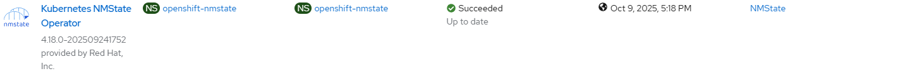

# MMState Operator - Create Operator

[[Back]](./README.md)

## Workflow

- create openshift-nmstate namespace
- create operator group
- create subscription with user controlled channel or defaultChannelName

## Requirements

None

## Expected outcome



## Configurable options

```
# iserver set ocp nmstate --mode operator
  --cluster TEXT              Cluster Name
  --channel TEXT              Operator channel  [default: __default__]
  --no-confirm                Confirmation mode
```

## Example

```
# iserver set ocp nmstate --mode operator --cluster bm1 --no-confirm

OpenShift Workflow - NMState Operator - Create Operator
=======================================================

OpenShift Cluster: bm1
Subscription not found kubernetes-nmstate-operator

Create Namespace
----------------
- name: openshift-nmstate

~~~
apiVersion: v1
kind: Namespace
metadata:
  name: openshift-nmstate
~~~
Namespace [openshift-nmstate] created
Wait for namespace [timeout:60]...

Create OperatorGroup
--------------------
- namespace: openshift-nmstate
- name: nmstate-operator-group

~~~
apiVersion: operators.coreos.com/v1
kind: OperatorGroup
metadata:
  name: nmstate-operator-group
  namespace: openshift-nmstate
spec:
  targetNamespaces:
  - openshift-nmstate
  upgradeStrategy: Default
~~~
OperatorGroup [openshift-nmstate/nmstate-operator-group] created
Wait for OperatorGroup openshift-nmstate/nmstate-operator-group [timeout:60s]

Create Subscription
-------------------
Subscription: openshift-nmstate/kubernetes-nmstate-operator
Source: openshift-marketplace/redhat-operators/kubernetes-nmstate-operator
Install plan approval: Automatic
Getting subscription and packege manifest information...
Resolving channel name...
Channel: stable
- CSV [kubernetes-nmstate-operator.4.21.0-202609301335]
- CSV Display name [Kubernetes NMState Operator]
- CVS Version [4.21.0-202609301335]
- CSV Provider [{'name': 'Red Hat, Inc.'}]
- CSV Maturity [GA]

~~~
apiVersion: operators.coreos.com/v1alpha1
kind: Subscription
metadata:
  name: kubernetes-nmstate-operator
  namespace: openshift-nmstate
spec:
  channel: stable
  installPlanApproval: Automatic
  name: kubernetes-nmstate-operator
  source: redhat-operators
  sourceNamespace: openshift-marketplace
~~~

Subscription created

Wait for subscription install plan started [timeout:360]...
Install plan: install-l2bpx
Wait for subscription install plan ready [timeout:600]...
Install plan succeeded
Wait for deployment openshift-nmstate/nmstate-operator ready (optional: False, allow zero replicas: False, timeout: 600s)...
Subscription nmstate ready

Operator
- subscription          : openshift-nmstate/kubernetes-nmstate-operator
- package               : openshift-marketplace/redhat-operators/kubernetes-nmstate-operator
- channel               : stable
- install plan          : openshift-nmstate/install-l2bpx
- install plan approved : ✓
- installed csv         : kubernetes-nmstate-operator.4.21.0-202609301335
- latest_csv            : ✓


Completed tasks
- Namespace created
- Operator Group created
- Subscription created

+----+---------+---------+-----------------+---------+---------+--------------+
| ID | Target  | Scope   | Workflow        | Changes | Success | Duration [s] |
+----+---------+---------+-----------------+---------+---------+--------------+
| 1  | ocp:bm1 | nmstate | create operator | 3       | ✓       | 31           | 
+----+---------+---------+-----------------+---------+---------+--------------+
```

[[Back]](./README.md)