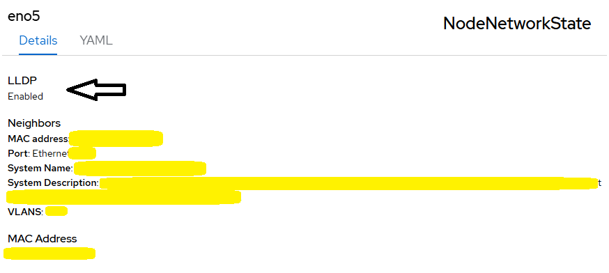

# NMState Operator - Enable LLDP

[[Back]](./README.md)

## Why

NMState operator provides NodeNetworkState that provides per-node per-interface state information. 

LLDP neighbor information improves operational experience however,
- LLDP is disabled by default on nmstate level and can be enabled by applying specific nncp resource
- LLDP may be enabled on the NIC firmware level
    - depends on the NIC HW type and firmware defaults
    - ethtool priv flags show lldp-on-nic settings
    - ethtool priv flags not shown in nns output
    - priv flags controlling lldp-on-nic not standard and differ per NIC type e.g. Intel 700 vs 800 series

> [!NOTE]
> If lldp is enabled on NIC level, then no lldp information is exposed at nmstate level

## Workflow

On every cluster node
- if --fw flag set, disable lldp on ethernet nic firmware level using ethtool cli
- include interfaces in operational down state if --with-down flag set 
- wait for nncp crd to complete the configuration task
- delete nncp object if --delete-nncp flag is set

## Expected outcome



## Configurable options

```
# iserver set ocp nmstate --mode lldp
  --cluster TEXT                  Cluster name
  --node TEXT                     Node name
  --fw                            Disable LLDP on NIC fw level
  --delete-nncp                   Delete NNCP
  --with-down                     Include interfaces in down state
  --no-confirm                    Confirmation mode
```

## Example

```
iserver set ocp nmstate --cluster bm1 --mode lldp --fw --no-confirm


OpenShift Workflow - NMState Operator - Enable LLDP
===================================================

OpenShift Cluster: bm1

Operator resources
------------------
- deployment openshift-nmstate/nmstate-operator: ready
- deployment openshift-nmstate/nmstate-console-plugin: ready
- deployment openshift-nmstate/nmstate-metrics: ready
- deployment openshift-nmstate/nmstate-webhook: ready
- daemonset openshift-nmstate/nmstate-handler: ready
Subscription nmstate ready
Deploy netshoot daemonset with host networking
----------------------------------------------
~~~
apiVersion: apps/v1
kind: DaemonSet
metadata:
  namespace: default
  name: cd-netshoot
spec:
  selector:
    matchLabels:
      name: cd-netshoot
  template:
    metadata:
      labels:
        name: cd-netshoot
    spec:
      hostNetwork: true
      containers:
      - name: netshoot
        image: nicolaka/netshoot:latest
        command:
        - sleep
        - infinite
      securityContext:
        runAsUser: 0
        capabilities:
          add: ["IPC_LOCK","SYS_RESOURCE","NET_RAW", "NET_ADMIN"]
~~~

Create DaemonSet
----------------
- namespace: default
- name: cd-netshoot

~~~
apiVersion: apps/v1
kind: DaemonSet
metadata:
  name: cd-netshoot
  namespace: default
spec:
  selector:
    matchLabels:
      name: cd-netshoot
  template:
    metadata:
      labels:
        name: cd-netshoot
    spec:
      containers:
      - command:
        - sleep
        - infinite
        image: nicolaka/netshoot:latest
        name: netshoot
      hostNetwork: true
      securityContext:
        capabilities:
          add:
          - IPC_LOCK
          - SYS_RESOURCE
          - NET_RAW
          - NET_ADMIN
        runAsUser: 0
~~~
DaemonSet [default/cd-netshoot] created
DaemonSet created
Wait for daemonset default/cd-netshoot ready (optional: False, timeout: 600s)...
Netshoots
- bm1: default/cd-netshoot-flphf

Get interface details
---------------------
	interface: bond0
	interface: bond0.702
	interface: cilium_vxlan
	interface: eno1
		ethtool
		priv flags
		state
	interface: eno2
		ethtool
		priv flags
		state
	interface: eno5
		ethtool
		priv flags
		state
	interface: eno6
		ethtool
		priv flags
		state
	interface: eno7
		ethtool
		priv flags
		state
	interface: eno8
		ethtool
		priv flags
		state
	interface: enp216s0f0
		ethtool
		priv flags
		state
	interface: enp216s0f1
		ethtool
		priv flags
		state
	interface: ens1f0
		ethtool
		priv flags
		state
	interface: ens1f1
		ethtool
		priv flags
		state
	interface: lo
Disable lldp on ethernet interface fw level [bm1]
Interface state eno1
- driver: ixgbe
- version: 5.14.0-570.140.1.el9_6.x86_64
- pci: 0000:3b:00.0
Interface eno1 [0000:3b:00.0] - no change
Interface state eno2
- driver: ixgbe
- version: 5.14.0-570.140.1.el9_6.x86_64
- pci: 0000:3b:00.1
Interface eno2 [0000:3b:00.1] - no change
Interface state eno5
- driver: enic
- version: 5.14.0-570.140.1.el9_6.x86_64
- pci: 0000:1d:00.0
Interface eno5 [0000:1d:00.0] - no change
Interface state eno6
- driver: enic
- version: 5.14.0-570.140.1.el9_6.x86_64
- pci: 0000:1d:00.1
Interface eno6 [0000:1d:00.1] - no change
Interface state eno7
- driver: enic
- version: 5.14.0-570.140.1.el9_6.x86_64
- pci: 0000:1d:00.2
Interface eno7 [0000:1d:00.2] - no change
Interface state eno8
- driver: enic
- version: 5.14.0-570.140.1.el9_6.x86_64
- pci: 0000:1d:00.3
Interface eno8 [0000:1d:00.3] - no change
Interface state enp216s0f0
- driver: i40e
- version: 5.14.0-570.140.1.el9_6.x86_64
- pci: 0000:d8:00.0
- disable-fw-lldp: off
Action: set disable-fw-lldp to on
~~~
{'bm1': 'netlink error: Operation not permitted\n'}
~~~
Interface enp216s0f0 [0000:d8:00.0] - fw lldp disabled
Interface state enp216s0f1
- driver: i40e
- version: 5.14.0-570.140.1.el9_6.x86_64
- pci: 0000:d8:00.1
- disable-fw-lldp: off
Action: set disable-fw-lldp to on
~~~
{'bm1': 'netlink error: Operation not permitted\n'}
~~~
Interface enp216s0f1 [0000:d8:00.1] - fw lldp disabled
Interface state ens1f0
- driver: i40e
- version: 5.14.0-570.140.1.el9_6.x86_64
- pci: 0000:5e:00.0
- disable-fw-lldp: off
Action: set disable-fw-lldp to on
~~~
{'bm1': 'netlink error: Operation not permitted\n'}
~~~
Interface ens1f0 [0000:5e:00.0] - fw lldp disabled
Interface state ens1f1
- driver: i40e
- version: 5.14.0-570.140.1.el9_6.x86_64
- pci: 0000:5e:00.1
- disable-fw-lldp: off
Action: set disable-fw-lldp to on
~~~
{'bm1': 'netlink error: Operation not permitted\n'}
~~~
Interface ens1f1 [0000:5e:00.1] - fw lldp disabled
Enable lldp on nmstate level [bm1]
Interface eno1 - skip on interface oper down
Interface eno2 - skip on interface oper down
Interface eno5 - enabling with nncp (enable-lldp-bm1-eno5)
Interface eno6 - enabling with nncp (enable-lldp-bm1-eno6)
Interface eno7 - enabling with nncp (enable-lldp-bm1-eno7)
Interface eno8 - enabling with nncp (enable-lldp-bm1-eno8)
Interface enp216s0f0 - skip on interface oper down
Interface enp216s0f1 - skip on interface oper down
Interface ens1f0 - skip on interface oper down
Interface ens1f1 - skip on interface oper down

+----+-----------------------------------+-------------+--------------------------+
| ID | Node Network Configuration Policy | Status      | Reason                   |
+----+-----------------------------------+-------------+--------------------------+
| 1  | enable-lldp-bm1-eno5              | Progressing | ConfigurationProgressing | 
| 2  | enable-lldp-bm1-eno6              | Unknown     | N/A                      | 
| 3  | enable-lldp-bm1-eno7              | Unknown     | N/A                      | 
| 4  | enable-lldp-bm1-eno8              | Unknown     | N/A                      | 
+----+-----------------------------------+-------------+--------------------------+
Waiting for [4]: enable-lldp-bm1-eno5, enable-lldp-bm1-eno6, enable-lldp-bm1-eno7, enable-lldp-bm1-eno8
Waiting for [3]: enable-lldp-bm1-eno6, enable-lldp-bm1-eno7, enable-lldp-bm1-eno8
Waiting for [1]: enable-lldp-bm1-eno8

+----+-----------------------------------+-----------+------------------------+
| ID | Node Network Configuration Policy | Status    | Reason                 |
+----+-----------------------------------+-----------+------------------------+
| 1  | enable-lldp-bm1-eno5              | Available | SuccessfullyConfigured | 
| 2  | enable-lldp-bm1-eno6              | Available | SuccessfullyConfigured | 
| 3  | enable-lldp-bm1-eno7              | Available | SuccessfullyConfigured | 
| 4  | enable-lldp-bm1-eno8              | Available | SuccessfullyConfigured | 
+----+-----------------------------------+-----------+------------------------+
Node network policies not deleted (based on user flag)
Undeploy netshoot daemonset with host networking: default/cd-netshoot
---------------------------------------------------------------------
Wait for no DaemonSet default/cd-netshoot [timeout:180s]

Completed tasks
- LLDP disabled on fw nic level
- LLDP enabled on nmstate level
- LLDP enabled

+----+---------+---------+-------------+---------+---------+--------------+
| ID | Target  | Scope   | Workflow    | Changes | Success | Duration [s] |
+----+---------+---------+-------------+---------+---------+--------------+
| 1  | ocp:bm1 | nmstate | create lldp | 6       | ✓       | 51           | 
+----+---------+---------+-------------+---------+---------+--------------+
```

[[Back]](./README.md)