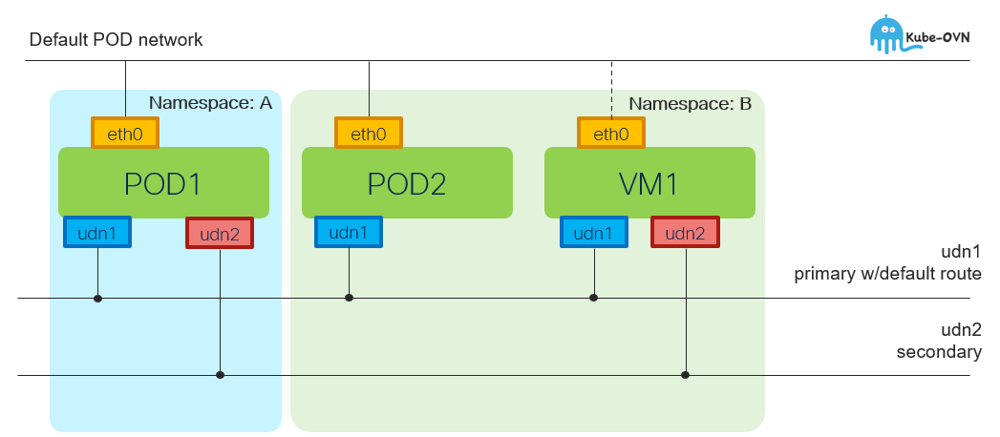

# OVNKubernetes - Cluster User Defined Network (CUDN)

[[Back]](../Operations.md) [[User Defined Network]](../ovn-udn/README.md)

The ClusterUserDefinedNetwork (CUDN) custom resource (CR) provides cluster-scoped network segmentation in OpenShift Container Platform and isolation for administrators only. Defining this resource ensures that network traffic is securely partitioned across the entire cluster as explained in the official [documentation](https://docs.redhat.com/en/documentation/openshift_container_platform/4.21/pdf/multiple_networks/OpenShift_Container_Platform-4.21-Multiple_networks-en-US.pdf).

## Knowledge Base

Cluster scope with [namespace selection](./kb/namespace.md)

Role
- single [primary](./kb/primary.md) network per namespace
- mutliple [secondary](./kb/secondary.md) networks per namespace

IPAM and subnets
- IPAM mode by default enabled
- IPv4 and IPv6 subnets mandatory when ipam mode enabled, max one subnet per address family
- IPAM can be disabled for l2 and localnet secondary-only network topologies
- subnets may overlap between cudns using [vrf isolation](./kb/vrf.md)
- ip security enforced with ipam enabled
- mac security always enforced

Topology
- [L2](./l2/overview.md) - flat L2 subnet across the nodes (bridging)
- [L3](./l3/overview.md) - similar to POD CIDR with per node subnets (routing)
- [localnet](./localnet/overview.md) - connects **secondary network only** to physical underlay

Topology | Role | EW | NS | Service | NetworkPolicy | MultiNetworkPolicy
--- | --- | --- | --- | --- | --- | --- 
L2 | Primary | :white_check_mark: | :white_check_mark: | :white_check_mark: | :white_check_mark: | :x: 
L3 | Primary | :white_check_mark: | :white_check_mark: | :white_check_mark: | :white_check_mark: | :x: 
L2 | Secondary | :white_check_mark: | :x: | :x: | :x: | :x:
L3 | Secondary | :white_check_mark: | :x: | :x: | :x: | :x:
Localnet | Secondary | :white_check_mark: no-overlay | :white_check_mark: no-masq | :x: | :x: | :white_check_mark: 

Fabric integration
- [l2 with evpn](./evpn/cudn-l2-v2.md)
- [l3 with evpn](./evpn/cudn-l3-v2.md)
- [ovn-bgp integration](../ovn-bgp/example/cudn-l3/README.md)
- [ovn-bgp vrf-lite](../ovn-bgp/example/cudn-l3-vrflite/README.md)

Limitations
- Virtual machine primary interface does not work with L3 topology ([Link](./l3/vm.md))
- L2 topology: link local multicast (224.0.0.x) works within namespace only, not across namespaces e.g. OSPF

## Commands

Command | Intent | Details
--- | --- | ---
iserver get k8s cudn | get cudn | [Link](./get.md)
iserver set ocp task | in task way | [L2](./l2/task.md), [L3](./l3/task.md), [Localnet](./localnet/task.md)
iserver delete ocp task | in task way | [Link](./delete_task.md)

[[Back]](../Operations.md) [[User Defined Network]](../ovn-udn/README.md)