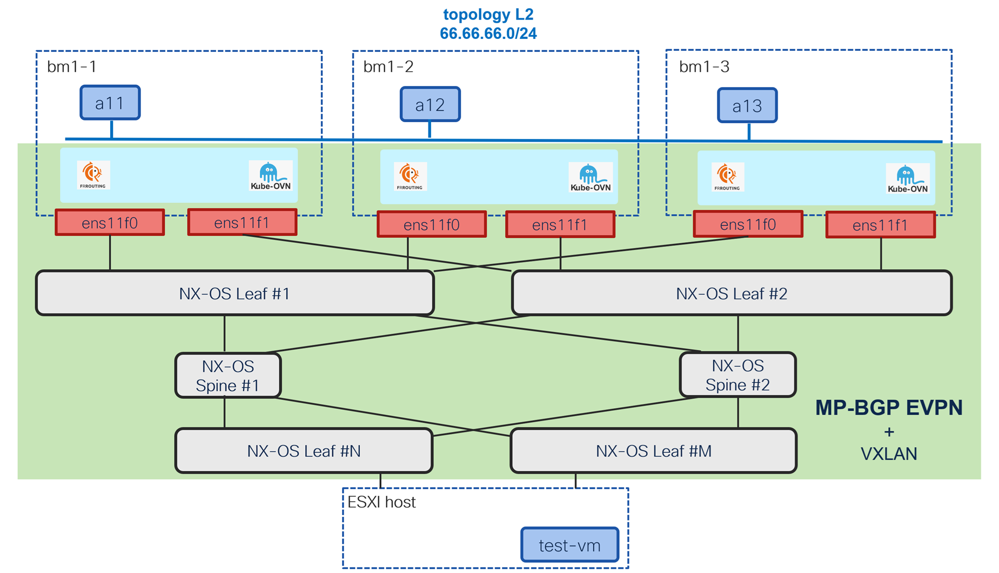
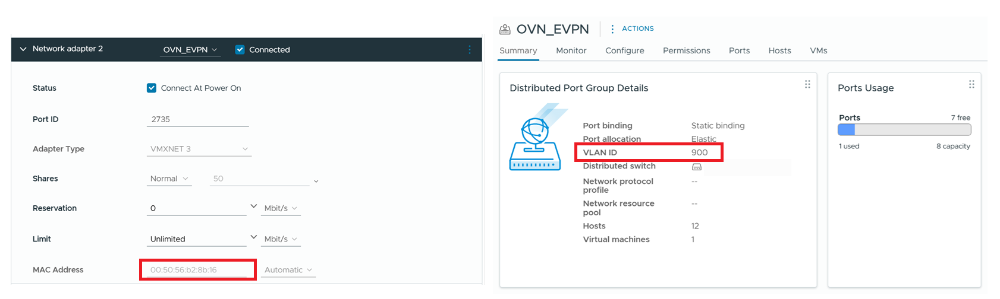
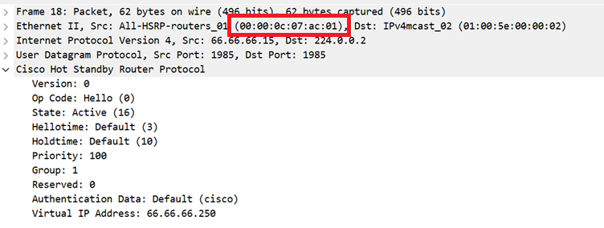
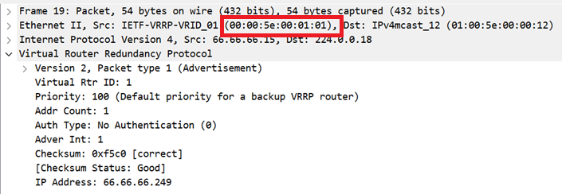
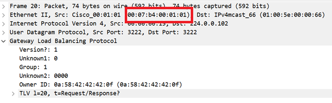

# BGP EVPN for primary l2 cluster user-defined networks

[[Back]](../README.md) [[l3]](./cudn-l3-v2.md)

OpenShift 4.22 introduces BGP EVPN support for primary cudn as documented [here](https://docs.redhat.com/en/documentation/openshift_container_platform/4.22/html-single/advanced_networking/index#bgp-evpn-for-user-defined-networks) and shown by example using the topology as below



## Table of content

- [key highlights](#summary)
- [hw/sw info](#hwsw-info)
- [complete leaf configuration](#complete-nx-os-configuration)
- [esxi configuration](#esxi-configuration)
- [OpenShift setup](#openshift-configuration-steps-overview)
  - [enable features](#enable-openshift-features)
  - [p2p interface](#p2p-interface)
  - [vtep](#vtep)
  - [route to leaf bgp control plane loopback](#route-to-leaf-bgp-control-plane-loopback)
  - [route to leaf vxlan data plane loopback](#route-to-leaf-vxlan-data-plane-loopback)
  - [bgp peering](#bgp-peering)
  - [namespace](#namespace)
  - [cluster user defined network](#cluster-user-defined-network)
  - [ipam](#ipam)
  - [route advertisement](#route-advertisement)
- Application deployment
  - [pod](#pod)
  - [virtual machine](#vm)
- BGP Control Plane
  - [ovn advertised route](#ovn-advertised-routes)
  - [ovn received route](#ovn-received-routes)
- VXLAN Data Plane
  - [arp resolution](#arp-resolution)
  - [inside the cluster](#l2-to-endpoint-inside-the-cluster)
  - [outside of the cluster](#l2-to-endpoint-outside-of-cluster)
  - [cluster ip service](#east-west-cluster-ip-service)
  - [microsegmentation](#east-west-microsegmentation)
  - [ospf](#ospf)
  - [hsrp](#hsrp)
  - [vrrp](#vrrp)
  - [glbp](#glbp)

## key highlights

Node interface
- pair of p2p interface to two leaves (redundant)
- dummy (loopback-like) interface used as vtep (vxlan data plane)

BGP Control Plane
- eBGP session to two leaves using leaf's routing loopback (loopback0)
- leaf configured with `set ip next-hop unchanged` towards the cluster nodes
- no modifications of the prefixes advertised by cluster nodes toward the spines (rr)
- no vlan re-stitching enforced, vxlan tunnel built between the cluster nodes or other fabric vteps
- the same route target used for import and export rules
- node bgp (frr) advertise 
  - type-3 route for ingress replication destination for the given VNI
  - type-2 routes (mac-only and mac+ip) for any application (pod or vm) deployed on the node 

Cluster user defined network
- primary [l2 cudn](#cluster-user-defined-network) associated with evpn transport incl. vni and route target values

Application
- ipam enabled and cannot be disabled
- no extra annotation or label required for [pod](#pod), as long as pod deployed in "cudn namespace", it will be connected to it
- [vm](#vm) needs to be deployed in "cudn namespace" and requires `l2bridge` binding value 

Forwarding
- ip and mac security enforced
- l2 bridging between the applications deployed on the cluster nodes as well as outside e.g. [vmware](#esxi-configuration)
- east-west service i.e. [cluster ip](#east-west-cluster-ip-service) supported
- [microsegmentation](#east-west-microsegmentation) supported

Limitations
- primary interface of the pod or vm only
- ip and mac security cannot be disabled and that breaks virtual source mac techniques such as [hsrp](#hsrp), [vrrp](#vrrp) or [glbp](#glbp)
- static ip address configuration not supported
- mac address must be auto-generated, static mac address configuration breaks ip dhcp
- impossible to retain virtual machine ip/mac when migrated from another hypervisor (e.g., esxi) to OpenShift cudn

## hw/sw info

Bare metal OpenShift cluster

```
$ oc version
Client Version: 4.22.0-202605222252.p2.g062bc54.assembly.stream-062bc54
Kustomize Version: v5.7.1
Server Version: 4.22.2
Kubernetes Version: v1.35.5
```

Nexus 9000 leafs

```
Software
  BIOS: version 05.53
  NXOS: version 10.6(3) [Feature Release]

Hardware
  cisco Nexus9000 C93240YC-FX2 Chassis
  Intel(R) Xeon(R) CPU D-1526 @ 1.80GHz with 24530756 kB of memory.
```

## complete NX-OS configuration

While the guide shows incremental configuration steps for OpenShift, NX-OS configuration on pair of leaf switches is already complete as below

### control and data plane loopbacks

Leaf1

```
interface loopback0
  description Routing loopback interface
  ip address 100.64.0.112/32
  ip router isis UNDERLAY
  ip pim sparse-mode
!
interface loopback1
  description VTEP loopback interface
  ip address 100.65.0.112/32
  ip address 100.65.0.12/32 secondary
  ip router isis UNDERLAY
  ip pim sparse-mode
!
```

Leaf2

```
interface loopback0
  description Routing loopback interface
  ip address 100.64.0.212/32
  ip router isis UNDERLAY
  ip pim sparse-mode

interface loopback1
  description VTEP loopback interface
  ip address 100.65.0.212/32
  ip address 100.65.0.12/32 secondary
  ip router isis UNDERLAY
  ip pim sparse-mode
!
```

### p2p interfaces between the leaf switch and cluster nodes

Leaf1 

```
interface Ethernet1/49
  description bm1-1 ens11f0 address: cc79.d7f2.1397 (bia cc79.d7f2.13c8)
  no switchport
  mtu 9216
  medium p2p
  ip address 100.66.0.110/31
  no shutdown
!
interface Ethernet1/50
  description bm1-2 ens11f0 address: cc79.d7f2.1397 (bia cc79.d7f2.13c9)
  no switchport
  mtu 9216
  medium p2p
  ip address 100.66.0.120/31
  no shutdown
!
interface Ethernet1/51
  description bm1-3 ens11f0 address: cc79.d7f2.1397 (bia cc79.d7f2.13ca)
  no switchport
  mtu 9216
  medium p2p
  ip address 100.66.0.130/31
  no shutdown
```

Leaf2 

```
interface Ethernet1/49
  description bm1-1 ens11f1 address: cc79.d7f2.04af (bia cc79.d7f2.04e0)
  no switchport
  mtu 9216
  medium p2p
  ip address 100.66.0.210/31
  no shutdown
!
interface Ethernet1/50
  description bm1-2 ens11f1 address: cc79.d7f2.04af (bia cc79.d7f2.04e1)
  no switchport
  mtu 9216
  medium p2p
  ip address 100.66.0.220/31
  no shutdown
!
interface Ethernet1/51
  description bm1-3 ens11f1 address: cc79.d7f2.04af (bia cc79.d7f2.04e2)
  no switchport
  mtu 9216
  medium p2p
  ip address 100.66.0.230/31
  no shutdown
```

unlike [Cilium](../../cilium-pnet/evpn-leaf/README.md), there is no overlay (ipv4/unicast) bgp session to advertise the loopback ips between nodes and fabric. as such static route to openshift vtep via p2p interface is required

Leaf1

```
ip route 100.69.0.111/32 100.66.0.111 name BM1-1_VTEP
ip route 100.69.0.121/32 100.66.0.121 name BM1-2_VTEP
ip route 100.69.0.131/32 100.66.0.131 name BM1-3_VTEP
```

Leaf2

```
ip route 100.69.0.111/32 100.66.0.211 name BM1-1_VTEP
ip route 100.69.0.121/32 100.66.0.221 name BM1-2_VTEP
ip route 100.69.0.131/32 100.66.0.231 name BM1-3_VTEP
```

### vlan

```
vlan 900
  vn-segment 96100
!
interface nve1
  source-interface loopback1
  member vni 96100
    ingress-replication protocol bgp
```

### BGP configuration

Goal
- nothing advertised and learnt over ipv4 unicast address family
- **do not** rewrite next-hop towards openshift and towards the fabric (spines)

Leaf1

```
route-map FILTER_ALL deny 1000
!
route-map TO_OVN_NEXT_HOP_BM1 permit 10
  set ip next-hop unchanged
!
router bgp 64701
  router-id 100.64.0.112
  address-family l2vpn evpn
    advertise-pip
  template peer OVN
    remote-as external
    update-source loopback0
    ebgp-multihop 5
    address-family ipv4 unicast
      route-map FILTER_ALL in
      route-map FILTER_ALL out
    address-family l2vpn evpn
      disable-peer-as-check
      send-community
      send-community extended
      route-map TO_OVN_NEXT_HOP_BM1 out
  template peer-policy OVN
  template peer-session OVN
    log-neighbor-changes
  neighbor 100.66.0.0/24
    inherit peer OVN
    inherit peer-session OVN
  neighbor ip-of-spine1
    remote-as 64701
    update-source loopback0
    address-family ipv4 mvpn
      send-community
      send-community extended
    address-family l2vpn evpn
      send-community
      send-community extended
  neighbor ip-of-spine2
    remote-as 64701
    update-source loopback0
    address-family ipv4 mvpn
      send-community
      send-community extended
    address-family l2vpn evpn
      send-community
      send-community extended
```

Leaf2

```
route-map FILTER_ALL deny 1000
!
route-map TO_OVN_NEXT_HOP_BM1 permit 10
  set ip next-hop unchanged
!
router bgp 64701
  router-id 100.64.0.212
  address-family l2vpn evpn
    advertise-pip
  template peer OVN
    remote-as external
    update-source loopback0
    ebgp-multihop 5
    address-family ipv4 unicast
      route-map FILTER_ALL in
      route-map FILTER_ALL out
    address-family l2vpn evpn
      disable-peer-as-check
      send-community
      send-community extended
      route-map TO_OVN_NEXT_HOP_BM1 out
  template peer-session OVN
    log-neighbor-changes
  neighbor 100.66.0.0/24
    inherit peer OVN
    inherit peer-session OVN
  neighbor ip-of-spine1
    remote-as 64701
    update-source loopback0
    address-family ipv4 mvpn
      send-community
      send-community extended
    address-family l2vpn evpn
      send-community
      send-community extended
  neighbor ip-of-spine2
    remote-as 64701
    update-source loopback0
    address-family ipv4 mvpn
      send-community
      send-community extended
    address-family l2vpn evpn
      send-community
      send-community extended
```

## ESXI configuration

The virtual machine running in vmware cluster connects using its second interface to `OVN_EVPN` network that leaves the server using vlan 900 encapsulation



The vm's mac address is seen on the leaf switch where esxi host connects to

```
leaf-xyz# show mac address-table
*  900     0050.56b2.8b16   dynamic  NA         F      F    Eth1/66
```

and vlan 900 is associated with vn-segment 96100 that is going to be also configured on the OpenShift [cudn](#cluster-user-defined-network).

```
vlan 900
  vn-segment 96100
!
interface nve1
  member vni 96100
    ingress-replication protocol bgp
```

## OpenShift configuration steps overview

>[!CAUTION]
>Order **does matter**

### Deploy

- [enable OpenShift features](#enable-openshift-features)
- [ip address on interface towards leaves](#node-to-leaf-connectivity)
- [dummy/loopback interface as vtep source](#vtep)
- [route to leaves bgp control plane loopback](#route-to-leaf-bgp-control-plane-loopback)
- [route to leaves vxlan data plane loopback](#route-to-leaf-vxlan-data-plane-loopback)
- [bgp peering](#bgp-peering)
- [namespace](#namespace)
- [cluster user defined network](#cluster-user-defined-network)
- [pod](#pod)
- [vm](#vm)
- [route advertisement](#route-advertisement)

### Undeploy

- application (pod/vm)
- route advertisement
- bgp peering
- cluster user defined network
- namespace
- vtep
- route to leaves bgp control plane loopback
- route to leaves vtep data plane loopback
- dummy/loopback interface (vtep source)
- ip address on interface towards leaves

## enable OpenShift features

```
# oc patch Network.operator.openshift.io/cluster --type=merge -p '{
  "spec": {
    "additionalRoutingCapabilities": {
      "providers": ["FRR"]
    },
    "defaultNetwork": {
        "ovnKubernetesConfig": {
            "gatewayConfig": {
              "ipForwarding": "Global",
              "routingViaHost": true
            },
            "routeAdvertisements": "Enabled"
        }
    }
  }
}'
```

OVN kubernetes resources are expected to be redeployed

```
$ oc get all -n openshift-ovn-kubernetes 
NAME                                         READY   STATUS    RESTARTS   AGE
pod/ovnkube-control-plane-76b7f44cf8-9gwrq   2/2     Running   0          50s
pod/ovnkube-control-plane-76b7f44cf8-vcvhc   2/2     Running   0          48s
pod/ovnkube-node-2c7vh                       8/8     Running   0          48s
pod/ovnkube-node-2ks5v                       5/8     Running   0          9s
pod/ovnkube-node-jm8hc                       8/8     Running   0          29s
```

All resources should come up in `openshift-frr-k8s` namespace

```
$ oc get all -n openshift-frr-k8s
NAME                                         READY   STATUS    RESTARTS   AGE
pod/frr-k8s-9ckzb                            7/7     Running   0          2m50s
pod/frr-k8s-c4jk4                            7/7     Running   0          2m50s
pod/frr-k8s-statuscleaner-6c46867584-2f6n4   1/1     Running   0          2m49s
pod/frr-k8s-zpxj6                            7/7     Running   0          2m50s

NAME                              TYPE        CLUSTER-IP      EXTERNAL-IP   PORT(S)             AGE
service/frr-k8s-monitor-service   ClusterIP   None            <none>        9140/TCP,9141/TCP   2m50s
service/frr-k8s-webhook-service   ClusterIP   172.30.144.15   <none>        443/TCP             2m49s

NAME                     DESIRED   CURRENT   READY   UP-TO-DATE   AVAILABLE   NODE SELECTOR            AGE
daemonset.apps/frr-k8s   3         3         3       3            3           kubernetes.io/os=linux   2m50s

NAME                                    READY   UP-TO-DATE   AVAILABLE   AGE
deployment.apps/frr-k8s-statuscleaner   1/1     1            1           2m49s

NAME                                               DESIRED   CURRENT   READY   AGE
replicaset.apps/frr-k8s-statuscleaner-6c46867584   1         1         1       2m49s
```

## p2p interface

node | interface | ip | mac
--- | --- | --- | ---
bm1-1 | ens11f0 | 100.66.0.111/31 | b4:96:91:f9:40:40
bm1-1 | ens11f1 | 100.66.0.211/31 | b4:96:91:f9:40:41
bm1-2 | ens11f0 | 100.66.0.121/31 | b4:96:91:f9:3d:f8
bm1-2 | ens11f1 | 100.66.0.221/31 | b4:96:91:f9:3d:f9
bm1-3 | ens11f0 | 100.66.0.131/31 | b4:96:91:f9:3c:18
bm1-3 | ens11f1 | 100.66.0.231/31 | b4:96:91:f9:3c:19

```yaml
apiVersion: nmstate.io/v1
kind: NodeNetworkConfigurationPolicy
metadata:
  name: bm1-1-ens11f0
spec:
  desiredState:
    interfaces:
    - ipv4:
        address:
        - ip: 100.66.0.111
          prefix-length: 31
        dhcp: false
        enabled: true
      name: ens11f0
      state: up
      type: ethernet
  nodeSelector:
    kubernetes.io/hostname: bm1-1
---
apiVersion: nmstate.io/v1
kind: NodeNetworkConfigurationPolicy
metadata:
  name: bm1-2-ens11f0
spec:
  desiredState:
    interfaces:
    - ipv4:
        address:
        - ip: 100.66.0.121
          prefix-length: 31
        dhcp: false
        enabled: true
      name: ens11f0
      state: up
      type: ethernet
  nodeSelector:
    kubernetes.io/hostname: bm1-2
---
apiVersion: nmstate.io/v1
kind: NodeNetworkConfigurationPolicy
metadata:
  name: bm1-3-ens11f0
spec:
  desiredState:
    interfaces:
    - ipv4:
        address:
        - ip: 100.66.0.131
          prefix-length: 31
        dhcp: false
        enabled: true
      name: ens11f0
      state: up
      type: ethernet
  nodeSelector:
    kubernetes.io/hostname: bm1-3
---
apiVersion: nmstate.io/v1
kind: NodeNetworkConfigurationPolicy
metadata:
  name: bm1-1-ens11f1
spec:
  desiredState:
    interfaces:
    - ipv4:
        address:
        - ip: 100.66.0.211
          prefix-length: 31
        dhcp: false
        enabled: true
      name: ens11f1
      state: up
      type: ethernet
  nodeSelector:
    kubernetes.io/hostname: bm1-1
---
apiVersion: nmstate.io/v1
kind: NodeNetworkConfigurationPolicy
metadata:
  name: bm1-2-ens11f1
spec:
  desiredState:
    interfaces:
    - ipv4:
        address:
        - ip: 100.66.0.221
          prefix-length: 31
        dhcp: false
        enabled: true
      name: ens11f1
      state: up
      type: ethernet
  nodeSelector:
    kubernetes.io/hostname: bm1-2
---
apiVersion: nmstate.io/v1
kind: NodeNetworkConfigurationPolicy
metadata:
  name: bm1-3-ens11f1
spec:
  desiredState:
    interfaces:
    - ipv4:
        address:
        - ip: 100.66.0.231
          prefix-length: 31
        dhcp: false
        enabled: true
      name: ens11f1
      state: up
      type: ethernet
  nodeSelector:
    kubernetes.io/hostname: bm1-3
```

Example outcome on bm1-1 node

```
6: ens11f0: <BROADCAST,MULTICAST,UP,LOWER_UP> mtu 1500 qdisc mq state UP group default qlen 1000
    link/ether b4:96:91:f9:40:40 brd ff:ff:ff:ff:ff:ff
    inet 100.66.0.111/31 scope global noprefixroute ens11f0
       valid_lft forever preferred_lft foreve
```

```
7: ens11f1: <BROADCAST,MULTICAST,UP,LOWER_UP> mtu 1500 qdisc mq state UP group default qlen 1000
    link/ether b4:96:91:f9:40:41 brd ff:ff:ff:ff:ff:ff
    inet 100.66.0.211/31 scope global noprefixroute ens11f1
       valid_lft forever preferred_lft forever
```

```
$ ip r
100.66.0.110/31 dev ens11f0 proto kernel scope link src 100.66.0.111 metric 106
100.66.0.210/31 dev ens11f1 proto kernel scope link src 100.66.0.211 metric 107
```

Connectivity test

```
# leaf1 via ens11f0
$ ping 100.66.0.110 -c 1 
PING 100.66.0.110 (100.66.0.110) 56(84) bytes of data.
64 bytes from 100.66.0.110: icmp_seq=1 ttl=255 time=0.959 ms

# leaf2 via ens11f1
$ ping 100.66.0.210 -c 1 
PING 100.66.0.210 (100.66.0.210) 56(84) bytes of data.
64 bytes from 100.66.0.210: icmp_seq=1 ttl=255 time=1.03 ms
```

## vtep

In the redundant design, vtep source interface (aka loopback) needs to be created first 

node | interface | ip
--- | --- | ---
bm1-1 | vtep | 100.69.0.111/32
bm1-2 | vtep | 100.69.0.121/32
bm1-3 | vtep | 100.69.0.131/32

```yaml
apiVersion: nmstate.io/v1
kind: NodeNetworkConfigurationPolicy
metadata:
  name: bm1-1-dummy
spec:
  desiredState:
    interfaces:
    - ipv4:
        address:
        - ip: 100.69.0.111
          prefix-length: 32
        dhcp: false
        enabled: true
      ipv6:
        enabled: false
      name: vtep
      state: up
      type: dummy
  nodeSelector:
    kubernetes.io/hostname: bm1-1
---
apiVersion: nmstate.io/v1
kind: NodeNetworkConfigurationPolicy
metadata:
  name: bm1-2-dummy
spec:
  desiredState:
    interfaces:
    - ipv4:
        address:
        - ip: 100.69.0.121
          prefix-length: 32
        dhcp: false
        enabled: true
      ipv6:
        enabled: false
      name: vtep
      state: up
      type: dummy
  nodeSelector:
    kubernetes.io/hostname: bm1-2
---
apiVersion: nmstate.io/v1
kind: NodeNetworkConfigurationPolicy
metadata:
  name: bm1-3-dummy
spec:
  desiredState:
    interfaces:
    - ipv4:
        address:
        - ip: 100.69.0.131
          prefix-length: 32
        dhcp: false
        enabled: true
      ipv6:
        enabled: false
      name: vtep
      state: up
      type: dummy
  nodeSelector:
    kubernetes.io/hostname: bm1-3
```

Expected outcome showing bm1-1 as an example

```
[core@bm1-1 ~]$ ip a l vtep
204: vtep: <BROADCAST,NOARP,UP,LOWER_UP> mtu 1500 qdisc noqueue state UNKNOWN group default qlen 1000
    inet 100.69.0.111/32 scope global noprefixroute vtep
```

`VTEP` object selects by `spec:cidrs` dummy interface on every node as vtep 

```yaml
apiVersion: k8s.ovn.org/v1
kind: VTEP
metadata:
  name: vtep
spec:
  mode: Unmanaged
  cidrs:
  - 100.69.0.0/24
```

Expected outcome

```yaml
status:
  conditions:
  - lastTransitionTime: "2026-07-27T08:29:19Z"
    message: VTEP allocation succeeded
    reason: Allocated
    status: "True"
    type: Accepted
```

## route to leaf bgp control plane loopback

OpenShift BGP speaker (FRR) will peer with leaves loopback interface. Unlike [Cilium](../../cilium-pnet/evpn-leaf/README.md), there is no overlay (ipv4/unicast) bgp session over ipv6 unnumbered to advertise the bgp control plane loopback. As such explicit static route is needed on the nodes to reach leaves loopback via p2p interface for bgp control plane establishment.

```yaml
apiVersion: nmstate.io/v1
kind: NodeNetworkConfigurationPolicy
metadata:
  name: bm1-1-fabric-loopback
spec:
  desiredState:
    routes:
      config:
      - destination: 100.64.0.112/32
        next-hop-address: 100.66.0.110
        next-hop-interface: ens11f0
      - destination: 100.64.0.212/32
        next-hop-address: 100.66.0.210
        next-hop-interface: ens11f1
  nodeSelector:
    kubernetes.io/hostname: bm1-1
---
apiVersion: nmstate.io/v1
kind: NodeNetworkConfigurationPolicy
metadata:
  name: bm1-2-fabric-loopback
spec:
  desiredState:
    routes:
      config:
      - destination: 100.64.0.112/32
        next-hop-address: 100.66.0.120
        next-hop-interface: ens11f0
      - destination: 100.64.0.212/32
        next-hop-address: 100.66.0.220
        next-hop-interface: ens11f1
  nodeSelector:
    kubernetes.io/hostname: bm1-2
---
apiVersion: nmstate.io/v1
kind: NodeNetworkConfigurationPolicy
metadata:
  name: bm1-3-fabric-loopback
spec:
  desiredState:
    routes:
      config:
      - destination: 100.64.0.112/32
        next-hop-address: 100.66.0.130
        next-hop-interface: ens11f0
      - destination: 100.64.0.212/32
        next-hop-address: 100.66.0.230
        next-hop-interface: ens11f1
  nodeSelector:
    kubernetes.io/hostname: bm1-3
```

Expected outcome on bm1-1 node as an example

```
$ ip r
100.64.0.112 via 100.66.0.110 dev ens11f0 proto static 
100.64.0.212 via 100.66.0.210 dev ens11f1 proto static 
```

## route to leaf vxlan data plane loopback

Routing requirements
- other node vteps (100.69.0.0/24) 
- other vteps (100.65.0.0/24) 

```yaml
apiVersion: nmstate.io/v1
kind: NodeNetworkConfigurationPolicy
metadata:
  name: bm1-1-route
spec:
  desiredState:
    routes:
      config:
      - destination: 100.65.0.0/24
        next-hop-address: 100.66.0.110
        next-hop-interface: ens11f0
        weight: 1
        metric: 100
        table-id: 254
      - destination: 100.65.0.0/24
        next-hop-address: 100.66.0.210
        next-hop-interface: ens11f1
        weight: 1
        metric: 100
        table-id: 254
      - destination: 100.69.0.0/24
        next-hop-address: 100.66.0.110
        next-hop-interface: ens11f0
        weight: 1
        metric: 100
        table-id: 254
      - destination: 100.69.0.0/24
        next-hop-address: 100.66.0.210
        next-hop-interface: ens11f1
        weight: 1
        metric: 100
        table-id: 254
  nodeSelector:
    kubernetes.io/hostname: bm1-1
---
apiVersion: nmstate.io/v1
kind: NodeNetworkConfigurationPolicy
metadata:
  name: bm1-2-route
spec:
  desiredState:
    routes:
      config:
      - destination: 100.65.0.0/24
        next-hop-address: 100.66.0.120
        next-hop-interface: ens11f0
        weight: 1
        metric: 100
        table-id: 254
      - destination: 100.65.0.0/24
        next-hop-address: 100.66.0.220
        next-hop-interface: ens11f1
        weight: 1
        metric: 100
        table-id: 254
      - destination: 100.69.0.0/24
        next-hop-address: 100.66.0.120
        next-hop-interface: ens11f0
        weight: 1
        metric: 100
        table-id: 254
      - destination: 100.69.0.0/24
        next-hop-address: 100.66.0.220
        next-hop-interface: ens11f1
        weight: 1
        metric: 100
        table-id: 254
  nodeSelector:
    kubernetes.io/hostname: bm1-2
---
apiVersion: nmstate.io/v1
kind: NodeNetworkConfigurationPolicy
metadata:
  name: bm1-3-route
spec:
  desiredState:
    routes:
      config:
      - destination: 100.65.0.0/24
        next-hop-address: 100.66.0.130
        next-hop-interface: ens11f0
        weight: 1
        metric: 100
        table-id: 254
      - destination: 100.65.0.0/24
        next-hop-address: 100.66.0.230
        next-hop-interface: ens11f1
        weight: 1
        metric: 100
        table-id: 254
      - destination: 100.69.0.0/24
        next-hop-address: 100.66.0.130
        next-hop-interface: ens11f0
        weight: 1
        metric: 100
        table-id: 254
      - destination: 100.69.0.0/24
        next-hop-address: 100.66.0.230
        next-hop-interface: ens11f1
        weight: 1
        metric: 100
        table-id: 254
  nodeSelector:
    kubernetes.io/hostname: bm1-3
```

The ip route entry **must** look like this using bm1-1 as an example

```
$ ip r
100.65.0.0/24
        nexthop via 100.66.0.110 dev ens11f0 weight 1 
        nexthop via 100.66.0.210 dev ens11f1 weight 1 
100.69.0.0/24 proto static 
        nexthop via 100.66.0.110 dev ens11f0 weight 1 
        nexthop via 100.66.0.210 dev ens11f1 weight 1 
```

## bgp peering

>[!NOTE]
>Kubernetes nodes peer with leaves loopback interface, that's why common `FRRConfiguration` can be used instead of per-node configuration

```yaml
apiVersion: frrk8s.metallb.io/v1beta1
kind: FRRConfiguration
metadata:
  name: fabric-peering
  namespace: openshift-frr-k8s
  labels:
    evpn: enabled
spec:
  bgp:
    routers:
    - asn: 64667
      neighbors:
      - address: 100.64.0.112
        asn: 64701
        ebgpMultiHop: true
      - address: 100.64.0.212
        asn: 64701
        ebgpMultiHop: true
```

The frr configuration generated based on `FRRConfiguration` object, shown for single node as an example. BGP neighbors configured with ipv4 unicast address family enabled, however, associated route-map denies everything in both directions.

```
bm1-1# show run
Building configuration...

Current configuration:
!
frr version 10.4.3
frr defaults traditional
hostname bm1-1
log stdout informational
log timestamp precision 3
service integrated-vtysh-config
!
ip prefix-list 100.64.0.112-allowed-ipv4 seq 1 deny any
ip prefix-list 100.64.0.112-inpl-ipv4 seq 1 deny any
ip prefix-list 100.64.0.212-allowed-ipv4 seq 1 deny any
ip prefix-list 100.64.0.212-inpl-ipv4 seq 1 deny any
!
ipv6 prefix-list 100.64.0.112-allowed-ipv6 seq 1 deny any
ipv6 prefix-list 100.64.0.112-inpl-ipv4 seq 2 deny any
ipv6 prefix-list 100.64.0.212-allowed-ipv6 seq 1 deny any
ipv6 prefix-list 100.64.0.212-inpl-ipv4 seq 2 deny any
!
route-map 100.64.0.112-out permit 1
 match ip address prefix-list 100.64.0.112-allowed-ipv4
exit
!
route-map 100.64.0.112-out permit 2
 match ipv6 address prefix-list 100.64.0.112-allowed-ipv6
exit
!
route-map 100.64.0.112-in permit 3
 match ip address prefix-list 100.64.0.112-inpl-ipv4
exit
!
route-map 100.64.0.112-in permit 4
 match ipv6 address prefix-list 100.64.0.112-inpl-ipv4
exit
!
route-map 100.64.0.212-out permit 1
 match ip address prefix-list 100.64.0.212-allowed-ipv4
exit
!
route-map 100.64.0.212-out permit 2
 match ipv6 address prefix-list 100.64.0.212-allowed-ipv6
exit
!
route-map 100.64.0.212-in permit 3
 match ip address prefix-list 100.64.0.212-inpl-ipv4
exit
!
route-map 100.64.0.212-in permit 4
 match ipv6 address prefix-list 100.64.0.212-inpl-ipv4
exit
!
vrf a
exit-vrf
!
router bgp 64667
 no bgp ebgp-requires-policy
 no bgp default ipv4-unicast
 bgp graceful-restart preserve-fw-state
 no bgp network import-check
 neighbor 100.64.0.112 remote-as 64701
 neighbor 100.64.0.112 ebgp-multihop
 neighbor 100.64.0.212 remote-as 64701
 neighbor 100.64.0.212 ebgp-multihop
 !
 address-family ipv4 unicast
  neighbor 100.64.0.112 activate
  neighbor 100.64.0.112 route-map 100.64.0.112-in in
  neighbor 100.64.0.112 route-map 100.64.0.112-out out
  neighbor 100.64.0.212 activate
  neighbor 100.64.0.212 route-map 100.64.0.212-in in
  neighbor 100.64.0.212 route-map 100.64.0.212-out out
 exit-address-family
exit
!
end
```

BGP session established to each leaf

```
bm1-1# show bgp summary

IPv4 Unicast Summary:
BGP router identifier 100.69.0.111, local AS number 64667 VRF default vrf-id 0
BGP table version 0
RIB entries 0, using 0 bytes of memory
Peers 2, using 47 KiB of memory

Neighbor        V         AS   MsgRcvd   MsgSent   TblVer  InQ OutQ  Up/Down State/PfxRcd   PfxSnt Desc
100.64.0.112    4      64701      1012       770        0    0    0 00:00:02            0        0 N/A
100.64.0.212    4      64701      1012       770        0    0    0 00:00:02            0        0 N/A

Total number of neighbors 2
```

NX-OS perspective on leaf1 with BGP session for ipv4 unicast address family is established

```
leaf1# show bgp ipv4 unicast summary
Neighbor        V    AS    MsgRcvd    MsgSent   TblVer  InQ OutQ Up/Down  State/PfxRcd
100.66.0.111    4 64667        769        372       27    0    0 00:00:19 0
100.66.0.121    4 64667        771        372       27    0    0 00:00:19 0
100.66.0.131    4 64667        771        372       27    0    0 00:00:19 0
```

However the l2vpn evpn address family is not yet enabled in FRR. Note that peerings with spine are removed in the output below.

```
Neighbor        V    AS    MsgRcvd    MsgSent   TblVer  InQ OutQ Up/Down  State/PfxRcd
100.66.0.111    4 64667        769        372        0    0    0 00:00:32 0 (No Cap)
100.66.0.121    4 64667        771        372        0    0    0 00:00:32 0 (No Cap)
100.66.0.131    4 64667        771        372        0    0    0 00:00:32 0 (No Cap)

Neighbor        T    AS Type-1     Type-2     Type-3     Type-4     Type-5     Type-6     Type-7     Type-8     Type-12
100.66.0.111    I 64667 0          0          0          0          0          0          0          0          0
100.66.0.121    I 64667 0          0          0          0          0          0          0          0          0
100.66.0.131    I 64667 0          0          0          0          0          0          0          0          0
```

## namespace

Requirements
- BGP EVPN feature works for primary cudn only so primary cudn capable namespace is required 
- label namespace with `metadata.labels.k8s.ovn.org/primary-user-defined-network = ''`
- tenant label is used in cudn definition to select the namespaces where cudn is operational

```yaml
apiVersion: v1
kind: Namespace
metadata:
  labels:
    k8s.ovn.org/primary-user-defined-network: ''
    tenant: a
  name: a1p
```

## cluster user defined network

cudn | namespace | topology | primary | subnet | transport | macVRF | ipVRF
--- | --- | --- | --- | --- | --- | --- | ---
a | a1b | Layer2 | :white_check_mark: | 66.66.66.0/24 | EVPN | --- | vni 96100, rt 64701:96100

Cluster user defined network selects namespace by label and requires the namespace to be primary enabled

```yaml
apiVersion: k8s.ovn.org/v1
kind: ClusterUserDefinedNetwork
metadata:
  name: a
  labels:
    tenant: a
spec:
  namespaceSelector:
    matchLabels:
      "tenant": "a"
  network:
    topology: Layer2
    layer2:
      role: Primary
      subnets:
      - 66.66.66.0/24
    transport: EVPN
    evpn:
      vtep: vtep
      macVRF:
        vni: 96100
        routeTarget: 64701:96100
```

>[!NOTE]
>It is expected that TransportAccepted is False since RouteAdvertisement is not configured yet

```yaml
status:
  conditions:
  - lastTransitionTime: "2026-08-05T13:43:36Z"
    message: No RouteAdvertisements CR is advertising the pod networks.
    reason: EVPNRouteAdvertisementsIsMissing
    status: "False"
    type: TransportAccepted
  - lastTransitionTime: "2026-07-30T07:54:54Z"
    message: 'NetworkAttachmentDefinition has been created in following namespaces:
      [a1p]'
    reason: NetworkAttachmentDefinitionCreated
    status: "True"
    type: NetworkCreated
  - lastTransitionTime: "2026-08-05T08:16:18Z"
    message: Network allocation succeeded for all synced nodes.
    reason: NetworkAllocationSucceeded
    status: "True"
    type: NetworkAllocationSucceeded
```

Notes
- no FRR configuration change expected yet.
- network attachment definition triggered by cudn creation
- created on every host: vrf, ovn

```yaml
apiVersion: k8s.cni.cncf.io/v1
kind: NetworkAttachmentDefinition
metadata:
  annotations:
    k8s.ovn.org/network-id: "2"
    k8s.ovn.org/network-name: cluster_udn_a
    k8s.ovn.org/route-advertisements: '[]'
    k8s.ovn.org/tunnel-keys: '[16711685,16715779]'
  labels:
    k8s.ovn.org/user-defined-network: ""
    tenant: a
  name: a
  namespace: a1p
  ownerReferences:
  - apiVersion: k8s.ovn.org/v1
    blockOwnerDeletion: true
    controller: true
    kind: ClusterUserDefinedNetwork
    name: a
spec:
  config: '
    {
        "cniVersion":"1.1.0",
        "evpn":{
            "vtep":"vtep",
            "macVRF":{
                "vni":96100,
                "routeTarget":"64701:96100",
                "vid":3
            }
        },
        "joinSubnet":"100.65.0.0/16,fd99::/64",
        "name":"cluster_udn_a",
        "netAttachDefName":"a1p/a",
        "role":"primary",
        "subnets":"66.66.66.0/24",
        "topology":"layer2",
        "transitSubnet":"100.88.0.0/16",
        "transport":"evpn",
        "type":"ovn-k8s-cni-overlay"
    }
    '
```

```
[core@bm1-1 ~]$ ip vrf
Name              Table
-----------------------
a                 1017
```

vrf ip route table with cudn subnets via dedicated ovn instance

```
[core@bm1-1 ~]$ ip route show vrf b
default via 10.10.10.222 dev br-ex mtu 1400 
unreachable default metric 4278198272 
66.66.66.0/24 dev ovn-k8s-mp2 proto kernel scope link src 66.66.66.2 
169.254.0.3 via 66.66.66.1 dev ovn-k8s-mp2 
169.254.0.14 dev ovn-k8s-mp2 mtu 1400 
172.30.0.0/16 via 169.254.0.4 dev br-ex mtu 1400 
```

```
[core@bm1-1 ~]$ ip a show vrf a
17: ovn-k8s-mp2: <BROADCAST,MULTICAST,PROMISC,UP,LOWER_UP> 
    link/ether 0a:58:42:42:42:02 brd ff:ff:ff:ff:ff:ff
    inet 66.66.66.2/24 brd 66.66.66.255 scope global ovn-k8s-mp2
24: svl2-a@evbr-vtep: <BROADCAST,MULTICAST,UP,LOWER_UP> 
    link/ether 22:d6:06:3e:96:48 brd ff:ff:ff:ff:ff:ff
```

ovn instantiated per node however emulating as if there was common cluster-wide switch with the same ovn ip/mac. note that ovn-k8s-mp${INDEX} value is represented in k8s.ovn.org/network-id of net-attach-def

node | table | l3 subnet | ovn ip | ovn mac | vtep mac
--- | --- | --- | --- | --- | ---
bm1-1 | 1017 | 66.66.66.0/24 | 66.66.66.2/24 | 0a:58:42:42:42:02 | 22:d6:06:3e:96:48
bm1-2 | 1016 | 66.66.66.0/24 | 66.66.66.2/24 | 0a:58:42:42:42:02 | a2:1a:70:b1:ea:54
bm1-3 | 1017 | 66.66.66.0/24 | 66.66.66.2/24 | 0a:58:42:42:42:02 | 52:44:e8:13:1f:58

## ipam

IP Address Management (IPAM) is optional in case of L2 secondary network **only**. As such in the context of primary l2 cluster used-defined network is mandatory with `spec.network.layer2.ipam.mode` set to `Enabled` by default.

IPAM feature not only assigns IP address from `spec.network.layer2.subnets` but also enables
- mac address allocation
- network policy
- service
- IP port security

DHCP-based allocation for [pod](#pod) and [virtual machine](#vm) is **mandatory**. Static IP allocation is not supported and tracked in [feature request](https://access.redhat.com/solutions/7135572)

## route advertisement

Requirements
- BGP EVPN feature works for primary cudn only so primary cudn capable namespace is required 
- label namespace with `metadata.labels.k8s.ovn.org/primary-user-defined-network = ''`
- tenant label is used in cudn definition to select the namespaces where cudn is allowed

```yaml
apiVersion: k8s.ovn.org/v1
kind: RouteAdvertisements
metadata:
  name: a
spec:
  targetVRF: auto
  advertisements:
  - PodNetwork
  nodeSelector: {}
  frrConfigurationSelector:
    matchLabels:
      evpn: enabled
  networkSelectors:
  - networkSelectionType: ClusterUserDefinedNetworks
    clusterUserDefinedNetworkSelector:
      networkSelector:
        matchLabels:
          tenant: a
```

```yaml
status:
  conditions:
  - lastTransitionTime: "2026-08-05T13:55:02Z"
    message: ovn-kubernetes cluster-manager validated the resource and requested the
      necessary configuration changes
    observedGeneration: 1
    reason: Accepted
    status: "True"
    type: Accepted
  status: Accepted
```

cudn status updated for TransportAccepted condition

```yaml
status:
  conditions:
  - lastTransitionTime: "2026-08-05T13:55:02Z"
    message: Transport has been configured as 'EVPN'.
    reason: EVPNTransportAccepted
    status: "True"
    type: TransportAccepted
```

FRR configuration changed

```
bm1-1# show run
Building configuration...

Current configuration:
!
frr version 10.4.3
frr defaults traditional
hostname bm1-1
log stdout informational
log timestamp precision 3
service integrated-vtysh-config
!
ip prefix-list 100.64.0.112-allowed-ipv4 seq 1 deny any
ip prefix-list 100.64.0.112-inpl-ipv4 seq 1 deny any
ip prefix-list 100.64.0.212-allowed-ipv4 seq 1 deny any
ip prefix-list 100.64.0.212-inpl-ipv4 seq 1 deny any
!
ipv6 prefix-list 100.64.0.112-allowed-ipv6 seq 1 deny any
ipv6 prefix-list 100.64.0.112-inpl-ipv4 seq 2 deny any
ipv6 prefix-list 100.64.0.212-allowed-ipv6 seq 1 deny any
ipv6 prefix-list 100.64.0.212-inpl-ipv4 seq 2 deny any
!
route-map 100.64.0.112-out permit 1
 match ip address prefix-list 100.64.0.112-allowed-ipv4
exit
!
route-map 100.64.0.112-out permit 2
 match ipv6 address prefix-list 100.64.0.112-allowed-ipv6
exit
!
route-map 100.64.0.112-in permit 3
 match ip address prefix-list 100.64.0.112-inpl-ipv4
exit
!
route-map 100.64.0.112-in permit 4
 match ipv6 address prefix-list 100.64.0.112-inpl-ipv4
exit
!
route-map 100.64.0.212-out permit 1
 match ip address prefix-list 100.64.0.212-allowed-ipv4
exit
!
route-map 100.64.0.212-out permit 2
 match ipv6 address prefix-list 100.64.0.212-allowed-ipv6
exit
!
route-map 100.64.0.212-in permit 3
 match ip address prefix-list 100.64.0.212-inpl-ipv4
exit
!
route-map 100.64.0.212-in permit 4
 match ipv6 address prefix-list 100.64.0.212-inpl-ipv4
exit
!
vrf a
exit-vrf
!
router bgp 64667
 no bgp ebgp-requires-policy
 no bgp default ipv4-unicast
 bgp graceful-restart preserve-fw-state
 no bgp network import-check
 neighbor 100.64.0.112 remote-as 64701
 neighbor 100.64.0.112 ebgp-multihop
 neighbor 100.64.0.212 remote-as 64701
 neighbor 100.64.0.212 ebgp-multihop
 !
 address-family ipv4 unicast
  neighbor 100.64.0.112 activate
  neighbor 100.64.0.112 route-map 100.64.0.112-in in
  neighbor 100.64.0.112 route-map 100.64.0.112-out out
  neighbor 100.64.0.212 activate
  neighbor 100.64.0.212 route-map 100.64.0.212-in in
  neighbor 100.64.0.212 route-map 100.64.0.212-out out
 exit-address-family
 !
 address-family l2vpn evpn
  neighbor 100.64.0.112 activate
  neighbor 100.64.0.112 allowas-in origin
  neighbor 100.64.0.212 activate
  neighbor 100.64.0.212 allowas-in origin
  advertise-all-vni
  vni 96100
   route-target import 64701:96100
   route-target export 64701:96100
  exit-vni
 exit-address-family
exit
!
end
```

Nothing sent/received over ipv4/unicast

```
bm1-1# show bgp ipv4 unicast summary 
Neighbor        V         AS   MsgRcvd   MsgSent   TblVer  InQ OutQ  Up/Down State/PfxRcd   PfxSnt Desc
100.64.0.112    4      64701      1421      1043        0    0    0 00:00:23            0        0 N/A
100.64.0.212    4      64701      1421      1043        0    0    0 00:00:23            0        0 N/A

Total number of neighbors 2
```

Lot of data exchanged over l2vpn/evpn

```
bm1-1# show bgp l2vpn evpn summary 
Neighbor        V         AS   MsgRcvd   MsgSent   TblVer  InQ OutQ  Up/Down State/PfxRcd   PfxSnt Desc
100.64.0.112    4      64701      1421      1043     2247    0    0 00:00:37         2476     2620 N/A
100.64.0.212    4      64701      1421      1043     2247    0    0 00:00:37         2476     2620 N/A

Total number of neighbors 2
```

## pod

There is no need for extra label or annotation, pod can be defined in a usual way. As long as it is deployed in the [namespace](#namespace) labeled as cudn primary and the [cudn](#cluster-user-defined-network) is defined, pod will get its main connection via cudn.

Pod gets IP address and MAC address allocated dynamically based on [ipam](#ipam) settings. Static configuration of ip/mac is not supported.

```yaml
apiVersion: v1
kind: Pod
metadata:
  name: a11
  namespace: a1p
spec:
  containers:
  - command:
    - sleep
    - infinite
    image: nicolaka/netshoot:latest
    name: netshoot
    securityContext:
      capabilities:
        add:
        - IPC_LOCK
        - SYS_RESOURCE
        - NET_RAW
      runAsUser: 0
  nodeName: bm1-1
```

Example outcome

```
$ oc describe pod -n a1p a11
Name:             a11
Namespace:        a1p
Priority:         0
Service Account:  default
Node:             bm1-1/...
Start Time:       Wed, 05 Aug 2026 14:14:17 +0000
Labels:           <none>
Annotations:      k8s.v1.cni.cncf.io/network-status:
                    [{
                        "name": "ovn-kubernetes",
                        "interface": "eth0",
                        "ips": [
                            "10.128.0.12"
                        ],
                        "mac": "0a:58:0a:80:00:0c",
                        "dns": {}
                    },{
                        "name": "ovn-kubernetes",
                        "interface": "ovn-udn1",
                        "ips": [
                            "66.66.66.4"
                        ],
                        "mac": "0a:58:42:42:42:04",
                        "default": true,
                        "dns": {}
                    }]
```

>[!NOTE]
>`ovn-udn1` interface is routing out the only way in-and-out

```
$ oc exec -it -n a1p a11 -- ip a
1: lo: <LOOPBACK,UP,LOWER_UP>
    inet 127.0.0.1/8 scope host lo
2: eth0@if92: <BROADCAST,MULTICAST,UP,LOWER_UP>
    link/ether 0a:58:0a:80:00:0c brd ff:ff:ff:ff:ff:ff link-netnsid 0
    inet 10.128.0.12/23 brd 10.128.1.255 scope global eth0
3: ovn-udn1@if93: <BROADCAST,MULTICAST,UP,LOWER_UP>
    link/ether 0a:58:42:42:42:04 brd ff:ff:ff:ff:ff:ff link-netnsid 0
    inet 66.66.66.4/24 brd 66.66.66.255 scope global ovn-udn1
```

```
$ oc exec -it -n a1p a11 -- ip r
default via 66.66.66.1 dev ovn-udn1 
10.128.0.0/23 dev eth0 proto kernel scope link src 10.128.0.12 
10.128.0.0/14 via 10.128.0.1 dev eth0 
66.66.66.0/24 dev ovn-udn1 proto kernel scope link src 66.66.66.4 
100.64.0.0/16 via 10.128.0.1 dev eth0 
100.65.0.0/16 via 66.66.66.1 dev ovn-udn1 
172.30.0.0/16 via 66.66.66.1 dev ovn-udn1
```

## vm

### Overview

Requirements
- storage e.g., [lvm](../../lvm/README.md), [odf](../../odf/README.md)
- [cnv operator](../../cnv/README.md)

Virtual Machine can connect to cudn as primary interface, the cudn/nad name is not explicitly defined, `l2bridge` binding value is used instead

```yaml
  template:
    spec:
      domain:
        devices:
          interfaces:
          - binding:
              name: l2bridge
            name: default
      networks:
      - name: default
        pod: {}
```

Virtual machine gets IP address and MAC address allocated dynamically based on [ipam](#ipam) settings. Static configuration of ip/mac is not supported.

Even if technicaly speaking, mac address can be defined e.g.

```yaml
spec:
  template:
    spec:
      domain:
        devices:
          interfaces:
          - name: default
            macAddress: '02:85:38:00:00:0b'
```

then ip address allocation fails, probably since internal dhcp server is not configured with lease for manually defined mac address

```
c8kv3#show interfaces gigabitEthernet 1
GigabitEthernet1 is up, line protocol is up
  Hardware is vNIC, address is 0285.3800.000b (bia 0285.3800.000b)
  Internet address will be negotiated using DHCP  <<< and it's not >>>
```

If data volume source is in another namespace, then clone operation must be allowed from source namespace e.g., `default` to target cudn namespace e.g., `a1p`

```yaml
apiVersion: rbac.authorization.k8s.io/v1
kind: ClusterRole
metadata:
  name: datavolume-cloner
rules:
- apiGroups: ["cdi.kubevirt.io"]
  resources: ["datavolumes/source"]
  verbs: ["*"]
---
apiVersion: rbac.authorization.k8s.io/v1
kind: RoleBinding
metadata:
  name: cudn-a-cloner
  namespace: default
subjects:
- kind: ServiceAccount
  name: default
  namespace: a1p
roleRef:
  kind: ClusterRole
  name: datavolume-cloner 
  apiGroup: rbac.authorization.k8s.io
```

### Example: cat8kv

```yaml
apiVersion: v1
kind: ConfigMap
metadata:
  name: c8kv2-day0
  namespace: a1p
data:
  iosxe_config.txt: |-
    hostname c8kv2
    ip domain name domain.com
    aaa new-model
    aaa authentication login default local
    aaa authorization exec default local
    username admin privilege 15 secret password
    no ip http secure-server
    crypto key generate rsa modulus 2048
    ip ssh version 2
    interface GigabitEthernet1
      ip address dhcp
      no shutdown
    ip http secure-server
    line con 0
      length 0
    line vty 0 4
      length 0
---
apiVersion: kubevirt.io/v1
kind: VirtualMachine
metadata:
  name: c8kv2
  namespace: a1p
spec:
  dataVolumeTemplates:
  - apiVersion: cdi.kubevirt.io/v1beta1
    kind: DataVolume
    metadata:
      name: c8kv2
      namespace: a1p
    spec:
      pvc:
        accessModes:
        - ReadWriteOnce
        resources:
          requests:
            storage: 10Gi
        storageClassName: lvms-vg1
        volumeMode: Block
      source:
        pvc:
          namespace: default
          name: c8kv
  runStrategy: Always
  template:
    metadata:
      labels:
        app: c8kv2
        kubevirt.io/domain: c8kv2
    spec:
      domain:
        cpu:
          cores: 1
          sockets: 1
          threads: 1
        devices:
          disks:
          - disk:
              bus: virtio
            name: rootdisk
          - cdrom:
              bus: sata
              readyOnly: true
            name: day0
          interfaces:
          - binding:
              name: l2bridge
            name: default
          rng: {}
        resources:
          requests:
            memory: 4Gi
      evictionStrategy: LiveMigrate
      hostname: c8kv2
      networks:
      - name: default
        pod: {}
      nodeSelector:
        kubernetes.io/hostname: bm1-2
      volumes:
      - dataVolume:
          name: c8kv2
          namespace: a1p
        name: rootdisk
      - configMap:
          name: c8kv2-day0
          namespace: a1p
        name: day0
```

Virtlauncher pod shows the allocated ip address for `ovn-udn1` interface that is also provided to virtual machine **using dhcp**

```
$ oc describe pod -n a1p virt-launcher-c8kv2-7fdsd 
Name:              virt-launcher-c8kv2-7fdsd
Namespace:         a1p
Annotations:       k8s.v1.cni.cncf.io/network-status:
                     [{
                         "name": "ovn-kubernetes",
                         "interface": "eth0",
                         "ips": [
                             "10.130.0.28"
                         ],
                         "mac": "0a:58:0a:82:00:1c",
                         "dns": {}
                     },{
                         "name": "ovn-kubernetes",
                         "interface": "ovn-udn1",
                         "ips": [
                             "66.66.66.6"
                         ],
                         "mac": "0a:58:42:42:42:06",
                         "default": true,
                         "dns": {}
                     }]
```

State of the configured interface, note that vm has the same mac and ip on its primary interface as seen on the virt-launcher pod level due to `l2bridge` connectivity mode.

```
c8kv2#show int gigabitEthernet 1
GigabitEthernet1 is up, line protocol is up 
  Hardware is vNIC, address is 0a58.4242.4206 (bia 0a58.4242.4206)
  Internet address is 66.66.66.6/24
```

Connectivity test to [pod](#pod) running on another node, note: the first ping lost due to arp resolution

```
c8kv2#ping 66.66.66.4
Type escape sequence to abort.
Sending 5, 100-byte ICMP Echos to 66.66.66.4, timeout is 2 seconds:
.!!!!
Success rate is 80 percent (4/5), round-trip min/avg/max = 1/2/6 ms
```

Virtual machine has l2 transparent connection to pod on another node, mac address is seen in arp table

```
c8kv2#show arp
Protocol  Address          Age (min)  Hardware Addr   Type   Interface
Internet  66.66.66.1              1   0a58.4242.4201  ARPA   GigabitEthernet1
Internet  66.66.66.4              0   0a58.4242.4204  ARPA   GigabitEthernet1
Internet  66.66.66.6              -   0a58.4242.4206  ARPA   GigabitEthernet1
```

## ovn advertised routes

- [type-3](#adverised-type-3) for ingress replication destination for the given VNI
- [type-2](#advertised-type-2) to advertise the mac and mac+ip endpoint deployed on a cluster node

### adverised type-3

**Before** any pod/vm is created on l2 cudn, every node advertises type-3 route as below 

```
bm1-1# show bgp l2vpn evpn route self-originate 
BGP table version is 9, local router ID is 100.69.0.111
Status codes: s suppressed, d damped, h history, * valid, > best, i - internal
Origin codes: i - IGP, e - EGP, ? - incomplete
EVPN type-1 prefix: [1]:[EthTag]:[ESI]:[IPlen]:[VTEP-IP]:[Frag-id]
EVPN type-2 prefix: [2]:[EthTag]:[MAClen]:[MAC]:[IPlen]:[IP]
EVPN type-3 prefix: [3]:[EthTag]:[IPlen]:[OrigIP]
EVPN type-4 prefix: [4]:[ESI]:[IPlen]:[OrigIP]
EVPN type-5 prefix: [5]:[EthTag]:[IPlen]:[IP]

   Network          Next Hop            Metric LocPrf Weight Path
                    Extended Community
Route Distinguisher: 100.69.0.111:2
 *>  [3]:[0]:[32]:[100.69.0.111]
                    100.69.0.111                       32768 i
                    ET:8 RT:64701:96100

Displayed 1 prefixes (1 paths)
```

```json
"100.69.0.111:2": {
    "rd": "100.69.0.111:2",
    "[3]:[0]:[32]:[100.69.0.111]": {
        "prefix": "[3]:[0]:[32]:[100.69.0.111]",
        "prefixLen": 352,
        "paths": [
            [
                {
                    "valid": true,
                    "bestpath": true,
                    "selectionReason": "First path received",
                    "pathFrom": "external",
                    "routeType": 3,
                    "ethTag": 0,
                    "ipLen": 32,
                    "ip": "100.69.0.111",
                    "weight": 32768,
                    "peerId": "(unspec)",
                    "path": "",
                    "origin": "IGP",
                    "extendedCommunity": {
                        "string": "ET:8 RT:64701:96100"
                    },
                    "nexthops": [
                        {
                            "ip": "100.69.0.111",
                            "hostname": "bm1-1",
                            "afi": "ipv4",
                            "used": true
                        }
                    ]
                }
            ]
        ]
    }
}
```

Notes:
- rd 100.69.0.111 is based on [vtep](#vtep) interface ip address
- advertised extended community based on cudn definition
- advertised nexthop based on [vtep](#vtep) interface 
- the route is advertised to both leaves

Route received on leaf1

```
leaf1# show bgp l2vpn evpn rd 100.69.0.111:2
BGP routing table information for VRF default, address family L2VPN EVPN
Route Distinguisher: 100.69.0.111:2
BGP routing table entry for [3]:[0]:[32]:[100.69.0.111]/88, version 46878
Paths: (1 available, best #1)
Flags: (0x000002) (high32 00000000) on xmit-list, is not in l2rib/evpn, is not in HW

  Advertised path-id 1
  Path type: external, path is valid, is best path, no labeled nexthop, is extd
             Imported to 1 destination(s)
             Imported paths list: L2-96100
  AS-Path: 64667 , path sourced external to AS
    100.69.0.111 (metric 0) from 100.66.0.111 (100.69.0.111)
      Origin IGP, MED not set, localpref 100, weight 0
      Extcommunity: RT:64701:96100 ENCAP:8
      PMSI Tunnel Attribute:
        flags: 0x00, Tunnel type: Ingress Replication
        Label: 96100, Tunnel Id: 100.69.0.111

  Path-id 1 advertised to peers:
    100.64.0.23        100.64.0.24        100.66.0.121       100.66.0.131
    << spine1 >>       << spine 2 >>      << bm1-2 >>        << bm1-3 >>
```

Route is further advertised to both spines and other openshift nodes. 

Closer look at the spine

```
spine1# show bgp l2vpn evpn rd 100.69.0.111:2
BGP routing table information for VRF default, address family L2VPN EVPN
Route Distinguisher: 100.69.0.111:2
BGP routing table entry for [3]:[0]:[32]:[100.69.0.111]/88, version 91840
Paths: (2 available, best #2)
Flags: (0x000002) (high32 00000000) on xmit-list, is not in l2rib/evpn, is not in HW

  Path type: internal, path is valid, not best reason: Router Id, no labeled nexthop, is extd
  AS-Path: 64667 , path sourced external to AS
    100.69.0.111 (metric 11) from 100.64.0.212 (100.64.0.212)
      Origin IGP, MED not set, localpref 100, weight 0
      Extcommunity: RT:64701:96100 ENCAP:8
      PMSI Tunnel Attribute:
        flags: 0x00, Tunnel type: Ingress Replication
        Label: 96100, Tunnel Id: 100.69.0.111

  Advertised path-id 1
  Path type: internal, path is valid, is best path, no labeled nexthop, is extd
  AS-Path: 64667 , path sourced external to AS
    100.69.0.111 (metric 11) from 100.64.0.112 (100.64.0.112)
      Origin IGP, MED not set, localpref 100, weight 0
      Extcommunity: RT:64701:96100 ENCAP:8
      PMSI Tunnel Attribute:
        flags: 0x00, Tunnel type: Ingress Replication
        Label: 96100, Tunnel Id: 100.69.0.111

  Path-id 1 advertised to peers:
  ...
```

Notes
- the route received from two leaves, one selected as best
- next hop **not changed**
- spine is aware of the real location i.e. openshift node
- openshift nodes are not "hidden" by leaf switches
- no vxlan re-stitching

### advertised type-2

**As soon as** pod/vm is created on l2 cudn, the node where pod is deployed advertises type-2 route with allocated mac address as below 

```
bm1-1# show bgp l2vpn evpn route self-originate 
BGP table version is 11, local router ID is 100.69.0.111
Status codes: s suppressed, d damped, h history, * valid, > best, i - internal
Origin codes: i - IGP, e - EGP, ? - incomplete
EVPN type-1 prefix: [1]:[EthTag]:[ESI]:[IPlen]:[VTEP-IP]:[Frag-id]
EVPN type-2 prefix: [2]:[EthTag]:[MAClen]:[MAC]:[IPlen]:[IP]
EVPN type-3 prefix: [3]:[EthTag]:[IPlen]:[OrigIP]
EVPN type-4 prefix: [4]:[ESI]:[IPlen]:[OrigIP]
EVPN type-5 prefix: [5]:[EthTag]:[IPlen]:[IP]

   Network          Next Hop            Metric LocPrf Weight Path
                    Extended Community
Route Distinguisher: 100.69.0.111:2
 *>  [2]:[0]:[48]:[0a:58:42:42:42:04]
                    100.69.0.111                       32768 i
                    ET:8 RT:64701:96100
 *>  [2]:[0]:[48]:[0a:58:42:42:42:04]:[32]:[66.66.66.4]
                    100.69.0.111                       32768 i
                    ET:8 RT:64701:96100
 *>  [3]:[0]:[32]:[100.69.0.111]
                    100.69.0.111                       32768 i
                    ET:8 RT:64701:96100

Displayed 3 prefixes (3 paths)
```

Note: skipping type-3 route in json output below

```json
"100.69.0.111:2": {
    "rd": "100.69.0.111:2",
    "[2]:[0]:[48]:[0a:58:42:42:42:04]": {
        "prefix": "[2]:[0]:[48]:[0a:58:42:42:42:04]",
        "prefixLen": 352,
        "paths": [
            [
                {
                    "valid": true,
                    "bestpath": true,
                    "selectionReason": "First path received",
                    "pathFrom": "external",
                    "routeType": 2,
                    "ethTag": 0,
                    "macLen": 48,
                    "mac": "0a:58:42:42:42:04",
                    "weight": 32768,
                    "peerId": "(unspec)",
                    "path": "",
                    "origin": "IGP",
                    "extendedCommunity": {
                        "string": "ET:8 RT:64701:96100"
                    },
                    "nexthops": [
                        {
                            "ip": "100.69.0.111",
                            "hostname": "bm1-1",
                            "afi": "ipv4",
                            "used": true
                        }
                    ]
                }
            ]
        ]
    },
    "[2]:[0]:[48]:[0a:58:42:42:42:04]:[32]:[66.66.66.4]": {
        "prefix": "[2]:[0]:[48]:[0a:58:42:42:42:04]:[32]:[66.66.66.4]",
        "prefixLen": 352,
        "paths": [
            [
                {
                    "valid": true,
                    "bestpath": true,
                    "selectionReason": "First path received",
                    "pathFrom": "external",
                    "routeType": 2,
                    "ethTag": 0,
                    "macLen": 48,
                    "mac": "0a:58:42:42:42:04",
                    "ipLen": 32,
                    "ip": "66.66.66.4",
                    "weight": 32768,
                    "peerId": "(unspec)",
                    "path": "",
                    "origin": "IGP",
                    "extendedCommunity": {
                        "string": "ET:8 RT:64701:96100"
                    },
                    "nexthops": [
                        {
                            "ip": "100.69.0.111",
                            "hostname": "bm1-1",
                            "afi": "ipv4",
                            "used": true
                        }
                    ]
                }
            ]
        ]
    }
}
```

Notes:
- rd 100.69.0.111 is based on [vtep](#vtep) interface ip address
- advertised extended community based on cudn definition
- advertised nexthop based on [vtep](#vtep) interface 
- the route is advertised to both leaves
- two type-2 routes advertised: mac-only and mac+ip

Routes received on leaf1

```
leaf1# show bgp l2vpn evpn rd 100.69.0.111:2 route-type 2
BGP routing table information for VRF default, address family L2VPN EVPN
Route Distinguisher: 100.69.0.111:2
BGP routing table entry for [2]:[0]:[0]:[48]:[0a58.4242.4204]:[0]:[0.0.0.0]/216, version 46977
Paths: (1 available, best #1)
Flags: (0x000202) (high32 00000000) on xmit-list, is not in l2rib/evpn, is not in HW

  Advertised path-id 1
  Path type: external, path is valid, is best path, no labeled nexthop
             Imported to 1 destination(s)
             Imported paths list: L2-96100
  AS-Path: 64667 , path sourced external to AS
    100.69.0.111 (metric 0) from 100.66.0.111 (100.69.0.111)
      Origin IGP, MED not set, localpref 100, weight 0
      Received label 96100
      Extcommunity: RT:64701:96100 ENCAP:8

  Path-id 1 advertised to peers:
    100.64.0.23        100.64.0.24        100.66.0.121       100.66.0.131
    << spine1 >>       << spine 2 >>      << bm1-2 >>        << bm1-3 >>

BGP routing table entry for [2]:[0]:[0]:[48]:[0a58.4242.4204]:[32]:[66.66.66.4]/248, version 46978
Paths: (1 available, best #1)
Flags: (0x000202) (high32 00000000) on xmit-list, is not in l2rib/evpn, is not in HW

  Advertised path-id 1
  Path type: external, path is valid, is best path, no labeled nexthop
             Imported to 1 destination(s)
             Imported paths list: L2-96100
  AS-Path: 64667 , path sourced external to AS
    100.69.0.111 (metric 0) from 100.66.0.111 (100.69.0.111)
      Origin IGP, MED not set, localpref 100, weight 0
      Received label 96100
      Extcommunity: RT:64701:96100 ENCAP:8

  Path-id 1 advertised to peers:
    100.64.0.23        100.64.0.24        100.66.0.121       100.66.0.131
    << spine1 >>       << spine 2 >>      << bm1-2 >>        << bm1-3 >>
```

Routes are further advertised to both spines and other openshift nodes. 

Closer look at the spine

```
spine1# 
show bgp l2vpn evpn rd 100.69.0.111:2 route-type 2
BGP routing table information for VRF default, address family L2VPN EVPN
Route Distinguisher: 100.69.0.111:2
BGP routing table entry for [2]:[0]:[0]:[48]:[0a58.4242.4204]:[0]:[0.0.0.0]/216, version 91880
Paths: (2 available, best #1)
Flags: (0x000202) (high32 00000000) on xmit-list, is not in l2rib/evpn, is not in HW

  Advertised path-id 1
  Path type: internal, path is valid, is best path, no labeled nexthop
  AS-Path: 64667 , path sourced external to AS
    100.69.0.111 (metric 11) from 100.64.0.112 (100.64.0.112)
      Origin IGP, MED not set, localpref 100, weight 0
      Received label 96100
      Extcommunity: RT:64701:96100 ENCAP:8

  Path type: internal, path is valid, not best reason: Router Id, no labeled nexthop
  AS-Path: 64667 , path sourced external to AS
    100.69.0.111 (metric 11) from 100.64.0.212 (100.64.0.212)
      Origin IGP, MED not set, localpref 100, weight 0
      Received label 96100
      Extcommunity: RT:64701:96100 ENCAP:8

  Path-id 1 advertised to peers:
  ...

BGP routing table entry for [2]:[0]:[0]:[48]:[0a58.4242.4204]:[32]:[66.66.66.4]/248, version 91881
Paths: (2 available, best #1)
Flags: (0x000202) (high32 00000000) on xmit-list, is not in l2rib/evpn, is not in HW

  Advertised path-id 1
  Path type: internal, path is valid, is best path, no labeled nexthop
  AS-Path: 64667 , path sourced external to AS
    100.69.0.111 (metric 11) from 100.64.0.112 (100.64.0.112)
      Origin IGP, MED not set, localpref 100, weight 0
      Received label 96100
      Extcommunity: RT:64701:96100 ENCAP:8

  Path type: internal, path is valid, not best reason: Router Id, no labeled nexthop
  AS-Path: 64667 , path sourced external to AS
    100.69.0.111 (metric 11) from 100.64.0.212 (100.64.0.212)
      Origin IGP, MED not set, localpref 100, weight 0
      Received label 96100
      Extcommunity: RT:64701:96100 ENCAP:8

  Path-id 1 advertised to peers:
  ...
```

Notes
- the route received from two leaves, one selected as best
- next hop **not changed**
- spine is aware of the real location i.e. openshift node
- openshift nodes are not "hidden" by leaf switches
- no vxlan re-stitching

## ovn received routes

Node learns type-2 and type-3 routes over l2vpn/evpn advertisement:
- [type-3](#received-type-3) of other cluster nodes and other fabric vteps
- [type-2](#received-type-2) of apps deployed in the same broadcast domain (vni)

### received type-3

As an example, cluster node `bm1-1` receives type-3 routes for all other vteps in the vxlan domain incl. other cluster nodes and fabric vteps

```
   Network          Next Hop            Metric LocPrf Weight Path
                    Extended Community
Route Distinguisher: 100.64.0.112:33667
 *>  [3]:[0]:[32]:[100.65.0.12]
                    100.65.0.12                            0 64701 i
                    RT:64701:96100 ET:8
Route Distinguisher: 100.64.0.122:33667
 *>  [3]:[0]:[32]:[100.65.0.22]
                    100.65.0.22                            0 64701 i
                    RT:64701:96100 ET:8
 *=  [3]:[0]:[32]:[100.65.0.22]
                    100.65.0.22                            0 64701 i
                    RT:64701:96100 ET:8
Route Distinguisher: 100.64.0.123:33667
 *>  [3]:[0]:[32]:[100.65.0.23]
                    100.65.0.23                            0 64701 i
                    RT:64701:96100 ET:8
 *=  [3]:[0]:[32]:[100.65.0.23]
                    100.65.0.23                            0 64701 i
                    RT:64701:96100 ET:8
Route Distinguisher: 100.64.0.125:33667
 *>  [3]:[0]:[32]:[100.65.0.25]
                    100.65.0.25                            0 64701 i
                    RT:64701:96100 ET:8
 *=  [3]:[0]:[32]:[100.65.0.25]
                    100.65.0.25                            0 64701 i
                    RT:64701:96100 ET:8
Route Distinguisher: 100.64.0.212:33667
 *>  [3]:[0]:[32]:[100.65.0.12]
                    100.65.0.12                            0 64701 i
                    RT:64701:96100 ET:8
Route Distinguisher: 100.64.0.222:33667
 *>  [3]:[0]:[32]:[100.65.0.22]
                    100.65.0.22                            0 64701 i
                    RT:64701:96100 ET:8
 *=  [3]:[0]:[32]:[100.65.0.22]
                    100.65.0.22                            0 64701 i
                    RT:64701:96100 ET:8
Route Distinguisher: 100.64.0.223:33667
 *>  [3]:[0]:[32]:[100.65.0.23]
                    100.65.0.23                            0 64701 i
                    RT:64701:96100 ET:8
 *=  [3]:[0]:[32]:[100.65.0.23]
                    100.65.0.23                            0 64701 i
                    RT:64701:96100 ET:8
Route Distinguisher: 100.64.0.225:33667
 *>  [3]:[0]:[32]:[100.65.0.25]
                    100.65.0.25                            0 64701 i
                    RT:64701:96100 ET:8
 *=  [3]:[0]:[32]:[100.65.0.25]
                    100.65.0.25                            0 64701 i
                    RT:64701:96100 ET:8
Route Distinguisher: 100.69.0.111:2
 *>  [3]:[0]:[32]:[100.69.0.111]
                    100.69.0.111                       32768 i
                    ET:8 RT:64701:96100
Route Distinguisher: 100.69.0.121:2
 *>  [3]:[0]:[32]:[100.69.0.121]
                    100.69.0.121                           0 64701 64667 i
                    RT:64701:96100 ET:8
 *=  [3]:[0]:[32]:[100.69.0.121]
                    100.69.0.121                           0 64701 64667 i
                    RT:64701:96100 ET:8
Route Distinguisher: 100.69.0.131:2
 *>  [3]:[0]:[32]:[100.69.0.131]
                    100.69.0.131                           0 64701 64667 i
                    RT:64701:96100 ET:8
 *=  [3]:[0]:[32]:[100.69.0.131]
                    100.69.0.131                           0 64701 64667 i
                    RT:64701:96100 ET:8

Displayed 11 prefixes (19 paths) (of requested type)
```

Taking closer look at route advertised by `bm1-3` node

```json
{
  "bgpTableVersion":37,
  "bgpLocalRouterId":"100.69.0.111",
  "defaultLocPrf":100,
  "localAS":64667,
  "100.69.0.131:2":{
    "rd":"100.69.0.131:2",
    "[3]:[0]:[32]:[100.69.0.131]":{
      "prefix":"[3]:[0]:[32]:[100.69.0.131]",
      "prefixLen":352,
      "paths":[
        {
          "valid":true,
          "bestpath":true,
          "selectionReason":"Router ID",
          "pathFrom":"external",
          "routeType":3,
          "ethTag":0,
          "ipLen":32,
          "ip":"100.69.0.131",
          "weight":0,
          "peerId":"100.64.0.112",
          "path":"64701 64667",
          "origin":"IGP",
          "extendedCommunity":{
            "string":"RT:64701:96100 ET:8"
          },
          "nexthops":[
            {
              "ip":"100.69.0.131",
              "afi":"ipv4",
              "used":true
            }
          ]
        },
        {
          "valid":true,
          "multipath":true,
          "pathFrom":"external",
          "routeType":3,
          "ethTag":0,
          "ipLen":32,
          "ip":"100.69.0.131",
          "weight":0,
          "peerId":"100.64.0.212",
          "path":"64701 64667",
          "origin":"IGP",
          "extendedCommunity":{
            "string":"RT:64701:96100 ET:8"
          },
          "nexthops":[
            {
              "ip":"100.69.0.131",
              "afi":"ipv4",
              "used":true
            }
          ]
        }
      ]
    }
  },
  "numPrefix":1,
  "totalPrefix":2
}
```

Notes:
- rd based on cluster node vtep address
- next hop unchanged and set to cluster node vtep address

### received type-2

As an example, cluster node `bm1-1` receives type-2 routes from `bm1-2` node for application (vm) deployed on that node. The routes are advertised via leaf1 and leaf2, however, the next is unchanged and set to remote cluster node vtep ip address.

```
   Network          Next Hop            Metric LocPrf Weight Path
Route Distinguisher: 100.69.0.121:2
 *>  [2]:[0]:[48]:[0a:58:42:42:42:06]
                    100.69.0.121                           0 64701 64667 i
                    RT:64701:96100 ET:8
 *=                   100.69.0.121                           0 64701 64667 i
                    RT:64701:96100 ET:8
 *>  [2]:[0]:[48]:[0a:58:42:42:42:06]:[32]:[66.66.66.6]
                    100.69.0.121                           0 64701 64667 i
                    RT:64701:96100 ET:8
 *=                   100.69.0.121                           0 64701 64667 i
                    RT:64701:96100 ET:8
```

```json
{
  "bgpTableVersion":39,
  "bgpLocalRouterId":"100.69.0.111",
  "defaultLocPrf":100,
  "localAS":64667,
  "100.69.0.121:2":{
    "rd":"100.69.0.121:2",
    "[2]:[0]:[48]:[0a:58:42:42:42:06]":{
      "prefix":"[2]:[0]:[48]:[0a:58:42:42:42:06]",
      "prefixLen":352,
      "paths":[
        {
          "valid":true,
          "bestpath":true,
          "selectionReason":"Router ID",
          "pathFrom":"external",
          "routeType":2,
          "ethTag":0,
          "macLen":48,
          "mac":"0a:58:42:42:42:06",
          "weight":0,
          "peerId":"100.64.0.112",
          "path":"64701 64667",
          "origin":"IGP",
          "extendedCommunity":{
            "string":"RT:64701:96100 ET:8"
          },
          "nexthops":[
            {
              "ip":"100.69.0.121",
              "afi":"ipv4",
              "used":true
            }
          ]
        },
        {
          "valid":true,
          "multipath":true,
          "pathFrom":"external",
          "routeType":2,
          "ethTag":0,
          "macLen":48,
          "mac":"0a:58:42:42:42:06",
          "weight":0,
          "peerId":"100.64.0.212",
          "path":"64701 64667",
          "origin":"IGP",
          "extendedCommunity":{
            "string":"RT:64701:96100 ET:8"
          },
          "nexthops":[
            {
              "ip":"100.69.0.121",
              "afi":"ipv4",
              "used":true
            }
          ]
        }
      ]
    },
    "[2]:[0]:[48]:[0a:58:42:42:42:06]:[32]:[66.66.66.6]":{
      "prefix":"[2]:[0]:[48]:[0a:58:42:42:42:06]:[32]:[66.66.66.6]",
      "prefixLen":352,
      "paths":[
        {
          "valid":true,
          "bestpath":true,
          "selectionReason":"Router ID",
          "pathFrom":"external",
          "routeType":2,
          "ethTag":0,
          "macLen":48,
          "mac":"0a:58:42:42:42:06",
          "ipLen":32,
          "ip":"66.66.66.6",
          "weight":0,
          "peerId":"100.64.0.112",
          "path":"64701 64667",
          "origin":"IGP",
          "extendedCommunity":{
            "string":"RT:64701:96100 ET:8"
          },
          "nexthops":[
            {
              "ip":"100.69.0.121",
              "afi":"ipv4",
              "used":true
            }
          ]
        },
        {
          "valid":true,
          "multipath":true,
          "pathFrom":"external",
          "routeType":2,
          "ethTag":0,
          "macLen":48,
          "mac":"0a:58:42:42:42:06",
          "ipLen":32,
          "ip":"66.66.66.6",
          "weight":0,
          "peerId":"100.64.0.212",
          "path":"64701 64667",
          "origin":"IGP",
          "extendedCommunity":{
            "string":"RT:64701:96100 ET:8"
          },
          "nexthops":[
            {
              "ip":"100.69.0.121",
              "afi":"ipv4",
              "used":true
            }
          ]
        }
      ]
    }
  },
  "numPrefix":3,
  "totalPrefix":6
}
```

## arp resolution

Type | Node | IP | MAC
--- | --- | --- | --- 
pod | bm1-1 | 66.66.66.7/24 | 0a:58:42:42:42:07
vm | bm1-2 | 66.66.66.6/24 | 0a:58:42:42:42:06
vm | vmware | 66.66.66.66/24 | 00:50:56:b2:8b:16

Pod's arp table is empty

```
$ oc exec -n a1p a11 -- arp -n
$
```

### other cluster node (mac+ip entry)

Pod `a11` sends ping to `66.66.66.6` and since it is reachable on the connected `ovn-udn1` interface and there is no arp entry, arp request is expected to be sent

```
$ oc exec -it -n a1p a11 -- tcpdump -n -nn -i ovn-udn1 -e
14:37:04.137342 
    0a:58:42:42:42:07 > ff:ff:ff:ff:ff:ff, 
    ethertype ARP (0x0806), length 42: 
        Request who-has 66.66.66.6 tell 66.66.66.7, length 28
```

The arp request broadcast packet sent by `a11` is not forwarded out on any interface towards the leaf. Due to arp suppression mechanism, arp response is created locally on the node based on the mac+ip type-2 advertisement

```
bm1-1# show bgp l2vpn evpn route vni 96100 type macip
BGP table version is 25, local router ID is 100.69.0.111
Status codes: s suppressed, d damped, h history, * valid, > best, i - internal
Origin codes: i - IGP, e - EGP, ? - incomplete
EVPN type-1 prefix: [1]:[EthTag]:[ESI]:[IPlen]:[VTEP-IP]:[Frag-id]
EVPN type-2 prefix: [2]:[EthTag]:[MAClen]:[MAC]:[IPlen]:[IP]
EVPN type-3 prefix: [3]:[EthTag]:[IPlen]:[OrigIP]
EVPN type-4 prefix: [4]:[ESI]:[IPlen]:[OrigIP]
EVPN type-5 prefix: [5]:[EthTag]:[IPlen]:[IP]

   Network          Next Hop            Metric LocPrf Weight Path
 *>  [2]:[0]:[48]:[0a:58:42:42:42:06]:[32]:[66.66.66.6]
                    100.69.0.121                           0 64701 64667 i
                    RT:64701:96100 ET:8
 *=  [2]:[0]:[48]:[0a:58:42:42:42:06]:[32]:[66.66.66.6]
                    100.69.0.121                           0 64701 64667 i
                    RT:64701:96100 ET:8
 *>  [2]:[0]:[48]:[0a:58:42:42:42:07]:[32]:[66.66.66.7]
                    100.69.0.111                       32768 i
                    ET:8 RT:64701:96100

Displayed 2 prefixes (3 paths) (of requested type)
```

Locally generated ARP response

```
$ oc exec -it -n a1p a11 -- tcpdump -n -nn -i ovn-udn1 -e
14:37:04.137917 
    0a:58:42:42:42:06 > 0a:58:42:42:42:07, 
    ethertype ARP (0x0806), length 42: 
        Reply 66.66.66.6 is-at 0a:58:42:42:42:06, length 28
```

And as a final outcome, arp table on the originating pod

```
$ oc exec -it -n a1p a11 -- arp -n
? (66.66.66.6) at 0a:58:42:42:42:06 [ether]  on ovn-udn1
```

### outside of the cluster (no mac+ip entry)

this case is slightly different since originating pod `a11` sends ping to endpoint 
- not deployed on other kube cluster node
- no associated mac+ip entry over bgp l2vpn
- no entry in local arp table

as such as soon broadcast arp request is sent by the pod

```
$ oc exec -it -n a1p a11 -- tcpdump -n -nn -i ovn-udn1 -e
14:59:04.901743 
    0a:58:42:42:42:07 > ff:ff:ff:ff:ff:ff, 
    ethertype ARP (0x0806), length 42: 
        Request who-has 66.66.66.66 tell 66.66.66.7, length 28
```

Local vtep will forward (flood) that broadcast frame to every vtep as advertised by type-3 routes

```
bm1-1# show bgp l2vpn evpn route type 3
BGP table version is 3, local router ID is 100.69.0.111
Status codes: s suppressed, d damped, h history, * valid, > best, i - internal
Origin codes: i - IGP, e - EGP, ? - incomplete
EVPN type-1 prefix: [1]:[EthTag]:[ESI]:[IPlen]:[VTEP-IP]:[Frag-id]
EVPN type-2 prefix: [2]:[EthTag]:[MAClen]:[MAC]:[IPlen]:[IP]
EVPN type-3 prefix: [3]:[EthTag]:[IPlen]:[OrigIP]
EVPN type-4 prefix: [4]:[ESI]:[IPlen]:[OrigIP]
EVPN type-5 prefix: [5]:[EthTag]:[IPlen]:[IP]

   Network          Next Hop            Metric LocPrf Weight Path
                    Extended Community
Route Distinguisher: 100.64.0.112:33667
 *>  [3]:[0]:[32]:[100.65.0.12]
                    100.65.0.12                            0 64701 i
                    RT:64701:96100 ET:8
Route Distinguisher: 100.64.0.122:33667
 *>  [3]:[0]:[32]:[100.65.0.22]
                    100.65.0.22                            0 64701 i
                    RT:64701:96100 ET:8
 *=  [3]:[0]:[32]:[100.65.0.22]
                    100.65.0.22                            0 64701 i
                    RT:64701:96100 ET:8
Route Distinguisher: 100.64.0.123:33667
 *>  [3]:[0]:[32]:[100.65.0.23]
                    100.65.0.23                            0 64701 i
                    RT:64701:96100 ET:8
 *=  [3]:[0]:[32]:[100.65.0.23]
                    100.65.0.23                            0 64701 i
                    RT:64701:96100 ET:8
Route Distinguisher: 100.64.0.125:33667
 *>  [3]:[0]:[32]:[100.65.0.25]
                    100.65.0.25                            0 64701 i
                    RT:64701:96100 ET:8
 *=  [3]:[0]:[32]:[100.65.0.25]
                    100.65.0.25                            0 64701 i
                    RT:64701:96100 ET:8
Route Distinguisher: 100.64.0.212:33667
 *>  [3]:[0]:[32]:[100.65.0.12]
                    100.65.0.12                            0 64701 i
                    RT:64701:96100 ET:8
Route Distinguisher: 100.64.0.222:33667
 *>  [3]:[0]:[32]:[100.65.0.22]
                    100.65.0.22                            0 64701 i
                    RT:64701:96100 ET:8
 *=  [3]:[0]:[32]:[100.65.0.22]
                    100.65.0.22                            0 64701 i
                    RT:64701:96100 ET:8
Route Distinguisher: 100.64.0.223:33667
 *>  [3]:[0]:[32]:[100.65.0.23]
                    100.65.0.23                            0 64701 i
                    RT:64701:96100 ET:8
 *=  [3]:[0]:[32]:[100.65.0.23]
                    100.65.0.23                            0 64701 i
                    RT:64701:96100 ET:8
Route Distinguisher: 100.64.0.225:33667
 *>  [3]:[0]:[32]:[100.65.0.25]
                    100.65.0.25                            0 64701 i
                    RT:64701:96100 ET:8
 *=  [3]:[0]:[32]:[100.65.0.25]
                    100.65.0.25                            0 64701 i
                    RT:64701:96100 ET:8
Route Distinguisher: 100.69.0.111:2
 *>  [3]:[0]:[32]:[100.69.0.111]
                    100.69.0.111                       32768 i
                    ET:8 RT:64701:96100
Route Distinguisher: 100.69.0.121:2
 *>  [3]:[0]:[32]:[100.69.0.121]
                    100.69.0.121                           0 64701 64667 i
                    RT:64701:96100 ET:8
 *=  [3]:[0]:[32]:[100.69.0.121]
                    100.69.0.121                           0 64701 64667 i
                    RT:64701:96100 ET:8
Route Distinguisher: 100.69.0.131:2
 *>  [3]:[0]:[32]:[100.69.0.131]
                    100.69.0.131                           0 64701 64667 i
                    RT:64701:96100 ET:8
 *=  [3]:[0]:[32]:[100.69.0.131]
                    100.69.0.131                           0 64701 64667 i
                    RT:64701:96100 ET:8

Displayed 11 prefixes (19 paths) (of requested type)
```

On-the-wire to leaf1

```
14:59:04.903226 
    b4:96:91:f9:40:40 > cc:79:d7:f2:13:97, ethertype IPv4 (0x0800), 
        100.69.0.111.58975 > 100.65.0.25.4789: VXLAN, flags [I] (0x08), vni 96100
            0a:58:42:42:42:07 > ff:ff:ff:ff:ff:ff, ethertype ARP (0x0806)
                Request who-has 66.66.66.66 tell 66.66.66.7, length 28
```

On-the-wire to leaf2

```
14:59:04.903203 
    b4:96:91:f9:40:41 > cc:79:d7:f2:04:af, ethertype IPv4 (0x0800), 
        100.69.0.111.58975 > 100.65.0.22.4789: VXLAN, flags [I] (0x08), vni 96100
            0a:58:42:42:42:07 > ff:ff:ff:ff:ff:ff, ethertype ARP (0x0806)
                Request who-has 66.66.66.66 tell 66.66.66.7, length 28

14:59:04.903217 
    b4:96:91:f9:40:41 > cc:79:d7:f2:04:af, ethertype IPv4 (0x0800), 
        100.69.0.111.58975 > 100.65.0.23.4789: VXLAN, flags [I] (0x08), vni 96100
            0a:58:42:42:42:07 > ff:ff:ff:ff:ff:ff, ethertype ARP (0x0806)
                Request who-has 66.66.66.66 tell 66.66.66.7, length 28

14:59:04.903237 
    b4:96:91:f9:40:41 > cc:79:d7:f2:04:af, ethertype IPv4 (0x0800), 
        100.69.0.111.58975 > 100.69.0.121.4789: VXLAN, flags [I] (0x08), vni 96100
            0a:58:42:42:42:07 > ff:ff:ff:ff:ff:ff, ethertype ARP (0x0806), length 42: 
                Request who-has 66.66.66.66 tell 66.66.66.7, length 28

14:59:04.903245 
    b4:96:91:f9:40:41 > cc:79:d7:f2:04:af, ethertype IPv4 (0x0800), 
        100.69.0.111.58975 > 100.69.0.131.4789: VXLAN, flags [I] (0x08), vni 96100
            0a:58:42:42:42:07 > ff:ff:ff:ff:ff:ff, ethertype ARP (0x0806), 
                Request who-has 66.66.66.66 tell 66.66.66.7, length 28

14:59:04.903251 b4:96:91:f9:40:41 > cc:79:d7:f2:04:af, ethertype IPv4 (0x0800), 
    100.69.0.111.58975 > 100.65.0.12.4789: VXLAN, flags [I] (0x08), vni 96100
        0a:58:42:42:42:07 > ff:ff:ff:ff:ff:ff, ethertype ARP (0x0806), 
            Request who-has 66.66.66.66 tell 66.66.66.7, length 28
```

Every receiving vtep will send the packet out of every port where that VLAN is present and in case remote endpoint responds, the response is unicast in l2 and originated by the local vtep of the remote endpoint

```
14:59:04.903436 
    cc:79:d7:f2:13:97 > b4:96:91:f9:40:40, ethertype IPv4 (0x0800), length 110: 
        100.65.0.25.6844 > 100.69.0.111.4789: VXLAN, flags [I] (0x08), vni 96100
            00:50:56:b2:8b:16 > 0a:58:42:42:42:07, ethertype ARP (0x0806), 
                Reply 66.66.66.66 is-at 00:50:56:b2:8b:16, length 46
```

ARP response

```
$ oc exec -it -n a1p a11 -- tcpdump -n -nn -i ovn-udn1 -e
14:59:04.903725 
    00:50:56:b2:8b:16 > 0a:58:42:42:42:07, ethertype ARP (0x0806), 
        Reply 66.66.66.66 is-at 00:50:56:b2:8b:16, length 46
```

And as a final outcome, arp table on the originating pod

```
$ oc exec -it -n a1p a11 -- arp -n
? (66.66.66.6) at 0a:58:42:42:42:06 [ether]  on ovn-udn1
? (66.66.66.66) at 00:50:56:b2:8b:16 [ether]  on ovn-udn1
```

## l2 to endpoint inside the cluster

Type | Node | IP | MAC
--- | --- | --- | --- 
pod | bm1-1 | 66.66.66.7/24 | 0a:58:42:42:42:07
vm | bm1-2 | 66.66.66.6/24 | 0a:58:42:42:42:06

ARP table on pod deployed on node `bm1-1` has already remote endpoint entry [resolved](#arp-resolution)

```
$ oc exec -it -n a1p a11 -- arp -n
? (66.66.66.6) at 0a:58:42:42:42:06 [ether]  on ovn-udn1
```

Connectivity check

```
$ oc exec -it -n a1p a11 -- ping 66.66.66.6 -c 1
PING 66.66.66.6 (66.66.66.6) 56(84) bytes of data.
64 bytes from 66.66.66.6: icmp_seq=1 ttl=255 time=6.58 ms

--- 66.66.66.6 ping statistics ---
1 packets transmitted, 1 received, 0% packet loss, time 0ms
rtt min/avg/max/mdev = 6.580/6.580/6.580/0.000 ms
```

Echo request on the pod's `ovd-udn1` interface

```
0a:58:42:42:42:07 > 0a:58:42:42:42:06, ethertype IPv4 (0x0800)
    66.66.66.7 > 66.66.66.6: 
        ICMP echo request, id 81, seq 1, length 64
```

Control plane state for destination mac `0a:58:42:42:42:06`

```
BGP routing table entry for 100.69.0.121:2:[2]:[0]:[48]:[0a:58:42:42:42:06]
Paths: (2 available, best #1)
  Advertised to peers:
  100.64.0.112 100.64.0.212
  Route [2]:[0]:[48]:[0a:58:42:42:42:06] VNI 96100
  64701 64667
    100.69.0.121 from 100.64.0.112 (100.64.0.112)
      Origin IGP, valid, external, multipath, best (Router ID)
      Extended Community: RT:64701:96100 ET:8
      Last update: Thu Aug  6 09:34:44 2026
  Route [2]:[0]:[48]:[0a:58:42:42:42:06] VNI 96100
  64701 64667
    100.69.0.121 from 100.64.0.212 (100.64.0.212)
      Origin IGP, valid, external, multipath
      Extended Community: RT:64701:96100 ET:8
      Last update: Thu Aug  6 09:34:44 2026

BGP routing table entry for 100.69.0.121:2:[2]:[0]:[48]:[0a:58:42:42:42:06]:[32]:[66.66.66.6]
Paths: (2 available, best #1)
  Advertised to peers:
  100.64.0.112 100.64.0.212
  Route [2]:[0]:[48]:[0a:58:42:42:42:06]:[32]:[66.66.66.6] VNI 96100
  64701 64667
    100.69.0.121 from 100.64.0.112 (100.64.0.112)
      Origin IGP, valid, external, multipath, best (Router ID)
      Extended Community: RT:64701:96100 ET:8
      Last update: Thu Aug  6 09:34:44 2026
  Route [2]:[0]:[48]:[0a:58:42:42:42:06]:[32]:[66.66.66.6] VNI 96100
  64701 64667
    100.69.0.121 from 100.64.0.212 (100.64.0.212)
      Origin IGP, valid, external, multipath
      Extended Community: RT:64701:96100 ET:8
      Last update: Thu Aug  6 09:34:44 2026
```

Packet on-the-wire carries unmodified Ethernet frame over VXLAN encap straight towards destination vtep on `bm1-2` due to `set ip next-hop unchanged` configuration on the leaf

```
b4:96:91:f9:40:41 > cc:79:d7:f2:04:af, ethertype IPv4 (0x0800)
    100.69.0.111.34724 > 100.69.0.121.4789: VXLAN, flags [I] (0x08), vni 96100
        0a:58:42:42:42:07 > 0a:58:42:42:42:06, ethertype IPv4 (0x0800)
            66.66.66.7 > 66.66.66.6: 
                ICMP echo request, id 81, seq 1, length 64
```

## l2 to endpoint outside of cluster

Node | IP | MAC
--- | --- | --- 
bm1-1 | 66.66.66.7/24 | 0a:58:42:42:42:07
vmware | 66.66.66.66/24 | 00:50:56:b2:8b:16

ARP table on pod deployed on node `bm1-1` has already remote endpoint entry [resolved](#arp-resolution)

```
$ oc exec -it -n a1p a11 -- arp -n
? (66.66.66.66) at 00:50:56:b2:8b:16 [ether]  on ovn-udn1
```

Connectivity check

```
$ oc exec -it -n a1p a11 -- ping 66.66.66.66 -c 1
PING 66.66.66.66 (66.66.66.66) 56(84) bytes of data.
64 bytes from 66.66.66.66: icmp_seq=1 ttl=64 time=1.96 ms

--- 66.66.66.66 ping statistics ---
1 packets transmitted, 1 received, 0% packet loss, time 0ms
rtt min/avg/max/mdev = 1.956/1.956/1.956/0.000 ms
```

Echo request on the pod's `ovd-udn1` interface

```
0a:58:42:42:42:07 > 00:50:56:b2:8b:16, ethertype IPv4 (0x0800)
    66.66.66.7 > 66.66.66.66: 
        ICMP echo request, id 82, seq 1, length 64
```

Control plane state for destination mac `00:50:56:b2:8b:16`

```
   Network          Next Hop            Metric LocPrf Weight Path
Route Distinguisher: 100.64.0.225:33667
 *>  [2]:[0]:[48]:[00:50:56:b2:8b:16]
                    100.65.0.25                            0 64701 i
                    RT:64701:96100 SoO:100.65.0.25:0 ET:8
 *=                   100.65.0.25                            0 64701 i
                    RT:64701:96100 SoO:100.65.0.25:0 ET:8
```

Packet on-the-wire carries unmodified Ethernet frame over VXLAN encap straight towards destination remote vtep where esxi host connects to due to `set ip next-hop unchanged` configuration on the leaf

```
b4:96:91:f9:40:40 > cc:79:d7:f2:13:97, ethertype IPv4 (0x0800)
    100.69.0.111.57166 > 100.65.0.25.4789: VXLAN, flags [I] (0x08), vni 96100
        0a:58:42:42:42:07 > 00:50:56:b2:8b:16, ethertype IPv4 (0x0800)
            66.66.66.7 > 66.66.66.66: 
                ICMP echo request, id 82, seq 1, length 64
```

Echo reply may be received on another interface via another leaf due to equal-cost route

```
cc:79:d7:f2:04:af > b4:96:91:f9:40:41, ethertype IPv4 (0x0800)
    100.65.0.25.22773 > 100.69.0.111.4789: VXLAN, flags [I] (0x08), vni 96100
        00:50:56:b2:8b:16 > 0a:58:42:42:42:07, ethertype IPv4 (0x0800)
            66.66.66.66 > 66.66.66.7: 
                ICMP echo reply, id 82, seq 1, length 64
```

## east-west cluster ip service

east-west connectivity test in [previous step](#l2-to-endpoint-inside-the-cluster) was performed using pod ip address directly, let's check the service

New nginx pod deployed on node bm1-3 with associated service

```yaml
apiVersion: v1
kind: Pod
metadata:
  name: a13-nginx
  namespace: a1p
  labels:
    app: a-nginx
spec:
  nodeName: bm7-3
  containers:
  - name: nginx
    image: nginxinc/nginx-unprivileged
---
apiVersion: v1
kind: Service
metadata:
  name: a-nginx
  namespace: a1p
spec:
  type: NodePort
  selector:
    app: a-nginx
  ports:
  - name: http
    port: 80
    targetPort: 8080
```

Outcome

Name | Node | IP | MAC
--- | --- | --- | --- 
a11 | bm1-1 | 66.66.66.7/24 | 0a:58:42:42:42:07
a13-nginx | bm1-3 | 66.66.66.20/24 | 0a:58:42:42:42:14

```
$ oc get service -n a1p -o wide
NAME      TYPE       CLUSTER-IP       EXTERNAL-IP   PORT(S)        AGE     SELECTOR
a-nginx   NodePort   172.30.219.106   <none>        80:32350/TCP   9m47s   app=a-nginx
```

```
$ oc get ep -n a1p
NAME      ENDPOINTS           AGE
a-nginx   10.129.0.132:8080   10m
```

Functional test
- source `a11` with 66.66.66.7
- destination cluster ip service 172.30.219.106
- `a13-nginx` pod with 66.66.66.20 as service endpoint

```
$ oc exec -it -n a1p a11 -- curl 172.30.219.106
<!DOCTYPE html>
<html>
<body>
<h1>Welcome to nginx!</h1>
</body>
</html>
```

Originating pod route table has route entry to service cidr via `ovn-udn1` interface as such traffic takes "evpn tranport" path

```
$ oc exec -it -n a1p a11 -- ip r
default via 66.66.66.1 dev ovn-udn1 
10.128.0.0/23 dev eth0 proto kernel scope link src 10.128.0.50 
10.128.0.0/14 via 10.128.0.1 dev eth0 
66.66.66.0/24 dev ovn-udn1 proto kernel scope link src 66.66.66.7 
100.64.0.0/16 via 10.128.0.1 dev eth0 
100.65.0.0/16 via 66.66.66.1 dev ovn-udn1 
172.30.0.0/16 via 66.66.66.1 dev ovn-udn1  <<< that's the one >>>
```

### ovn-udn1 interface i.e. inside originating pod

Service ip seen in both direections

```
$ oc exec -it -n a1p a11 -- tcpdump -i ovn-udn1 -n -nn
10:34:20.338262 IP 66.66.66.7.33588 > 172.30.219.106.80: Flags [S], seq 1895985514
10:34:20.344816 IP 172.30.219.106.80 > 66.66.66.7.33588: Flags [S.], seq 3773668074, ack 1895985515
```

### on-the-wire

Service ip is resolved to endpoint ip address before packets hits the wire, so on vxlan level the endpoint ip address is seen instead of cluster ip (service)

>[!NOTE]
>Traffic is assymetric

TCP SYN vxlan from `bm1-1` vtep towards `leaf1` vtep (vxlan re-stitching) and inside the `nginx` pod ip address used as destination, not service ip anymore

```
10:36:11.079232 b4:96:91:f9:40:41 > cc:79:d7:f2:04:af, ethertype IPv4 (0x0800)
  100.69.0.111.38221 > 100.69.0.131.4789: VXLAN, flags [I] (0x08), vni 96100
    0a:58:42:42:42:01 > 0a:58:42:42:42:14, ethertype IPv4 (0x0800)
      66.66.66.7.48284 > 66.66.66.20.8080: Flags [S], seq 3426405846
```

TCP SYN ACK received over different interface (thus change in outer mac)

```
10:36:11.081875 cc:79:d7:f2:13:97 > b4:96:91:f9:40:40, ethertype IPv4 (0x0800)
  100.69.0.131.55058 > 100.69.0.111.4789: VXLAN, flags [I] (0x08), vni 96100
    0a:58:42:42:42:14 > 0a:58:42:42:42:07, ethertype IPv4 (0x0800)
      66.66.66.20.8080 > 66.66.66.7.48284: Flags [S.], seq 1276162073, ack 3426405847
```

The rest of communication is like in [east west connectivity](#l2-to-endpoint-inside-the-cluster) analysis.

## east-west microsegmentation

Following the previous [cluster ip service](#east-west-cluster-ip-service) test, let's add the rule that only `a12` pod should be able to reach `nginx` either directly using pod ip address or via cluster ip (service), even if all pods are in the same cudn and should be able to talk to each other.

Initial state

```
$ oc get pod -n a1p -o wide
NAME         READY   STATUS    RESTARTS   AGE     IP             NODE
a11          1/1     Running   0          2d20h   10.128.0.50    bm7-1
a12          1/1     Running   0          20m     10.130.0.92    bm7-2
a13          1/1     Running   0          20m     10.129.0.131   bm7-3
a13-nginx    1/1     Running   0          19m     10.129.0.132   bm7-3
```

```
$ oc get service -n a1p -o wide
NAME      TYPE       CLUSTER-IP       EXTERNAL-IP   PORT(S)        AGE   SELECTOR
a-nginx   NodePort   172.30.219.106   <none>        80:32350/TCP   20m   app=a-nginx
```

```
$ oc get ep -n a1p
NAME      ENDPOINTS          AGE
a-nginx   10.129.0.132:8080  20m
```

Pod `a12` is labeled with `nginx=enabled`

```
$ oc label pod -n a1p a12 nginx=enabled
pod/a12 labeled
```

`nginx` pod is already labeled with `app=a-nginx` for service selector.

New `NetworkPolicy` object implemeting the desired microsegmentation scenario

```yaml
kind: NetworkPolicy
apiVersion: networking.k8s.io/v1
metadata:
  name: allow-a12
  namespace: a1p
spec:
  podSelector:
    matchLabels:
      app: a-nginx
  ingress:
  - from:
    - podSelector:
        matchLabels:
          nginx: enabled
    ports:
    - protocol: TCP
      port: 8080
```

Pod `a12` is allowed to reach `nginx` application directly or via service

```
$ oc exec -it -n a1p a12 -- curl -v 172.30.219.106
*   Trying 172.30.219.106:80...
* Established connection to 172.30.219.106 (172.30.219.106 port 80) from 66.66.66.18 port 39318 

$ oc exec -it -n a1p a12 -- curl -v 66.66.66.20:8080
*   Trying 66.66.66.20:8080...
* Established connection to 66.66.66.20 (66.66.66.20 port 8080) from 66.66.66.18 port 43434 
```

Any other pod in the same cudn times out on such connection

```
$ oc exec -it -n a1p a11 -- curl -v 66.66.66.20:8080
*   Trying 66.66.66.20:8080...

$ oc exec -it -n a1p a11 -- curl -v 172.30.219.106
*   Trying 172.30.219.106:80...
```

## ospf

VM | Node | IP | MAC
--- | --- | --- | --- 
c8kv1 | bm1-1 | 66.66.66.10/24 | 0a:58:42:42:42:0a
c8kv2 | bm1-2 | 66.66.66.13/24 | 0a:58:42:42:42:0d

Configuration c8kv1

```
interface GigabitEthernet1
 ip address dhcp
 negotiation auto
!
router ospf 1
 network 66.66.66.0 0.0.0.255 area 0
```

Configuration c8kv2

```
interface GigabitEthernet1
 ip address dhcp
 negotiation auto
!
router ospf 1
 network 66.66.66.0 0.0.0.255 area 0
```

OSPF neighborship is formed correctly

```
c8kv1#show ip ospf nei          

Neighbor ID     Pri   State           Dead Time   Address         Interface
66.66.66.13       1   FULL/DR         00:00:32    66.66.66.13     GigabitEthernet1
```

Hello sent by `c8kv1` on-the-wire on node `bm1-1`

>[!NOTE]
>Only showing single hello sent to vtep `bm1-2` where `c8kv2` is deployed, however, the same hello is sent to all other vteps as per type-3 advertisement

```
b4:96:91:f9:40:41 > cc:79:d7:f2:04:af, ethertype IPv4 (0x0800)
  100.69.0.111.35257 > 100.69.0.121.4789: VXLAN, flags [I] (0x08), vni 96100
    0a:58:42:42:42:0a > 01:00:5e:00:00:05, ethertype IPv4 (0x0800), proto OSPF (89)
      66.66.66.10 > 224.0.0.5: 
        OSPFv2, Hello, length 80 [len 48]
          Router-ID 66.66.66.10, Backbone Area, Authentication Type: none (0)
          Options [External, LLS]
            Hello Timer 10s, Dead Timer 40s, Mask 255.255.255.0, Priority 1
            Designated Router 66.66.66.13, Backup Designated Router 66.66.66.10
            Neighbor List:
              66.66.66.13
            LLS: checksum: 0x7fc0, length: 8
              Extended Options (1), length: 4
                Options: 0x00000001 [LSDB resync]
              Unknown TLV (18), length: 4
              Unknown TLV (32768), length: 8
```

Hello sent by `c8kv2` and received on the `bm1-1` node

```
cc:79:d7:f2:04:af > b4:96:91:f9:40:41, ethertype IPv4 (0x0800)
  100.69.0.121.42196 > 100.69.0.111.4789: VXLAN, flags [I] (0x08), vni 96100
    0a:58:42:42:42:0d > 01:00:5e:00:00:05, ethertype IPv4 (0x0800), proto OSPF (89)
      66.66.66.13 > 224.0.0.5: 
        OSPFv2, Hello, length 80 [len 48]
          Router-ID 66.66.66.13, Backbone Area, Authentication Type: none (0)
          Options [External, LLS]
            Hello Timer 10s, Dead Timer 40s, Mask 255.255.255.0, Priority 1
            Designated Router 66.66.66.13, Backup Designated Router 66.66.66.10
            Neighbor List:
              66.66.66.10
            LLS: checksum: 0x7fc0, length: 8
              Extended Options (1), length: 4
                Options: 0x00000001 [LSDB resync]
              Unknown TLV (18), length: 4
              Unknown TLV (32768), length: 8
```

## hsrp

>[!CAUTION]
>Does not work as explained below

VM | Node | IP | MAC
--- | --- | --- | --- 
c8kv1 | bm1-1 | 66.66.66.10/24 | 0a:58:42:42:42:0a
c8kv2 | bm1-2 | 66.66.66.13/24 | 0a:58:42:42:42:0d

Configuration c8kv1 (non-working - see below for working with `use-bia`)

```
interface GigabitEthernet1
 ip address dhcp
 negotiation auto
 standby 1 ip 66.66.66.250
 standby 1 priority 150
```

Configuration c8kv2 (non-working - see below for working with `use-bia`)

```
interface GigabitEthernet1
 ip address dhcp
 negotiation auto
 standby 1 ip 66.66.66.250
 standby 1 priority 150
```

Both hsrp speakers will be in Active state and not other speakers are discovered. While cat8kv instance sends HSRP Hello message, it is not forwarded over VXLAN encapsulation. Checking the packet on veth interface sent by virtual machine and received on root network namespace, source mac address is spoofed i.e., it is not based on interface (bia) mac address



When frame is sent to OVS, the built-in and unconfigurable mac spoofing feature kicks in, dropping the Ethernet frame.

The possible workarund is using burnt-in-address (bia) instead

Configuration c8kv1

```
interface GigabitEthernet1
 ip address dhcp
 standby use-bia scope interface
 standby 1 ip 66.66.66.250
 standby 1 priority 150
```

Configuration c8kv2

```
interface GigabitEthernet1
 ip address dhcp
 standby use-bia scope interface
 standby 1 ip 66.66.66.250
 standby 1 priority 150
```

Then local-scope multicast is forwarded over vxlan encapsulation to all vteps as per type-3 advertisement, showing the one forwarded towards `bm1-2` node where another hspr speaker is running on

```
b4:96:91:f9:40:41 > cc:79:d7:f2:04:af, ethertype IPv4 (0x0800)
  100.69.0.111.56954 > 100.69.0.121.4789: VXLAN, flags [I] (0x08), vni 96100
    0a:58:42:42:42:0f > 01:00:5e:00:00:02, ethertype IPv4 (0x0800)
      66.66.66.15.1985 > 224.0.0.2.1985: 
        HSRPv0-hello 20: state=standby group=1 addr=66.66.66.250
```

Note: source mac address inside vxlan encapsulation is `0a:58:42:42:42:0f` and matches the sending virtual machine interface mac.

Due to successful communication, one peers is active and another standby

```
c8kv1#show standby   
GigabitEthernet1 - Group 1
  State is Standby
    4 state changes, last state change 00:17:22
  Virtual IP address is 66.66.66.250
  Active virtual MAC address is 0a58.4242.4210 (MAC Not In Use)
    Local virtual MAC address is 0a58.4242.420f (bia)
  Hello time 3 sec, hold time 10 sec
    Next hello sent in 0.048 secs
  Preemption disabled
  Active router is 66.66.66.16, priority 100 (expires in 8.960 sec)
  Standby router is local
  Priority 150 (configured 150)
  Group name is "hsrp-Gi1-1" (default)
  FLAGS: 0/1
```

```
c8kv2#show standby
GigabitEthernet1 - Group 1
  State is Active
    2 state changes, last state change 02:41:09
  Virtual IP address is 66.66.66.250
  Active virtual MAC address is 0a58.4242.4210 (MAC In Use)
    Local virtual MAC address is 0a58.4242.4210 (bia)
  Hello time 3 sec, hold time 10 sec
    Next hello sent in 2.544 secs
  Preemption disabled
  Active router is local
  Standby router is 66.66.66.15, priority 150 (expires in 8.912 sec)
  Priority 100 (default 100)
  Group name is "hsrp-Gi1-1" (default)
  FLAGS: 0/1
```

However, the arp request from another member of the same broadcast segment is not responded due to ip security feature that is mandatory and cannot be disabled in case of primary network. As the result, **arp is not resolved** and as such **communication with virtual ip fails**.  

## vrrp

>[!CAUTION]
>Does not work as explained below

VM | Node | IP | MAC
--- | --- | --- | --- 
c8kv1 | bm1-1 | 66.66.66.10/24 | 0a:58:42:42:42:0a
c8kv2 | bm1-2 | 66.66.66.13/24 | 0a:58:42:42:42:0d

Configuration c8kv1

```
interface GigabitEthernet1
 ip address dhcp
 negotiation auto
 vrrp 1 ip 66.66.66.249
 vrrp 1 priority 150
```

Configuration c8kv2

```
interface GigabitEthernet1
 ip address dhcp
 negotiation auto
 vrrp 1 ip 66.66.66.249
 vrrp 1 priority 100
```

However, when checking vrrp state, both virtual machines see each other as master

```
c8kv1#show vrrp all 
GigabitEthernet1 - Group 1  
  State is Master
  Virtual IP address is 66.66.66.249
  Virtual MAC address is 0000.5e00.0101
  Advertisement interval is 1.000 sec
  Preemption enabled
  Priority is 150 
  Master Router is 66.66.66.10 (local), priority is 150 
  Master Advertisement interval is 1.000 sec
  Master Down interval is 3.414 sec
  FLAGS: 1/1
```

Checking the packet on-the-wire, there is no vrrp advertisement sent over vxlan. The reason is that vrrp sends the announcement with virtual source mac address



When frame is sent to OVS, the built-in and unconfigurable mac spoofing feature kicks in, dropping the Ethernet frame.

As the result, vrrp breaks and is not functional. Unlike [hsrp](#hsrp), there is no configuration knob to use-bia.

## glbp

>[!CAUTION]
>Does not work as explained below

VM | Node | IP | MAC
--- | --- | --- | --- 
c8kv1 | bm1-1 | 66.66.66.10/24 | 0a:58:42:42:42:0a
c8kv2 | bm1-2 | 66.66.66.13/24 | 0a:58:42:42:42:0d

Configuration c8kv1

```
interface GigabitEthernet1
 ip address dhcp
 negotiation auto
 glbp 1 ip 66.66.66.248
```

Configuration c8kv2

```
interface GigabitEthernet1
 ip address dhcp
 negotiation auto
 glbp 1 ip 66.66.66.248
```

However, when checking glbp state, both virtual machines see each other as master

```
c8kv1#show glbp 
GigabitEthernet1 - Group 1
  State is Active
    1 state change, last state change 02:29:50
  Virtual IP address is 66.66.66.248
  Hello time 3 sec, hold time 10 sec
    Next hello sent in 2.624 secs
  Redirect time 600 sec, forwarder time-out 14400 sec
  Preemption disabled
  Active is local
  Standby is unknown
  Priority 100 (default)
  Weighting 100 (default 100), thresholds: lower 1, upper 100
  Load balancing: round-robin
  Group members:
    0a58.4242.420f (66.66.66.15) local
  There is 1 forwarder (1 active)
  Forwarder 1
    State is Active
      1 state change, last state change 02:29:40
    MAC address is 0007.b400.0101 (default)
    Owner ID is 0a58.4242.420f
    Redirection enabled
    Preemption enabled, min delay 30 sec
    Active is local, weighting 100
    FLAGS: 1/1
```

Checking the packet on-the-wire, there is no glbp advertisement sent over vxlan. The reason is that glbp sends the announcement with virtual source mac address



When frame is sent to OVS, the built-in and unconfigurable mac spoofing feature kicks in, dropping the Ethernet frame.

As the result, glbp breaks and is not functional. Unlike [hsrp](#hsrp), there is no configuration knob to use-bia.

[[Back]](../README.md) [[l3]](./cudn-l3-v2.md)