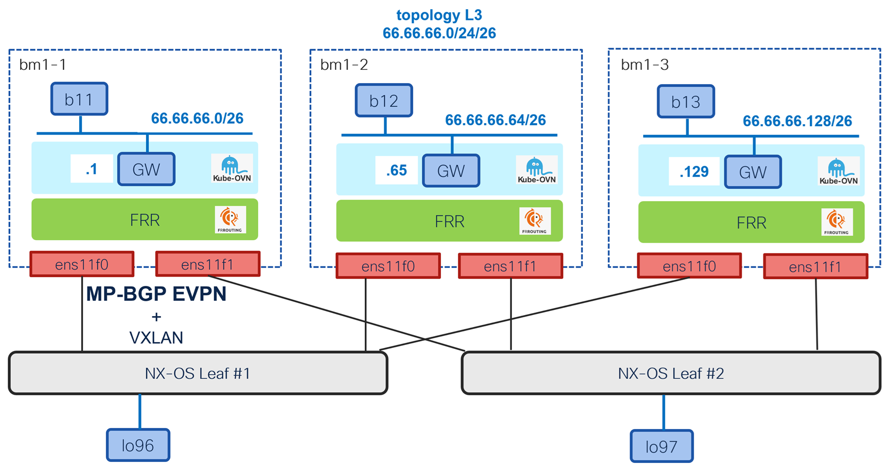

# BGP EVPN for primary l3 cluster user-defined networks

[[Back]](../README.md) [[non-redundant l3]](./cudn-l3.md) [[l2]](./cudn-l2-v2.md)

OpenShift 4.22 introduces BGP EVPN support for primary cudn as documented [here](https://docs.redhat.com/en/documentation/openshift_container_platform/4.22/html-single/advanced_networking/index#bgp-evpn-for-user-defined-networks) and shown by example using the topology as below



## Table of content

- [key highlights](#summary)
- [hw/sw info](#hwsw-info)
- [complete leaf configuration](#complete-nx-os-configuration)
- [OpenShift setup](#openshift-configuration-steps-overview)
  - [enable features](#enable-openshift-features)
  - [p2p interface](#p2p-interface)
  - [vtep](#vtep)
  - [route to leaf bgp control plane loopback](#route-to-leaf-bgp-control-plane-loopback)
  - [route to leaf vxlan data plane loopback](#route-to-leaf-vxlan-data-plane-loopback)
  - [bgp peering](#bgp-peering)
  - [namespace](#namespace)
  - [cluster user defined network](#cluster-user-defined-network)
  - [route advertisement](#route-advertisement)
- Workload
  - [pod](#pod)
  - [virtual machine](#vm)
- BGP
  - [ovn advertised route](#ovn-advertised-routes)
  - [ovn received route](#ovn-received-routes)
- Packet captures
  - east-west
    - [inter-node](#east-west-inter-node)
    - [cluster ip service](#east-west-cluster-ip-service)
    - [microsegmentation](#east-west-microsegmentation)
  - north-south
    - [egress](#north-south-egress)

## key highlights

Node interface
- pair of p2p interface to two leaves (redundant)
- dummy (loopback-like) interface used as vtep (vxlan data plane)

BGP Control Plane
- eBGP session to two leaves using leaf's routing loopback (loopback0)
- leaf configured with vxlan re-stitching by next-hop manipulation
  - node vteps "hidden" by the leaves from fabric perspective
  - fabric vteps "hidden" by the leaves from node perspecitve
- the same route target used for import and export rules
- node bgp (frr) advertise per-node cudn prefix using type-5 route

Cluster user defined network
- primary l3 cudn with automatic allocation of per-node prefix from cudn cidr
- the first ip address of node prefix acts as default gateway
- east-west inter-node traffic routed
- east-west as well as north-south traffic go over "evpn interfaces"

Limitations
- primary interface of the pod **only**
- virtual machine not officially supported in Layer3 UDN; however, it works

## hw/sw info

Bare metal OpenShift cluster

```
$ oc version
Client Version: 4.22.0-202605222252.p2.g062bc54.assembly.stream-062bc54
Kustomize Version: v5.7.1
Server Version: 4.22.2
Kubernetes Version: v1.35.5
```

Nexus 9000 leafs

```
Software
  BIOS: version 05.53
  NXOS: version 10.6(3) [Feature Release]

Hardware
  cisco Nexus9000 C93240YC-FX2 Chassis
  Intel(R) Xeon(R) CPU D-1526 @ 1.80GHz with 24530756 kB of memory.
```

## complete NX-OS configuration

While the guide shows incremental configuration steps for OpenShift, NX-OS configuration on pair of leaf switches is already complete as below

### control and data plane loopbacks

Leaf1

```
interface loopback0
  description Routing loopback interface
  ip address 100.64.0.112/32
  ip router isis UNDERLAY
  ip pim sparse-mode
!
interface loopback1
  description VTEP loopback interface
  ip address 100.65.0.112/32
  ip address 100.65.0.12/32 secondary
  ip router isis UNDERLAY
  ip pim sparse-mode
!
```

Leaf2

```
interface loopback0
  description Routing loopback interface
  ip address 100.64.0.212/32
  ip router isis UNDERLAY
  ip pim sparse-mode

interface loopback1
  description VTEP loopback interface
  ip address 100.65.0.212/32
  ip address 100.65.0.12/32 secondary
  ip router isis UNDERLAY
  ip pim sparse-mode
!
```

### p2p interfaces between the leaf switch and cluster nodes

Leaf1 

```
interface Ethernet1/49
  description bm1-1 ens11f0 address: cc79.d7f2.1397 (bia cc79.d7f2.13c8)
  no switchport
  mtu 9216
  medium p2p
  ip address 100.66.0.110/31
  no shutdown
!
interface Ethernet1/50
  description bm1-2 ens11f0 address: cc79.d7f2.1397 (bia cc79.d7f2.13c9)
  no switchport
  mtu 9216
  medium p2p
  ip address 100.66.0.120/31
  no shutdown
!
interface Ethernet1/51
  description bm1-3 ens11f0 address: cc79.d7f2.1397 (bia cc79.d7f2.13ca)
  no switchport
  mtu 9216
  medium p2p
  ip address 100.66.0.130/31
  no shutdown
```

Leaf2 

```
interface Ethernet1/49
  description bm1-1 ens11f1 address: cc79.d7f2.04af (bia cc79.d7f2.04e0)
  no switchport
  mtu 9216
  medium p2p
  ip address 100.66.0.210/31
  no shutdown
!
interface Ethernet1/50
  description bm1-2 ens11f1 address: cc79.d7f2.04af (bia cc79.d7f2.04e1)
  no switchport
  mtu 9216
  medium p2p
  ip address 100.66.0.220/31
  no shutdown
!
interface Ethernet1/51
  description bm1-3 ens11f1 address: cc79.d7f2.04af (bia cc79.d7f2.04e2)
  no switchport
  mtu 9216
  medium p2p
  ip address 100.66.0.230/31
  no shutdown
```

unlike [Cilium](../../cilium-pnet/evpn-leaf/README.md), there is no overlay (ipv4/unicast) bgp session to advertise the loopback ips between nodes and fabric. as such static route to openshift vtep via p2p interface is required

Leaf1

```
ip route 100.69.0.111/32 100.66.0.111 name BM1-1_VTEP
ip route 100.69.0.121/32 100.66.0.121 name BM1-2_VTEP
ip route 100.69.0.131/32 100.66.0.131 name BM1-3_VTEP
```

Leaf2

```
ip route 100.69.0.111/32 100.66.0.211 name BM1-1_VTEP
ip route 100.69.0.121/32 100.66.0.221 name BM1-2_VTEP
ip route 100.69.0.131/32 100.66.0.231 name BM1-3_VTEP
```

### vrf

VRF context with vni that matches [cudn](#cluster-user-defined-network) configuration

```
vrf context OVN_L3
  vni 66200 l3
  rd auto
  address-family ipv4 unicast
    route-target both auto
    route-target both auto evpn
!
interface nve1
  source-interface loopback1
  member vni 66200 associate-vrf
!
```

### test loopback 

Test loopback interface for [north south](#north-south-connectivity) connectivity tests

Leaf1

```
interface loopback66
  description TEST_OVN_L3
  vrf member OVN_L3
  ip address 96.96.96.96/32 tag 12345
```

Leaf2

```
interface loopback66
  description TEST_OVN_L3
  vrf member OVN_L3
  ip address 96.96.96.97/32 tag 12345
```

### BGP configuration

Goal
- nothing advertised and learnt over ipv4 unicast address family
- rewrite next-hop towards openshift and towards the fabric (spines)

Leaf1

```
ip prefix-list OVN_NODES seq 5 permit 100.69.0.0/24 eq 32
!
route-map FILTER_ALL deny 1000
!
route-map FROM_OVN_NEXT_HOP permit 10
  match ip next-hop prefix-list OVN_NODES
  set ip next-hop 100.65.0.112
route-map FROM_OVN_NEXT_HOP permit 1000
!
route-map TO_OVN_NEXT_HOP_BM1 permit 10
  set ip next-hop 100.65.0.112
!
router bgp 64701
  router-id 100.64.0.112
  address-family l2vpn evpn
    advertise-pip
  template peer OVN
    remote-as external
    update-source loopback0
    ebgp-multihop 5
    address-family ipv4 unicast
      route-map FILTER_ALL in
      route-map FILTER_ALL out
    address-family l2vpn evpn
      disable-peer-as-check
      send-community
      send-community extended
      route-map TO_OVN_NEXT_HOP_BM1 out
  template peer-session OVN
    log-neighbor-changes
  neighbor 100.66.0.0/24
    inherit peer OVN
    inherit peer-session OVN
  neighbor ip-of-spine1
    remote-as 64701
    update-source loopback0
    address-family ipv4 mvpn
      send-community
      send-community extended
    address-family l2vpn evpn
      send-community
      send-community extended
      route-map FROM_OVN_NEXT_HOP out
  neighbor ip-of-spine2
    remote-as 64701
    update-source loopback0
    address-family ipv4 mvpn
      send-community
      send-community extended
    address-family l2vpn evpn
      send-community
      send-community extended
      route-map FROM_OVN_NEXT_HOP out
  vrf OVN_L3
    address-family ipv4 unicast
      advertise l2vpn evpn
      redistribute direct route-map fabric-rmap-redist-subnet
      redistribute static route-map fabric-rmap-redist-subnet
      maximum-paths ibgp 2
```

Leaf2

```
ip prefix-list OVN_NODES seq 5 permit 100.69.0.0/24 eq 32
!
route-map FILTER_ALL deny 1000
!
route-map FROM_OVN_NEXT_HOP permit 10
  match ip next-hop prefix-list OVN_NODES
  set ip next-hop 100.65.0.212
route-map FROM_OVN_NEXT_HOP permit 1000
!
route-map TO_OVN_NEXT_HOP_BM1 permit 10
  set ip next-hop 100.65.0.212
!
router bgp 64701
  router-id 100.64.0.212
  address-family l2vpn evpn
    advertise-pip
  template peer OVN
    remote-as external
    update-source loopback0
    ebgp-multihop 5
    address-family ipv4 unicast
      route-map FILTER_ALL in
      route-map FILTER_ALL out
    address-family l2vpn evpn
      disable-peer-as-check
      send-community
      send-community extended
      route-map TO_OVN_NEXT_HOP_BM1 out
  template peer-session OVN
    log-neighbor-changes
  neighbor 100.66.0.0/24
    inherit peer OVN
    inherit peer-session OVN
  neighbor ip-of-spine1
    remote-as 64701
    update-source loopback0
    address-family ipv4 mvpn
      send-community
      send-community extended
    address-family l2vpn evpn
      send-community
      send-community extended
      route-map FROM_OVN_NEXT_HOP out
  neighbor ip-of-spine2
    remote-as 64701
    update-source loopback0
    address-family ipv4 mvpn
      send-community
      send-community extended
    address-family l2vpn evpn
      send-community
      send-community extended
      route-map FROM_OVN_NEXT_HOP out
  vrf OVN_L3
    address-family ipv4 unicast
      advertise l2vpn evpn
      redistribute direct route-map fabric-rmap-redist-subnet
      redistribute static route-map fabric-rmap-redist-subnet
      maximum-paths ibgp 2
```

## OpenShift configuration steps overview

>[!CAUTION]
>Order **does matter**

### Deploy

- [enable OpenShift features](#enable-openshift-features)
- [ip address on interface towards leaves](#node-to-leaf-connectivity)
- [dummy/loopback interface as vtep source](#vtep)
- [route to leaves bgp control plane loopback](#route-to-leaf-bgp-control-plane-loopback)
- [route to leaves vxlan data plane loopback](#route-to-leaf-vxlan-data-plane-loopback)
- [bgp peering](#bgp-peering)
- [namespace](#namespace)
- [cluster user defined network](#cluster-user-defined-network)
- [pod](#pod)
- [vm](#vm)
- [route advertisement](#route-advertisement)

### Undeploy

- application (pod/vm)
- route advertisement
- bgp peering
- cluster user defined network
- namespace
- vtep
- route to leaves bgp control plane loopback
- route to leaves vtep data plane loopback
- dummy/loopback interface (vtep source)
- ip address on interface towards leaves

## enable OpenShift features

```
# oc patch Network.operator.openshift.io/cluster --type=merge -p '{
  "spec": {
    "additionalRoutingCapabilities": {
      "providers": ["FRR"]
    },
    "defaultNetwork": {
        "ovnKubernetesConfig": {
            "gatewayConfig": {
              "ipForwarding": "Global",
              "routingViaHost": true
            },
            "routeAdvertisements": "Enabled"
        }
    }
  }
}'
```

OVN kubernetes resources are expected to be redeployed

```
$ oc get all -n openshift-ovn-kubernetes 
NAME                                         READY   STATUS    RESTARTS   AGE
pod/ovnkube-control-plane-76b7f44cf8-9gwrq   2/2     Running   0          50s
pod/ovnkube-control-plane-76b7f44cf8-vcvhc   2/2     Running   0          48s
pod/ovnkube-node-2c7vh                       8/8     Running   0          48s
pod/ovnkube-node-2ks5v                       5/8     Running   0          9s
pod/ovnkube-node-jm8hc                       8/8     Running   0          29s
```

All resources should come up in `openshift-frr-k8s` namespace

```
$ oc get all -n openshift-frr-k8s
NAME                                         READY   STATUS    RESTARTS   AGE
pod/frr-k8s-9ckzb                            7/7     Running   0          2m50s
pod/frr-k8s-c4jk4                            7/7     Running   0          2m50s
pod/frr-k8s-statuscleaner-6c46867584-2f6n4   1/1     Running   0          2m49s
pod/frr-k8s-zpxj6                            7/7     Running   0          2m50s

NAME                              TYPE        CLUSTER-IP      EXTERNAL-IP   PORT(S)             AGE
service/frr-k8s-monitor-service   ClusterIP   None            <none>        9140/TCP,9141/TCP   2m50s
service/frr-k8s-webhook-service   ClusterIP   172.30.144.15   <none>        443/TCP             2m49s

NAME                     DESIRED   CURRENT   READY   UP-TO-DATE   AVAILABLE   NODE SELECTOR            AGE
daemonset.apps/frr-k8s   3         3         3       3            3           kubernetes.io/os=linux   2m50s

NAME                                    READY   UP-TO-DATE   AVAILABLE   AGE
deployment.apps/frr-k8s-statuscleaner   1/1     1            1           2m49s

NAME                                               DESIRED   CURRENT   READY   AGE
replicaset.apps/frr-k8s-statuscleaner-6c46867584   1         1         1       2m49s
```

## p2p interface

node | interface | ip | mac
--- | --- | --- | ---
bm1-1 | ens11f0 | 100.66.0.111/31 | b4:96:91:f9:40:40
bm1-1 | ens11f1 | 100.66.0.211/31 | b4:96:91:f9:40:41
bm1-2 | ens11f0 | 100.66.0.121/31 | b4:96:91:f9:3d:f8
bm1-2 | ens11f1 | 100.66.0.221/31 | b4:96:91:f9:3d:f9
bm1-3 | ens11f0 | 100.66.0.131/31 | b4:96:91:f9:3c:18
bm1-3 | ens11f1 | 100.66.0.231/31 | b4:96:91:f9:3c:19

```yaml
apiVersion: nmstate.io/v1
kind: NodeNetworkConfigurationPolicy
metadata:
  name: bm1-1-ens11f0
spec:
  desiredState:
    interfaces:
    - ipv4:
        address:
        - ip: 100.66.0.111
          prefix-length: 31
        dhcp: false
        enabled: true
      name: ens11f0
      state: up
      type: ethernet
  nodeSelector:
    kubernetes.io/hostname: bm1-1
---
apiVersion: nmstate.io/v1
kind: NodeNetworkConfigurationPolicy
metadata:
  name: bm1-2-ens11f0
spec:
  desiredState:
    interfaces:
    - ipv4:
        address:
        - ip: 100.66.0.121
          prefix-length: 31
        dhcp: false
        enabled: true
      name: ens11f0
      state: up
      type: ethernet
  nodeSelector:
    kubernetes.io/hostname: bm1-2
---
apiVersion: nmstate.io/v1
kind: NodeNetworkConfigurationPolicy
metadata:
  name: bm1-3-ens11f0
spec:
  desiredState:
    interfaces:
    - ipv4:
        address:
        - ip: 100.66.0.131
          prefix-length: 31
        dhcp: false
        enabled: true
      name: ens11f0
      state: up
      type: ethernet
  nodeSelector:
    kubernetes.io/hostname: bm1-3
---
apiVersion: nmstate.io/v1
kind: NodeNetworkConfigurationPolicy
metadata:
  name: bm1-1-ens11f1
spec:
  desiredState:
    interfaces:
    - ipv4:
        address:
        - ip: 100.66.0.211
          prefix-length: 31
        dhcp: false
        enabled: true
      name: ens11f1
      state: up
      type: ethernet
  nodeSelector:
    kubernetes.io/hostname: bm1-1
---
apiVersion: nmstate.io/v1
kind: NodeNetworkConfigurationPolicy
metadata:
  name: bm1-2-ens11f1
spec:
  desiredState:
    interfaces:
    - ipv4:
        address:
        - ip: 100.66.0.221
          prefix-length: 31
        dhcp: false
        enabled: true
      name: ens11f1
      state: up
      type: ethernet
  nodeSelector:
    kubernetes.io/hostname: bm1-2
---
apiVersion: nmstate.io/v1
kind: NodeNetworkConfigurationPolicy
metadata:
  name: bm1-3-ens11f1
spec:
  desiredState:
    interfaces:
    - ipv4:
        address:
        - ip: 100.66.0.231
          prefix-length: 31
        dhcp: false
        enabled: true
      name: ens11f1
      state: up
      type: ethernet
  nodeSelector:
    kubernetes.io/hostname: bm1-3
```

Example outcome on bm1-1 node

```
6: ens11f0: <BROADCAST,MULTICAST,UP,LOWER_UP> mtu 1500 qdisc mq state UP group default qlen 1000
    link/ether b4:96:91:f9:40:40 brd ff:ff:ff:ff:ff:ff
    inet 100.66.0.111/31 scope global noprefixroute ens11f0
       valid_lft forever preferred_lft foreve
```

```
7: ens11f1: <BROADCAST,MULTICAST,UP,LOWER_UP> mtu 1500 qdisc mq state UP group default qlen 1000
    link/ether b4:96:91:f9:40:41 brd ff:ff:ff:ff:ff:ff
    inet 100.66.0.211/31 scope global noprefixroute ens11f1
       valid_lft forever preferred_lft forever
```

```
$ ip r
100.66.0.110/31 dev ens11f0 proto kernel scope link src 100.66.0.111 metric 106
100.66.0.210/31 dev ens11f1 proto kernel scope link src 100.66.0.211 metric 107
```

Connectivity test

```
# leaf1 via ens11f0
$ ping 100.66.0.110 -c 1 
PING 100.66.0.110 (100.66.0.110) 56(84) bytes of data.
64 bytes from 100.66.0.110: icmp_seq=1 ttl=255 time=0.959 ms

# leaf2 via ens11f1
$ ping 100.66.0.210 -c 1 
PING 100.66.0.210 (100.66.0.210) 56(84) bytes of data.
64 bytes from 100.66.0.210: icmp_seq=1 ttl=255 time=1.03 ms
```

## vtep

In the redundant design, vtep source interface (aka loopback) needs to be created first 

node | interface | ip
--- | --- | ---
bm1-1 | vtep | 100.69.0.111/32
bm1-2 | vtep | 100.69.0.121/32
bm1-3 | vtep | 100.69.0.131/32

```yaml
apiVersion: nmstate.io/v1
kind: NodeNetworkConfigurationPolicy
metadata:
  name: bm1-1-dummy
spec:
  desiredState:
    interfaces:
    - ipv4:
        address:
        - ip: 100.69.0.111
          prefix-length: 32
        dhcp: false
        enabled: true
      ipv6:
        enabled: false
      name: vtep
      state: up
      type: dummy
  nodeSelector:
    kubernetes.io/hostname: bm1-1
---
apiVersion: nmstate.io/v1
kind: NodeNetworkConfigurationPolicy
metadata:
  name: bm1-2-dummy
spec:
  desiredState:
    interfaces:
    - ipv4:
        address:
        - ip: 100.69.0.121
          prefix-length: 32
        dhcp: false
        enabled: true
      ipv6:
        enabled: false
      name: vtep
      state: up
      type: dummy
  nodeSelector:
    kubernetes.io/hostname: bm1-2
---
apiVersion: nmstate.io/v1
kind: NodeNetworkConfigurationPolicy
metadata:
  name: bm1-3-dummy
spec:
  desiredState:
    interfaces:
    - ipv4:
        address:
        - ip: 100.69.0.131
          prefix-length: 32
        dhcp: false
        enabled: true
      ipv6:
        enabled: false
      name: vtep
      state: up
      type: dummy
  nodeSelector:
    kubernetes.io/hostname: bm1-3
```

Expected outcome showing bm1-1 as an example

```
[core@bm1-1 ~]$ ip a l vtep
204: vtep: <BROADCAST,NOARP,UP,LOWER_UP> mtu 1500 qdisc noqueue state UNKNOWN group default qlen 1000
    inet 100.69.0.111/32 scope global noprefixroute vtep
```

`VTEP` object selects by `spec:cidrs` dummy interface on every node as vtep 

```yaml
apiVersion: k8s.ovn.org/v1
kind: VTEP
metadata:
  name: vtep
spec:
  mode: Unmanaged
  cidrs:
  - 100.69.0.0/24
```

Expected outcome

```yaml
status:
  conditions:
  - lastTransitionTime: "2026-07-27T08:29:19Z"
    message: VTEP allocation succeeded
    reason: Allocated
    status: "True"
    type: Accepted
```

## route to leaf bgp control plane loopback

OpenShift BGP speaker (FRR) will peer with leaves loopback interface. Unlike [Cilium](../../cilium-pnet/evpn-leaf/README.md), there is no overlay (ipv4/unicast) bgp session over ipv6 unnumbered to advertise the bgp control plane loopback. As such explicit static route is needed on the nodes to reach leaves loopback via p2p interface for bgp control plane establishment.

```yaml
apiVersion: nmstate.io/v1
kind: NodeNetworkConfigurationPolicy
metadata:
  name: bm1-1-fabric-loopback
spec:
  desiredState:
    routes:
      config:
      - destination: 100.64.0.112/32
        next-hop-address: 100.66.0.110
        next-hop-interface: ens11f0
      - destination: 100.64.0.212/32
        next-hop-address: 100.66.0.210
        next-hop-interface: ens11f1
  nodeSelector:
    kubernetes.io/hostname: bm1-1
---
apiVersion: nmstate.io/v1
kind: NodeNetworkConfigurationPolicy
metadata:
  name: bm1-2-fabric-loopback
spec:
  desiredState:
    routes:
      config:
      - destination: 100.64.0.112/32
        next-hop-address: 100.66.0.120
        next-hop-interface: ens11f0
      - destination: 100.64.0.212/32
        next-hop-address: 100.66.0.220
        next-hop-interface: ens11f1
  nodeSelector:
    kubernetes.io/hostname: bm1-2
---
apiVersion: nmstate.io/v1
kind: NodeNetworkConfigurationPolicy
metadata:
  name: bm1-3-fabric-loopback
spec:
  desiredState:
    routes:
      config:
      - destination: 100.64.0.112/32
        next-hop-address: 100.66.0.130
        next-hop-interface: ens11f0
      - destination: 100.64.0.212/32
        next-hop-address: 100.66.0.230
        next-hop-interface: ens11f1
  nodeSelector:
    kubernetes.io/hostname: bm1-3
```

Expected outcome on bm1-1 node as an example

```
$ ip r
100.64.0.112 via 100.66.0.110 dev ens11f0 proto static 
100.64.0.212 via 100.66.0.210 dev ens11f1 proto static 
```

## route to leaf vxlan data plane loopback

Due to vxlan re-stitching design, the vxlan data plane packet received by OpenShift nodes is sourced from data plane `loopback` interface on leaf switch, using its secondary IP address. Unless the source ip address check is successful, the packet is dropped by OpenShift node. As such it is **mandatory** to define the route in OpenShift.

>[!NOTE]
>The data plane `loopback` interface secondary IP address it **the same** on both leaves as it represents two switches working as one in vPC domain.

```yaml
apiVersion: nmstate.io/v1
kind: NodeNetworkConfigurationPolicy
metadata:
  name: bm7-1-route
spec:
  desiredState:
    routes:
      config:
      - destination: 100.65.0.0/24
        next-hop-address: 100.66.0.110
        next-hop-interface: ens11f0
        weight: 1
        metric: 100
        table-id: 254
      - destination: 100.65.0.0/24
        next-hop-address: 100.66.0.210
        next-hop-interface: ens11f1
        weight: 1
        metric: 100
        table-id: 254
  nodeSelector:
    kubernetes.io/hostname: bm7-1
---
apiVersion: nmstate.io/v1
kind: NodeNetworkConfigurationPolicy
metadata:
  name: bm7-2-route
spec:
  desiredState:
    routes:
      config:
      - destination: 100.65.0.0/24
        next-hop-address: 100.66.0.120
        next-hop-interface: ens11f0
        weight: 1
        metric: 100
        table-id: 254
      - destination: 100.65.0.0/24
        next-hop-address: 100.66.0.220
        next-hop-interface: ens11f1
        weight: 1
        metric: 100
        table-id: 254
  nodeSelector:
    kubernetes.io/hostname: bm7-2
---
apiVersion: nmstate.io/v1
kind: NodeNetworkConfigurationPolicy
metadata:
  name: bm7-3-route
spec:
  desiredState:
    routes:
      config:
      - destination: 100.65.0.0/24
        next-hop-address: 100.66.0.130
        next-hop-interface: ens11f0
        weight: 1
        metric: 100
        table-id: 254
      - destination: 100.65.0.0/24
        next-hop-address: 100.66.0.230
        next-hop-interface: ens11f1
        weight: 1
        metric: 100
        table-id: 254
  nodeSelector:
    kubernetes.io/hostname: bm7-3
```

The ip route entry **must** look like this using bm1-1 as an example

```
$ ip r
100.65.0.0/24
        nexthop via 100.66.0.110 dev ens11f0 weight 1 
        nexthop via 100.66.0.210 dev ens11f1 weight 1 
```

## bgp peering

>[!NOTE]
>Kubernetes nodes peer with leaves loopback interface, that's why common `FRRConfiguration` can be used instead of per-node configuration

```yaml
apiVersion: frrk8s.metallb.io/v1beta1
kind: FRRConfiguration
metadata:
  name: fabric-peering
  namespace: openshift-frr-k8s
  labels:
    evpn: enabled
spec:
  bgp:
    routers:
    - asn: 64667
      neighbors:
      - address: 100.64.0.112
        asn: 64701
        ebgpMultiHop: true
      - address: 100.64.0.212
        asn: 64701
        ebgpMultiHop: true
```

The frr configuration generated based on `FRRConfiguration` object, shown for single node as an example. BGP neighbors configured with ipv4 unicast address family enabled, however, associated route-map denies everything in both directions.

```
bm1-1# show run
Building configuration...

Current configuration:
!
frr version 10.4.3
frr defaults traditional
hostname bm1-1
log stdout informational
log timestamp precision 3
service integrated-vtysh-config
!
ip prefix-list 100.64.0.112-allowed-ipv4 seq 1 deny any
ip prefix-list 100.64.0.112-inpl-ipv4 seq 1 deny any
ip prefix-list 100.64.0.212-allowed-ipv4 seq 1 deny any
ip prefix-list 100.64.0.212-inpl-ipv4 seq 1 deny any
!
ipv6 prefix-list 100.64.0.112-allowed-ipv6 seq 1 deny any
ipv6 prefix-list 100.64.0.112-inpl-ipv4 seq 2 deny any
ipv6 prefix-list 100.64.0.212-allowed-ipv6 seq 1 deny any
ipv6 prefix-list 100.64.0.212-inpl-ipv4 seq 2 deny any
!
route-map 100.64.0.112-out permit 1
 match ip address prefix-list 100.64.0.112-allowed-ipv4
exit
!
route-map 100.64.0.112-out permit 2
 match ipv6 address prefix-list 100.64.0.112-allowed-ipv6
exit
!
route-map 100.64.0.112-in permit 3
 match ip address prefix-list 100.64.0.112-inpl-ipv4
exit
!
route-map 100.64.0.112-in permit 4
 match ipv6 address prefix-list 100.64.0.112-inpl-ipv4
exit
!
route-map 100.64.0.212-out permit 1
 match ip address prefix-list 100.64.0.212-allowed-ipv4
exit
!
route-map 100.64.0.212-out permit 2
 match ipv6 address prefix-list 100.64.0.212-allowed-ipv6
exit
!
route-map 100.64.0.212-in permit 3
 match ip address prefix-list 100.64.0.212-inpl-ipv4
exit
!
route-map 100.64.0.212-in permit 4
 match ipv6 address prefix-list 100.64.0.212-inpl-ipv4
exit
!
router bgp 64667
 no bgp ebgp-requires-policy
 no bgp enforce-first-as
 no bgp hard-administrative-reset
 no bgp default ipv4-unicast
 no bgp graceful-restart notification
 bgp graceful-restart preserve-fw-state
 no bgp network import-check
 neighbor 100.64.0.112 remote-as 64701
 neighbor 100.64.0.112 ebgp-multihop
 neighbor 100.64.0.212 remote-as 64701
 neighbor 100.64.0.212 ebgp-multihop
 !
 address-family ipv4 unicast
  neighbor 100.64.0.112 activate
  neighbor 100.64.0.112 route-map 100.64.0.112-in in
  neighbor 100.64.0.112 route-map 100.64.0.112-out out
  neighbor 100.64.0.212 activate
  neighbor 100.64.0.212 route-map 100.64.0.212-in in
  neighbor 100.64.0.212 route-map 100.64.0.212-out out
 exit-address-family
exit
!
end
```

BGP session established to each leaf

```
bm1-1# show bgp summary

IPv4 Unicast Summary:
BGP router identifier 100.69.0.111, local AS number 64667 VRF default vrf-id 0
BGP table version 0
RIB entries 0, using 0 bytes of memory
Peers 2, using 47 KiB of memory

Neighbor        V         AS   MsgRcvd   MsgSent   TblVer  InQ OutQ  Up/Down State/PfxRcd   PfxSnt Desc
100.64.0.112    4      64701         6         6        0    0    0 00:02:11            0        0 N/A
100.64.0.212    4      64701         7         6        0    0    0 00:02:11            0        0 N/A

Total number of neighbors 2
```

NX-OS perspective on leaf1 with BGP session for ipv4 unicast address family is established

```
leaf1# show bgp ipv4 unicast summary
Neighbor        V    AS    MsgRcvd    MsgSent   TblVer  InQ OutQ Up/Down  State/PfxRcd
100.66.0.111    4 64667          6          6      133    0    0 00:02:58 0
100.66.0.121    4 64667          6          7      133    0    0 00:02:58 0
100.66.0.131    4 64667          6          7      133    0    0 00:02:58 0
```

However the l2vpn evpn address family is not yet enabled in FRR. Note that peerings with spine are removed in the output below.

```
leaf# show bgp l2vpn evpn summary
Neighbor        V    AS    MsgRcvd    MsgSent   TblVer  InQ OutQ Up/Down  State/PfxRcd
100.66.0.111    4 64667          7          7        0    0    0 00:03:28 0 (No Cap)
100.66.0.121    4 64667          7          8        0    0    0 00:03:28 0 (No Cap)
100.66.0.131    4 64667          7          8        0    0    0 00:03:28 0 (No Cap)


Neighbor        T    AS Type-1     Type-2     Type-3     Type-4     Type-5     Type-6     Type-7     Type-8     Type-12
100.66.0.111    I 64667 0          0          0          0          0          0          0          0          0
100.66.0.121    I 64667 0          0          0          0          0          0          0          0          0
100.66.0.131    I 64667 0          0          0          0          0          0          0          0          0
```

## namespace

Requirements
- BGP EVPN feature works for primary cudn only so primary cudn capable namespace is required 
- label namespace with `metadata.labels.k8s.ovn.org/primary-user-defined-network = ''`
- tenant label is used in cudn definition to select the namespaces where cudn is allowed

```yaml
apiVersion: v1
kind: Namespace
metadata:
  labels:
    k8s.ovn.org/primary-user-defined-network: ''
    tenant: b
  name: b1p
```

## cluster user defined network

cudn | namespace | topology | primary | subnet | transport | macVRF | ipVRF
--- | --- | --- | --- | --- | --- | --- | ---
b | p1b | Layer3 | :white_check_mark: | 66.66.66.0/24/26 | EVPN | --- | vni 66200, rt 64701:66200 

Cluster user defined network selects namespace by label and requires the namespace to be primary enabled

```yaml
apiVersion: k8s.ovn.org/v1
kind: ClusterUserDefinedNetwork
metadata:
  name: b 
  labels:
    tenant: b
spec:
  namespaceSelector:
    matchLabels:
      "tenant": "b"
  network:
    topology: Layer3
    layer3:
      role: Primary
      subnets:
      - cidr: 66.66.66.0/24
        hostSubnet: 26
    transport: EVPN
    evpn:
      vtep: vtep
      ipVRF:
        vni: 66200
        routeTarget: 64701:66200
```

>[!NOTE]
>It is expected that TransportAccepted is False since RouteAdvertisement is not configured yet

```yaml
status:
  conditions:
  - lastTransitionTime: "2026-07-22T19:42:21Z"
    message: No RouteAdvertisements CR is advertising the pod networks.
    reason: EVPNRouteAdvertisementsIsMissing
    status: "False"
    type: TransportAccepted
  - lastTransitionTime: "2026-07-22T19:42:21Z"
    message: 'NetworkAttachmentDefinition has been created in following namespaces:
      [b1p]'
    reason: NetworkAttachmentDefinitionCreated
    status: "True"
    type: NetworkCreated
  - lastTransitionTime: "2026-07-22T19:42:21Z"
    message: Network allocation succeeded for all synced nodes.
    reason: NetworkAllocationSucceeded
    status: "True"
    type: NetworkAllocationSucceeded
```

Notes
- no FRR configuration change expected yet.
- network attachment definition triggered by cudn creation
- created on every host: vrf, ovn

```yaml
apiVersion: k8s.cni.cncf.io/v1
kind: NetworkAttachmentDefinition
metadata:
  annotations:
    k8s.ovn.org/network-id: "6"
    k8s.ovn.org/network-name: cluster_udn_b
    k8s.ovn.org/tunnel-keys: '[]'
  labels:
    k8s.ovn.org/user-defined-network: ""
    tenant: b
  name: b
  namespace: b1p
  ownerReferences:
  - apiVersion: k8s.ovn.org/v1
    blockOwnerDeletion: true
    controller: true
    kind: ClusterUserDefinedNetwork
    name: b
spec:
  config: '{
    "cniVersion":"1.1.0",
    "evpn":{
      "vtep":"vtep",
      "ipVRF":{
        "vni":66200,
        "routeTarget":"64701:66200",
        "vid":7
      }
    },
    "joinSubnet":"100.65.0.0/16,fd99::/64",
    "name":"cluster_udn_b",
    "netAttachDefName":"b1p/b",
    "role":"primary",
    "subnets":"66.66.66.0/24/26",
    "topology":"layer3",
    "transport":"evpn",
    "type":"ovn-k8s-cni-overlay
  "}'
```

```
[core@bm1-1 ~]$ ip vrf
Name              Table
-----------------------
b                 1208
```

vrf ip route table with cudn subnets via dedicated ovn instance

```
[core@bm1-1 ~]$ ip route show vrf b
default via 10.10.10.222 dev br-ex mtu 1400 
unreachable default metric 4278198272 
66.66.66.0/26 dev ovn-k8s-mp6 proto kernel scope link src 66.66.66.2 
66.66.66.0/24 via 66.66.66.1 dev ovn-k8s-mp6 
169.254.0.3 via 66.66.66.1 dev ovn-k8s-mp6 
169.254.0.22 dev ovn-k8s-mp6 mtu 1400 
172.30.0.0/16 via 169.254.0.4 dev br-ex mtu 1400 
```

```
[core@bm1-1 ~]$ ip a show vrf b
208: ovn-k8s-mp6: <BROADCAST,MULTICAST,PROMISC,UP,LOWER_UP> mtu 1400 qdisc noqueue master b state UNKNOWN group default qlen 1000
    link/ether 0a:58:42:42:42:02 brd ff:ff:ff:ff:ff:ff
    inet 66.66.66.2/26 brd 66.66.66.63 scope global ovn-k8s-mp6
       valid_lft forever preferred_lft forever
    inet6 fe80::858:42ff:fe42:4202/64 scope link 
       valid_lft forever preferred_lft forever
210: svl3-b@evbr-vtep: <BROADCAST,MULTICAST,UP,LOWER_UP> mtu 1400 qdisc noqueue master b state UP group default 
    link/ether 2a:ab:2a:2d:07:4d brd ff:ff:ff:ff:ff:ff
    inet6 fe80::28ab:2aff:fe2d:74d/64 scope link 
       valid_lft forever preferred_lft forever
```

ovn instantiated per node. note that ovn-k8s-mp${INDEX} value is represented in k8s.ovn.org/network-id of net-attach-def

node | table | l3 subnet | ovn ip | ovn mac | vtep mac
--- | --- | --- | --- | --- | ---
bm1-1 | 1208 | 66.66.66.0/26 | 66.66.66.2/26 | 0a:58:42:42:42:02 | 2a:ab:2a:2d:07:4d
bm1-2 | 1135 | 66.66.66.64/26 | 66.66.66.66/26 | 0a:58:42:42:42:42 | 6a:4d:8d:d8:82:e1
bm1-3 | 1133 | 66.66.66.128/26 | 66.66.66.130/26 | 0a:58:42:42:42:82 | 5a:85:24:9a:1f:a9

## route advertisement

Requirements
- BGP EVPN feature works for primary cudn only so primary cudn capable namespace is required 
- label namespace with `metadata.labels.k8s.ovn.org/primary-user-defined-network = ''`
- tenant label is used in cudn definition to select the namespaces where cudn is allowed

```yaml
apiVersion: k8s.ovn.org/v1
kind: RouteAdvertisements
metadata:
  name: b
spec:
  targetVRF: auto
  advertisements:
  - PodNetwork
  nodeSelector: {}
  frrConfigurationSelector:
    matchLabels:
      evpn: enabled
  networkSelectors:
  - networkSelectionType: ClusterUserDefinedNetworks
    clusterUserDefinedNetworkSelector:
      networkSelector:
        matchLabels:
          tenant: b
```

```yaml
status:
  conditions:
  - lastTransitionTime: "2026-07-27T09:57:07Z"
    message: ovn-kubernetes cluster-manager validated the resource and requested the
      necessary configuration changes
    observedGeneration: 1
    reason: Accepted
    status: "True"
    type: Accepted
  status: Accepted
```

cudn status updated for TransportAccepted condition

```yaml
status:
  conditions:
  - lastTransitionTime: "2026-07-27T09:57:07Z"
    message: Transport has been configured as 'EVPN'.
    reason: EVPNTransportAccepted
    status: "True"
    type: TransportAccepted
```

FRR configuration changed

```
bm1-1# show run
Building configuration...

Current configuration:
!
frr version 10.4.3
frr defaults traditional
hostname bm1-1
log stdout informational
log timestamp precision 3
service integrated-vtysh-config
!
ip prefix-list 100.64.0.112-allowed-ipv4 seq 1 deny any
ip prefix-list 100.64.0.112-inpl-ipv4 seq 1 deny any
ip prefix-list 100.64.0.212-allowed-ipv4 seq 1 deny any
ip prefix-list 100.64.0.212-inpl-ipv4 seq 1 deny any
!
ipv6 prefix-list 100.64.0.112-allowed-ipv6 seq 1 deny any
ipv6 prefix-list 100.64.0.112-inpl-ipv4 seq 2 deny any
ipv6 prefix-list 100.64.0.212-allowed-ipv6 seq 1 deny any
ipv6 prefix-list 100.64.0.212-inpl-ipv4 seq 2 deny any
!
route-map 100.64.0.112-out permit 1
 match ip address prefix-list 100.64.0.112-allowed-ipv4
exit
!
route-map 100.64.0.112-out permit 2
 match ipv6 address prefix-list 100.64.0.112-allowed-ipv6
exit
!
route-map 100.64.0.112-in permit 3
 match ip address prefix-list 100.64.0.112-inpl-ipv4
exit
!
route-map 100.64.0.112-in permit 4
 match ipv6 address prefix-list 100.64.0.112-inpl-ipv4
exit
!
route-map 100.64.0.212-out permit 1
 match ip address prefix-list 100.64.0.212-allowed-ipv4
exit
!
route-map 100.64.0.212-out permit 2
 match ipv6 address prefix-list 100.64.0.212-allowed-ipv6
exit
!
route-map 100.64.0.212-in permit 3
 match ip address prefix-list 100.64.0.212-inpl-ipv4
exit
!
route-map 100.64.0.212-in permit 4
 match ipv6 address prefix-list 100.64.0.212-inpl-ipv4
exit
!
vrf b
 vni 66200
exit-vrf
!
router bgp 64667
 no bgp ebgp-requires-policy
 no bgp default ipv4-unicast
 bgp graceful-restart preserve-fw-state
 no bgp network import-check
 neighbor 100.64.0.112 remote-as 64701
 neighbor 100.64.0.112 ebgp-multihop
 neighbor 100.64.0.212 remote-as 64701
 neighbor 100.64.0.212 ebgp-multihop
 !
 address-family ipv4 unicast
  neighbor 100.64.0.112 activate
  neighbor 100.64.0.112 route-map 100.64.0.112-in in
  neighbor 100.64.0.112 route-map 100.64.0.112-out out
  neighbor 100.64.0.212 activate
  neighbor 100.64.0.212 route-map 100.64.0.212-in in
  neighbor 100.64.0.212 route-map 100.64.0.212-out out
 exit-address-family
 !
 address-family l2vpn evpn
  neighbor 100.64.0.112 activate
  neighbor 100.64.0.112 allowas-in origin
  neighbor 100.64.0.212 activate
  neighbor 100.64.0.212 allowas-in origin
  advertise-all-vni
 exit-address-family
exit
!
router bgp 64667 vrf b
 no bgp ebgp-requires-policy
 no bgp enforce-first-as
 no bgp hard-administrative-reset
 no bgp default ipv4-unicast
 no bgp graceful-restart notification
 bgp graceful-restart preserve-fw-state
 no bgp network import-check
 !
 address-family ipv4 unicast
  network 66.66.66.0/26
 exit-address-family
 !
 address-family l2vpn evpn
  advertise ipv4 unicast
  route-target import 64701:66200
  route-target export 64701:66200
 exit-address-family
exit
!
end
```

Nothing sent/received over ipv4/unicast

```
bm1-1# show bgp ipv4 unicast summary 
Neighbor        V         AS   MsgRcvd   MsgSent   TblVer  InQ OutQ  Up/Down State/PfxRcd   PfxSnt Desc
100.64.0.112    4      64701       424       316        0    0    0 00:06:56            0        0 N/A
100.64.0.212    4      64701       428       317        0    0    0 00:06:56            0        0 N/A

Total number of neighbors 2
```

Lot of data exchanged over l2vpn/evpn

```
bm1-1# show bgp l2vpn evpn summary 
Neighbor        V         AS   MsgRcvd   MsgSent   TblVer  InQ OutQ  Up/Down State/PfxRcd   PfxSnt Desc
100.64.0.112    4      64701       426       428      319    0    0 00:08:58         2418     2553 N/A
100.64.0.212    4      64701       815       599      319    0    0 00:00:54         2418     2553 N/A

Total number of neighbors 2
```

## pod

Example

```yaml
apiVersion: v1
kind: Pod
metadata:
  name: b11
  namespace: b1p
spec:
  containers:
  - command:
    - sleep
    - infinite
    image: nicolaka/netshoot:latest
    name: netshoot
    securityContext:
      capabilities:
        add:
        - IPC_LOCK
        - SYS_RESOURCE
        - NET_RAW
      runAsUser: 0
  nodeName: bm1-1
```

Example outcome of creating pod per node

node | pod | eth0 ip | eth0 mac | ovn-udn1 ip | ovn-udn1 mac
--- | --- | --- | --- | --- | ---
bm1-1 | b11 | 10.128.0.149 | 0a:58:0a:80:00:95 | 66.66.66.3/26 | 0a:58:42:42:42:03
bm1-2 | b12 | 10.130.0.63 | 0a:58:0a:82:00:3f | 66.66.66.67/26 | 0a:58:42:42:42:43
bm1-3 | b13 | 10.129.0.32 | 0a:58:0a:81:00:20 | 66.66.66.132/26  | 0a:58:42:42:42:84

## vm

>[!CAUTION]
>Virtual machine is officially not supported in L3 (C)UDN since we can't have same IP address for a VM across the nodes which restricts the Live Migration feature. That's why only layer2 is supported with OCP Virtualization.

### Overview

Requirements
- storage like [lvm](../../lvm/README.md)
- [cnv operator](../../cnv/README.md)

Virtual Machine can connect to cudn as primary interface, the cudn/nad name is not explicitly defined, `l2bridge` binding value is used instead

```yaml
  template:
    spec:
      domain:
        devices:
          interfaces:
          - binding:
              name: l2bridge
            name: default
      networks:
      - name: default
        pod: {}
```

If data volume source is in another namespace, then clone operation must be allowed from source namespace e.g., `default` to target cudn namespace e.g., `b1p`

```yaml
apiVersion: rbac.authorization.k8s.io/v1
kind: ClusterRole
metadata:
  name: datavolume-cloner
rules:
- apiGroups: ["cdi.kubevirt.io"]
  resources: ["datavolumes/source"]
  verbs: ["*"]
---
apiVersion: rbac.authorization.k8s.io/v1
kind: RoleBinding
metadata:
  name: cudn-b-cloner
  namespace: default
subjects:
- kind: ServiceAccount
  name: default
  namespace: b1p
roleRef:
  kind: ClusterRole
  name: datavolume-cloner 
  apiGroup: rbac.authorization.k8s.io
```

### Example: cat8kv

Even if cat8kv instance is configured with dhcp on its primary interface, dhcp is not working and static IP address with the allocated IP address must be configured once vm is running using `virtctl`.

```yaml
apiVersion: v1
kind: ConfigMap
metadata:
  name: c8kv1-day0
  namespace: b1p
data:
  iosxe_config.txt: |-
    hostname c8kv1
    ip domain name domain.com
    aaa new-model
    aaa authentication login default local
    aaa authorization exec default local
    username admin privilege 15 secret password
    no ip http secure-server
    crypto key generate rsa modulus 2048
    ip ssh version 2
    interface GigabitEthernet1
      ip address dhcp
      no shutdown
    ip http secure-server
    line con 0
      length 0
    line vty 0 4
      length 0
---
apiVersion: kubevirt.io/v1
kind: VirtualMachine
metadata:
  name: c8kv1
  namespace: b1p
spec:
  dataVolumeTemplates:
  - apiVersion: cdi.kubevirt.io/v1beta1
    kind: DataVolume
    metadata:
      name: c8kv1
      namespace: b1p
    spec:
      pvc:
        accessModes:
        - ReadWriteOnce
        resources:
          requests:
            storage: 10Gi
        storageClassName: lvms-vg1
        volumeMode: Block
      source:
        pvc:
          namespace: default
          name: c8kv
  runStrategy: Always
  template:
    metadata:
      labels:
        app: c8kv1
        kubevirt.io/domain: c8kv1
    spec:
      domain:
        cpu:
          cores: 1
          sockets: 1
          threads: 1
        devices:
          disks:
          - disk:
              bus: virtio
            name: rootdisk
          - cdrom:
              bus: sata
              readyOnly: true
            name: day0
          interfaces:
          - binding:
              name: l2bridge
            name: default
          rng: {}
        resources:
          requests:
            memory: 4Gi
      evictionStrategy: LiveMigrate
      hostname: c8kv1
      networks:
      - name: default
        pod: {}
      nodeSelector:
        kubernetes.io/hostname: bm7-1
      volumes:
      - dataVolume:
          name: c8kv1
          namespace: b1p
        name: rootdisk
      - configMap:
          name: c8kv1-day0
          namespace: b1p
        name: day0
```

Virtlauncher pod shows the allocated ip address for `ovn-udn1` interface that must be configured manually inside the vm

```
$ oc describe pod -n b1p virt-launcher-c8kv1-6dshj 
Name:              virt-launcher-c8kv1-6dshj
Namespace:         b1p
Annotations:       k8s.v1.cni.cncf.io/network-status:
                     [{
                         "name": "ovn-kubernetes",
                         "interface": "eth0",
                         "ips": [
                             "10.128.0.49"
                         ],
                         "mac": "0a:58:0a:80:00:31",
                         "dns": {}
                     },{
                         "name": "ovn-kubernetes",
                         "interface": "ovn-udn1",
                         "ips": [
                             "66.66.66.5"
                         ],
                         "mac": "0a:58:42:42:42:05",
                         "default": true,
                         "dns": {}
                     }]
```

State of the configured interface

```
c8kv1#show int gigabitEthernet 1
GigabitEthernet1 is up, line protocol is up 
  Hardware is vNIC, address is 0a58.4242.4205 (bia 0a58.4242.4205)
  Internet address is 66.66.66.5/26
```

IP route table must be configured with default route

```
ip route 0.0.0.0 0.0.0.0 66.66.66.1
```

Connectivity test to pod running on another node and as such in another cudn subnet

```
c8kv1#ping 66.66.66.70 
Type escape sequence to abort.
Sending 5, 100-byte ICMP Echos to 66.66.66.70, timeout is 2 seconds:
!!!!!
Success rate is 100 percent (5/5), round-trip min/avg/max = 1/2/6 m
```

## ovn advertised routes

The only self originated route is node scoped subnet /26 allocated from cudn l3 /24 cidr

```
bm1-1# show bgp l2vpn evpn route self-originate 
BGP table version is 2, local router ID is 100.69.0.111
Status codes: s suppressed, d damped, h history, * valid, > best, i - internal
Origin codes: i - IGP, e - EGP, ? - incomplete
EVPN type-1 prefix: [1]:[EthTag]:[ESI]:[IPlen]:[VTEP-IP]:[Frag-id]
EVPN type-2 prefix: [2]:[EthTag]:[MAClen]:[MAC]:[IPlen]:[IP]
EVPN type-3 prefix: [3]:[EthTag]:[IPlen]:[OrigIP]
EVPN type-4 prefix: [4]:[ESI]:[IPlen]:[OrigIP]
EVPN type-5 prefix: [5]:[EthTag]:[IPlen]:[IP]

   Network          Next Hop            Metric LocPrf Weight Path
                    Extended Community
Route Distinguisher: 66.66.66.2:2
 *>  [5]:[0]:[26]:[66.66.66.0]
                    100.69.0.111             0         32768 i
                    ET:8 RT:64701:66200 Rmac:2a:ab:2a:2d:07:4d

Displayed 1 prefixes (1 paths)
```

```json
"66.66.66.2:2": {
    "rd": "66.66.66.2:2",
    "[5]:[0]:[26]:[66.66.66.0]": {
        "prefix": "[5]:[0]:[26]:[66.66.66.0]",
        "prefixLen": 352,
        "paths": [
            [
                {
                    "valid": true,
                    "bestpath": true,
                    "selectionReason": "First path received",
                    "pathFrom": "external",
                    "routeType": 5,
                    "ethTag": 0,
                    "ipLen": 26,
                    "ip": "66.66.66.0",
                    "metric": 0,
                    "weight": 32768,
                    "peerId": "(unspec)",
                    "path": "",
                    "origin": "IGP",
                    "extendedCommunity": {
                        "string": "ET:8 RT:64701:66200 Rmac:2a:ab:2a:2d:07:4d"
                    },
                    "nexthops": [
                        {
                            "ip": "100.69.0.111",
                            "hostname": "bm1-1",
                            "afi": "ipv4",
                            "used": true
                        }
                    ]
                }
            ]
        ]
    }
}
```

Notes:
- rd 66.66.66.2 is based on ovn-k8s-mp6 ip address
- advertised extended community based on cudn definition
- advertised router mac based on vrf vtep mac
- advertised nexthop based on [vtep](#vtep) interface configured on the node
- the route is advertised to both leaves

Route received on leaf1

```
leaf1# show bgp l2vpn evpn rd 66.66.66.2:2
BGP routing table information for VRF default, address family L2VPN EVPN
Route Distinguisher: 66.66.66.2:2
BGP routing table entry for [5]:[0]:[0]:[26]:[66.66.66.0]/224, version 173918
Paths: (1 available, best #1)
Flags: (0x000002) (high32 00000000) on xmit-list, is not in l2rib/evpn, is not in HW

  Advertised path-id 1
  Path type: external, path is valid, is best path, no labeled nexthop
             Imported to 2 destination(s)
             Imported paths list: OVN_L3 L3-66200
  Gateway IP: 0.0.0.0
  AS-Path: 64667 , path sourced external to AS
    100.69.0.111 (metric 0) from 100.66.0.111 (100.69.0.111)
      Origin IGP, MED 0, localpref 100, weight 0
      Received label 66200
      Extcommunity: RT:64701:66200 ENCAP:8 Router MAC:2aab.2a2d.074d

  Path-id 1 advertised to peers:
    100.64.0.23        100.64.0.24        100.66.0.121       100.66.0.131
    << spine1 >>       << spine 2 >>      << bm1-2 >>        << bm1-3 >>
```

Route is further advertised to both spines and other openshift nodes. 

Closer look at the spine

```
spine1# show bgp l2vpn evpn rd 66.66.66.2:2
BGP routing table information for VRF default, address family L2VPN EVPN
Route Distinguisher: 66.66.66.2:2
BGP routing table entry for [5]:[0]:[0]:[26]:[66.66.66.0]/224, version 64202
Paths: (2 available, best #2)
Flags: (0x000002) (high32 00000000) on xmit-list, is not in l2rib/evpn, is not in HW

  Path type: internal, path is valid, not best reason: Router Id, no labeled nexthop
  Gateway IP: 0.0.0.0
  AS-Path: 64667 , path sourced external to AS
    100.65.0.212 (metric 2) from 100.64.0.212 (100.64.0.212)
      Origin IGP, MED 0, localpref 100, weight 0
      Received label 66200
      Extcommunity: RT:64701:66200 ENCAP:8 Router MAC:cc79.d7f2.04af

  Advertised path-id 1
  Path type: internal, path is valid, is best path, no labeled nexthop
  Gateway IP: 0.0.0.0
  AS-Path: 64667 , path sourced external to AS
    100.65.0.112 (metric 2) from 100.64.0.112 (100.64.0.112)
      Origin IGP, MED 0, localpref 100, weight 0
      Received label 66200
      Extcommunity: RT:64701:66200 ENCAP:8 Router MAC:cc79.d7f2.1397

  Path-id 1 advertised to peers:
  ...
```

Notes
- the route received from two leaves, one selected as best
- next hop changed to leaf's data plane loopback as configured with TO_OVN_NEXT_HOP_BM1 route map
- router mac changed to supervisor's mac address of the leaf
- spine is not aware of the real location i.e. openshift node
- openshift nodes are "hidden" by leaf switches

## ovn received routes

Node learns two type-5 routes over l2vpn/evpn advertisement:
- cudn of other cluster nodes 
- leaf loopback interface

### other cudn subnet

Other node advertises its cudn subnet to pair of leaves, every leaf knows how to reach the subnet directly or via other leaf. Resulting in the following advertisement towards the ovn node

```
bm1-1# show bgp l2vpn evpn 66.66.66.64/24
BGP routing table entry for 100.64.0.112:10:[5]:[0]:[24]:[66.66.66.0]
Paths: (2 available, best #1)
  Advertised to peers:
  100.64.0.112 100.64.0.212
  Route [5]:[0]:[24]:[66.66.66.0] VNI 50012
  64701
    100.65.0.112 from 100.64.0.112 (100.64.0.112)
      Origin incomplete, metric 0, valid, external, multipath, best (Older Path)
      Extended Community: RT:64701:50012 ET:8 Rmac:cc:79:d7:f2:13:97
      Last update: Tue Jul 28 09:03:02 2026
  Route [5]:[0]:[24]:[66.66.66.0] VNI 50012
  64701
    100.65.0.212 from 100.64.0.212 (100.64.0.212)
      Origin incomplete, valid, external, multipath
      Extended Community: RT:64701:50012 ET:8 Rmac:cc:79:d7:f2:04:af
      Last update: Tue Jul 28 09:04:16 2026
BGP routing table entry for 100.64.0.212:10:[5]:[0]:[24]:[66.66.66.0]
Paths: (2 available, best #1)
  Advertised to peers:
  100.64.0.112 100.64.0.212
  Route [5]:[0]:[24]:[66.66.66.0] VNI 50012
  64701
    100.65.0.112 from 100.64.0.112 (100.64.0.112)
      Origin incomplete, valid, external, multipath, best (Older Path)
      Extended Community: RT:64701:50012 ET:8 Rmac:cc:79:d7:f2:13:97
      Last update: Tue Jul 28 09:03:02 2026
  Route [5]:[0]:[24]:[66.66.66.0] VNI 50012
  64701
    100.65.0.212 from 100.64.0.212 (100.64.0.212)
      Origin incomplete, metric 0, valid, external, multipath
      Extended Community: RT:64701:50012 ET:8 Rmac:cc:79:d7:f2:04:af
      Last update: Tue Jul 28 09:04:16 2026
```

```json
{
  "100.64.0.112:10":{
    "rd":"100.64.0.112:10",
    "routeType":5,
    "ethTag":0,
    "ipLen":24,
    "ip":"66.66.66.0",
    "advertisedTo":{
      "100.64.0.112":{
      },
      "100.64.0.212":{
      }
    },
    "pathCount":2,
    "paths":[
      {
        "vni":"50012",
        "aspath":{
          "string":"64701",
          "segments":[
            {
              "type":"as-sequence",
              "list":[
                64701
              ]
            }
          ],
          "length":1
        },
        "origin":"incomplete",
        "metric":0,
        "valid":true,
        "version":8,
        "multipath":true,
        "bestpath":{
          "overall":true,
          "selectionReason":"Older Path"
        },
        "extendedCommunity":{
          "string":"RT:64701:50012 ET:8 Rmac:cc:79:d7:f2:13:97"
        },
        "lastUpdate":{
          "epoch":1785229382,
          "string":"Tue Jul 28 09:03:02 2026"
        },
        "nexthops":[
          {
            "ip":"100.65.0.112",
            "afi":"ipv4",
            "metric":0,
            "accessible":true,
            "used":true
          }
        ],
        "peer":{
          "peerId":"100.64.0.112",
          "routerId":"100.64.0.112",
          "type":"external"
        }
      },
      {
        "vni":"50012",
        "aspath":{
          "string":"64701",
          "segments":[
            {
              "type":"as-sequence",
              "list":[
                64701
              ]
            }
          ],
          "length":1
        },
        "origin":"incomplete",
        "valid":true,
        "version":8,
        "multipath":true,
        "extendedCommunity":{
          "string":"RT:64701:50012 ET:8 Rmac:cc:79:d7:f2:04:af"
        },
        "lastUpdate":{
          "epoch":1785229456,
          "string":"Tue Jul 28 09:04:16 2026"
        },
        "nexthops":[
          {
            "ip":"100.65.0.212",
            "afi":"ipv4",
            "metric":0,
            "accessible":true,
            "used":true
          }
        ],
        "peer":{
          "peerId":"100.64.0.212",
          "routerId":"100.64.0.212",
          "type":"external"
        }
      }
    ]
  },
  "100.64.0.212:10":{
    "rd":"100.64.0.212:10",
    "routeType":5,
    "ethTag":0,
    "ipLen":24,
    "ip":"66.66.66.0",
    "advertisedTo":{
      "100.64.0.112":{
      },
      "100.64.0.212":{
      }
    },
    "pathCount":2,
    "paths":[
      {
        "vni":"50012",
        "aspath":{
          "string":"64701",
          "segments":[
            {
              "type":"as-sequence",
              "list":[
                64701
              ]
            }
          ],
          "length":1
        },
        "origin":"incomplete",
        "valid":true,
        "version":9,
        "multipath":true,
        "bestpath":{
          "overall":true,
          "selectionReason":"Older Path"
        },
        "extendedCommunity":{
          "string":"RT:64701:50012 ET:8 Rmac:cc:79:d7:f2:13:97"
        },
        "lastUpdate":{
          "epoch":1785229382,
          "string":"Tue Jul 28 09:03:02 2026"
        },
        "nexthops":[
          {
            "ip":"100.65.0.112",
            "afi":"ipv4",
            "metric":0,
            "accessible":true,
            "used":true
          }
        ],
        "peer":{
          "peerId":"100.64.0.112",
          "routerId":"100.64.0.112",
          "type":"external"
        }
      },
      {
        "vni":"50012",
        "aspath":{
          "string":"64701",
          "segments":[
            {
              "type":"as-sequence",
              "list":[
                64701
              ]
            }
          ],
          "length":1
        },
        "origin":"incomplete",
        "metric":0,
        "valid":true,
        "version":9,
        "multipath":true,
        "extendedCommunity":{
          "string":"RT:64701:50012 ET:8 Rmac:cc:79:d7:f2:04:af"
        },
        "lastUpdate":{
          "epoch":1785229456,
          "string":"Tue Jul 28 09:04:16 2026"
        },
        "nexthops":[
          {
            "ip":"100.65.0.212",
            "afi":"ipv4",
            "metric":0,
            "accessible":true,
            "used":true
          }
        ],
        "peer":{
          "peerId":"100.64.0.212",
          "routerId":"100.64.0.212",
          "type":"external"
        }
      }
    ]
  }
}
```

Notes:
- rd based on leaf address
- next hop changed to leaf's data plane loopback as configured with TO_OVN_NEXT_HOP_BM1 route map
- router mac changed to egress phy interface of the leaf
- spine is not aware of the real location i.e. openshift node
- openshift nodes are "hidden" by leaf switches

As the result node has two route entries to remote cudn subnet, via leaf1 and leaf2. The routes can be seen on FRR bgp table level

```
bm1-1# show ip route vrf b 66.66.66.64/26
Routing entry for 66.66.66.64/26
  Known via "bgp", distance 20, metric 0, vrf b, best
  Last update 00:34:28 ago
  * 100.65.0.112, via svl3-b onlink, weight 1
  * 100.65.0.212, via svl3-b onlink, weight 1
```

as well as on the host vrf route table level

```
[core@bm1-1 ~]$ ip r show vrf b
66.66.66.64/26 nhid 928 proto bgp metric 20 
        nexthop via 100.65.0.112 dev svl3-b weight 1 onlink 
        nexthop via 100.65.0.212 dev svl3-b weight 1 onlink
```

### fabric test loopback

The loopback interface on leaf1 is configured as vrf member and as such bgp l2vpn advertised

```
bm1-1# show bgp l2vpn evpn 96.96.96.96/32
BGP routing table entry for 100.64.0.112:19:[5]:[0]:[32]:[96.96.96.96]
Paths: (2 available, best #1)
  Advertised to peers:
  100.64.0.112 100.64.0.212
  Route [5]:[0]:[32]:[96.96.96.96] VNI 66200
  64701
    100.65.0.112 from 100.64.0.112 (100.64.0.112)
      Origin incomplete, metric 0, valid, external, multipath, best (Older Path)
      Extended Community: RT:64701:66200 ET:8 Rmac:cc:79:d7:f2:13:97
      Last update: Tue Jul 28 09:03:02 2026
  Route [5]:[0]:[32]:[96.96.96.96] VNI 66200
  64701
    100.65.0.212 from 100.64.0.212 (100.64.0.212)
      Origin incomplete, valid, external, multipath
      Extended Community: RT:64701:66200 ET:8 Rmac:cc:79:d7:f2:04:af
      Last update: Tue Jul 28 09:04:16 2026
```

```json
{
  "100.64.0.112:19":{
    "rd":"100.64.0.112:19",
    "routeType":5,
    "ethTag":0,
    "ipLen":32,
    "ip":"96.96.96.96",
    "advertisedTo":{
      "100.64.0.112":{
      },
      "100.64.0.212":{
      }
    },
    "pathCount":2,
    "paths":[
      {
        "vni":"66200",
        "aspath":{
          "string":"64701",
          "segments":[
            {
              "type":"as-sequence",
              "list":[
                64701
              ]
            }
          ],
          "length":1
        },
        "origin":"incomplete",
        "metric":0,
        "valid":true,
        "version":8,
        "multipath":true,
        "bestpath":{
          "overall":true,
          "selectionReason":"Older Path"
        },
        "extendedCommunity":{
          "string":"RT:64701:66200 ET:8 Rmac:cc:79:d7:f2:13:97"
        },
        "lastUpdate":{
          "epoch":1785229382,
          "string":"Tue Jul 28 09:03:02 2026"
        },
        "nexthops":[
          {
            "ip":"100.65.0.112",
            "afi":"ipv4",
            "metric":0,
            "accessible":true,
            "used":true
          }
        ],
        "peer":{
          "peerId":"100.64.0.112",
          "routerId":"100.64.0.112",
          "type":"external"
        }
      },
      {
        "vni":"66200",
        "aspath":{
          "string":"64701",
          "segments":[
            {
              "type":"as-sequence",
              "list":[
                64701
              ]
            }
          ],
          "length":1
        },
        "origin":"incomplete",
        "valid":true,
        "version":8,
        "multipath":true,
        "extendedCommunity":{
          "string":"RT:64701:66200 ET:8 Rmac:cc:79:d7:f2:04:af"
        },
        "lastUpdate":{
          "epoch":1785229456,
          "string":"Tue Jul 28 09:04:16 2026"
        },
        "nexthops":[
          {
            "ip":"100.65.0.212",
            "afi":"ipv4",
            "metric":0,
            "accessible":true,
            "used":true
          }
        ],
        "peer":{
          "peerId":"100.64.0.212",
          "routerId":"100.64.0.212",
          "type":"external"
        }
      }
    ]
  }
}
```

The advertised routes are imported to vrf route table based on matching extended community

```
bm1-1# show ip route vrf b 96.96.96.96/32
Routing entry for 96.96.96.96/32
  Known via "bgp", distance 20, metric 0, vrf b, best
  Last update 00:35:58 ago
  * 100.65.0.112, via svl3-b onlink, weight 1
  * 100.65.0.212, via svl3-b onlink, weight 1
```

and finally populates vrf route table

```
[core@bm1-1 ~]$ ip route show vrf b
96.96.96.96 nhid 928 proto bgp metric 20 
        nexthop via 100.65.0.112 dev svl3-b weight 1 onlink 
        nexthop via 100.65.0.212 dev svl3-b weight 1 onlink
```

## east-west inter-node

connectivity test using ping from pod b11 deploed on bm1-1 node to pod b12 deployed on bm1-2 node

```
[core@bm1-1 ~]$ oc exec -it -n b1p b11 -- ping 66.66.66.67 -c 1
PING 66.66.66.67 (66.66.66.67) 56(84) bytes of data.
64 bytes from 66.66.66.67: icmp_seq=1 ttl=60 time=6.60 ms

--- 66.66.66.67 ping statistics ---
1 packets transmitted, 1 received, 0% packet loss, time 0ms
rtt min/avg/max/mdev = 6.599/6.599/6.599/0.000 ms
```

### pod's ovn-udn1 interface

```
[core@bm1-1 ~]$ oc exec -it -n b1p b11 -- tcpdump -i ovn-udn1 -n -nn -vv -e
09:40:59.375931 0a:58:42:42:42:03 > 0a:58:42:42:42:01, ethertype IPv4 (0x0800)
  66.66.66.3 > 66.66.66.67: ICMP echo request, id 136, seq 1, length 64
    
09:40:59.379716 0a:58:42:42:42:02 > 0a:58:42:42:42:03, ethertype IPv4 (0x0800)
    66.66.66.67 > 66.66.66.3: ICMP echo reply, id 136, seq 1, length 64
```

Packet | Field | Value | Comment
--- | --- | --- | ---
request | source mac | 0a:58:42:42:42:03 | pod `b11` interface `ovn-udn1`
request | destination mac | 0a:58:42:42:42:01 | default router mac from pod perspective
request | inner source ip | 66.66.66.3 | pod `b11` ovn-udn1 interface
request | inner destination ip | 66.66.66.67 | pod `b12` ovn-udn1 interface

### on-the-wire: sending node

>[!NOTE]
>Assymetric routing

```
09:43:29.885834 b4:96:91:f9:40:41 > cc:79:d7:f2:04:af, ethertype IPv4 (0x0800)
  100.69.0.111.35218 > 100.65.0.212.4789: VXLAN, flags [I] (0x08), vni 66200
    2a:ab:2a:2d:07:4d > cc:79:d7:f2:04:af, ethertype IPv4 (0x0800)
      66.66.66.3 > 66.66.66.67: ICMP echo request, id 138, seq 1, length 64

09:43:09.253066 cc:79:d7:f2:13:97 > b4:96:91:f9:40:40, ethertype IPv4 (0x0800)
  100.65.0.12.11359 > 100.69.0.111.4789: VXLAN, flags [I] (0x08), vni 66200
    02:00:64:41:00:0c > 2a:ab:2a:2d:07:4d, ethertype IPv4 (0x0800)
      66.66.66.67 > 66.66.66.3: ICMP echo reply, id 137, seq 1, length 64
```

Packet | Field | Value | Comment
--- | --- | --- | ---
request | outer source mac | b4:96:91:f9:40:41 | bm1-1 ens11f1 towards leaf2
request | outer destination mac | cc:79:d7:f2:04:af | leaf2 phy interface
request | outer source ip | 100.69.0.111 | bm1-1 vtep
request | outer destination ip | 100.65.0.212 | leaf2 data plane loopback
request | inner source mac | 2a:ab:2a:2d:07:4d | bm1-1 vrf-b svl3-b
request | inner destination mac | cc:79:d7:f2:04:af | leaf2 ingress phy interface
request | inner source ip | 66.66.66.3 | pod `b11` ovn-udn1 interface
request | inner destination ip | 66.66.66.67 | pod `b12` ovn-udn1 interface
reply | outer source mac | cc:79:d7:f2:13:97 | leaf1 phy interface
reply | outer destination mac | b4:96:91:f9:40:40 | bm1-1 ens11f0 towards leaf1
reply | outer source ip | 100.65.0.12 | leaf1 data plane loopback
reply | outer destination ip | 100.69.0.111 | bm1-1 vtep
reply | inner source mac | 02:00:64:41:00:0c | leaf1 supervisor
reply | inner destination mac | 2a:ab:2a:2d:07:4d | bm1-1 vrf-b svl3-b
reply | inner ip | --- | reversed

### on-the-wire: receiving node

>[!NOTE]
>Assymetric routing

```
10:03:05.059885 cc:79:d7:f2:04:af > b4:96:91:f9:3d:f9, ethertype IPv4 (0x0800)
  100.65.0.12.26801 > 100.69.0.121.4789: VXLAN, flags [I] (0x08), vni 66200
    02:00:64:41:00:0c > 6a:4d:8d:d8:82:e1, ethertype IPv4 (0x0800)
      66.66.66.3 > 66.66.66.67: ICMP echo request, id 139, seq 1, length 64

10:03:25.165482 b4:96:91:f9:3d:f8 > cc:79:d7:f2:13:97, ethertype IPv4 (0x0800)
  100.69.0.121.53221 > 100.65.0.112.4789: VXLAN, flags [I] (0x08), vni 66200
    6a:4d:8d:d8:82:e1 > cc:79:d7:f2:13:97, ethertype IPv4 (0x0800)
      66.66.66.67 > 66.66.66.3: ICMP echo reply, id 140, seq 1, length 64
```

Packet | Field | Value | Comment
--- | --- | --- | ---
request | outer source mac | cc:79:d7:f2:04:af | leaf2 phy interface
request | outer destination mac | b4:96:91:f9:3d:f9 | bm1-2 ens11f1 towards leaf2
request | outer source ip | 100.65.0.12 | leaf1 data plane loopback
request | outer destination ip | 100.69.0.121 | bm1-2 vtep
request | inner source mac | 02:00:64:41:00:0c | leaf2 supervisor
request | inner destination mac | 6a:4d:8d:d8:82:e1 | bm1-2 vrf-b svl3-b
request | inner source ip | 66.66.66.3 | pod `b11` ovn-udn1 interface
request | inner destination ip | 66.66.66.67 | pod `b12` ovn-udn1 interface
reply | outer source mac | b4:96:91:f9:3d:f8 | bm1-2 ens11f0 towards leaf1
reply | outer destination mac | cc:79:d7:f2:13:97 | leaf1 phy interface
reply | outer source ip | 100.69.0.121 | bm1-2 vtep
reply | outer destination ip | 100.65.0.212 | leaf2 data plane loopback
reply | inner source mac | 6a:4d:8d:d8:82:e1 | bm1-2 vrf-b svl3-b
reply | inner destination mac | 2a:ab:2a:2d:07:4d | bm1-1 vrf-b svl3-b
reply | inner ip | --- | reversed

## east-west cluster ip service

east-west connectivity test in previous step was performed using pod ip address directly, let's check the service

New nginx pod deployed on node bm1-3 with associated service

```yaml
apiVersion: v1
kind: Pod
metadata:
  name: b13-nginx
  namespace: b1p
  labels:
    app: b-nginx
spec:
  nodeName: bm1-3
  containers:
  - name: nginx
    image: nginxinc/nginx-unprivileged
---
apiVersion: v1
kind: Service
metadata:
  name: b-nginx
  namespace: b1p
spec:
  type: NodePort
  selector:
    app: b-nginx
  ports:
  - name: http
    port: 80
    targetPort: 8080
```

Outcome

```
$ oc get pod -n b1p -o wide
NAME        READY   STATUS    RESTARTS   AGE     IP            NODE    NOMINATED NODE   READINESS GATES
b11         1/1     Running   0          41m     10.128.0.25   bm1-1   <none>           <none>
b12         1/1     Running   0          41m     10.130.0.5    bm1-2   <none>           <none>
b13         1/1     Running   0          41m     10.129.0.9    bm1-3   <none>           <none>
b13-nginx   1/1     Running   0          6m42s   10.129.0.20   bm1-3   <none>           <none>
```

```
$ oc get service -n b1p -o wide
NAME      TYPE       CLUSTER-IP      EXTERNAL-IP   PORT(S)        AGE    SELECTOR
b-nginx   NodePort   172.30.87.110   <none>        80:31247/TCP   7m1s   app=b-nginx
```

```
$ oc get ep -n b1p
NAME      ENDPOINTS          AGE
b-nginx   10.129.0.20:8080   57m
```

Functional test
- source `b11` with 66.66.66.4
- destination cluster ip service 172.30.87.110
- `b13-nginx` pod with 66.66.66.136 as service endpoint

```
$ oc exec -it -n b1p b11 -- curl 172.30.87.110
<!DOCTYPE html>
<html>
<body>
<h1>Welcome to nginx!</h1>
</body>
</html>
```

Originating pod route table has route entry to service cidr via `ovn-udn1` interface as such traffic takes "evpn tranport" path

```
$ oc exec -it -n b1p b11 -- ip r
172.30.0.0/16 via 66.66.66.1 dev ovn-udn1 
```

### ovn-udn1 interface i.e. inside originating pod

Service ip seen in both direections

```
$ oc exec -it -n b1p b11 -- tcpdump -i ovn-udn1 -n -nn
11:22:02.423913 IP 66.66.66.4.33714 > 172.30.87.110.80: Flags [S], seq 3872937393 
11:22:02.427889 IP 172.30.87.110.80 > 66.66.66.4.33714: Flags [S.], seq 3835812386
```

### on-the-wire

Service ip is resolved to endpoint ip address before packets hits the wire, so on vxlan level the endpoint ip address is seen instead of cluster ip (service)

>[!NOTE]
>Traffic is assymetric

TCP SYN vxlan from `bm1-1` vtep towards `leaf1` vtep (vxlan re-stitching) and inside the `nginx` pod ip address used as destination, not service ip anymore

```
11:29:06.070761 b4:96:91:f9:40:41 > cc:79:d7:f2:04:af, ethertype IPv4 (0x0800)
  100.69.0.111.41212 > 100.65.0.112.4789: VXLAN, flags [I] (0x08), vni 66200
    5e:35:b2:63:2f:32 > cc:79:d7:f2:13:97, ethertype IPv4 (0x0800)
      66.66.66.4.35350 > 66.66.66.136.8080: Flags [S]
```

TCP SYN ACK received over different interface (thus change in outer mac)

```
11:29:06.074354 cc:79:d7:f2:13:97 > b4:96:91:f9:40:40, ethertype IPv4 (0x0800)
  100.65.0.12.27132 > 100.69.0.111.4789: VXLAN, flags [I] (0x08), vni 66200
    02:00:64:41:00:0c > 5e:35:b2:63:2f:32, ethertype IPv4 (0x0800)
      66.66.66.136.8080 > 66.66.66.4.35350: Flags [S.]
```

The rest of communication is like in [east west connectivity](#east-west-connectivity) analysis.

## east-west microsegmentation

Following the previous [cluster ip service](#east-west-cluster-ip-service) test, let's add the rule that only `b12` pod should be able to reach `nginx` either directly using pod ip address or via cluster ip (service), even if all pods are in the same cudn and should be able to talk to each other.

Initial state

```
$ oc get pod -n b1p -o wide
NAME        READY   STATUS    RESTARTS   AGE     IP            NODE    NOMINATED NODE   READINESS GATES
b11         1/1     Running   0          41m     10.128.0.25   bm1-1   <none>           <none>
b12         1/1     Running   0          41m     10.130.0.5    bm1-2   <none>           <none>
b13         1/1     Running   0          41m     10.129.0.9    bm1-3   <none>           <none>
b13-nginx   1/1     Running   0          6m42s   10.129.0.20   bm1-3   <none>           <none>
```

```
$ oc get service -n b1p -o wide
NAME      TYPE       CLUSTER-IP      EXTERNAL-IP   PORT(S)        AGE    SELECTOR
b-nginx   NodePort   172.30.87.110   <none>        80:31247/TCP   7m1s   app=b-nginx
```

```
$ oc get ep -n b1p
NAME      ENDPOINTS          AGE
b-nginx   10.129.0.20:8080   57m
```

Pod `b12` is labeled with `nginx=enabled`

```
$ oc label pod -n b1p b12 nginx=enabled
pod/b12 labeled
```

`nginx` pod is already labeled with `app=b-nginx` for service selector.

New `NetworkPolicy` object implemeting the desired microsegmentation scenario

```yaml
kind: NetworkPolicy
apiVersion: networking.k8s.io/v1
metadata:
  name: allow-b12
  namespace: b1p
spec:
  podSelector:
    matchLabels:
      app: b-nginx
  ingress:
  - from:
    - podSelector:
        matchLabels:
          nginx: enabled
    ports:
    - protocol: TCP
      port: 8080
```

Pod `b12` is allowed to reach `nginx` application directly or via service

```
$ oc exec -it -n b1p b12 -- curl -v 172.30.87.110
*   Trying 172.30.87.110:80...
* Established connection to 172.30.87.110 (172.30.87.110 port 80) from 66.66.66.70 port 50818 

$ oc exec -it -n b1p b12 -- curl -v 66.66.66.136:8080
*   Trying 66.66.66.136:8080...
* Established connection to 66.66.66.136 (66.66.66.136 port 8080) from 66.66.66.70 port 47468 
```

Any other pod in the same cudn times out on such connection

```
$ oc exec -it -n b1p b11 -- curl -v 66.66.66.136:8080
*   Trying 66.66.66.136:8080...

$ oc exec -it -n b1p b11 -- curl -v 172.30.87.110
*   Trying 172.30.87.110:80...
```

## north-south egress

in this test pod `b11` deployed on node bm1-1 is sending packet to leaf's loopback that was made part of the vrf and bgp advertised

```
$ oc exec -it -n b1p b11 -- ping 96.96.96.96 -c 1
PING 96.96.96.96 (96.96.96.96) 56(84) bytes of data.
64 bytes from 96.96.96.96: icmp_seq=1 ttl=254 time=5.60 ms

--- 96.96.96.96 ping statistics ---
1 packets transmitted, 1 received, 0% packet loss, time 0ms
rtt min/avg/max/mdev = 5.595/5.595/5.595/0.000 ms
```

### on-the-wire

```
10:08:10.191054 b4:96:91:f9:40:40 > cc:79:d7:f2:13:97, ethertype IPv4 (0x0800)
  100.69.0.111.54419 > 100.65.0.112.4789: VXLAN, flags [I] (0x08), vni 66200
    2a:ab:2a:2d:07:4d > cc:79:d7:f2:13:97, ethertype IPv4 (0x0800)
      66.66.66.3 > 96.96.96.96: ICMP echo request, id 142, seq 1, length 64

10:08:10.191930 cc:79:d7:f2:13:97 > b4:96:91:f9:40:40, ethertype IPv4 (0x0800)
  100.65.0.12.59241 > 100.69.0.111.4789: VXLAN, flags [I] (0x08), vni 66200
    02:00:64:41:00:0c > 2a:ab:2a:2d:07:4d, ethertype IPv4 (0x0800)
      96.96.96.96 > 66.66.66.3: ICMP echo reply, id 142, seq 1, length 64
```

Packet | Field | Value | Comment
--- | --- | --- | ---
request | outer source mac | b4:96:91:f9:40:40 | bm1-1 ens11f0 towards leaf1
request | outer destination mac | cc:79:d7:f2:13:97 | leaf1 phy interface
request | outer source ip | 100.69.0.111 | bm1-1 vtep
request | outer destination ip | 100.65.0.112 | leaf1 data plane loopback
request | inner source mac | 2a:ab:2a:2d:07:4d | bm1-1 vrf-b svl3-b
request | inner destination mac | cc:79:d7:f2:13:97 | leaf1 phy interface
request | inner source ip | 66.66.66.3 | pod `b11` ovn-udn1 interface
request | inner destination ip | 96.96.96.96 | leaf1 test loopback
reply | outer mac | --- | reversed
reply | outer source ip | 100.65.0.12 | leaf1 data plane loopback
reply | outer destination ip | 100.69.0.111 | bm1-1 vtep
reply | inner source mac | 02:00:64:41:00:0c | leaf1 supervisor
reply | inner destination mac | 2a:ab:2a:2d:07:4d | bm1-1 vrf-b svl3-b
reply | inner ip | --- | reversed

[[Back]](../README.md) [[non-redundant l3]](./cudn-l3.md) [[l2]](./cudn-l2-v2.md)