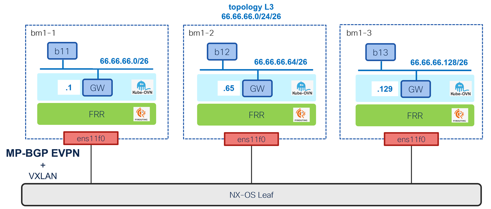

# BGP EVPN for primary l3 cluster user-defined networks

[[Back]](../README.md) [[redundant]](./cudn-l3-v2.md)

OpenShift 4.22 introduces BGP EVPN support for primary cudn as documented [here](https://docs.redhat.com/en/documentation/openshift_container_platform/4.22/html-single/advanced_networking/index#bgp-evpn-for-user-defined-networks) and shown by example using the topology as below



## Table of content

- [key highlights](#summary)
- [leaf configuration](#nx-os-configuration)
- [node to leaf connectivity](#node-to-leaf-connectivity)
- [ovn vtep](#ovn-vtep)
- [baseline bgp](#baseline-bgp)
- [namespace](#namespace)
- [cudn l3](#cudn-l3)
- [application](#application)
- [route advertisement](#route-advertisement)
- [advertised route](#advertised-routes)
- [received route](#received-routes)
- [extra routing requirement](#why-extra-routing-on-kube-node-is-required)
- [east-west connectivity test](#east-west-connectivity)
- [north-south connectivity test](#north-south-connectivity)

## Summary

- every cluster node with single p2p interface to leaf (non-redundant)
- eBGP session over p2p interface to leaf
- cluster nodes using phy interface as vtep source (not good in case of redundant connectivity)
- leaf configured with vxlan re-stitching by updating next-hop
- the same route target used for import and export rules
- cluster node bgp advertising allocated subnet from cudn cidr using type-5 route
- east-west as well as north-south traffic goes over "evpn route"

## NX-OS configuration

While the guide shows incremental configuration steps for OpenShift, NX-OS configuration on leaf is already complete as below

p2p interfaces between the leaf switch and cluster nodes

```
interface Ethernet1/49
  description bm7-1 ens11f0
  no switchport
  mtu 9216
  medium p2p
  ip address 100.66.0.110/31
  no shutdown
!
interface Ethernet1/50
  description bm7-2 ens11f0
  no switchport
  mtu 9216
  medium p2p
  ip address 100.66.0.120/31
  no shutdown
!
interface Ethernet1/51
  description bm7-3 ens11f0
  no switchport
  mtu 9216
  medium p2p
  ip address 100.66.0.130/31
  no shutdown
```

VRF context with vni that matches [cudn](#cudn-l3) configuration

```
vrf context OVN_CUDN_L3
  vni 66200 l3
  rd auto
  address-family ipv4 unicast
    route-target both auto
    route-target both auto evpn
  address-family ipv6 unicast
    route-target both auto
    route-target both auto evpn
!
interface nve1
  member vni 66200 associate-vrf
!
interface loopback70
  vrf member OVN_CUDN_L3
  ip address 70.70.70.70/32
```

BGP configuration
- rewrites next-hop to itself i.e. p2p interface end
- advertise test loopback interface

```
route-map TO_OVN_BM1-1 permit 10
  set ip next-hop 100.66.0.110
route-map TO_OVN_BM1-2 permit 10
  set ip next-hop 100.66.0.120
route-map TO_OVN_BM1-3 permit 10
  set ip next-hop 100.66.0.130
!
router bgp 64701
  router-id 100.64.0.112
  template peer OVN
    remote-as external
    address-family ipv4 unicast
      disable-peer-as-check
    address-family ipv6 unicast
    address-family l2vpn evpn
      disable-peer-as-check
      send-community
      send-community extended
      rewrite-evpn-rt-asn
      no advertise-gw-ip
  template peer-session OVN
    log-neighbor-changes
  neighbor 100.66.0.111
    inherit peer OVN
    inherit peer-session OVN
    address-family l2vpn evpn
      route-map TO_OVN_BM1-1 out
  neighbor 100.66.0.121
    inherit peer OVN
    inherit peer-session OVN
    address-family l2vpn evpn
      route-map TO_OVN_BM1-2 out
  neighbor 100.66.0.131
    inherit peer OVN
    inherit peer-session OVN
    address-family l2vpn evpn
      route-map TO_OVN_BM1-3 out
  vrf OVN_CUDN_L3
    address-family ipv4 unicast
      network 70.70.70.70/32
      advertise l2vpn evpn
      redistribute direct route-map fabric-rmap-redist-subnet
      redistribute static route-map fabric-rmap-redist-subnet
      maximum-paths ibgp 2
    address-family ipv6 unicast
      advertise l2vpn evpn
      redistribute direct route-map fabric-rmap-redist-subnet
      redistribute static route-map fabric-rmap-redist-subnet
      maximum-paths ibgp 2
```

## node to leaf connectivity

```yaml
apiVersion: nmstate.io/v1
kind: NodeNetworkConfigurationPolicy
metadata:
  name: bm1-1-ens11f0
spec:
  desiredState:
    interfaces:
    - ipv4:
        address:
        - ip: 100.66.0.111
          prefix-length: 31
        dhcp: false
        enabled: true
      name: ens11f0
      state: up
      type: ethernet
  nodeSelector:
    kubernetes.io/hostname: bm1-1
---
apiVersion: nmstate.io/v1
kind: NodeNetworkConfigurationPolicy
metadata:
  name: bm1-2-ens11f0
spec:
  desiredState:
    interfaces:
    - ipv4:
        address:
        - ip: 100.66.0.121
          prefix-length: 31
        dhcp: false
        enabled: true
      name: ens11f0
      state: up
      type: ethernet
  nodeSelector:
    kubernetes.io/hostname: bm1-2
---
apiVersion: nmstate.io/v1
kind: NodeNetworkConfigurationPolicy
metadata:
  name: bm1-3-ens11f0
spec:
  desiredState:
    interfaces:
    - ipv4:
        address:
        - ip: 100.66.0.131
          prefix-length: 31
        dhcp: false
        enabled: true
      name: ens11f0
      state: up
      type: ethernet
  nodeSelector:
    kubernetes.io/hostname: bm1-3
```

node | interface | ip | mac
--- | --- | --- | ---
bm1-1 | ens11f0 | 100.66.0.111/31 | b4:96:91:f9:40:40
bm1-2 | ens11f0 | 100.66.0.121/31 | b4:96:91:f9:3d:f8
bm1-3 | ens11f0 | 100.66.0.131/31 | b4:96:91:f9:3c:18


```
[core@bm1-1 ~]$ ip r
default via 10.10.10.222 dev br-ex proto static 
10.10.10.208/28 dev br-ex proto kernel scope link src 10.10.10.210 metric 48 
10.128.0.0/23 dev ovn-k8s-mp0 proto kernel scope link src 10.128.0.2 
10.128.0.0/14 via 10.128.0.1 dev ovn-k8s-mp0 
100.66.0.110/31 dev ens11f0 proto kernel scope link src 100.66.0.111 metric 112 
169.254.0.0/17 dev br-ex proto kernel scope link src 169.254.0.2 
169.254.0.1 dev br-ex src 10.10.10.210 
169.254.0.3 via 10.128.0.1 dev ovn-k8s-mp0 
172.30.0.0/16 via 169.254.0.4 dev br-ex src 169.254.0.2 mtu 1400 
```

Connectivity test from the leaf

```
leaf# ping 100.66.0.111
PING 100.66.0.111 (100.66.0.111): 56 data bytes
64 bytes from 100.66.0.111: icmp_seq=0 ttl=63 time=0.859 ms
64 bytes from 100.66.0.111: icmp_seq=1 ttl=63 time=0.687 ms
64 bytes from 100.66.0.111: icmp_seq=2 ttl=63 time=0.792 ms
64 bytes from 100.66.0.111: icmp_seq=3 ttl=63 time=0.752 ms
64 bytes from 100.66.0.111: icmp_seq=4 ttl=63 time=0.502 ms

--- 100.66.0.111 ping statistics ---
5 packets transmitted, 5 packets received, 0.00% packet loss
round-trip min/avg/max = 0.502/0.718/0.859 ms
```

## ovn vtep

`VTEP` object selects p2p interface on every leaf as vtep based on `spec:cidrs` definition

```yaml
apiVersion: k8s.ovn.org/v1
kind: VTEP
metadata:
  name: ocp-vtep
spec:
  mode: Unmanaged
  cidrs:
  - 100.66.0.0/24
```

```
status:
  conditions:
  - lastTransitionTime: "2026-07-22T14:38:46Z"
    message: VTEP allocation succeeded
    reason: Allocated
    status: "True"
    type: Accepted
```

## baseline bgp

>[!NOTE]
>Kubernetes node peering with p2p interface end, that's why per-node `FRRConfiguration` is required using `spec:nodeSelector`

```yaml
apiVersion: frrk8s.metallb.io/v1beta1
kind: FRRConfiguration
metadata:
  name: fabric-peering-bm1-1
  namespace: openshift-frr-k8s
  labels:
    evpn: enabled
spec:
  nodeSelector:
    matchLabels:
      kubernetes.io/hostname: bm1-1
  bgp:
    routers:
    - asn: 64667
      neighbors:
      - address: 100.66.0.110
        asn: 64701
---
apiVersion: frrk8s.metallb.io/v1beta1
kind: FRRConfiguration
metadata:
  name: fabric-peering-bm1-2
  namespace: openshift-frr-k8s
  labels:
    evpn: enabled
spec:
  nodeSelector:
    matchLabels:
      kubernetes.io/hostname: bm1-2
  bgp:
    routers:
    - asn: 64667
      neighbors:
      - address: 100.66.0.120
        asn: 64701
---
apiVersion: frrk8s.metallb.io/v1beta1
kind: FRRConfiguration
metadata:
  name: fabric-peering-bm1-3
  namespace: openshift-frr-k8s
  labels:
    evpn: enabled
spec:
  nodeSelector:
    matchLabels:
      kubernetes.io/hostname: bm1-3
  bgp:
    routers:
    - asn: 64667
      neighbors:
      - address: 100.66.0.130
        asn: 64701
```

The frr configuration generated based on `FRRConfiguration` object, shown for single node as an example. BGP neighbors configured with ipv4 unicast address family enabled, however, associated route-map denies everything in both directions.

```
bm1-1# show run
Building configuration...

Current configuration:
!
frr version 10.4.3
frr defaults traditional
hostname bm1-1
log stdout informational
log timestamp precision 3
service integrated-vtysh-config
!
ip prefix-list 100.66.0.110-allowed-ipv4 seq 1 deny any
ip prefix-list 100.66.0.110-inpl-ipv4 seq 1 deny any
!
ipv6 prefix-list 100.66.0.110-allowed-ipv6 seq 1 deny any
ipv6 prefix-list 100.66.0.110-inpl-ipv4 seq 2 deny any
!
route-map 100.66.0.110-out permit 1
 match ip address prefix-list 100.66.0.110-allowed-ipv4
exit
!
route-map 100.66.0.110-out permit 2
 match ipv6 address prefix-list 100.66.0.110-allowed-ipv6
exit
!
route-map 100.66.0.110-in permit 3
 match ip address prefix-list 100.66.0.110-inpl-ipv4
exit
!
route-map 100.66.0.110-in permit 4
 match ipv6 address prefix-list 100.66.0.110-inpl-ipv4
exit
!
router bgp 64667
 no bgp ebgp-requires-policy
 no bgp enforce-first-as
 no bgp hard-administrative-reset
 no bgp default ipv4-unicast
 no bgp graceful-restart notification
 bgp graceful-restart preserve-fw-state
 no bgp network import-check
 neighbor 100.66.0.110 remote-as 64701
 !
 address-family ipv4 unicast
  neighbor 100.66.0.110 activate
  neighbor 100.66.0.110 route-map 100.66.0.110-in in
  neighbor 100.66.0.110 route-map 100.66.0.110-out out
 exit-address-family
exit
!
end
```

BGP session established

```
bm1-1# show bgp summary 

IPv4 Unicast Summary:
BGP router identifier 100.66.0.111, local AS number 64667 VRF default vrf-id 0
BGP table version 0
RIB entries 0, using 0 bytes of memory
Peers 1, using 24 KiB of memory

Neighbor        V         AS   MsgRcvd   MsgSent   TblVer  InQ OutQ  Up/Down State/PfxRcd   PfxSnt Desc
100.66.0.110    4      64701         8         7        0    0    0 00:03:43            0        0 N/A

Total number of neighbors 1
```

NX-OS perspective with BBP session for ipv4 unicast address family is established

```
leaf# show bgp ipv4 unicast summary
BGP summary information for VRF default, address family IPv4 Unicast
BGP router identifier 100.64.0.112, local AS number 64701
BGP table version is 53, IPv4 Unicast config peers 3, capable peers 3
5 network entries and 5 paths using 1820 bytes of memory
BGP attribute entries [1/368], BGP AS path entries [0/0]
BGP community entries [0/0], BGP clusterlist entries [11/44]

Neighbor        V    AS    MsgRcvd    MsgSent   TblVer  InQ OutQ Up/Down  State/PfxRcd
100.66.0.111    4 64667       2645        378       53    0    0 00:04:56 0
100.66.0.121    4 64667       1862        369       53    0    0 00:04:56 0
100.66.0.131    4 64667       2124        369       53    0    0 00:04:56 0
```

However the l2vpn evpn address family is not yet enabled in FRR. Note that peerings with spine are removed in the output below.

```
leaf# show bgp l2vpn evpn summary
Neighbor        V    AS    MsgRcvd    MsgSent   TblVer  InQ OutQ Up/Down  State/PfxRcd
100.66.0.111    4 64667       2645        378        0    0    0 00:04:59 0 (No Cap)
100.66.0.121    4 64667       1862        369        0    0    0 00:04:59 0 (No Cap)
100.66.0.131    4 64667       2124        369        0    0    0 00:04:59 0 (No Cap)

Neighbor        T    AS Type-1     Type-2     Type-3     Type-4     Type-5     Type-6     Type-7     Type-8     Type-12
100.66.0.111    I 64667 0          0          0          0          0          0          0          0          0
100.66.0.121    I 64667 0          0          0          0          0          0          0          0          0
100.66.0.131    I 64667 0          0          0          0          0          0          0          0          0
```

## namespace

Requirements
- BGP EVPN feature works for primary cudn only so primary cudn capable namespace is required 
- label namespace with `metadata.labels.k8s.ovn.org/primary-user-defined-network = ''`
- tenant label is used in cudn definition to select the namespaces where cudn is allowed

```yaml
apiVersion: v1
kind: Namespace
metadata:
  labels:
    k8s.ovn.org/primary-user-defined-network: ''
    tenant: b
  name: b1p
```

## cudn l3

cudn | namespace | topology | primary | subnet | transport | macVRF | ipVRF
--- | --- | --- | --- | --- | --- | --- | ---
b | p1b | Layer3 | :white_check_mark: | 66.66.66.0/24/26 | EVPN | --- | vni 66200, rt 64701:66200 

```yaml
apiVersion: k8s.ovn.org/v1
kind: ClusterUserDefinedNetwork
metadata:
  name: b
  labels:
    tenant: b
spec:
  namespaceSelector:
    matchLabels:
      "tenant": "b"
  network:
    topology: Layer3
    layer3:
      role: Primary
      subnets:
      - cidr: 66.66.66.0/24
        hostSubnet: 26
    transport: EVPN
    evpn:
      vtep: ocp-vtep
      ipVRF:
        vni: 66200
        routeTarget: 64701:66200
```

>[!NOTE]
>It is expected that TransportAccepted is False since RouteAdvertisement is not configured yet

```
status:
  conditions:
  - lastTransitionTime: "2026-07-22T19:42:21Z"
    message: No RouteAdvertisements CR is advertising the pod networks.
    reason: EVPNRouteAdvertisementsIsMissing
    status: "False"
    type: TransportAccepted
  - lastTransitionTime: "2026-07-22T19:42:21Z"
    message: 'NetworkAttachmentDefinition has been created in following namespaces:
      [b1p]'
    reason: NetworkAttachmentDefinitionCreated
    status: "True"
    type: NetworkCreated
  - lastTransitionTime: "2026-07-22T19:42:21Z"
    message: Network allocation succeeded for all synced nodes.
    reason: NetworkAllocationSucceeded
    status: "True"
    type: NetworkAllocationSucceeded
```

Note:
- no FRR configuration change expected yet.
- no vrf created yet on any host since there is no pod scheduled connected to this network
- network attachment definition triggered by udn creation

```
$ ip vrf show
Name              Table
-----------------------
No VRF has been configured
```

```
apiVersion: k8s.cni.cncf.io/v1
kind: NetworkAttachmentDefinition
metadata:
  annotations:
    k8s.ovn.org/network-id: "7"
    k8s.ovn.org/network-name: cluster_udn_b
    k8s.ovn.org/route-advertisements: '[]'
    k8s.ovn.org/tunnel-keys: '[]'
  creationTimestamp: "2026-07-22T20:29:53Z"
  finalizers:
  - k8s.ovn.org/user-defined-network-protection
  generation: 1
  labels:
    k8s.ovn.org/user-defined-network: ""
    tenant: b
  name: b
  namespace: b1p
  ownerReferences:
  - apiVersion: k8s.ovn.org/v1
    blockOwnerDeletion: true
    controller: true
    kind: ClusterUserDefinedNetwork
    name: b
    uid: bf89f05a-ed91-4ec3-bfbb-e67e947637ec
  resourceVersion: "10123145"
  uid: 80c2934d-493e-4e9f-ad82-fd48a908dbf5
spec:
  config: '
    {
        "cniVersion":"1.1.0",
        "evpn":{
            "vtep":"ocp-vtep",
            "ipVRF":{
                "vni":66200,
                "routeTarget":"64701:66200",
                "vid":10
            }
        },
        "joinSubnet":"100.65.0.0/16,fd99::/64",
        "name":"cluster_udn_b",
        "netAttachDefName":"b1p/b",
        "role":"primary",
        "subnets":"66.66.66.0/24/26",
        "topology":"layer3",
        "transport":"evpn",
        "type":"ovn-k8s-cni-overlay"
    }'
```

## application

Example

```yaml
apiVersion: v1
kind: Pod
metadata:
  name: b11
  namespace: b1p
spec:
  containers:
  - command:
    - sleep
    - infinite
    image: nicolaka/netshoot:latest
    name: netshoot
    securityContext:
      capabilities:
        add:
        - IPC_LOCK
        - SYS_RESOURCE
        - NET_RAW
      runAsUser: 0
  nodeName: bm1-1
```

node | pod | eth0 ip | eth0 mac | ovn-udn1 ip | ovn-udn1 mac
--- | --- | --- | --- | --- | ---
bm1-1 | b11 | 10.128.1.12 | 0a:58:0a:80:01:0c | 66.66.66.4/26 | 0a:58:42:42:42:04
bm1-2 | b12 | 10.130.1.129 | 0a:58:0a:82:01:81 | 66.66.66.68/26 | 0a:58:42:42:42:44
bm1-3 | b13 | 10.129.0.213 | 0a:58:0a:81:00:d5 | 66.66.66.132/26  | 0a:58:42:42:42:84

when apps are scheduled, vrf is created with table id being local node signifacant

```
[core@bm1-1 ~]$ ip vrf show
Name              Table
-----------------------
b                 1308
```

vrf ip route table with cudn subnets via dedicated ovn instance

```
[core@bm1-1 ~]$ ip route show vrf b
default via 10.10.10.222 dev br-ex mtu 1400 
unreachable default metric 4278198272 
66.66.66.0/26 dev ovn-k8s-mp7 proto kernel scope link src 66.66.66.2 
66.66.66.0/24 via 66.66.66.1 dev ovn-k8s-mp7 
169.254.0.3 via 66.66.66.1 dev ovn-k8s-mp7 
169.254.0.24 dev ovn-k8s-mp7 mtu 1400 
172.30.0.0/16 via 169.254.0.4 dev br-ex mtu 1400 
```

```
[core@bm1-1 ~]$ ip a show vrf b
308: ovn-k8s-mp7: <BROADCAST,MULTICAST,PROMISC,UP,LOWER_UP> mtu 1400
    link/ether 0a:58:42:42:42:02 brd ff:ff:ff:ff:ff:ff
    inet 66.66.66.2/26 brd 66.66.66.63 scope global ovn-k8s-mp7

310: svl3-b@evbr-ocp-vtep: <BROADCAST,MULTICAST,UP,LOWER_UP> mtu 1400 qdisc noqueue master b state UP group default 
    link/ether e6:6f:90:65:db:c7 brd ff:ff:ff:ff:ff:ff
```

ovn instantiated per node. note that ovn-k8s-mp${INDEX} value is represented in k8s.ovn.org/network-id of net-attach-def

node | table | l3 subnet | ovn ip | ovn mac | vtep mac
--- | --- | --- | ---
bm1-1 | 1308 | 66.66.66.0/26 | 66.66.66.2/26 | 0a:58:42:42:42:02 | e6:6f:90:65:db:c7
bm1-2 | 1298 | 66.66.66.64/26 | 66.66.66.66/26 | 0a:58:42:42:42:42 | de:04:c0:01:ab:8a
bm1-3 | 1251 | 66.66.66.128/26 | 66.66.66.130/26 | 0a:58:42:42:42:82 | d6:aa:72:a2:01:ff

No changes in frr configuration

## route advertisement

Requirements
- BGP EVPN feature works for primary cudn only so primary cudn capable namespace is required 
- label namespace with `metadata.labels.k8s.ovn.org/primary-user-defined-network = ''`
- tenant label is used in cudn definition to select the namespaces where cudn is allowed

```yaml
apiVersion: k8s.ovn.org/v1
kind: RouteAdvertisements
metadata:
  name: b
spec:
  targetVRF: auto
  advertisements:
  - PodNetwork
  nodeSelector: {}
  frrConfigurationSelector:
    matchLabels:
      evpn: enabled
  networkSelectors:
  - networkSelectionType: ClusterUserDefinedNetworks
    clusterUserDefinedNetworkSelector:
      networkSelector:
        matchLabels:
          tenant: b
```

```
status:
  conditions:
  - lastTransitionTime: "2026-07-22T19:53:37Z"
    message: ovn-kubernetes cluster-manager validated the resource and requested the
      necessary configuration changes
    observedGeneration: 1
    reason: Accepted
    status: "True"
    type: Accepted
  status: Accepted
```

cudn status updated for TransportAccepted condition

```
status:
  conditions:
  - lastTransitionTime: "2026-07-22T19:53:37Z"
    message: Transport has been configured as 'EVPN'.
    reason: EVPNTransportAccepted
    status: "True"
    type: TransportAccepted
```

FRR configuration changed

```
bm1-1# show run
Building configuration...

Current configuration:
!
frr version 10.4.3
frr defaults traditional
hostname bm1-1
log stdout informational
log timestamp precision 3
service integrated-vtysh-config
!
ip prefix-list 100.66.0.110-allowed-ipv4 seq 1 deny any
ip prefix-list 100.66.0.110-inpl-ipv4 seq 1 deny any
!
ipv6 prefix-list 100.66.0.110-allowed-ipv6 seq 1 deny any
ipv6 prefix-list 100.66.0.110-inpl-ipv4 seq 2 deny any
!
route-map 100.66.0.110-out permit 1
 match ip address prefix-list 100.66.0.110-allowed-ipv4
exit
!
route-map 100.66.0.110-out permit 2
 match ipv6 address prefix-list 100.66.0.110-allowed-ipv6
exit
!
route-map 100.66.0.110-in permit 3
 match ip address prefix-list 100.66.0.110-inpl-ipv4
exit
!
route-map 100.66.0.110-in permit 4
 match ipv6 address prefix-list 100.66.0.110-inpl-ipv4
exit
!
vrf b
 vni 66200
exit-vrf
!
router bgp 64667
 no bgp ebgp-requires-policy
 no bgp default ipv4-unicast
 bgp graceful-restart preserve-fw-state
 no bgp network import-check
 neighbor 100.66.0.110 remote-as 64701
 !
 address-family ipv4 unicast
  neighbor 100.66.0.110 activate
  neighbor 100.66.0.110 route-map 100.66.0.110-in in
  neighbor 100.66.0.110 route-map 100.66.0.110-out out
 exit-address-family
 !
 address-family l2vpn evpn
  neighbor 100.66.0.110 activate
  neighbor 100.66.0.110 allowas-in origin
  advertise-all-vni
 exit-address-family
exit
!
router bgp 64667 vrf b
 no bgp ebgp-requires-policy
 no bgp enforce-first-as
 no bgp hard-administrative-reset
 no bgp default ipv4-unicast
 no bgp graceful-restart notification
 bgp graceful-restart preserve-fw-state
 no bgp network import-check
 !
 address-family ipv4 unicast
  network 66.66.66.0/26
 exit-address-family
 !
 address-family l2vpn evpn
  advertise ipv4 unicast
  route-target import 64701:66200
  route-target export 64701:66200
 exit-address-family
exit
!
end
```

Nothing sent/received over ipv4/unicast

```
bm1-1# show bgp ipv4 unicast summary 
BGP router identifier 100.66.0.111, local AS number 64667 VRF default vrf-id 0
BGP table version 0
RIB entries 0, using 0 bytes of memory
Peers 1, using 24 KiB of memory

Neighbor        V         AS   MsgRcvd   MsgSent   TblVer  InQ OutQ  Up/Down State/PfxRcd   PfxSnt Desc
100.66.0.110    4      64701       424       289        0    0    0 00:01:28            0        0 N/A

Total number of neighbors 1
```

Lot of data exchanged over l2vpn/evpn

```
bm1-1# show bgp l2vpn evpn summary 
BGP router identifier 100.66.0.111, local AS number 64667 VRF default vrf-id 0
BGP table version 0
RIB entries 413, using 52 KiB of memory
Peers 1, using 24 KiB of memory

Neighbor        V         AS   MsgRcvd   MsgSent   TblVer  InQ OutQ  Up/Down State/PfxRcd   PfxSnt Desc
100.66.0.110    4      64701       424       289      121    0    0 00:01:56         2452     2453 N/A

Total number of neighbors 1
```

## advertised routes

The only self originated route is node scoped subnet /26 allocated from cudn l3 /24 cidr

```
bm1-1# show bgp l2vpn evpn route self-originate 
BGP table version is 3, local router ID is 100.66.0.111
Status codes: s suppressed, d damped, h history, * valid, > best, i - internal
Origin codes: i - IGP, e - EGP, ? - incomplete
EVPN type-1 prefix: [1]:[EthTag]:[ESI]:[IPlen]:[VTEP-IP]:[Frag-id]
EVPN type-2 prefix: [2]:[EthTag]:[MAClen]:[MAC]:[IPlen]:[IP]
EVPN type-3 prefix: [3]:[EthTag]:[IPlen]:[OrigIP]
EVPN type-4 prefix: [4]:[ESI]:[IPlen]:[OrigIP]
EVPN type-5 prefix: [5]:[EthTag]:[IPlen]:[IP]

   Network          Next Hop            Metric LocPrf Weight Path
                    Extended Community
Route Distinguisher: 66.66.66.2:2
 *>  [5]:[0]:[26]:[66.66.66.0]
                    100.66.0.111             0         32768 i
                    ET:8 RT:64701:66200 Rmac:e6:6f:90:65:db:c7

Displayed 1 prefixes (1 paths)
```

```json
{
    "66.66.66.2:2": {
        "rd": "66.66.66.2:2",
        "[5]:[0]:[26]:[66.66.66.0]": {
            "prefix": "[5]:[0]:[26]:[66.66.66.0]",
            "prefixLen": 352,
            "paths": [
                [
                    {
                        "valid": true,
                        "bestpath": true,
                        "selectionReason": "First path received",
                        "pathFrom": "external",
                        "routeType": 5,
                        "ethTag": 0,
                        "ipLen": 26,
                        "ip": "66.66.66.0",
                        "metric": 0,
                        "weight": 32768,
                        "peerId": "(unspec)",
                        "path": "",
                        "origin": "IGP",
                        "extendedCommunity": {
                            "string": "ET:8 RT:64701:66200 Rmac:e6:6f:90:65:db:c7"
                        },
                        "nexthops": [
                            {
                                "ip": "100.66.0.111",
                                "hostname": "bm1-1",
                                "afi": "ipv4",
                                "used": true
                            }
                        ]
                    }
                ]
            ]
        }
    }
}
```

Notes:
- rd 666.66.66.2 is based on ovn-k8s-mp6 ip address
- advertised extended community based on cudn definition
- advertised router mac based on vrf vtep mac

NX-OS perspective

```
leaf# show bgp l2vpn evpn rd 66.66.66.2:2
BGP routing table information for VRF default, address family L2VPN EVPN
Route Distinguisher: 66.66.66.2:2
BGP routing table entry for [5]:[0]:[0]:[26]:[66.66.66.0]/224, version 135487
Paths: (1 available, best #1)
Flags: (0x000002) (high32 00000000) on xmit-list, is not in l2rib/evpn, is not in HW

  Advertised path-id 1
  Path type: external, path is valid, is best path, no labeled nexthop
             Imported to 2 destination(s)
             Imported paths list: OVN_CUDN_L3 L3-66200
  Gateway IP: 0.0.0.0
  AS-Path: 64667 , path sourced external to AS
    100.66.0.111 (metric 0) from 100.66.0.111 (100.66.0.111)
      Origin IGP, MED 0, localpref 100, weight 0
      Received label 66200
      Extcommunity: RT:64701:66200 ENCAP:8 Router MAC:e66f.9065.dbc7

  Path-id 1 advertised to peers:
    100.64.0.23        100.64.0.24        100.66.0.121       100.66.0.131
```

## received routes

Node learns two type-5 routes over l2vpn/evpn advertisement from other cluster nodes as well as the loopback interface ip injected into vrf in leaf configuration

```
bm1-1# show bgp l2vpn evpn 66.66.66.64/26      
BGP routing table entry for 66.66.66.66:2:[5]:[0]:[26]:[66.66.66.64]
Paths: (1 available, best #1)
  Advertised to peers:
  100.66.0.110
  Route [5]:[0]:[26]:[66.66.66.64] VNI 66200
  64701 64667
    100.66.0.110 (metric 112) from 100.66.0.110 (100.64.0.112)
      Origin IGP, valid, external, best (First path received)
      Extended Community: RT:64701:66200 ET:8 Rmac:de:04:c0:01:ab:8a
      Last update: Wed Jul 22 20:42:11 2026
```

```json
{
  "66.66.66.66:2":{
    "rd":"66.66.66.66:2",
    "routeType":5,
    "ethTag":0,
    "ipLen":26,
    "ip":"66.66.66.64",
    "advertisedTo":{
      "100.66.0.110":{
      }
    },
    "pathCount":1,
    "paths":[
      {
        "vni":"66200",
        "aspath":{
          "string":"64701 64667",
          "segments":[
            {
              "type":"as-sequence",
              "list":[
                64701,
                64667
              ]
            }
          ],
          "length":2
        },
        "origin":"IGP",
        "valid":true,
        "version":3,
        "bestpath":{
          "overall":true,
          "selectionReason":"First path received"
        },
        "extendedCommunity":{
          "string":"RT:64701:66200 ET:8 Rmac:de:04:c0:01:ab:8a"
        },
        "lastUpdate":{
          "epoch":1784752931,
          "string":"Wed Jul 22 20:42:11 2026"
        },
        "nexthops":[
          {
            "ip":"100.66.0.110",
            "afi":"ipv4",
            "metric":112,
            "accessible":true,
            "used":true
          }
        ],
        "peer":{
          "peerId":"100.66.0.110",
          "routerId":"100.64.0.112",
          "type":"external"
        }
      }
    ]
  }
}
```

```
bm1-1# show bgp l2vpn evpn 66.66.66.128/26
BGP routing table entry for 66.66.66.130:2:[5]:[0]:[26]:[66.66.66.128]
Paths: (1 available, best #1)
  Advertised to peers:
  100.66.0.110
  Route [5]:[0]:[26]:[66.66.66.128] VNI 66200
  64701 64667
    100.66.0.110 (metric 112) from 100.66.0.110 (100.64.0.112)
      Origin IGP, valid, external, best (First path received)
      Extended Community: RT:64701:66200 ET:8 Rmac:d6:aa:72:a2:01:ff
      Last update: Wed Jul 22 20:42:11 2026
```

```json
{
  "66.66.66.130:2":{
    "rd":"66.66.66.130:2",
    "routeType":5,
    "ethTag":0,
    "ipLen":26,
    "ip":"66.66.66.128",
    "advertisedTo":{
      "100.66.0.110":{
      }
    },
    "pathCount":1,
    "paths":[
      {
        "vni":"66200",
        "aspath":{
          "string":"64701 64667",
          "segments":[
            {
              "type":"as-sequence",
              "list":[
                64701,
                64667
              ]
            }
          ],
          "length":2
        },
        "origin":"IGP",
        "valid":true,
        "version":3,
        "bestpath":{
          "overall":true,
          "selectionReason":"First path received"
        },
        "extendedCommunity":{
          "string":"RT:64701:66200 ET:8 Rmac:d6:aa:72:a2:01:ff"
        },
        "lastUpdate":{
          "epoch":1784752931,
          "string":"Wed Jul 22 20:42:11 2026"
        },
        "nexthops":[
          {
            "ip":"100.66.0.110",
            "afi":"ipv4",
            "metric":112,
            "accessible":true,
            "used":true
          }
        ],
        "peer":{
          "peerId":"100.66.0.110",
          "routerId":"100.64.0.112",
          "type":"external"
        }
      }
    ]
  }
}
```

Notes:
- rd based on remote/advertising node ovn-k8s-mp6 ip address
- advertised extended community based on cudn definition
- advertised router mac based on remote vrf vtep mac

```
bm1-1# show bgp l2vpn evpn 70.70.70.70/32
BGP routing table entry for 100.64.0.112:18:[5]:[0]:[32]:[70.70.70.70]
Paths: (1 available, best #1)
  Advertised to peers:
  100.66.0.110
  Route [5]:[0]:[32]:[70.70.70.70] VNI 66200
  64701
    100.66.0.110 (metric 112) from 100.66.0.110 (100.64.0.112)
      Origin IGP, valid, external, best (First path received)
      Extended Community: RT:64701:66200 ET:8 Rmac:cc:79:d7:f2:13:97
      Last update: Thu Jul 23 06:37:05 2026
```

```json
{
  "100.64.0.112:18":{
    "rd":"100.64.0.112:18",
    "routeType":5,
    "ethTag":0,
    "ipLen":32,
    "ip":"70.70.70.70",
    "advertisedTo":{
      "100.66.0.110":{
      }
    },
    "pathCount":1,
    "paths":[
      {
        "vni":"66200",
        "aspath":{
          "string":"64701",
          "segments":[
            {
              "type":"as-sequence",
              "list":[
                64701
              ]
            }
          ],
          "length":1
        },
        "origin":"IGP",
        "valid":true,
        "version":18,
        "bestpath":{
          "overall":true,
          "selectionReason":"First path received"
        },
        "extendedCommunity":{
          "string":"RT:64701:66200 ET:8 Rmac:cc:79:d7:f2:13:97"
        },
        "lastUpdate":{
          "epoch":1784788624,
          "string":"Thu Jul 23 06:37:04 2026"
        },
        "nexthops":[
          {
            "ip":"100.66.0.110",
            "afi":"ipv4",
            "metric":112,
            "accessible":true,
            "used":true
          }
        ],
        "peer":{
          "peerId":"100.66.0.110",
          "routerId":"100.64.0.112",
          "type":"external"
        }
      }
    ]
  }
}
```

The advertised routes are imported to vrf route table based on matching extended community

```
bm1-1# show bgp vrf b ipv4 unicast detail
BGP table version is 9, local router ID is 66.66.66.2, vrf id 309
Default local pref 100, local AS 64667
BGP routing table entry for 66.66.66.0/26, version 1
Paths: (1 available, best #1, vrf b)
  Not advertised to any peer
  Local
    0.0.0.0 from 0.0.0.0 (66.66.66.2)
      Origin IGP, metric 0, weight 32768, valid, sourced, local, best (First path received)
      Last update: Wed Jul 22 20:41:39 2026
BGP routing table entry for 66.66.66.64/26, version 7
Paths: (1 available, best #1, vrf b)
  Not advertised to any peer
  Imported from 66.66.66.66:2:[5]:[0]:[26]:[66.66.66.64], VNI 66200  64701 64667
    100.66.0.110 (metric 112) from 100.66.0.110 (100.64.0.112) announce-nh-self
      Origin IGP, valid, external, best (First path received)
      Last update: Wed Jul 22 20:55:02 2026
BGP routing table entry for 66.66.66.128/26, version 6
Paths: (1 available, best #1, vrf b)
  Not advertised to any peer
  Imported from 66.66.66.130:2:[5]:[0]:[26]:[66.66.66.128], VNI 66200  64701 64667
    100.66.0.110 (metric 112) from 100.66.0.110 (100.64.0.112) announce-nh-self
      Origin IGP, valid, external, best (First path received)
      Last update: Wed Jul 22 20:55:02 2026
BGP routing table entry for 70.70.70.70/32, version 9
Paths: (1 available, best #1, vrf b)
  Not advertised to any peer
  Imported from 100.64.0.112:18:[5]:[0]:[32]:[70.70.70.70], VNI 66200  64701
    100.66.0.110 (metric 112) from 100.66.0.110 (100.64.0.112) announce-nh-self
      Origin IGP, valid, external, best (First path received)
      Last update: Thu Jul 23 06:37:05 2026

Displayed 4 routes and 4 total paths
```

```
bm1-1# show ip route vrf b
Codes: K - kernel route, C - connected, L - local, S - static,
       R - RIP, O - OSPF, I - IS-IS, B - BGP, E - EIGRP, N - NHRP,
       T - Table, v - VNC, V - VNC-Direct, F - PBR,
       f - OpenFabric, t - Table-Direct,
       > - selected route, * - FIB route, q - queued, r - rejected, b - backup
       t - trapped, o - offload failure

IPv4 unicast VRF b:
K>* 0.0.0.0/0 [255/8192] unreachable (ICMP unreachable), weight 1, 10:27:30
K>* 66.66.66.0/24 [0/0] via 66.66.66.1, ovn-k8s-mp7, weight 1, 10:27:30
C>* 66.66.66.0/26 is directly connected, ovn-k8s-mp7, weight 1, 10:27:30
L>* 66.66.66.2/32 is directly connected, ovn-k8s-mp7, weight 1, 10:27:30
B>* 66.66.66.64/26 [20/0] via 100.66.0.110, svl3-b onlink, weight 1, 10:07:49
B>* 66.66.66.128/26 [20/0] via 100.66.0.110, svl3-b onlink, weight 1, 10:07:49
B>* 70.70.70.70/32 [20/0] via 100.66.0.110, svl3-b onlink, weight 1, 00:25:46
K>* 169.254.0.3/32 [0/0] via 66.66.66.1, ovn-k8s-mp7, weight 1, 10:27:30
K>* 169.254.0.24/32 [0/0] is directly connected, ovn-k8s-mp7, weight 1, 10:27:30
K>* 172.30.0.0/16 [0/0] via 169.254.0.4, br-ex (vrf default), weight 1, 10:27:30
```

```
[core@bm1-1 ~]$ ip route show vrf b
unreachable default metric 4278198272 
66.66.66.0/26 dev ovn-k8s-mp7 proto kernel scope link src 66.66.66.2 
66.66.66.0/24 via 66.66.66.1 dev ovn-k8s-mp7 
66.66.66.64/26 nhid 1189 via 100.66.0.110 dev svl3-b proto bgp metric 20 onlink 
66.66.66.128/26 nhid 1189 via 100.66.0.110 dev svl3-b proto bgp metric 20 onlink 
70.70.70.70 nhid 1189 via 100.66.0.110 dev svl3-b proto bgp metric 20 onlink 
169.254.0.3 via 66.66.66.1 dev ovn-k8s-mp7 
169.254.0.24 dev ovn-k8s-mp7 mtu 1400 
172.30.0.0/16 via 169.254.0.4 dev br-ex mtu 1400 
```

NX-OS perspective

```
leaf# show bgp l2vpn evpn vrf OVN_CUDN_L3
BGP routing table information for VRF default, address family L2VPN EVPN
BGP table version is 139151, Local Router ID is 100.64.0.112
Status: s-suppressed, x-deleted, S-stale, d-dampened, h-history, *-valid, >-best
Path type: i-internal, e-external, c-confed, l-local, a-aggregate, r-redist, I-injected
Origin codes: i - IGP, e - EGP, ? - incomplete, | - multipath, & - backup, 2 - best2

   Network            Next Hop            Metric     LocPrf     Weight Path
Route Distinguisher: 100.64.0.112:18    (L3VNI 66200)
*>l[2]:[0]:[0]:[48]:[cc79.d7f2.1397]:[0]:[0.0.0.0]/216
                      100.65.0.12                       100      32768 i
*>e[5]:[0]:[0]:[26]:[66.66.66.0]/224
                      100.66.0.111             0                     0 64667 i
*>e[5]:[0]:[0]:[26]:[66.66.66.64]/224
                      100.66.0.121             0                     0 64667 i
*>e[5]:[0]:[0]:[26]:[66.66.66.128]/224
                      100.66.0.131             0                     0 64667 i
*>l[5]:[0]:[0]:[32]:[70.70.70.70]/224
                      100.65.0.112                      100      32768 i
```

## why extra routing on kube node is required

we should be set, so let's test connectivity using east-west ping from pod b11 deploed on bm1-1 node to pod b12 deployed on bm1-2 node

```
[core@bm1-1 ~]$ oc exec -it -n b1p b11 -- ping 66.66.66.68 -c 1
PING 66.66.66.68 (66.66.66.68) 56(84) bytes of data.

--- 66.66.66.68 ping statistics ---
1 packets transmitted, 0 received, 100% packet loss, time 0ms
```

let's analyze where things break...


packet is sent over pod's ovn-udn1 interface

```
[core@bm1-1 ~]$ oc exec -it -n b1p b11 -- tcpdump -i ovn-udn1 -n -nn -vv -e
tcpdump: listening on ovn-udn1, link-type EN10MB (Ethernet), snapshot length 262144 bytes
07:16:06.429782 0a:58:42:42:42:04 > 0a:58:42:42:42:01, ethertype IPv4 (0x0800), length 98: (tos 0x0, ttl 64, id 38035, offset 0, flags [DF], proto ICMP (1), length 84)
    66.66.66.4 > 66.66.66.68: ICMP echo request, id 222, seq 1, length 64
```

packet is sent over physical interface out of the server with expected vxlan encapsulation

```
[core@bm1-1 ~]$ oc exec -it tcpdump -- tcpdump -i ens11f0 -n -nn -vv -e
tcpdump: listening on ens11f0, link-type EN10MB (Ethernet), snapshot length 262144 bytes
07:24:39.324327 b4:96:91:f9:40:40 > cc:79:d7:f2:13:97, ethertype IPv4 (0x0800), length 148: (tos 0x0, ttl 64, id 20176, offset 0, flags [none], proto UDP (17), length 134)
    100.66.0.111.47341 > 100.66.0.110.4789: [bad udp cksum 0xc9e4 -> 0xb662!] VXLAN, flags [I] (0x08), vni 66200
e6:6f:90:65:db:c7 > cc:79:d7:f2:13:97, ethertype IPv4 (0x0800), length 98: (tos 0x0, ttl 62, id 53501, offset 0, flags [DF], proto ICMP (1), length 84)
    66.66.66.4 > 66.66.66.68: ICMP echo request, id 223, seq 1, length 64
```

vxlan packet is received on the other node, it is re-stitched by the leaf since the next hop has been overwritten on the bgp level, so the source ip address is no longer the originating node ip but it is the vtep loopback of the leaf

```
[core@bm1-1 ~]$ oc exec -it tcpdump2 -- tcpdump -i ens11f0 -n -nn -vv -e
tcpdump: listening on ens11f0, link-type EN10MB (Ethernet), snapshot length 262144 bytes
07:26:10.917653 cc:79:d7:f2:13:97 > b4:96:91:f9:3d:f8, ethertype IPv4 (0x0800), length 148: (tos 0x0, ttl 255, id 0, offset 0, flags [none], proto UDP (17), length 134)
    100.65.0.12.57648 > 100.66.0.121.4789: [no cksum] VXLAN, flags [I] (0x08), vni 66200
02:00:64:41:00:0c > de:04:c0:01:ab:8a, ethertype IPv4 (0x0800), length 98: (tos 0x0, ttl 61, id 47658, offset 0, flags [DF], proto ICMP (1), length 84)
    66.66.66.4 > 66.66.66.68: ICMP echo request, id 224, seq 1, length 64
```

however, the packet is not received by the destination pod. the problem may be that the source ip address of the vxlan packet is not known by the route table of the host and follows default route, which is different from evpn-enabled interface. so let's add the the route to this subnet

```yaml
apiVersion: nmstate.io/v1
kind: NodeNetworkConfigurationPolicy
metadata:
  name: bm1-1-r12a-route
spec:
  desiredState:
    routes:
      config:
      - destination: 100.65.0.0/24
        next-hop-address: 100.66.0.110
        next-hop-interface: ens11f0
  nodeSelector:
    kubernetes.io/hostname: bm1-1
---
apiVersion: nmstate.io/v1
kind: NodeNetworkConfigurationPolicy
metadata:
  name: bm1-2-r12a-route
spec:
  desiredState:
    routes:
      config:
      - destination: 100.65.0.0/24
        next-hop-address: 100.66.0.120
        next-hop-interface: ens11f0
  nodeSelector:
    kubernetes.io/hostname: bm1-2
---
apiVersion: nmstate.io/v1
kind: NodeNetworkConfigurationPolicy
metadata:
  name: bm1-3-r12a-route
spec:
  desiredState:
    routes:
      config:
      - destination: 100.65.0.0/24
        next-hop-address: 100.66.0.130
        next-hop-interface: ens11f0
  nodeSelector:
    kubernetes.io/hostname: bm1-3
```

```
[core@bm1-1 ~]$ ip r
default via 10.10.10.222 dev br-ex proto static 
10.10.10.208/28 dev br-ex proto kernel scope link src 10.10.10.210 metric 48 
10.128.0.0/23 dev ovn-k8s-mp0 proto kernel scope link src 10.128.0.2 
10.128.0.0/14 via 10.128.0.1 dev ovn-k8s-mp0 
100.65.0.0/24 via 100.66.0.110 dev ens11f0 proto static <<< new entry >>>
100.66.0.110/31 dev ens11f0 proto kernel scope link src 100.66.0.111 metric 112 
100.66.0.120 dev ens11f0 proto static scope link 
100.66.0.130 dev ens11f0 proto static scope link 
169.254.0.0/17 dev br-ex proto kernel scope link src 169.254.0.2 
169.254.0.1 dev br-ex src 10.10.10.210 
169.254.0.3 via 10.128.0.1 dev ovn-k8s-mp0 
172.30.0.0/16 via 169.254.0.4 dev br-ex src 169.254.0.2 mtu 1400
```

then

```
$ oc exec -it -n b1p b11 -- ping 66.66.66.68 -c 1
PING 66.66.66.68 (66.66.66.68) 56(84) bytes of data.
64 bytes from 66.66.66.68: icmp_seq=1 ttl=60 time=5.47 ms

--- 66.66.66.68 ping statistics ---
1 packets transmitted, 1 received, 0% packet loss, time 0ms
rtt min/avg/max/mdev = 5.472/5.472/5.472/0.000 ms
```

## east-west connectivity

let's test connectivity using ping from pod b11 deploed on bm1-1 node to pod b12 deployed on bm1-2 node

```
[core@bm1-1 ~]$ oc exec -it -n b1p b11 -- ping 66.66.66.68 -c 1
PING 66.66.66.68 (66.66.66.68) 56(84) bytes of data.
64 bytes from 66.66.66.68: icmp_seq=1 ttl=60 time=5.52 ms

--- 66.66.66.68 ping statistics ---
1 packets transmitted, 1 received, 0% packet loss, time 0ms
rtt min/avg/max/mdev = 5.523/5.523/5.523/0.000 ms
```

echo request/reply on pod's ovn-udn1 interface

```
[core@bm1-1 ~]$ oc exec -it -n b1p b11 -- tcpdump -i ovn-udn1 -n -nn -vv -e
tcpdump: listening on ovn-udn1, link-type EN10MB (Ethernet), snapshot length 262144 bytes
07:56:32.679899 0a:58:42:42:42:04 > 0a:58:42:42:42:01, ethertype IPv4 (0x0800), length 98: (tos 0x0, ttl 64, id 60148, offset 0, flags [DF], proto ICMP (1), length 84)
    66.66.66.4 > 66.66.66.68: ICMP echo request, id 229, seq 1, length 64

07:56:32.687256 0a:58:42:42:42:02 > 0a:58:42:42:42:04, ethertype IPv4 (0x0800), length 98: (tos 0x0, ttl 60, id 50913, offset 0, flags [none], proto ICMP (1), length 84)
    66.66.66.68 > 66.66.66.4: ICMP echo reply, id 229, seq 1, length 64
```

notes:
- source mac 0a:58:42:42:42:04 based on pod `b11` interface `ovn-udn1`
- destination mac 0a:58:42:42:42:01 based on the route entry inside the pod for cudn l3 /24 subnet via 66.66.66.1 gateway over ovn-udn1 interface

echo request/reply on nodes "evpn interface"

```
08:02:50.309168 b4:96:91:f9:40:40 > cc:79:d7:f2:13:97, ethertype IPv4 (0x0800), length 148: (tos 0x0, ttl 64, id 24728, offset 0, flags [none], proto UDP (17), length 134)
    100.66.0.111.47341 > 100.66.0.110.4789: [bad udp cksum 0xc9e4 -> 0xb662!] VXLAN, flags [I] (0x08), vni 66200
e6:6f:90:65:db:c7 > cc:79:d7:f2:13:97, ethertype IPv4 (0x0800), length 98: (tos 0x0, ttl 62, id 37242, offset 0, flags [DF], proto ICMP (1), length 84)
    66.66.66.4 > 66.66.66.68: ICMP echo request, id 230, seq 1, length 64

08:02:50.312478 cc:79:d7:f2:13:97 > b4:96:91:f9:40:40, ethertype IPv4 (0x0800), length 148: (tos 0x0, ttl 255, id 0, offset 0, flags [none], proto UDP (17), length 134)
    100.65.0.12.54520 > 100.66.0.111.4789: [no cksum] VXLAN, flags [I] (0x08), vni 66200
02:00:64:41:00:0c > e6:6f:90:65:db:c7, ethertype IPv4 (0x0800), length 98: (tos 0x0, ttl 61, id 40335, offset 0, flags [none], proto ICMP (1), length 84)
    66.66.66.68 > 66.66.66.4: ICMP echo reply, id 230, seq 1, length 64
```

notes on echo request:
- outer ethernet: src from ens11f0 interface, dst from leaf ethernet interface
- outer ip: src from esn11f0 interface, dst from leaf ethernet interface as configred via route-map in bgp (set next-hop) and learnt via bgp control plane
- inner ethernet: src from vtep mac in vrf b, dst from leaf ethernet interface
- inner ip: src of b11 pod, dst of b12 pod

notes on echo reply
- outer ethernet reversed from echo request
- outer ip source is the vtep loopback of the leaf since the vxlan is re-stitched by leaf accordingly with bgp next-hop change
- inner ethernet: src from leaf supervisor, dst of the vtep mac in vrf b
- inner ip: src of b12 pod, dst of b11 pod

echo request/reply as received by the destination node

```
[core@bm1-1 ~]$ oc exec -it tcpdump2 -- tcpdump -i ens11f0 -n -nn -vv -e
08:12:52.040829 cc:79:d7:f2:13:97 > b4:96:91:f9:3d:f8, ethertype IPv4 (0x0800), length 148: (tos 0x0, ttl 255, id 0, offset 0, flags [none], proto UDP (17), length 134)
    100.65.0.12.50989 > 100.66.0.121.4789: [no cksum] VXLAN, flags [I] (0x08), vni 66200
02:00:64:41:00:0c > de:04:c0:01:ab:8a, ethertype IPv4 (0x0800), length 98: (tos 0x0, ttl 61, id 52839, offset 0, flags [DF], proto ICMP (1), length 84)
    66.66.66.4 > 66.66.66.68: ICMP echo request, id 231, seq 1, length 64

08:12:52.043119 b4:96:91:f9:3d:f8 > cc:79:d7:f2:13:97, ethertype IPv4 (0x0800), length 148: (tos 0x0, ttl 64, id 47952, offset 0, flags [none], proto UDP (17), length 134)
    100.66.0.121.50948 > 100.66.0.120.4789: [bad udp cksum 0xc9f8 -> 0xb143!] VXLAN, flags [I] (0x08), vni 66200
de:04:c0:01:ab:8a > cc:79:d7:f2:13:97, ethertype IPv4 (0x0800), length 98: (tos 0x0, ttl 62, id 39348, offset 0, flags [none], proto ICMP (1), length 84)
    66.66.66.68 > 66.66.66.4: ICMP echo reply, id 231, seq 1, length 64
```

notes on echo request:
- outer ethernet: src mac from leaf ethernet interface towards the originating node, dst mac of ens11f0 interface of the receiving node
- outer ip: src ip rewritten to leaf's data plane loopback (vxlan re-stitching), dst ip of ens11f0 interface of the receiving node
- inner ethernet: src from leaf supervisor, dst of the vtep mac in vrf b
- inner ip: src of b11 pod, dst of b12 pod

notes on echo reply
- outer ethernet reversed from echo request
- outer ip source is the responding node ens11f0 (vtep) interface ip, destination is other end of p2p interface on the leaf following bgp next-hop change configuration
- inner ethernet: src of the vtep mac in vrf b, dst mac the same as outer
- inner ip: src of b12 pod, dst of b11 pod

## north-south connectivity

in this test pod `b11` deployed on node bm1-1 is sending packet to leaf's loopback that was made part of the vrf and bgp advertised

```
[core@bm1-1 ~]$ oc exec -it -n b1p b11 -- ping 70.70.70.70 -c 1
PING 70.70.70.70 (70.70.70.70) 56(84) bytes of data.
64 bytes from 70.70.70.70: icmp_seq=1 ttl=254 time=4.24 ms

--- 70.70.70.70 ping statistics ---
1 packets transmitted, 1 received, 0% packet loss, time 0ms
rtt min/avg/max/mdev = 4.242/4.242/4.242/0.000 ms
```

Tcpdump of the packet on-the-wire

```
[core@bm1-1 ~]$ oc exec -it tcpdump -- tcpdump -i ens11f0 -n -nn -vv -e
tcpdump: listening on ens11f0, link-type EN10MB (Ethernet), snapshot length 262144 bytes
08:34:23.215177 b4:96:91:f9:40:40 > cc:79:d7:f2:13:97, ethertype IPv4 (0x0800), length 148: (tos 0x0, ttl 64, id 11514, offset 0, flags [none], proto UDP (17), length 134)
    100.66.0.111.55887 > 100.66.0.110.4789: [bad udp cksum 0xc9e4 -> 0x9500!] VXLAN, flags [I] (0x08), vni 66200
e6:6f:90:65:db:c7 > cc:79:d7:f2:13:97, ethertype IPv4 (0x0800), length 98: (tos 0x0, ttl 62, id 13791, offset 0, flags [DF], proto ICMP (1), length 84)
    66.66.66.4 > 70.70.70.70: ICMP echo request, id 233, seq 1, length 64

08:34:23.215842 cc:79:d7:f2:13:97 > b4:96:91:f9:40:40, ethertype IPv4 (0x0800), length 148: (tos 0x0, ttl 255, id 32768, offset 0, flags [none], proto UDP (17), length 134)
    100.65.0.12.61688 > 100.66.0.111.4789: [no cksum] VXLAN, flags [I] (0x08), vni 66200
02:00:64:41:00:0c > e6:6f:90:65:db:c7, ethertype IPv4 (0x0800), length 98: (tos 0x0, ttl 255, id 13791, offset 0, flags [DF], proto ICMP (1), length 84)
    70.70.70.70 > 66.66.66.4: ICMP echo reply, id 233, seq 1, length 64
```

notes on echo request:
- outer ethernet: src from ens11f0 interface, dst from leaf ethernet interface
- outer ip: src from esn11f0 interface, dst from leaf ethernet interface as configred via route-map in bgp (set next-hop) and learnt via bgp control plane
- inner ethernet: src from vtep mac in vrf b, dst from leaf ethernet interface
- inner ip: src of b11 pod, dst of leaf's loopback

notes on echo reply
- outer ethernet reversed from echo request
- outer ip source is the vtep loopback of the leaf since the vxlan is re-stitched by leaf accordingly with bgp next-hop change
- inner ethernet: src from leaf supervisor, dst of the vtep mac in vrf b
- inner ip: src of leaf's loopback, dst of b11 pod

[[Back]](../README.md) [[redundant]](./cudn-l3-v2.md)